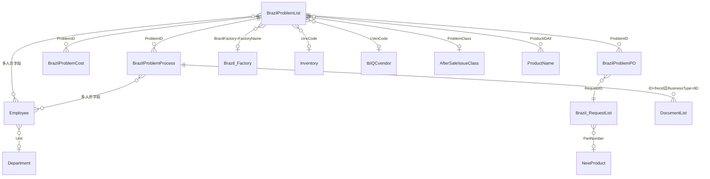

# 业务逻辑描述

> 信源：`1_user_input/brazil/tables.md`（字段口径唯一信源）。
>
> **主查询**：指 Agent 对外的一行一单、中文列名、汇总口径等**业务查询契约**。

## 业务域

**巴西制程问题查询**：面向「巴西工厂产线制程质量问题」的**只读智能查询**能力。业务数据锚点为 **`BrazilProblemList`（巴西制程问题主表）**，并经由过程、费用、PO/PN、8D 文档及工厂/物料/供应商/人员等关联表，支撑问题从发现到结案的**查询、列表、统计与明细穿透**（非填单、非流程审批系统本身）。

### 本域做什么

围绕一张制程单，覆盖下列已确认的业务关注点（字段与派生规则见后文各节）：

| 关注点 | 要点 |
| ------ | ---- |
| 发现与描述 | 现场发现日期/工位、问题描述、现象（JSON 展平为「问题现象」）、问题等级 |
| 分类与工厂 | 问题类型（含 `其他\|备注`）、巴西工厂名称（可逗号多值）、大机型、物料/供应商 |
| 停线 | 「是否停线」（历史事实）与「停线状态」（是否已标记重启）分工；停线级别取名称 |
| 跟进与流转 | 制程单 `Status` 状态机；跟进人/跟进部门取**最新过程记录**；无独立「定责部门」维 |
| 改善与结案 | 过程表原因/措施、SQE/设计更改相关结论、结案结果等（主查询取最新过程行） |
| 数量与质量 | 影响数量、不良数量、派生「不良率」 |
| 费用 | 是否涉及费用；主查询聚合 USD/BRL 与专项明细；过程侧扣款另列；费用明细可穿透 |
| 8D | 「是否需要回复 8D」与已上传 8D 文件分列；文件预览链接见 `document_preview_link.md` |
| 单号跳转 | 对用户展示 `OrderNumber`，可点开只读制程单页（`problem_link.md`） |

查询结果遵循 **一行一单**：一对多子表须先按规则汇总或取最新，再挂到主表（见「表关联」）。口语「制程问题 / 制程相关问题」与国内一致：**不加**「问题类型」筛选（≠ 只查「制程优化」）。

本域地理外延（已确认）：**仅**物理巴西发料工厂（`Brazil_Factory` / 主表 `BrazilFactory` 名称）上的制程问题；**不含**海外（HW）工厂单据。巴西班数据仓库为**独立 Mart**，表空间不与国内/海外混仓（见 `data_architecture.md`）。

### 本域不做什么（v1）

| 排除项 | 说明 |
| ------ | ---- |
| 写入巴西业务库 | 不在本助手内改单、结案、上传 8D、发邮件；跳转目标站登录/权限不由本系统负责 |
| 海外工厂单据 | 巴西班**不含** HW；海外属独立域 |
| 源表扩展列杂项 | `RequestList` 采购价合同等、`DocumentList` 非 8D、库存全量档案等：**不纳入**本域治理与查询优化 |
| 国内订单子表范式 | 无 `ZCTracking_ProblemOrders` 类订单明细问法；PO 仅用于桥接 **PN列表** |
| 定责 / 责任归属维 | 巴西域**无**国内「结案定责部门」对等维度；相关说法默认按「问题跟进部门」解释 |
| 巴西本地员工 / 供应商使用者画像 | **明确不做**（不为该角色设计账号场景与话术） |

> **说明**：「域内不混仓」≠「产品不做跨域汇总」。未点名业务域的全局问法，由编排层对多域**分别查询再汇总**，见下节「跨域未点名查询」。

### 与其它域的关系

- **巴西域**：仅巴西工厂产线制程问题（源 `ai-info` → **独立巴西 Mart**）。
- **国内域 / 海外域**：各自独立主表与 Mart；编号前缀国内 `ZC…`、巴西 `BR…`、海外 `HW…`。
- **域权限**：进入巴西查询须具备 **Brazil Process Issues**；有权后域内行/列全量可见（`privileges.md`）。国内、海外各有独立域闸门。
- **单域点名**：用户明确说「巴西 / BR / 巴西工厂…」→ 只查巴西班（需有巴西权限）。
- **跨域未点名**：见下。

#### 跨域未点名查询（已确认）

当用户问「制程问题」类统计/列表且**未指定**国内 / 巴西 / 海外时（例：「查询 6 月份的制程问题」「6 月总共发生多少制程问题」）：

| 项 | 口径 |
| ---- | ---- |
| 行为 | 编排层应对 **国内 + 巴西 + 海外** **三域都发起查询**（各查各域 Mart / Worker），再汇总回答 |
| 数据存放 | 仍各域独立；**不是**把三域表物理合成一张仓 |
| 权限 | 各域独立鉴权：用户对某域无权限则该域**不出数**；有权域照常计入。汇总**呈现形态**（仅总数 vs 分域明细、无权是否明示）**本阶段不决议** |
| 本域贡献 | 巴西班按本文默认范围（`Status <> -1`，含草稿与已终止等）参与汇总 |
| 海外域状态 | 海外治理 / Worker 未就绪前，跨域问法在实现上可能暂缺该域；产品口径仍按「目标三域」登记 |

显式点名某一域时，**不**自动扩到其它域。

**与国内域差异（摘要）**

| 项 | 国内 | 巴西 |
| ---- | ------------------------ | -------------------------------------------------------- |
| 业务范围 | 国内工厂制程问题 | 巴西工厂产线制程问题（仅巴西工厂；不含 HW） |
| 主表 | `ZCTracking_ProblemList` | `BrazilProblemList` |
| 工厂维 | `PaxFactory`（ID → 名称） | `Brazil_Factory`（主数据）；主表 `BrazilFactory` 存 **名称**（可逗号多值，按段匹配） |
| 问题类型 | int 枚举 | varchar 中文枚举 + `其他\|*` 管道格式 |
| 停线级别 | — | `ProblemClass` → `AfterSaleIssueClass.ClassName` |
| 问题现象 | 文本 | **JSON 数组**（展平为展示列） |
| 跟进部门/人 | 主表责任/跟进字段 | **最新** `BrazilProblemProcess.ProcessUserID` 派生 |
| 定责部门 | 有（如结案责任部门） | **无** |
| PN / 机型 | 订单/机型子表等 | 大机型：`ProductIDAll`；PN：仅 **PO → RequestList → NewProduct** |
| 8D / 类 CAR | 路径不同（如 CAR/IQC） | `IsRequire8D` + `DocumentList`（挂过程 `ID`） |
| 默认排除 | `IsDelete=1` | `Status = -1`（已删除）；无独立 `IsDelete` |
| 数据权限 | v1 域内全量（入口策略见国内 privileges） | **域级闸门**（Brazil Process Issues）+ 域内全量 |
| Mart | 国内 Mart | **独立**巴西 Mart（可同源 `ai-info`，不同步混仓） |


## 使用者与查询范围

### 使用者

**主体**：中国总部侧、获权访问 **Brazil Process Issues** 的内部人员（自然语言提问；系统以中文口径组织业务语义与列名）。

| 角色（示例，非穷举） | 典型关注 | 说明 |
| -------- | --------------------------- | ---- |
| 产线问题处理部门 | 待跟进清单、单号详情、停线/补料/8D、改善措施 | 例：生产工程部、质量管理部等；按「问题跟进部门 / 跟进人」筛常见 |
| 质量 / SQE 相关角色 | 类型与现象、设计更改与 SQE 结论、是否需 8D 及附件 | 过程字段 + 8D 明细；不替代源系统填报 |
| 高层领导 | 时段统计、工厂/类型/等级分布、停线与费用态势；未点名域时的全局制程问题规模 | 单域或跨域汇总（见「跨域未点名查询」） |
| 跨域已授权人员 | 同时拥有多域权限 | 点名域 → 单域；未点名 → 三域分别查询后汇总 |

**明确不做**：巴西本地员工、供应商/外部协作者等使用者画像与账号场景。

域入口与拒绝话术见 `privileges.md`；域内**不**按工厂、部门、个人再切行级可见性。

### 查询能力边界

| 能力 | v1 口径 |
| ---- | ------ |
| 交互 | 自然语言提问；理解意图后检索并组织回答 |
| 主查询（单域） | 一行一单、中文列名；含派生列（不良率、跟进部门/人、费用合计、现象展平等） |
| 明细穿透 | 过程**全部历史**、费用明细、PO/PN 桥接、有效 8D 文档列表（可点文档名预览） |
| 检索 | 结构化筛选/统计 + 叙述字段语义检索（向量范围见 `vectorization.md`） |
| 外链 | 拼制程单只读链、8D 预览链；**不**负责目标站鉴权 |
| 跨域 | 未点名域的列表/统计类问法 → **国内+巴西+海外**分别查再汇总（编排层职责；各域 Mart 仍隔离） |
| 不做 | 改单、审批、上传、权限开通；不在巴西 Mart 内混入国内/海外物理表 |

数据覆盖范围（巴西班）：本文「表关联」所列 **14 张表**及主查询契约；常见问法模式见后文「常见查询场景」。

### 默认数据范围（业务口径，全员一致）

| 规则 | 说明 |
| ----- | ------------------ |
| 排除已删除 | `Status = -1`（已删除）不出现在默认列表/统计/向量 |
| 默认过滤 | `Status <> -1` |
| 草稿 | `Status = 0`（待提交）**默认包含** |
| 已终止 | `Status = -2` **默认包含**（已确认） |
| 工厂 / 部门 | **默认不限**工厂或跟进部门；由用户问句收窄 |
| 行可见性 | 授权用户之间口径相同（无「我的待办」默认视角，除非用户话术显式指定跟进人/部门） |

无独立 `IsDelete` 字段；软删除仅通过 `Status = -1` 表达。

### 时间筛选口径（类比国内）

| 规则 | 巴西字段 | 国内对照 |
| ------------ | --------------------------------------------- | ------------------ |
| **默认**时间筛选 | 源 `AddDate`（datetime）→ 主查询列 **建单日期** | `AddDate` / `建单日期` |
| 用户明确要求「发现时间」 | `ProblemDiscoveryDate`（源为 varchar；**主查询解析列**） | `FoundDate` |
| 其它日期列 | 展示可用源值；**筛选 / 统计**须使用解析后的统一日期列 | 国内多为源 datetime |

日期 varchar 与混型处置见 `dirty_data.md`「日期字段治理」；沿用国内「源数据严格镜像 + 主查询口径收敛」思路（`2_landed/domestic/data_architecture.md`）。

### 与「常见查询场景」的分工

本节界定**谁用、默认可看什么、能力边界**；具体维度对照、语义别名与示例问句见后文「常见查询场景」。两者冲突时以字段专节与 `dirty_data.md` 为准。

## 表关联

本场景 v1 共 **14 张表**（`CoreINFO.dbo`、`info.dbo`，见各表 `db_description`），以 `**BrazilProblemList`** 为核心。




### `BrazilProblemList` → 子表（1:N）

> **一行一单原则**：以 `BrazilProblemList` 为锚点，每条制程单在查询结果中**仅一行**。凡一对多子表须先按业务规则**汇总或取最新**，再关联到主表；不可把多张未汇总的子表明细行直接并列展示，否则同一单会被重复计数。


| 子表 | 基数 | 关联条件 | v1 查询口径 |
| ---------------------- | --- | ------------------------------------ | ---------------------------------------------------------------- |
| `BrazilProblemProcess` | 1:N | `ProblemID` = `BrazilProblemList.ID` | 取 `ID` **最大**的一条（最新过程记录） |
| `BrazilProblemCost` | 1:N | 同上 | 按 `ProblemID` 汇总为 `费用USD合计` / `费用BRL合计` / `专项费用明细`（见 §费用聚合） |
| `BrazilProblemPO` | 1:N | 同上 | 按 `ProblemID` 合并去重为 `**PN列表**`；见下「PO 与 PN」 |
| `DocumentList`（8D） | N:M（经过程表） | 见 §8D 报告 | **不**扩主查询行数；文件清单走过程/文档明细；主表仅保留 `是否需要回复8D` 标志 |


#### `BrazilProblemPO` 与 PN（v1：PN 列表）

同一 `ProblemID` 可对应**多条** PO 记录。每条 PO 经 `RequestID` → `Brazil_RequestList` → `NewProduct` 解析 PN；**观测上各条 PN 一般相同**，但**尚无法排除**不同 PO 对应不同 PN。

**v1 采用** `PN列表`**（多值列表）**，与主表 `ProductIDAll` → `机型名称列表` 的列表模式一致：


| 项 | 口径 |
| --------- | ------------------------------------------------------------------------------------------------------------------------------------ |
| 展示列 | `**PN列表**`：该 `ProblemID` 下**全部** PO 经 RequestList → NewProduct 解析出的机型编码（`Name`），**去重**后合并为列表 |
| 汇总规则 | 同一 `ProblemID` 的多条 PO 先解析 PN 再合并；主表行数不因 PO 条数增加 |
| 单 PN 常见情况 | 列表仅含 1 个编码 |
| 多 PN 情况 | 列表含多个编码 |
| 筛选 | 按列表中是否包含指定 PN（支持模糊匹配；类比国内「机型列表」筛选） |
| 便利展示 | 仅 1 个 PN 时可直接展示该编码；多个时可用 `、` 拼接展示 |


#### 主表 `RequestID` 与 PN


| 项 | 口径 |
| -------------------------------- | -------------------------------------------------------------------------- |
| PN 解析路径 | **仅** `BrazilProblemPO` → `Brazil_RequestList` → `NewProduct` → `**PN列表`** |
| 主表 `BrazilProblemList.RequestID` | v1 **不参与** PN 解析、不进主查询对外列；与 PO 链路并存时 **以 PO 为准** |
| 理由 | 已按 PO 聚合 `PN列表`；主表 `RequestID` 默认 0，与 PO 链路职责重叠 |


**PO 链路**（汇总后与主表一对一，不增加行数）：

```
BrazilProblemList
  → BrazilProblemPO（同 ProblemID 全部 PO，聚合为 PN列表）
    → Brazil_RequestList（RequestID = ID）
      → NewProduct（PartNumber → Name）
```


#### 主表内多值字段（列内多值，不增加行数）


| 字段 | 处理 |
| ---------------------------- | ---------------------------------------------------------------- |
| `ProductIDAll`（逗号分隔 ID） | 解析各 ID 查得机型名称，合并为 `**机型名称列表**`（多值列表） |
| `ProblemPhenomenon`（JSON 数组） | 展平为主查询列 `**问题现象**`（`；` 分隔可读文本；规则见 §问题现象） |


#### 安全关联（不增加行数）

以下关联在子表已按上表汇总的前提下，均不会使主表行数变多：


| 主表/过程表键 | 关联表 | 说明 |
| -------------- | ------------------------- | ------------------------------------ |
| `ProblemClass` | `AfterSaleIssueClass` | **停线级别**；主查询列 `**停线级别`** 展示 `ClassName` |
| `cInvCode` | `Inventory` | 物料（名称 `cInvName`、规格 `cInvStd`） |
| `cVenCode` | `tbIQCvendor` | 供应商 |
| 各 `*UserID` | `Employee` → `Department` | 人员/部门展示 |


#### 重复计数风险（业务约束）

若对同一制程单同时将过程、费用、PO 等**未汇总**的子表明细行并列展示，同一单会在结果中出现多次，导致计数与汇总失真。v1 查询须遵循上表「一行一单」与各子表汇总规则。

### `BrazilProblemList` → 维表 / 主数据


| 主表字段 | 关联表 | 关联键 | 说明 |
| --------------- | --------------------- | ----------------- | ------------------------------------------------------------------------------ |
| `cInvCode` | `Inventory` | `cInvCode` | 物料名称（`cInvName`）、规格（`cInvStd`） |
| `cVenCode` | `tbIQCvendor` | `ferpcode` | 供应商名称 |
| `ProblemClass` | `AfterSaleIssueClass` | `ID` | **停线级别**；主查询列 `**停线级别`** 展示 `ClassName`；**不**向用户暴露 `ProblemClass` 原始 ID |
| `ProductIDAll` | `ProductName` | 逗号分隔 `ID` | 解析后可得机型名称列表 |
| `BrazilFactory` | `Brazil_Factory` | 名称（非 ID）；见下「巴西工厂」 | 主表已存 `FactoryName`；维表供 grounding |


### 巴西工厂（`BrazilFactory`）

**信源**：`1_user_input/brazil/tables.md`（`BrazilFactory` 字段 + `Brazil_Factory` 表）。


| 项 | 口径 |
| ---------- | ------------------------------------------------------ |
| 主表存储 | `**Brazil_Factory.FactoryName**`（工厂**名称**，**非** `fID`） |
| 主数据表 | `Brazil_Factory`（v1 纳入同步） |
| 多工厂 | 同一条制程单上可为**逗号分隔**多名称，如 `CA,TT` 表示涉及 CA 与 TT |
| 主查询展示列 | `**加工厂**`（与国内列名对齐） |
| 观测取值（历史数据） | `TT`、`CA`、`TR`、`CA,TT` 等 |


#### 筛选语义

用户指定工厂 **X**（如 `CA`）时，须命中：

1. `BrazilFactory` **整段等于** X（单工厂行）；且
2. `BrazilFactory` 为逗号分隔多值时，**任一段**去除首尾空格后 **等于** X 的行（如搜 `CA` **须包含** `CA,TT`）。

**不采用**仅整列精确相等（否则会漏掉 `CA,TT`）。

对称地：搜 `TT` 亦命中 `CA,TT`。用户若明确给出 `CA,TT`，可按整段相等或按所含工厂分别匹配。

工厂名称解析以 `Brazil_Factory` 主数据为准。

### PN（机型编码）解析链路

v1 标准展示列为 `**PN列表**`（多值列表），见上「`BrazilProblemPO` 与 PN」。与 `**机型名称列表**`（来自 `ProductIDAll`）为两条独立链路，查询时按用户意图选用。

### 人员与部门


| 主表/过程表字段 | 业务含义 | 关联 |
| -------------------- | ---------------------- | -------------------------------------- |
| `AddUserID` | 填单人 | `Employee.ID` |
| `UpdateUserID` | 最后修改人 | `Employee.ID` |
| `SupplementUserID` | 补料人 | `Employee.ID` |
| `ActorUserID` | 初始责任人 | `Employee.ID` |
| `ProcessUserID` | 问题责任人/跟进人（**过程表最新记录**） | `Employee.ID` → `Department`（经 `Unit`） |
| `StockPrecessUserID` | 退货确认人 | `Employee.ID` |
| `DesignUserID` | 设计更改人 | `Employee.ID` |
| `SQEUserID` | SQE 确认人 | `Employee.ID` |
| `ConfirmUserID` | 效果确认人 | `Employee.ID` |
| `FinishUserID` | 结案人 | `Employee.ID` |


#### 问题跟进部门（派生列）

与国内主查询列 `**问题跟进部门**` 对齐，便于共用查询语义。


| 项 | 口径 |
| ----------- | ------------------------------------------------------------------------------------------------------------ |
| 展示列名 | `**问题跟进部门**` |
| 源路径 | `BrazilProblemProcess`（同 `ProblemID` 取 `**ID` 最大**一条）→ `ProcessUserID` → `Employee.Unit` → `Department.Name` |
| 关联展示列 | `**问题跟进人**`（`ProcessUserID` → `Employee.Name`，同最新过程记录） |
| 部门筛选默认锚 | 用户问「某部门跟进/处理的制程问题」→ 筛 `**问题跟进部门**` |
| **无**责任归属部门 | v1 **不定义**「定责部门 / 责任归属部门」维度；国内 `AllReDepartment` / `v_bridge_all_re_department` **不适用** |


> 填单人部门（`AddUserID` → `Employee.Unit`）仅作人员展示，**不作为**部门统计默认锚。


## 核心字段业务口径


### 问题类型（`ProblemType`）


| 取值 | 说明 |
| ----------------------------- | ---------------------- |
| 设计问题、结构问题、生产问题、制程优化、硬件问题、物料问题 | 标准类型 |
| 其他 | 可为纯 `其他`，或 `其他\|备注`（`|` 后为自由文本备注） |
| 空 | **仅** `Status=0` 草稿可为空 |


主表与 `BrazilProblemProcess.ProblemType` 为**独立冗余**（同业务含义，非快照）。

**展示列** `问题类型`：当源值符合 `其他\|…` 管道格式时，对外展示归一化为 `**其他`**（不展示 `|` 后备注段）。

**展示列** `其他问题备注说明`：自 `ProblemType` 派生；仅当源值为 `其他\|备注` 时取 `|` **之后**的自由文本备注；其余类型为空。类型归类仍为「其他」，备注不改变类型。


| 源 `ProblemType` | `问题类型`（展示） | `其他问题备注说明` |
| --------------- | ---------- | ---------- |
| `物料问题` | 物料问题 | （空） |
| `其他\|包装破损` | 其他 | 包装破损 |
| `其他` | 其他 | （空） |


处置见 `dirty_data.md` D4。

### 制程单状态（`BrazilProblemList.Status`）

表示**制程单**在业务流程中的当前阶段（流转状态机）。枚举如下：


| 值 | 含义 | 默认查询 |
| --- | ------ | ------ |
| 0 | 待提交 | 包含 |
| 10 | 待修改类别 | 包含 |
| 20 | 待跟进 | 包含 |
| 25 | 待设计更改 | 包含 |
| 26 | 待SQE确认 | 包含 |
| 30 | 待效果确认 | 包含 |
| 40 | 待结案 | 包含 |
| 50 | 已结案 | 包含 |
| -2 | 已终止 | 包含 |
| -1 | 已删除 | **排除** |


### 问题生命周期


| 概念 | 所在表/字段 | 含义 |
| ----- | ----------------------------------------------- | ----------------------------------------------------------------- |
| 制程单状态 | `BrazilProblemList.Status` | 制程单在流程中的**当前阶段**（见上表） |
| 结案结果 | `BrazilProblemProcess.FinishResult`（**最新过程记录**） | **结案时**由专门负责人（`FinishUserID`）评定的结案结果；枚举：null、是、否 |
| 过程记录 | `BrazilProblemProcess` | 同一 `BrazilProblemList.ID` 可关联**多条**过程行；查询/展示过程字段时取 `**ID` 最大**的一条 |


`Status` 与 `FinishResult` **语义独立**：前者驱动制程单流转；后者是结案环节对结果的评定，存于过程表最新记录，**非**由 `Status` 直接派生。v1 不提供正式状态流转图；按枚举原值理解与筛选即可。

#### SQE 跟进与设计更改

`DisposeResult`（SQE 跟进结果）与 `SQEResult`（SQE 确认结果）为**先后两个步骤**：


| 步骤 | 字段 | 含义 |
| --- | --------------- | --------------- |
| 1 | `DisposeResult` | SQE 跟进结果；叙述型长文本 |
| 2 | `SQEResult` | SQE 对设计更改的确认结果。**枚举**：确认、为空 |


跟进结果有时需要设计更改（对应 `Status=25` 待设计更改、`IsDesignChange` 等）；设计更改完成后进入 SQE 确认（`Status=26` 待SQE确认），由 `SQEResult` 记录确认结论。

**退货单号**：`SReturnOrderNo` 为在库退货单号，有退货时使用。

### 问题现象（`ProblemPhenomenon`）

源字段为 **JSON 数组**（nvarchar）；每元素含 `Key`（int）、`Value`（str）、`parentType`、`otherVal`。

主查询展示列 `**问题现象**`：将 JSON 展平为一串可读文本（规则见下）。

#### 1. 解析入参


| 条件 | 处理 |
| ------------------------------------------------------- | ------------------------------------------------------------------------- |
| `ProblemPhenomenon` 为 NULL、空串，或去除首尾空白后**不以** `[` **开头** | 视为空数组 `[]` |
| 否则 | 对非法转义字符做容错处理后，再解析为 JSON 数组 |


#### 2. 单元素展平规则（按 `Key`）


| `Key` | 输出片段 |
| ------- | --------------------------------------------------------------- |
| `> 0` | `Value`（空则 `''`） |
| `< 0` | `parentType` + `->` + `Value`；若 `otherVal` 非空则追加空格 + `otherVal` |
| 其他（含 0） | `Value`（空则 `''`） |


#### 3. 聚合

- 各元素片段以 `**；**`（中文分号）连接为最终展示串。
- 示例形态：`parentType -> Value otherVal；Value；…`

查询/回复中涉及「问题现象」时，使用上述展平文本，**不**直接抛原始 JSON。

### 问题编号（`OrderNumber`）

格式：**BR + YYMM + 序号**。


| 示例 | 解析 |
| --------- | -------------------------- |
| BR2404001 | BR + 24（年）04（月）+ 001（当月序号） |


**跳转链接**：对用户展示仍为 `OrderNumber`；本系统按其对应主表 `ID` 拼可点击链接，打开巴西制程单只读页。规则与实现约束见 [`problem_link.md`](problem_link.md)。


### 投诉单号（`ClaimNumber`）

**自由文本**，无固定编码规则或来源系统约束。源数据探测：**多数**以 `CLAIM` 开头，但**不绝对**；分隔符、日期片段等写法多样。**不以** `CLAIN` 为合法/常见前缀。


| 示例 | 说明 |
| ----------------- | ------ |
| CLAIM 014.04/2024 | 常见写法之一 |
| CLAIM-019/24 | 常见写法之一 |


查询时展示原值；筛选靠模糊匹配或语义检索。处置见 `dirty_data.md` D2。

### 停线与重启（`IsStopLine` / `StopStatus`）

两字段分工：


| 字段 | 语义 | 更新规则 |
| ---------------- | ----------------- | ----------------------------------------- |
| `**IsStopLine**` | **是否发生过停线**（历史事实） | 发生停线后记为 **是**；后续「停线重启」等操作 **不会** 改回 **否** |
| `**StopStatus**` | **停线后是否已标记重启** | 空 = 尚未标记重启；`停线重启` = 已重启 |


`StopStatus` **无枚举集合**（除 `停线重启` 外可为空或其它自由文本，v1 以观测两态为主）。

#### 组合态


| `IsStopLine` | `StopStatus` | 含义 |
| ------------ | ------------ | ------------------------------------ |
| 否 | 空（常见） | **从未停线** |
| 是 | 空 | **曾/正在停线，尚未标记重启**（「目前停线中」） |
| 是 | `停线重启` | **曾停线，已标记重启**（`IsStopLine` 仍为 **是**） |


#### 查询语义


| 用户说法 | 查询口径 |
| -------------------- | -------------------------------------- |
| 停线中 / 目前停线 / 停线且未重启 | `"是否停线" = '是'` **且** `"停线状态"` 为空 |
| 停线已重启 / 停线后已恢复生产 | `"是否停线" = '是'` **且** `"停线状态" = '停线重启'` |
| 发生过停线 / 曾经停线 / 有停线记录 | `"是否停线" = '是'`（**不**看 `StopStatus`） |
| 从未停线 | `"是否停线" = '否'` |


主查询列名建议：`是否停线` ← `IsStopLine`；`停线状态` ← `StopStatus`。与国内 `StopStatus` 多状态枚举不同。

### 8D 报告（`IsRequire8D` + `DocumentList`）

两层口径须区分：

| 概念 | 来源 | 含义 |
|------|------|------|
| **是否需要回复 8D** | 主表 `IsRequire8D`（1=是、2=否） | 业务要求上**要不要**回 8D |
| **已上传的 8D 报告文件** | `DocumentList` | 实际挂接的文档清单（文件名、路径等） |

**挂接规则**（信源：`1_user_input/brazil/tables.md` + 业务方说明）：

| 项 | 口径 |
|----|------|
| 文档表 | `DocumentList`（通用文档清单） |
| 业务类型 | `BusinessType` = **`巴西制程问题单8D报告`** |
| 业务主键 | `frecid` = **`BrazilProblemProcess.ID`**（过程记录主键；**不是**主表 `BrazilProblemList.ID`） |
| 有效行 | 默认仅 `EffectFlag = 0`（已删除文档不展示） |
| 如何从制程单找 8D | 先取该单全部过程行的 `ID`，再按上表条件在 `DocumentList` 中查找 |

同一制程单可因多条过程记录挂接**多份** 8D；「需要回复 8D」为是，不保证已有文件。

**主查询**：保留展示/筛选列「是否需要回复 8D」；文件名列表**不**并入主查询行（防重复计数）。  
**明细**：过程明细之外，可按上述规则列出该单下全部有效 8D 文档；对用户**以文档名（`DocumentName`）为可点击预览链接**，规则见 [`document_preview_link.md`](document_preview_link.md)。全称、扩展名、路径、添加时间等可按需附带。`EffectFlag ≠ 0` **不展示**。  
**语义检索**：文档路径/附件**不入向量**（类比国内 `FileUrl`）。

### 是否涉及费用（`IsCost`）


| 值 | 含义 |
| --- | ---------------- |
| 1 | 是 |
| 2 | 否 |
| 0 | 删除状态测试数据（非正常业务值） |


### 费用类型（`BrazilProblemCost.CostType`）


| 取值 |
| ---------- |
| 物料费 |
| 第三方处理费用 |
| 物料报废处理费用 |
| 返工费 |
| CIF税费 |
| 物流费 |
| 损失产能费用（停线） |


### 过程 / 补料结果字段


| 字段 | 枚举 | 含义 |
| ---- | ---- | ---- |
| `BrazilProblemList.SupplementResult` | 是、否、null | 补料结果 |
| `StockPrecessResult` | 是、否、为空 | 退货确认结果 |
| `DesignResult` | 改善、保持现状、null | 设计更改结果 |
| `SQEResult` | 确认、为空 | SQE 对设计更改的确认结果 |
| `ProcessResult` | null、是、否 | 责任人确认结果 |
| `ConfirmResult` | 有效、无效、null | 效果确认结果 |
| `FinishResult` | null、是、否 | **结案结果**：结案时由专门负责人评定（见「问题生命周期」） |


`DisposeResult` 与 `SQEResult` 的先后关系见「问题生命周期」§SQE 跟进与设计更改。

## 派生字段与展示列

> 主查询 / 查询结果中的**非源表直出**列（完整列总表后续收口）。


### 不良率（派生）


| 项 | 口径 |
| ---- | ---------------------------------------------------------------------------- |
| 展示列名 | `不良率` |
| 源字段 | `BrazilProblemList.BadQty`（不良数量）、`ImpactQty`（影响数量） |
| 公式 | `ImpactQty = 0` 或 `NULL` → **0**；否则 `ROUND(BadQty × 100 ÷ ImpactQty, 2)` |
| 数值含义 | **百分比数值**：`46.4` 表示 **46.4%**，`100` 表示 **100%**（与国内 `Rate` 一致，**不是** 0–1 小数） |
| 筛选示例 | 不良率 100% → `"不良率" = 100`（**不是** `1.0`） |


与国内差异：国内 `Rate` 为源表存储列（`BadQty ÷ ProdQty`）；巴西**无**源表不良率列，须在主查询层**按公式计算**（分母为 `ImpactQty`，非 `ProdQty`）。

### 其他问题备注说明（展示）


| 项 | 口径 |
| ---- | ------------------------------------------ |
| 展示列名 | `其他问题备注说明` |
| 源字段 | `BrazilProblemList.ProblemType` |
| 规则 | 源值匹配 `其他\|…` 时，取 `|` 之后自由文本 |
| 关联 | 与展示列 `问题类型` 配合：管道格式时 `问题类型` 归一化为「其他」，备注进本列 |


详见上节「问题类型（`ProblemType`）」。

### PN列表（展示 / 聚合）


| 项 | 口径 |
| ---- | ------------------------------------------------------------------ |
| 展示列名 | `PN列表` |
| 类型 | 多值列表（机型编码） |
| 源路径 | `BrazilProblemPO`（全部 PO）→ `Brazil_RequestList` → `NewProduct.Name` |
| 规则 | 同 `ProblemID` 下全部 PO 解析 PN 后**去重**合并为列表；主表仍一行一单 |
| 筛选 | 按列表中是否包含指定 PN（类比国内「机型列表」） |


详见「`BrazilProblemPO` 与 PN」。

### 费用聚合

同一 `ProblemID` 可有多条 `BrazilProblemCost`（常按费用类型各占一行，含金额为 0 的占位行）。主查询一行内收敛为 **合计列 + 可读汇总列**；过程表扣款口径**单独列**，不与专项费用合计混算。


| 主查询列名 | 类型 | 规则 |
| ------------- | --------- | --------------------------------------------------------------------------------------------------------------------- |
| `是否涉及费用` | 展示 | `BrazilProblemList.IsCost`（1=是、2=否；0 为测试脏值） |
| `**费用USD合计**` | 数值 | 对该 `ProblemID` 下全部费用行的 `CostMoney` **求和**（零金额行不影响合计） |
| `**费用BRL合计**` | 数值 | 对该 `ProblemID` 下全部费用行的 `CostBrlMoney` **求和** |
| `**专项费用明细**` | 文本 | 仅拼接**美元或巴西币金额大于零**的费用行；格式：`{费用类型}: {美元金额} USD / {巴西币金额} BRL`，行间以 `；` 分隔；全零则空 |
| `是否有涉案金额` | 展示 | 最新过程 `IsCostShift` |
| `**扣款费用美元**` | 数值 | 最新过程 `DebitMoney`（扣款/转嫁，**≠** 上表专项费用合计） |


**费用明细查询**：可返回该制程单下**全部**费用明细行（含零金额行及汇率、备注）；行级汇率**不进**主查询合计列。

**实测示例**（`ProblemID = 195`，源库探测）：


| CostType | CostMoney | CostBrlMoney | ConstBrlRate |
| ---------- | --------- | ------------ | ------------ |
| 返工费 | 0.00 | 0.00 | 0 |
| 物料费 | 83.87 | 450.36 | 5.37 |
| 物料报废处理费用 | 213.23 | 1145.02 | 5.37 |
| 损失产能费用（停线） | 0.00 | 0.00 | 0 |
| CIF税费 | 0.00 | 0.00 | 0 |
| 第三方处理费用 | 0.00 | 0.00 | 0 |
| 物流费 | 0.00 | 0.00 | 0 |


→ `费用USD合计` = **297.10**；`费用BRL合计` = **1595.38**；`专项费用明细` = `物料费: 83.87 USD / 450.36 BRL；物料报废处理费用: 213.23 USD / 1145.02 BRL`。

筛选示例：「费用超过 200 美元」→ `"费用USD合计" > 200`。

## 常见查询场景

> 模式与国内制程问题查询**同类**（信源：`2_landed/domestic/business_description.md`、`query_playbook.md`）；下列问法已按巴西字段与 v1 表范围改写。默认排除 `Status = -1`（已删除）。


### 查询维度（与国内对照）


| 场景 | 巴西字段 / 路径 | 国内近似 |
| --------------- | ----------------------------------------------------------------------------------------- | ------------------------------------- |
| 按时间 | `**建单日期**`（源 `AddDate`，默认）；`ProblemDiscoveryDate`（用户明确要求发现时间时） | `AddDate` / `FoundDate` |
| 按工厂 | 主查询列 `**加工厂**`（`BrazilFactory` 名称；逗号多值**按段匹配**） | `PaxFactory.FactoryName` / `"加工厂"` |
| 按问题类型 / 状态 / 等级 | `ProblemType`（展示归一化）、`其他问题备注说明`、`Status`、`ProblemLevel` | `ProblemType`、`Status`、`ProblemLevel` |
| 按机型 / PN | `机型名称列表`（`ProductIDAll`）；`**PN列表**`（PO 链路） | `ZCTracking_ProductNames` / `机型列表` |
| 按跟进部门 / 处理人 | 派生列 `**问题跟进部门**`、`**问题跟进人**`（最新过程记录 `ProcessUserID`） | `RDepartment`、`MemberList` 等 |
| 停线 | `**是否停线**`（`IsStopLine`，曾发生即「是」不随重启改回）、`**停线状态**`（`StopStatus`：空=未标记重启；`停线重启`=已重启）、`停线日期` | `IsStop`、`StopStatus` |
| 停线级别 | 主查询列 `**停线级别**`（`AfterSaleIssueClass.ClassName`；筛选用名称非 ID） | — |
| 物料 / 供应商 | `cInvCode`、`cVenCode` + 维表 | 同左 |
| 数量 / 不良率 | `ImpactQty`、`BadQty`、派生列 `不良率` | `BadQty`、`ProdQty`、`Rate` |
| 费用 | `是否涉及费用`、`费用USD合计`、`费用BRL合计`、`专项费用明细`；过程侧 `扣款费用美元` / `是否有涉案金额`；明细查询见费用子表 | — |
| 8D | 主表 `是否需要回复8D`；已上传文件见 `DocumentList`（经过程表 `ID`，§8D 报告） | —（国内多为 CAR/IQC，路径不同） |
| 按现象 / 描述 | `ProblemPhenomenon` 展平文本、`ProblemDesc`、过程表原因/改善措施 | 叙述字段 + 语义检索 |
| 改善与结案 | `Status`、`FinishResult`（最新过程记录） | `Status`、`Confirmation` |


v1 **不纳入**国内订单子表维度（`ZCTracking_ProblemOrders` 等）；不问订单明细。

### 查询语义（对齐国内）


| 用户说法 | 查询口径 |
| ----------------------- | ---------------------------------------------------- |
| 制程问题 / 制程相关问题 | **不加** `"问题类型"` 条件（全量）；口语「制程」≠ 筛选 `问题类型 = '制程优化'` |
| 硬件问题、物料问题等（明确点名类型） | `"问题类型" =` 对应枚举 |
| 由 XX 部跟进 / 跟进处理 / 某部门负责 | `"问题跟进部门" =` |
| 责任部门 / 定责部门 / 责任归属 | **无此维度**；若用户明确指定，按 `**问题跟进部门`** 解释并可在回答中说明巴西域无独立定责部门 |


### 子表明细范围


| 明细类型 | v1 口径 |
| ------- | ------------------------------------------------------------ |
| 过程记录 | **全部** `BrazilProblemProcess` 历史行（按 `ID` 排序）；主查询行内过程字段仍仅最新一条 |
| 费用 | `BrazilProblemCost` 全部明细行 |
| 采购订单 | `BrazilProblemPO`；经 RequestList 仅桥接 PN（`ID`/`PartNumber`） |
| 8D 报告 | 该制程单下全部过程 `ID` 对应的有效 `DocumentList` 行（`BusinessType='巴西制程问题单8D报告'`，`EffectFlag=0`） |


v1 先暴露完整过程历史与 8D 文件清单；若后续收敛范围须再议。

### 数据规模与同步

主表约 **100+ 行**；数据同步频率 **每日一次**（与国内一致）。主查询的物理落库形态不在本文定案。

**数据仓库**：巴西域使用**独立 Mart**，与国内数据隔离；域内表命名惯例与国内一致（无区域表前缀）。详见 `[data_architecture.md](data_architecture.md)`。

### 常见查询示例（自然语言）

1. 「2024 年 Q3 **TT 工厂** **A 类硬件问题**有哪些？」
2. 「单号 **BR2404001** 的完整处理过程和当前处理人是谁？」
3. 「目前**停线且未重启**的**物料问题**有哪些？」（`"是否停线"='是'` 且 `"停线状态"` 为空）
4. 「某机型在 **2025 年**的不良数量与不良率情况？」
5. 「**质量管理部**负责跟进且**尚未结案**的问题列表？」
6. 「需要**回复 8D** 的物料问题及**改善措施**内容有哪些？」
7. 「**2026 年 1 月**由**生产工程部**负责跟进处理的制程问题有哪些？列出问题编号、处理人、问题类型、机型、不良数量、不良率」
8. 「**生产工程部** **2026 年第一季度**处理的制程问题统计」
9. 「**巴西工厂 CA** 涉及的机型名称有哪些？」
10. 「**请提供 26 年出现的非接相关问题**」（现象 + 时间；与国内「26年非接」同类）
11. 「**最近 14 天**出现的制程相关问题有哪些？」
12. 「搜索所有制程问题描述中含 **USB** 或 **打印** 的问题」
13. 「**某机型**的制程问题中是否有与**通信**相关的？」

**检索方式提示（业务层面）**


| 问法类型 | 典型方式 | 示例编号 |
| ---------- | -------------------------------------- | ----------- |
| 结构化筛选 | 按时间、工厂、类型、状态、部门等字段直接筛选 | 1、3、5、7、8、9 |
| 单号穿透 | 按问题编号查主单，并展示过程表最新记录 | 2 |
| 现象 + 时间 | 时间范围 + 问题现象或描述中的关键词（类比国内「非接」类问法） | 10、11 |
| 现象 + 机型/工厂 | 先限定机型或工厂，再在现象/描述中检索 | 13 |
| 叙述关键词 | 在问题描述、原因分析等长文本中检索关键词 | 12 |


## 富文本（HTML）格式

**默认规则**：凡叙述型长文本字段，处置与 `**ProblemDesc` 相同**（类比国内 `business_description.md`「富文本」）。

### 涉及字段（v1 列举）


| 表 | 字段 |
| ---------------------- | ------------------------------------------------------------------------------------------------------------------------------------------------------------------------------------------------------- |
| `BrazilProblemList` | `ProblemDesc`、`SupplementMemo`、`Memo` |
| `BrazilProblemProcess` | `DisposeResult`、`ReasonAnalysis`、`ImprovementMeasure`、`ImprovementBatch`、`PrecautionPolicy`、`StockPrecessMemo`、`UnCostShiftReason`、`DesignMemo`、`SQEMemo`、`ProcessMemo`、`ConfirmMemo`、`FinishMemo` 等叙述列 |
| `BrazilProblemCost` | `CostMemo` |


> `ProblemPhenomenon` 为 JSON，走「问题现象」展平逻辑，**不适用**本 HTML 规则。


### 下游处置口径


| 环节 | 行为 |
| ----------- | ------------------------------------------------------------------------------------------------------- |
| 源数据留存 | 严格镜像源值，**保留 HTML** |
| 展示与语义检索前 | **仅剔除**内嵌 Base64 图片；段落 HTML、外链图片等**保留** |
| 语义检索 | 在清洗后的长文本上做分块嵌入 |
| 结构化筛选 | **不以**长文本字段作为筛选、分组或关联条件 |
| 展示 | 可返回带 HTML 的字符串；v1 不统一做 HTML 渲染 |


v1 对**全部叙述型长文本**统一适用上述规则。细节见 `dirty_data.md` D6。

## 数据权限

见 `privileges.md`：有 **Brazil Process Issues** 访问权 → 域内全量可见；v1 无行级/列级管控。

## 参考文档


| 文档 | 路径 |
| ---- | --------------------------------------- |
| 字段明细 | `db_description/db_*_dbo_*.md` |
| 数据架构 | `data_architecture.md` |
| 脏数据 | `dirty_data.md` |
| 权限 | `privileges.md` |
| 制程单跳转 | `problem_link.md` |
| 8D 预览跳转 | `document_preview_link.md` |
| 待澄清 | `3_open/brazil/` |


