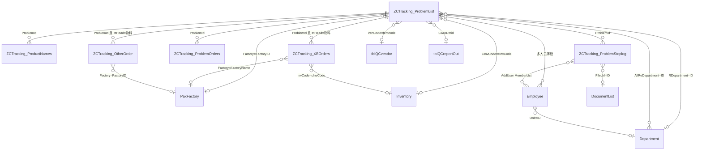

# 业务逻辑描述

> 信源：`1_user_input/tables.md`（G0 已齐：本场景全部表字段）+ G1 确认。`0_draft/` 为 Dify Chatflow 时代整理，仅作业务逻辑梳理参考，不得作为技术方案指导。

## 业务域

**国内制程问题查询**：围绕 **`ZCTracking_ProblemList`（制程问题表）**，查询制程质量问题的发现、分类、责任归属、停线、退货、改善与结案信息。

## 使用者与查询范围

**使用者**

公司内部人员，主要是生产过程中参与制程问题相关环节的人员，例如处理生产问题的人员、上级领导等。

**查询能力边界**

用户以自然语言提出问题；系统理解其查询意图，从制程问题数据源中检索与用户问题相关联的制程数据，并将结果展示给用户。数据范围为本场景所覆盖的制程问题及其关联信息（见「表关联」）。

**非核心业务梳理范围（v1 先不关注）**

以下字段与场景在源表中存在，但不属于国内制程问题查询助手的主要核心业务；G1 不做专项口径展开，G2 方案以核心制程问题查询为主，遇相关问法可按字段原样返回，不做专项优化：

- **退货**：`OReturnOrderNo`、`SReturnOrderNo`、`ZCTracking_OtherOrder`.`ReturnType` 等
- **版本与订单修订**：`Version`、`IsChangeOrderV`、`OrderVersion` 等

## 表关联

本场景共 **13 张表**（`CoreINFO.dbo`、`info.dbo`、`paxbase.dbo`，见各表 `db_description`），以 **`ZCTracking_ProblemList`（制程问题表）** 为核心。下图为总览；明细见后表（信源 `tables.md`）。下文「制程问题表」均指 `ZCTracking_ProblemList`；其字段在已明确表名的段落中可只写字段名。




### `ZCTracking_ProblemList` → 子表（1:N，`ProblemId` = `ZCTracking_ProblemList`.`ID`）


| 子表                          | 基数  | 关联条件                 | 说明                          |
| --------------------------- | --- | -------------------- | --------------------------- |
| `ZCTracking_ProductNames`   | 1:N | 始终                   | 机型；同一问题可多条                  |
| `ZCTracking_ProblemSteplog` | 1:N | 始终                   | 步骤日志；完整过程按 ID/时间保留全部；取某环节最新见 `dirty_data.md` C3 |
| `ZCTracking_ProblemOrders`  | 1:N | 整机制程问题（`ZCTracking_ProblemList`.`MHead` 为空） | 关联的生产订单（PN、数量、版本等） |
| `ZCTracking_XBOrders`       | 1:N | **`ZCTracking_ProblemList`.`MHead` =「物料」** | 小板生产订单 |
| `ZCTracking_OtherOrder`     | 1:N | **`ZCTracking_ProblemList`.`MHead` =「物料」** | 该物料生产关联影响的其他在线订单 |


### `ZCTracking_ProblemList` → 维表 / 主数据（N:1 或 N:M）


| `ZCTracking_ProblemList` 字段 | 关联表              | 关联键                      | 可空  | 说明                                    |
| ----------------- | ---------------- | ------------------------ | --- | ------------------------------------- |
| `Factory`         | `PaxFactory`     | `Factory` → `FactoryID`  | 是   | 加工厂；展示用 `FactoryName`                 |
| `CInvCode`        | `Inventory`      | `CInvCode` → `cInvCode`  | 是   | 涉及物料；可取 `cInvName`、`cInvStd` 等        |
| `VenCode`         | `tbIQCvendor`    | `VenCode` → `ferpcode`   | 是   | 供应商；可取 `fname`                        |
| `CARID`           | `tbIQCreportOut` | `CARID` → `fid`          | 是   | 仅 **`ZCTracking_ProblemList`.`ProblemType` = 3（物料问题）** 可关联；`CAR` 为编码，`CARID` 为内部关联 ID |
| `RDepartment`     | `Department`     | `RDepartment` → `ID`     | 是   | 问题跟进部门；被指定跟进处理的部门，即问题跟进人（`RUser`）所在部门 |
| `AllReDepartment` | `Department`     | 逗号分隔部门 ID → `ID`（UNNEST） | 是   | 结案后责任归属；可空表示无需定责                      |


### `ZCTracking_ProblemList` → `Employee`（N:1 或 N:M）


| `ZCTracking_ProblemList` 字段 | 类型       | 业务含义         | 关联方式                         |
| -------------------- | -------- | ------------ | ---------------------------- |
| `AddUser`            | int      | 填单人          | → `Employee.ID`              |
| `ConfirmUser`        | int      | 效果确认人        | → `Employee.ID`              |
| `DesignUser`         | int      | 设计变更责任人      | → `Employee.ID`              |
| `UpdateUser`         | int      | 更新人          | → `Employee.ID`              |
| `ProduceConfirmUser` | int      | 生产确认人        | → `Employee.ID`              |
| `RUser`              | nvarchar | 问题跟进人；仅部分问题类型指定（见「部门与人员」） | → `Employee.ID`（转整数）         |
| `ReStartExamineUser` | nvarchar | 停线重启审核人      | → `Employee.ID`（转整数）         |
| `ReStartSchemeUser`  | nvarchar | 重启方案制定人      | → `Employee.ID`（转整数）         |
| `MemberList`         | nvarchar | 当前责任人 ID 列表  | 逗号分隔后 UNNEST → `Employee.ID` |


`MemberListName` 直接存姓名，**不 JOIN** `Employee`。

### `ZCTracking_ProblemSteplog` → 其他表


| `ZCTracking_ProblemSteplog` 字段 | 关联表                      | 关联键                | 说明                          |
| ------------ | ------------------------ | ------------------ | --------------------------- |
| `ProblemId`  | `ZCTracking_ProblemList` | `ProblemId` → `ID` | 所属制程问题                      |
| `AddUser`    | `Employee`               | → `ID`             | 步骤创建人（语义同 `ZCTracking_ProblemList`.`AddUser`）      |
| `MemberList` | `Employee`               | 逗号分隔 → `ID`        | 当前步骤责任人（语义同 `ZCTracking_ProblemList`.`MemberList`） |
| `FileUrl`    | `DocumentList`           | → `ID`             | 该步骤的附件文档 ID。不对用户展示该 ID，不纳入向量 |


步骤附件只经 `FileUrl` 关联 `info.dbo.DocumentList`。`EffectFlag = 1` 的文档为已删除，不作为有效附件。

### `Employee` → `Department`


| `Employee` 字段   | 关联表          | 关联键           | 说明     |
| ------ | ------------ | ------------- | ------ |
| `Unit` | `Department` | `Unit` → `ID` | 员工所属部门 |


### `ZCTracking_XBOrders` → 维表（G1 确认）


| `ZCTracking_XBOrders` 字段      | 类型                 | 关联表          | 关联键                       | 说明                                  |
| --------- | ------------------ | ------------ | ------------------------- | ----------------------------------- |
| `Factory` | varchar / nvarchar | `PaxFactory` | `Factory` → `FactoryName` | 存**工厂名称**（非 `FactoryID`）；按名称对齐加工厂维表 |
| `InvCode` | nvarchar           | `Inventory`  | `InvCode` → `cInvCode`    | 物料编号，等同 `Inventory` 物料编码，需 JOIN     |


仅当 `ZCTracking_ProblemList`.`MHead` =「物料」时，`ZCTracking_XBOrders` 经 `ProblemId` 关联 `ZCTracking_ProblemList`。

### `ZCTracking_OtherOrder` → 维表（G1 确认）


| `ZCTracking_OtherOrder` 字段      | 类型  | 关联表          | 关联键                     | 说明                                                       |
| --------- | --- | ------------ | ----------------------- | -------------------------------------------------------- |
| `Factory` | —   | `PaxFactory` | `Factory` → `FactoryID` | 存**工厂 ID**（与 `ZCTracking_XBOrders`.`Factory` 存名称不同）；展示用 `FactoryName` |


仅当 `ZCTracking_ProblemList`.`MHead` =「物料」时，`ZCTracking_OtherOrder` 经 `ProblemId` 关联 `ZCTracking_ProblemList`。

> **对比**：`ZCTracking_XBOrders`.`Factory` 存工厂**名称** → `PaxFactory.FactoryName`；`ZCTracking_OtherOrder`.`Factory` 存工厂 **ID** → `PaxFactory.FactoryID`（与 `ZCTracking_ProblemList`.`Factory` 口径一致）。

## 核心枚举

### 问题类型 (ProblemType)


| 值   | 含义   |
| --- | ---- |
| 1   | 硬件问题 |
| 2   | 软件问题 |
| 3   | 物料问题 |
| 4   | 资料问题 |
| 5   | 工厂制程 |
| 6   | 结构问题 |
| 7   | 制程优化 |


修改问题类型时，`OldProblemType` 保留修改前的类型，`ProblemType` 为当前最新类型；枚举含义同上。

> **查询口径**：口语「制程问题」与字段「问题类型」易混，**完整决策表与 SQL 示例见 [`query_semantics.md`](query_semantics.md)**。摘要：用户说「制程问题」默认**不加**本字段筛选；仅明确点名「工厂制程」「制程优化」等枚举时才过滤；**禁止** `"问题类型" = '制程'`。

### 问题单状态 (Status)


| 值   | 含义         |
| --- | ---------- |
| 1   | 指定责任人      |
| 2   | 责任人确认      |
| 3   | 工程确认       |
| 4   | PMC确认      |
| 5   | 工厂制程分析     |
| 6   | IQC确认      |
| 7   | 填写退货单号     |
| 8   | SQC跟进      |
| 9   | 设计更改       |
| 10  | 设计变更后SQE确认 |
| 11  | IQC意见      |
| 12  | 生产角色确认     |
| 13  | 生产角色驳回     |
| 30  | 效果确认       |
| 31  | 结案确认       |
| 32  | 已完成        |


`ZCTracking_ProblemList`.`Status` 取值 **14–29 未使用**（与 `ZCTracking_ProblemSteplog`.`Step` 编码不是同一套编号，见「处理过程」）。

### 制程问题生命周期

`ZCTracking_ProblemList`.`Status` 表示制程问题**当前**所处的处理节点。

- **已完成（结案）**：`ZCTracking_ProblemList`.`Status` = 32
- **尚未结案**：`ZCTracking_ProblemList`.`Status` ≠ 32（且未删除，见「全局默认过滤」）

不同问题类型走不同路径，环节名称见「问题单状态 (Status)」枚举（指定责任人、工程确认、IQC 意见、效果确认、结案确认等）。实际路径可能经**驳回**等操作回到前序环节后再推进；完整路径以 `ZCTracking_ProblemSteplog` 时间线为准，而非单看当前 `ZCTracking_ProblemList`.`Status` 能否推断全程。

**`ZCTracking_ProblemList` 与 `ZCTracking_ProblemSteplog` 的分工**

|  | `ZCTracking_ProblemList` | `ZCTracking_ProblemSteplog` |
|--|------|---------|
| 作用 | 当前状态快照 | 每次节点流转的历史留痕 |
| 关键字段 | `Status` | `Step`、`StepStr`、`ProblemStatus`、`AddDate` 及意见/措施等 |
| 查「进行到哪了」 | 看 `Status` | — |
| 查「完整处理过程」 | 结合 `ZCTracking_ProblemSteplog` | 按 `ID`（或 `AddDate`）升序展示**全部**记录 |

`ZCTracking_ProblemSteplog` 中 **`StepStr`** 为环节名称（如「填写问题」「IQC填写意见」「驳回」「指定责任人」「结案确认」）；**`Step`** 为环节编码，与 `ZCTracking_ProblemList`.`Status` 枚举值**相关但不必相等**（例如 `ZCTracking_ProblemSteplog` 可见 `Step`=14 且 `StepStr`=「IQC填写意见」，而 `ZCTracking_ProblemList`.`Status` 枚举中 IQC 相关取值为 6、11 等）。**`ProblemStatus`** 记录该条日志产生时 `ZCTracking_ProblemList` 对应的状态值。

同一 `StepStr` 可多次出现（如驳回后再次「IQC填写意见」）。还原时间线须保留全部记录；若只取某一环节**最新一次**留痕，同 `ProblemId` + `StepStr` 取 `ID` 最大一条（见 `dirty_data.md` C3）。

### 产品在制属性 (OutPutStatus)

`OutPutStatus` 挂在制程问题单上，表示该单所关联的**那次生产**的订单 / 生产类型。生产过程中出现问题时，据此生产背景填写制程问题单。

| 值   | 含义     |
| --- | ------ |
| 5   | 首次量产   |
| 6   | 首次量产爬坡 |
| 7   | 正常量产   |
| 8   | 量产爬坡   |
| 9   | 未释放 PN |
| 195 | 物料试产   |
| 196 | 小批量试产  |
| 197 | 工程样机   |


### 停线状态 (StopStatus)


| 值   | 含义     |
| --- | ------ |
| 1   | 停线中    |
| 2   | 已经重启   |
| 3   | 没有停线   |
| 4   | 重启审核   |
| 5   | 审核通过   |
| 6   | 填写重启方案 |


### 其他枚举

- **设计变更确认 (DesignConfirmResult)**：1 改善、2 保持现状、3 挂起（仅物料问题且 `IsDesignChange` = 1 时有效，见「设计变更」）
- **IQC 意见 (IQCOpinion)**：2 退回仓库、3 继续使用；可为空
- **IQC 状态 (IQCStatus)**：6 IQC确认、7 填写退货单号（与主 `Status` 枚举的 6/7 语义重合但字段独立）
- **IQC 成员 (IQCMemberList、IQCMemberListName)**：`IQCMemberList` 为逗号分隔的成员 ID 列表，关联 `Employee.ID`；`IQCMemberListName` 为逗号分隔的成员姓名列表
- **问题等级 (ProblemLevel)**：A / B / C
- **资料问题确认 (ZLConfirmResult)**：0 否、1 是；仅当 `ZCTracking_ProblemList`.`ProblemType` = 4（资料问题）时，表示资料问题流程中的处理结果确认
- **退货处理方式 (ReturnType)**：1 就地销毁、2 退回仓库、3 挑选、4 特采
- **布尔字段**：IsStop、IsChangeOrderV、RConfirm、IsDelete（0/1 含义见各字段）；`IsDesignChange` 见「设计变更」

## 字段口径

本节字段均指 **`ZCTracking_ProblemList`**，除非另说明表名。

### 全局默认过滤

查询制程问题时，默认只展示 `ZCTracking_ProblemList`.`IsDelete` 为 0 或空的记录；子表经 `ProblemId` 关联 `ZCTracking_ProblemList`。用户明确要求查看已删除记录时可包含 `IsDelete=1`。

### 加工厂

`ZCTracking_ProblemList`.`Factory` 存 `PaxFactory.FactoryID`；展示与按名称筛选时经维表解析为 ID 后过滤。

### 制程问题单号 (Numbers)

`Numbers` 是制程问题单号（如 ZC2109001），业务上用于定位、指称某一单制程问题。`ZCTracking_ProblemList`.`ID` 为表内主键，不对用户暴露。

### 部门与人员

| 字段 | 含义 |
|------|------|
| AddUser | 填单人 |
| RUser | 问题跟进人；见下方「问题跟进人」规则 |
| RDepartment | 问题跟进部门；被指定跟进处理的部门，是问题跟进人（`RUser`）所在部门 |
| AllReDepartment | 结案后责任归属部门，逗号分隔多值，可空 |
| MemberList / MemberListName | 当前处理人 ID / 姓名；制程问题整个生命周期里，**最新处理状态下**的责任人 |
| ConfirmUser / ProduceConfirmUser / DesignUser 等 | 各流程环节上的确认人或变更责任人 |
| ReStartExamineUser / ReStartSchemeUser | 停线重启审核人、重启方案制定人 |

`RDepartment` 与 `AllReDepartment` 可能相同，也可能不同。

**问题跟进人（`RUser`）**

- **结构问题、软件问题、硬件问题、制程优化**（ProblemType = 1 / 2 / 6 / 7）：填单人提交制程单后，由固定负责人指定一名跟进处理人；此时 `RUser`、`RDepartment` 有值。
- **物料问题、工厂制程、资料问题**（ProblemType = 3 / 4 / 5）：提交后按类型固定流转到对应处理角色，**不指定问题跟进人**，`RUser` 为空；其中**工厂制程**默认流转至工厂的三个接口人。

**当前处理人与定责**

- 用户问「当前谁在处理」时，看 `MemberList` / `MemberListName`（随最新状态变化）。
- 制程问题一般**不定责到具体个人**；业务上不存在与 `RUser` 同义的「问题责任人」概念。结案后的部门定责见 `AllReDepartment`。

### 时间字段

- **AddDate（建单日期）**：统一使用该字段进行问题上的过滤筛选；除非用户明确要求基于现场发现时间筛选
- **FoundDate（现场发现日期）**：仅当用户明确指定按现场发现时间筛选时使用

### 物料标识 (MHead)


| 取值  | 含义            | 关联子表                                          |
| --- | ------------- | --------------------------------------------- |
| 空   | 整机或常规定义下的制程问题 | 无                                             |
| 物料  | 中间产物/物料制程问题   | `ZCTracking_XBOrders`、`ZCTracking_OtherOrder` |


源数据实际取值均为空或「物料」。产线除整机外还生产磁头、面壳组件等有独立 BOM 的中间产物。整机制程问题关联 `ZCTracking_ProblemOrders`；物料问题另关联 `ZCTracking_XBOrders`、`ZCTracking_OtherOrder`（见「产品在制属性与关联订单」）。

### 资料问题

`ZCTracking_ProblemList`.`ProblemType` = 4 表示资料问题。`ZLConfirmResult` 表示资料问题流程中的处理结果确认（0 否、1 是）。

### 设计变更

仅当 **`ZCTracking_ProblemList`.`ProblemType` = 3（物料问题）** 时，`IsDesignChange` 表示该物料问题的设计是否发生变更。

| 字段 | 含义 |
|------|------|
| IsDesignChange | 设计是否发生变更（0 否、1 是） |
| DesignUser | 设计变更责任人；`IsDesignChange` = 1 时有值 |
| DesignConfirmResult | 设计变更确认结果（1 改善、2 保持现状、3 挂起）；`IsDesignChange` = 1 时有值 |
| DesignDate | 设计变更预计完成时间；`IsDesignChange` = 1 时有值 |

### CAR 与 IQC 报告

仅当 **`ZCTracking_ProblemList`.`ProblemType` = 3（物料问题）** 时，制程问题单可关联 CAR（纠正预防措施报告）。

| 字段 | 含义 |
|------|------|
| CAR | CAR 编码（业务可见编号） |
| CARID | 内部 ID，关联 `tbIQCreportOut.fid` |

`IQCOpinion`（2 退回仓库、3 继续使用，可空）见「其他枚举」。报告正文（问题点、围堵对策、根本原因、纠正措施等）经 `CARID` 关联 `tbIQCreportOut`，字段明细见 `db_description/db_info_dbo_tbIQCreportOut.md`。

### 数量与不良率

| 字段 | 含义 |
|------|------|
| BadQty | 不良数量 |
| ProdQty | 生产数量 |
| Rate | 不良率；**Rate = BadQty ÷ ProdQty**（源值即百分比数值：1=1%，46.4=46.4%，100=100%） |
| ImpactQty | 影响数量；**整机制程问题**中，被影响到的关联生产订单（`ZCTracking_ProblemOrders`.`OrderQty`）总和 |

### 停线

| 字段 | 含义 |
|------|------|
| IsStop | 是否曾经停线过：只要停线过即为 1，否则为 0（不因重启而清零） |
| StopStatus | 停线后的处理状态流转（见「停线状态」枚举） |
| StopDate | 停线时间 |
| ReStartDate | 停线重启时间 |
| ReStartScheme | 停线重启方案（长文本） |
| ReStartExamineUser / ReStartSchemeUser | 重启审核人、重启方案制定人 |

用户说「停线中」「目前停线」「正在停线」时，业务口径为 **StopStatus ∈ {1,4,5,6}**（停线中、重启审核、审核通过、填写重启方案），**不是**仅 `StopStatus = 1`。列表与 COUNT 用同一 IN 条件；回答须简要说明含上述子状态、不含已经重启与没有停线。

用户只说「停线」、未带「中/目前/正在」时，指 **曾经停线**（`IsStop = 1`，视图列 `"是否曾经停线" = '是'`），与当前停线中四状态不同。

### 产品在制属性与关联订单

**`OutPutStatus`（产品在制属性）**：制程问题单关联的那次生产所处的在制阶段（见「产品在制属性」枚举）；填单时表示问题发生在何种生产背景下。

**子表订单明细**

| 子表 | 适用 | 含义 |
|------|------|------|
| `ZCTracking_ProblemOrders` | 整机制程问题（`ZCTracking_ProblemList`.`MHead` 为空） | 该制程问题关联的生产订单 |
| `ZCTracking_XBOrders` | `ZCTracking_ProblemList`.`MHead` =「物料」 | 物料生产的小板订单 |
| `ZCTracking_OtherOrder` | `ZCTracking_ProblemList`.`MHead` =「物料」 | 该物料生产关联、受影响的其他在线订单 |

### 原因与原因分类

| 字段 | 含义 |
|------|------|
| Reason | 制程问题发生的原因（叙述） |
| ReasonClass | 原因分类；自维护的原因列表中选取填写，为**有限集合**（如「人为工作疏忽」）；制程问题**完结时**由人为归类 |
| ReasonClassRemark | 对 `ReasonClass` 的补充说明 |

### 发现工位 (Station)

自由文本，约 425 个不同取值；非枚举，不宜作精确等值筛选。详见 `dirty_data.md` Q1。

### 机型

`ZCTracking_ProductNames` 按 `ProblemId` 聚合；同一问题可关联多个机型。`ProductName` 为具体终端产品型号（机型代号，如 A920、Q92、IM30、A920Pro），常表现为「字母 + 数字」简写模式。

### 处理过程（`ZCTracking_ProblemSteplog`）

`ZCTracking_ProblemSteplog` 记录制程问题各处理环节的操作与留痕。用户问「完整处理过程」「谁在处理过哪些步骤」时，以 `ZCTracking_ProblemSteplog` 为主，按时间顺序阅读各环节的名称（`StepStr`）、处理人（`MemberList`）、意见（`Opinon`）、措施（`Measures`）、结论（`Result`）等。

环节编码（`Step`）、环节名称（`StepStr`）、当时制程问题状态（`ProblemStatus`，对应 `ZCTracking_ProblemList`.`Status`）的含义见「制程问题生命周期」。过程日志附件的文档 ID 在 `FileUrl`，关联 `DocumentList.ID`；该 ID 不对用户展示，不纳入向量。

### 派生：责任人处理结果

从 `ZCTracking_ProblemSteplog` 取 `Step`=3（工程确认）最新一条的 `Measures`，提取「处理结果：…」段落。无该模式则视为无值。

### 问题叙述与详情文本

制程问题从发现到结案，各环节会留下由人填写的说明文字，是理解「发生了什么、怎么处理的」的主要依据。

**`ZCTracking_ProblemList` 字段**

| 业务含义 | 字段 |
|----------|------|
| 问题描述 | ProblemDesc |
| 发生原因 | Reason |
| 原因分类、原因分类说明 | ReasonClass、ReasonClassRemark |
| 改善建议、改善措施、预防对策 | Improve、Measures、Prevention |
| 效果确认、生产确认备注、备注 | Confirmation、ProduceConfirmRemark、Remark |

**过程与关联报告**

处理过程日志中的意见、措施、结论等，串联各步骤记录可还原流转过程；关联 CAR 报告的多段文字，记录 IQC 纠正措施相关内容。

业务上，用户谈到某类现象或处理做法时，往往指向上述文字内容——例如「外壳开裂」「磁头有异响」对应问题描述、原因等字段里的表述，「改善措施里提到换料」对应 Measures 等字段。发现工位（Station）亦为自由填写，同一含义可能有多种写法。

与问题状态、问题类型等离散取值不同，这些内容为自由文本，业务上通常用于理解案情、核对处理细节，而非按某一固定档位做计数或分组。

### 富文本（HTML）格式

源系统制程问题录入界面为**富文本编辑器**，上述长文本字段在库中常以 **HTML 片段**存储，而非纯纯文本。查询、详情展示与语义检索时须按「带标记的字符串」理解，不能假定用户看到的是无格式段落。

**典型标记**

| 标记 | 含义 |
|------|------|
| `<p>…</p>` | 段落 |
| `<strong>…</strong>` | 加粗强调（如关键部位、结论词） |
| `` | 外链图片（常见域 `info2api.paxsz.com/RootFile/Library/…`） |
| `&nbsp;` | 不换行空格（排版用） |
| `` | 内嵌 Base64 图片（见 `dirty_data.md` C1） |

**示例（节选，改善措施类字段常见写法）**

```html
<p>触发机器均为纽扣电池301001000000065<strong>负极</strong>引脚假焊---用镊子可以轻拨动纽扣电池负极引脚;</p>
<p>用吸锡线拖平纽扣电池焊点检查多台问题机器,&nbsp; 负片引脚与PCB焊盘呈1:1完全覆盖状态,&nbsp; &nbsp;具体如下图示:</p>
<p>与工程陈工(子强)沟通检讨结论:</p>
<p>临时方案: 使用剪钳加工剪掉纽扣电池部分金属焊片后焊接;&nbsp;</p>
<p>长期对策: 修改纽扣电池金属焊片尺寸;</p>
<p></p>
```

**涉及字段（源表 `ZCTracking_ProblemList`）**

`ProblemDesc`、`Reason`、`Improve`、`Measures`、`Prevention`、`Confirmation`、`ProduceConfirmRemark`、`Remark`、`ReasonClassRemark`、`ReStartScheme` 等长文本列均可能出现 HTML；过程日志 `ZCTracking_ProblemSteplog` 的 `Opinon`、`Measures`、`Result` 亦同。物料问题关联的 CAR 报告正文（`tbIQCreportOut` 各 `fstep*memo` / `fdesc`）在源侧也可能为富文本。

**下游处置口径（与查询助手）**

| 环节 | 行为 |
|------|------|
| ODS | 严格镜像源值，**保留 HTML** |
| L2 视图 | 对 `ProblemDesc` / `Improve` / `Measures` / `Prevention` / `ReasonClassRemark` 调用 `warehouse.strip_base64_img`：**仅剔除 Base64 内嵌 ``**；段落标签、外链 ``、`&nbsp;` 等**仍保留** |
| 向量 / `hybrid_search` | 在 L2 清洗后字段上分 chunk；HTML 标签会进入 `chunk_text`，关键词检索时通常仍可命中标签内中文（如「负极」「假焊」） |
| 结构化 SQL | 长文本列 **PROJECTION_ONLY**（仅 SELECT，禁 WHERE/GROUP BY/JOIN），见 `data_architecture.md` |
| 展示 | `get_detail` / `sql_query` 返回值为带 HTML 的原始字符串；前端若需可读排版须另行渲染或剥离标签（v1 未统一做 HTML 渲染） |

业务含义不受 HTML 包裹影响：用户口语中的现象词、对策描述，仍对应标签内的自然语言内容；图片为现场佐证，**语义检索不解析图片内容**，仅保留 URL 或已剥离 Base64 后的文字部分参与检索。


| 场景              | 典型条件 / 维度                                        |
| --------------- | ------------------------------------------------ |
| 按时间查问题          | 默认 `AddDate` 区间；仅当用户明确要求现场发现时间时用 `FoundDate`     |
| 按加工厂            | `PaxFactory.FactoryName`                         |
| 按问题类型 / 状态 / 等级 | ProblemType、Status、ProblemLevel（**类型筛选口径**见 `query_semantics.md`） |
| 按机型             | `ZCTracking_ProductNames.ProductName` / Series   |
| 按责任部门 / 当前处理人 | AllReDepartment、RDepartment、RUser、MemberListName |
| 停线问题（曾经停线） | `IsStop = 1`（`"是否曾经停线" = '是'`） |
| 停线中（当前流程中） | `StopStatus IN (1,4,5,6)`；见 `query_semantics.md` §8 |
| 物料 / 供应商        | CInvCode、VenCode + 维表名称                          |
| 订单维度            | `ZCTracking_ProblemOrders` / `ZCTracking_XBOrders` / `ZCTracking_OtherOrder`（`ZCTracking_ProblemList`.`MHead`=物料时） |
| 改善与结案           | Measures、Confirmation、Status=32                  |
| 按现象 / 措施等描述 | 问题描述、原因、改善措施等叙述内容；不含过程日志附件 |


## 常见查询示例（自然语言）

1. 「2024 年 Q3 某加工厂 A 类硬件问题有哪些？」
2. 「单号 ZC2109001 的完整处理过程和当前处理人是谁？」
3. 「目前停线中的物料问题，涉及哪些订单？」
4. 「某机型系列在首次量产阶段的不良率趋势？」
5. 「责任部门为 XX 且尚未结案的问题列表？」
6. 「含 CAR 报告的 IQC 问题及纠正措施内容？」
7. 「2026 年 1 月由生产工程部负责跟进处理的制程问题单有哪些，列出制程单号、处理人、问题分类、机型、不良数量、不良率」
8. 「工程部人员 2026 年第一季度处理的制程问题统计」
9. 「请提供加工厂为惠州百富的机器型号名称」
10. 「全局范围内最近一年（2025 年 6 月 12 日至 2026 年 6 月 12 日）的制程问题中，是否有涉及音频（包括喇叭和蜜鸣器）的内容？」
11. 「最近 14 天出现的制程相关问题有哪些？」
12. 「搜索所有制程问题中有“打印”和“USB”描述的问题」
13. 「L1400 机器的制程问题中是否有与音频相关的？」

