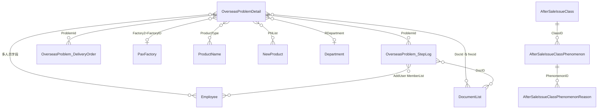

# 业务逻辑描述

> 信源：`1_user_input/overseas/tables.md`。已选问题现象的展平规则见下文「已选问题现象」。
>
> 单号前缀 `HW`。未点名国内、巴西或海外的列表与统计，三个域分别查询再汇总；点名海外则只查本域。

## 数据量

本域用 **12** 张表。行数在业务输入中未给出。

| 表 | 约行数 |
| --- | --- |
| `OverseasProblemDetail` | 未给出 |
| `OverseasProblem_StepLog` | 未给出 |
| `OverseasProblem_DeliveryOrder` | 未给出 |
| `Employee` | 未给出 |
| `Department` | 未给出 |
| `ProductName` | 未给出 |
| `NewProduct` | 未给出 |
| `DocumentList` | 未给出 |
| `PaxFactory` | 未给出 |
| `AfterSaleIssueClass` | 未给出 |
| `AfterSaleIssueClassPhenomenon` | 未给出 |
| `AfterSaleIssueClassPhenomenonReason` | 未给出 |

## 业务域

**海外制程问题查询**：围绕 **`OverseasProblemDetail`（海外制程问题）**，查询海外工厂制程问题的发现、分类、现象、跟进、处理过程、停线、发货与结案信息。只读。不在本助手内改单、审批或上传。

一张制程单在主表占一行。发货单、处理步骤、物料和已选现象都是这张单下面的内容，不把明细行数当成制程单张数。

### 本域做什么

| 关注点 | 要点 |
| --- | --- |
| 发现与描述 | 问题编号、建单时间、发现日期、发现工位、问题描述、改善建议、备注 |
| 分类 | 问题类型；问题等级 A+ / A / B / C |
| 现象与原因 | 已选问题现象展平为一段文字；标准现象可查可能问题原因。主表另有已填写的问题原因 |
| 工厂与机型 | 加工厂存海外工厂名称；国内工厂另存工厂码。大机型、PN、系列、发货单分列 |
| 物料 | 料号、描述、供应商编号、供应商名称取自物料 JSON |
| 跟进 | 问题跟进部门、问题跟进人、当前处理人、创建人 |
| 状态与过程 | 当前状态在主表；步骤日志记各环节。同一环节名称只留最新一条 |
| 停线 | 「是否停线」重启后不改回否；停线状态分开记录 |
| 数量 | 影响数量、不良数量；不良率按原文展示，保留 `%` 或 `‰` |
| 附件与打开单据 | 未删除附件以文档名称打开；问题编号可打开该单详情 |

口语「制程问题 / 制程相关问题」**不加**问题类型筛选。只有点名「硬件问题」「物料问题」「工厂制程」「制程优化」等具体类型时，才按问题类型筛选。

### 本域不做什么

| 排除项 | 说明 |
| --- | --- |
| 改单 | 不在本助手内填单、改状态、上传附件 |
| 国内、巴西单据 | 单号 `ZC`、`BR` 不在本域 |
| 物料档案、供应商档案 | 物料展示不连接 `Inventory`，供应商名称不另查 `tbIQCvendor` |
| 用现象主数据替换已选现象 | 已选问题现象用 JSON 里的文字，不用 `PhenomenonDesc` 替换 |
| 把可能问题原因当成已填写原因 | 可能问题原因是标准现象上的候选清单。本单已写的原因在主表问题原因 |
| 系列当查询条件 | 系列只展示主表里已有的文字 |
| 费用、8D、CAR | 本域用表不包含这些对象 |

### 与国内、巴西的差异

| 项 | 海外 | 国内 | 巴西 |
| --- | --- | --- | --- |
| 单号 | `HW` + 年月 + 3 位序号 | `ZC`… | `BR`… |
| 主表 | `OverseasProblemDetail` | `ZCTracking_ProblemList` | `BrazilProblemList` |
| 加工厂 | 海外工厂名称，直接存名称 | 工厂码，再取工厂名称 | 巴西工厂名称，可多个 |
| 国内工厂 | 另有一列，存工厂码 | 与加工厂是同一套工厂 | 无此列 |
| 问题类型「4」 | 其他 | 资料问题 | 类型集合不同 |
| 现象 | JSON 展平为一段文字 | 写在叙述文字里 | JSON 展平 |
| 可能问题原因 | 标准现象上的候选清单 | 无此清单 | 无此清单 |
| 物料 | JSON 内的料号与供应商 | 物料编码连接物料档案 | 物料编码连接物料档案 |
| PN | `NewProduct` 的名称 | 机型在机型子表 | 经采购订单解析名称 |
| 发货单 | 独立子表 | 无此子表 | 无此子表 |
| 停线状态 | 停线中、已经重启、没有停线 | 另有重启审核、审核通过、填写重启方案 | 是否已标记重启 |
| 不良率 | 原文，`%` 与 `‰` 都保留 | 由数量计算的百分数 | 由数量计算 |
| 跟进部门、跟进人 | 主表上的部门和人员 | 主表上的部门和人员 | 取最新一条处理过程上的人员 |

## 使用者与查询范围

使用者是公司内部查询海外工厂制程问题的人员。用户用自然语言提问；系统按本文件的口径检索并回答。

| 能力 | 口径 |
| --- | --- |
| 清单与统计 | 按已写明的字段筛选、计数。一张主表行是一张制程单 |
| 单号 | 用问题编号定位一张单，并打开详情 |
| 现象 | 已选问题现象、可能问题原因、问题描述中的文字 |
| 明细 | 发货单列表、处理步骤、物料列表、有效附件 |
| 人员 | 创建人、问题跟进人、当前处理人、问题跟进部门 |

## 表关联

### 主表 → 子表（1:N，`ProblemId` = `OverseasProblemDetail`.`Id`）

| 子表 | 基数 | 说明 |
| --- | --- | --- |
| `OverseasProblem_StepLog` | 1:N | 处理步骤。同一问题、同一环节名称只留最新一条 |
| `OverseasProblem_DeliveryOrder` | 1:N | 涉及发货单。按发货单列表给出，并另给订单数量合计 |

### 主表 → 维表

| 主表字段 | 关联表 | 关联键 | 说明 |
| --- | --- | --- | --- |
| `Factory2` | `PaxFactory` | `Factory2` → `FactoryID` | 国内工厂码。名称用 `FactoryName` |
| `ProductType` | `ProductName` | 逗号分隔的机型 ID → `ProductName.ID` | 大机型 |
| `PNList` | `NewProduct` | 逗号分隔的每一段 → `PartNumber` | 展示取 `Name`，列名仍是 PN |
| `RDepartment` | `Department` | `RDepartment` → `ID` | 问题跟进部门。空，或一个部门 |
| `AddUser`、`ConfirmUser`、`DesignUser` | `Employee` | → `ID` | 创建人、效果确认人、设计变更责任人 |
| `RUser`、`MemberList` | `Employee` | 逗号分隔的员工 ID → `ID` | 问题跟进人、当前处理人 |
| `DocId` | `DocumentList` | 逗号分隔的文档 ID → `ID` | 填单附件 |

`Factory` 是海外工厂名称，不关联 `PaxFactory`。

`MemberListName` 直接存当前处理人姓名，不另查 `Employee`。

### 步骤、附件、现象

| 来源 | 关联 | 说明 |
| --- | --- | --- |
| `OverseasProblem_StepLog.AddUser` | `Employee.ID` | 该步骤的创建人 |
| `OverseasProblem_StepLog.MemberList` | `Employee.ID` | 该步骤上的处理人。不用它代替主表的当前处理人 |
| `OverseasProblem_StepLog.DocID` | `DocumentList.ID` | 该步骤的附件，逗号分隔 |
| `DocumentList.frecid` | `OverseasProblemDetail.Id` | 有效附件还要求 `EffectFlag = 0` |
| `hasCheckedPhenomenon` 中 `Key > 0` | `AfterSaleIssueClassPhenomenon.ID` | 只用于查可能问题原因，不用于替换已选现象的展示文字 |
| `AfterSaleIssueClassPhenomenon.ClassID` | `AfterSaleIssueClass.ID` | 分类名称在 `ClassName` |
| `AfterSaleIssueClassPhenomenonReason.PhenomenonID` | 现象主键 | 命中行的 `ReasonDesc` 是一条可能问题原因 |

物料 JSON 里的供应商编号与 `tbIQCvendor.ferpcode` 同义，写在元素内。展示用元素里的供应商名称。

`OtherOnline`、`StockList` 是主表里的 JSON，不落到 `ZCTracking_OtherOrder`、`ZCTracking_Stock`。

## 核心枚举

### 问题类型（`ProblemType`）

| 值 | 含义 |
| --- | --- |
| 1 | 硬件问题 |
| 2 | 软件问题 |
| 3 | 物料问题 |
| 4 | 其他 |
| 5 | 工厂制程 |
| 6 | 结构问题 |
| 7 | 制程优化 |

`OldProblemType` 保存改类前的问题类型，取值与上表相同。`ProblemType` 是当前类型。

`ProblemRemark` 是其他问题说明，在问题类型为「其他」时使用。

### 状态（`Status`）

状态只取主表 `OverseasProblemDetail.Status`。

| 值 | 状态 |
| --- | --- |
| 1 | 指定责任人 |
| 2 | 责任人确认 |
| 3 | 其他问题确认 |
| 4 | IQC意见 |
| 5 | 工厂制程分析 |
| 6 | IQC确认 |
| 7 | 填写退货单号 |
| 8 | SQE跟进 |
| 9 | 设计更改 |
| 10 | 设计变更后SQE确认 |
| 30 | 效果确认 |
| 31 | 结案确认 |
| 32 | 已完成 |

当前到哪一环节，看主表状态。各环节留下的记录在 `OverseasProblem_StepLog`。步骤上的 `ProblemStatus` 是该条步骤记录的问题状态。

### 停线

| 字段 | 取值 |
| --- | --- |
| `IsStop` | 0 否，1 是。停线重启后仍为 1 |
| `StopState` | 1 停线中，2 已经重启，0 或其他值是没有停线 |

`StopDate` 是停线日期。`ReStartDate` 在停线重启时写入。

### 其他枚举

| 字段 | 取值 |
| --- | --- |
| `ProblemLevel` | `A+`、`A`、`B`、`C`。空表示未填写 |
| `IQCOpinion` | 2 退回仓库，3 继续使用 |
| `IsDesignChange` | 0 否，1 是 |
| `DesignConfirmResult` | 1 改善，2 保持现状，3 挂起 |
| `IsDelete` | 0 否，1 是 |
| `RConfirm` | 0 或空为否，不重新走流程；大于 0 为是 |

## 字段口径

下文未写表名时，字段属于 `OverseasProblemDetail`。

### 问题编号

`Numbers` 按月生成：`HW` + 两位年 + 两位月 + 3 位序号，如 `HW2609001`。用户用来指称一张单的是这个编号。

打开这张单的地址：

`https://{INFO_BASE_URL}/#/QualityManage/OverseasProblemAllDetail?id={OverseasProblemDetail.Id}`

`{INFO_BASE_URL}` 放运行配置。地址里的 `id` 用主键。

### 时间、创建人、发现工位

| 字段 | 展示名 | 说明 |
| --- | --- | --- |
| `AddDate` | 建单时间 | 建单时间 |
| `AddUser` | 创建人 | 关联 `Employee.ID`，姓名取 `Employee.Name` |
| `FoundDate` | 发现日期 | 发现日期，也叫现场发现日期 |
| `Station` | 发现工位 | 自由文本 |

### 加工厂与国内工厂

| 字段 | 展示名 | 存放 |
| --- | --- | --- |
| `Factory` | 加工厂 | 海外工厂名称 |
| `Factory2` | 国内工厂 | 工厂码，关联 `PaxFactory.FactoryID`，名称取 `FactoryName` |

### 大机型、PN、系列、版本

`ProductType` 是大机型，逗号分隔的机型 ID，关联 `ProductName.ID`。向用户展示机型名称。

`Version` 是主表上的版本。发货单上的发货版本、生产版本属于发货单，见「涉及发货单」。

### PN

源字段为 `PNList`。逗号分隔。每一段等于 `NewProduct.PartNumber`，取 `NewProduct.Name`。查询和展示都用这个 `Name`，展示名为 **PN**。多段时，各段的 `Name` 用逗号拼接成一列。

与物料中的料号不是同一套编号。发货单上的 **PN** 列来自发货单自身，不经 `NewProduct`。

### 系列

`Series` 只用于展示主表中已存的文本。不作为查询条件，不联 `ProductName` 或 `NewProduct`。

### 物料

源字段为 `InvInfo`。存的是 **JSON 数组**，不是子表，也不是单个对象。每个元素是一条物料。一单可以有多条。只有一条时仍然是数组。

| 键 | 展示名 | 含义 |
| --- | --- | --- |
| `PN` | 料号 | 物料编码。对应国内制程单的物料编码、巴西制程单的物料编码 |
| `materialDesc` | 描述 | 该物料的描述。整段展示，不拆成物料名称和规格型号 |
| `supplier` | 供应商编号 | 该物料在本单上的供应商编号。与 `tbIQCvendor.ferpcode` 同义，写在元素内 |
| `supplierName` | 供应商名称 | 供应商名称，写在该元素内 |

不连接 `Inventory`。展示所用的供应商名称取 `supplierName`。

与 `PNList` 不是同一套编号。

不展示原始 JSON。向用户给出 **料号**、**描述**、**供应商编号**、**供应商名称**。一条时给出该元素的这四项。多条时按数组顺序逐条列表，每条一行。空值、空串，或内容不是 JSON 数组时，不显示物料。数组没有元素时，同样不显示。

### 已选问题现象

源字段为 `hasCheckedPhenomenon`。库存的是 **JSON 数组**，不是单个对象。数组里每个元素是一条已选现象；一单可以有多条，也可以混有标准现象和手填现象。只有一条时仍然是数组，例如 `[{...}]`。

对用户展示的是把数组各元素展平后拼成的一段文本，列名为 **已选问题现象**。不展示原始 JSON，也不连接 `AfterSaleIssueClassPhenomenon`。

| 条件 | 处理 |
| --- | --- |
| 空值、空串，或去掉首尾空白后不以 `[` 开头 | 视为空数组 |
| 否则 | 按 JSON 数组解析 |

没有元素时，已选问题现象为空。

按元素的 `Key` 生成一段文本。`parentType`、`Value` 为空时按空串参与拼接。

| `Key` | 片段 |
| --- | --- |
| `> 0` | `Value` |
| `< 0` | `parentType` + ` -> ` + `Value`。`otherVal` 去掉空白后仍有内容时，再追加空格、左括号、`otherVal`、右括号 |
| `0` 或缺失 | `Value` |

`Key > 0` 时不使用 `parentType`、`subTypeName`、`otherVal`。这些键以及 `subTypeId`、`parentIndex`、`tagIndex` 不进入展示文本。

按数组里的元素顺序，逐个生成片段，再用中文分号 `；` 连成一串。某一段为空串时，它的位置仍保留。

| 数组 | 已选问题现象 |
| --- | --- |
| `[{"Key":39,"Value":"黑屏、白屏"}]` | 黑屏、白屏 |
| `[{"Key":39,"Value":"黑屏、白屏"},{"Key":-1,"parentType":"功能问题","Value":"花屏","otherVal":"夜间"}]` | 黑屏、白屏；功能问题 -> 花屏 (夜间) |

数组里每个 `Key > 0` 的元素，各自用自己的 `Key` 去查可能问题原因。`Key < 0` 的元素只参与上面的展示拼接。

### 可能问题原因

可能问题原因是已选现象在 `AfterSaleIssueClassPhenomenonReason` 中的候选记录。主表 `Reason` 是本单已经填写的问题原因。

对 `hasCheckedPhenomenon` 中每一个 `Key > 0` 的元素分别查询：该元素的 `Key` 等于 `AfterSaleIssueClassPhenomenon.ID`，再以该主键查询 `AfterSaleIssueClassPhenomenonReason.PhenomenonID`。命中的每一行 `ReasonDesc` 为这一条现象下的一条可能问题原因。一个现象可以有多条可能问题原因；一单有多个 `Key > 0` 的元素时，各查各的。

JSON 中不保存选中的原因 ID，也不保存 `ReasonDesc`。因此这次关联得到的是该现象的可能问题原因清单。

`Key < 0` 为手填现象，没有现象主键，不查可能问题原因。

`PhenomenonDesc` 不作为这条关联的条件，也不替代展示用的 `Value`。

元素中的 `parentType`、`subTypeId`、`subTypeName`、`parentIndex`、`tagIndex`、`otherVal` 不参与现象表和原因表的关联。`ClassID` 是现象行上的分类主键，关联 `AfterSaleIssueClass.ID`，分类名称在 `ClassName`。这些 JSON 键不对应 `ClassID`。

示例：`[{"Key":39,"Value":"黑屏、白屏","parentType":"功能问题","subTypeId":15,"subTypeName":"LCD 显示问题","otherVal":""}]` 的已选问题现象为「黑屏、白屏」。可能问题原因只沿 `Key 39` → 现象 `ID 39` → `PhenomenonID 39` 查询。若数组中还有其他 `Key > 0` 的元素，按那些元素的 `Key` 另行查询。

### 数量与不良率

| 字段 | 展示名 |
| --- | --- |
| `ImpactQty` | 影响数量 |
| `BadQty` | 不良数量 |
| `Rate` | 不良率 |

不良率向用户展示库存原文，保留 `%` 或 `‰`。

### 问题等级

`ProblemLevel` 取值为 `A+`、`A`、`B`、`C`。空表示未填写。

### 问题跟进部门

`RDepartment` 是问题跟进部门。填单时先选一个部门，再选该部门下的人员。本列为空，或为一个部门 ID，关联 `Department.ID`。

### 问题跟进人

`RUser` 是问题跟进人。可以为空，或为一个、多个员工 ID，逗号分隔，关联 `Employee.ID`。多个员工 ID 都属于 `RDepartment` 所指定的那一个部门。

`RConfirm` 是问题跟进人确认：0 或空为否，不重新走流程；大于 0 为是。`RCompleteTime` 是问题跟进人计划完成时间。

### 当前处理人

`MemberList` 是问题单流转到最新节点时的处理人 ID，逗号分隔，关联 `Employee.ID`。`MemberListName` 是对应姓名。向用户展示的名称是 **当前处理人**。

`OverseasProblem_StepLog.MemberList` 是该步骤节点上的处理人。不用步骤日志上的成员拼接代替主表的当前处理人。

### 叙述文字

| 字段 | 展示名 | 内容 |
| --- | --- | --- |
| `ProblemDesc` | 问题描述 | 自由文本，可能包含 base64 编码的图片 |
| `Improve` | 改善建议 | 自由文本，可能包含 base64 编码的图片 |
| `Remark` | 备注 | 备注 |
| `Reason` | 问题原因 | 责任人确认、原因分析文本 |
| `Prevention` | 预防对策 | 预防对策，也用于工厂制程制定对策 |
| `Measures` | 改善措施 | 改善措施，也用于工厂制程原因分析，以及物料问题的设计变更改善情况、原因说明 |
| `Confirmation` | 效果确认 | 效果确认结论 |
| `ProblemRemark` | 其他问题说明 | 问题类型为「其他」时使用 |

`ConfirmUser` 是效果确认人，关联 `Employee.ID`。`ConfirmDate` 是效果确认时间。

### 设计变更

| 字段 | 展示名 |
| --- | --- |
| `IsDesignChange` | 是否设计变更 |
| `DesignUser` | 设计变更责任人 |
| `DesignDate` | 设计更改预计完成时间 |
| `DesignConfirmResult` | 设计变更确认结果 |

设计变更责任人关联 `Employee.ID`。确认结果为 1 改善、2 保持现状、3 挂起。

状态取值 9 的名称是「设计更改」。

### 处理步骤

`OverseasProblem_StepLog` 通过 `ProblemId` 关联主表。

| 字段 | 展示名 |
| --- | --- |
| `StepStr` | 环节名称 |
| `AddDate` | 发生时间 |
| `AddUser` | 创建人 |
| `MemberList` | 该步骤的处理人 |
| `Opinon` | 意见 |
| `Result` | 结论 |
| `Measures` | 预防措施 |
| `DocID` | 该步骤的附件 |

同一问题的同一环节名称会重复。查看该环节时只保留最新一条。

步骤上的预防措施与主表的改善措施是两列。

### 涉及发货单

通过 `OverseasProblem_DeliveryOrder` 查询。`ProblemId` 关联 `OverseasProblemDetail.Id`。一单可以有多行。

不展示主键和问题 ID。向用户按下列顺序给出列表。**序号**按该列表从 1 起编。默认按发货单号升序。

| 展示名 | 来源列 |
| --- | --- |
| 序号 | 展示时生成 |
| PO | `PO` |
| 发货单号 | `OrderNumber` |
| 发货日期 | `Date` |
| PN | `PN` |
| 发货版本 | `DeliveryVersion` |
| 生产版本 | `ProdVersion` |
| 订单数量 | `Quantity` |
| 备注 | `Remark` |

**订单数量合计**是该制程单下各行 `Quantity` 之和。没有发货单时不展示列表，合计不展示。

### 附件

有效附件在 `DocumentList`：`frecid` 为该制程单 `OverseasProblemDetail.Id`，且 `EffectFlag = 0`。`EffectFlag = 1` 为已删除，不展示。

填单附件使用主表 `DocId`。逗号分隔的文档 ID，关联 `DocumentList.ID`。

步骤上的附件 ID 在 `OverseasProblem_StepLog.DocID`，逗号分隔，关联 `DocumentList.ID`。是否有效，与上面同一套 `frecid`、`EffectFlag` 条件。

有效附件以文档名称打开。预览地址的算法与国内、巴西相同：文档已经对应到 `DocumentList` 的一行时，用该行 ID 和校验值生成地址。

### 退货单号、其他在线、库存

| 字段 | 说明 |
| --- | --- |
| `OReturnOrderNo` | 在线退货单号 |
| `SReturnOrderNo` | 在库退货单号 |
| `OtherOnline` | 其他在线。JSON 写在本列，结构同国内其他在线订单。其中的工厂码与 `Factory2` 相同 |
| `StockList` | 库存。JSON 写在本列，结构同国内库存 |

### IQC 意见

`IQCOpinion` 为 2 时是退回仓库，为 3 时是继续使用。

## 常见查询场景

| 用户说法 | 口径 |
| --- | --- |
| 海外制程问题、海外制程相关问题 | 本域主表范围内的单据，不加问题类型条件 |
| 硬件问题、物料问题、工厂制程、制程优化等 | 点名了上表中的类型时，按问题类型筛选 |
| 问题编号、`HW` 开头的单号 | `Numbers` |
| 问题跟进部门、某部门跟进的 | `RDepartment` |
| 问题跟进人、某人跟进的 | `RUser` |
| 当前处理人、当前谁在处理 | `MemberListName` |
| 建单时间 | `AddDate` |
| 发现日期、现场发现日期 | `FoundDate` |
| 加工厂 | `Factory`（海外工厂名称） |
| 国内工厂 | `Factory2` |
| 大机型 | `ProductType` 对应的机型名称 |
| PN | `PNList` 对应的 `NewProduct.Name` |
| 料号 | 物料 JSON 的 `PN` |
| 已选问题现象 | 展平后的那段文字 |
| 可能问题原因 | 标准现象上的候选 `ReasonDesc` |
| 问题原因 | 主表 `Reason` |
| 不良率 | `Rate` 原文 |
| 发货单 | `OverseasProblem_DeliveryOrder` 列表；订单数量合计是各行数量之和 |

### 示例

1. 「问题等级为 A+ 的海外制程问题有哪些？」
2. 「单号 HW2609001 的已选问题现象、可能问题原因和当前处理人是什么？」
3. 「HW2609001 涉及哪些发货单，订单数量合计是多少？」
4. 「问题跟进部门为某部门的海外制程问题，跟进人是谁？」
5. 「状态为已完成，并且 IQC 意见为退回仓库的海外物料问题有哪些？」
6. 「料号为某编码的海外制程问题有哪些？」
7. 「PN 为某机型名称的海外制程问题，问题描述里有哪些说法？」
8. 「2026 年 9 月建单的海外制程问题有哪些？」
