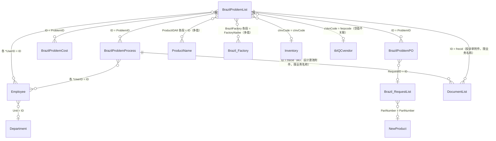
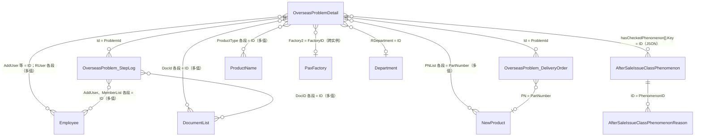

# 表关系总览

本模块 32 张表的结构图：三个域的主表、子表、各域专用查表与共用主数据，以及它们之间靠哪一列关联。

- **只画结构，不定口径**：关联的条件、取值转换、关联不上怎么显示，以各域 `business_description.md` 的「关联」一节与 `db_description/` 为准。两边不一致时以各域「关联」一节为准，并回来改本图。
- **维护**：改了任一域的「关联」一节，或增删表，同步改本文件。
- 连线标签里的短标记：**仅整机单 / 仅物料单 / 仅物料问题** = 带条件（物料单指物料标识为「物料」的国内单，物料问题指问题类型）；**多值** = 逗号分隔、逐段对应；**JSON** = 关联键存在 JSON 里；**文本键** = 两边类型不同，需转换；**跨实例** = 不在同一数据库实例，不能写成一条 SQL 连接。

## 1. 总览：实例、库与三域共用的表

```mermaid
flowchart LR
  subgraph INFO["INFO 实例（数据源 info）"]
    subgraph DOM["国内"]
      ZC[ZCTracking_ProblemList<br/>国内主表]
      ZCsub["子表 9 张<br/>机型 / 处理步骤 / 生产订单<br/>小板订单 / 其他在线订单 / 风险订单流程<br/>已选现象与可能原因 / 可能的问题物料 / 5Why"]
      CAR[tbIQCreportOut<br/>CAR 报告]
      TASK[tbTask<br/>流程待办任务]
    end
    subgraph BR["巴西"]
      BRM[BrazilProblemList<br/>巴西主表]
      BRsub["子表 3 张<br/>处理过程 / 费用 / 关联申请单"]
      BRx["专用查表 2 张<br/>Brazil_Factory / Brazil_RequestList"]
    end
    subgraph OS["海外"]
      HW[OverseasProblemDetail<br/>海外主表]
      HWsub["子表 2 张<br/>处理步骤 / 涉及发货单"]
    end
    subgraph CFG["现象配置（现象分类只有国内用）"]
      CLS[AfterSaleIssueClass<br/>现象分类]
      PHE[AfterSaleIssueClassPhenomenon<br/>现象主数据]
      REA[AfterSaleIssueClassPhenomenonReason<br/>现象可能原因]
    end
    subgraph SHARED["共用主数据（info 实例）"]
      EMP[Employee 人员]
      DEPT[Department 部门]
      DOC[DocumentList 文档清单]
      INV[Inventory 存货档案]
      VEN[tbIQCvendor 供应商]
      PN[ProductName 产品 / 大机型]
      NP[NewProduct PN]
    end
  end
  subgraph ERP["ERP 实例（数据源 erp）"]
    FAC[PaxFactory 国内工厂]
  end

  ZC --- ZCsub
  ZC --- CAR
  ZC --- TASK
  BRM --- BRsub
  BRM --- BRx
  HW --- HWsub

  ZC -.-> CLS & PHE & REA
  HW -.-> PHE & REA

  ZC -.-> EMP & DEPT & DOC & INV & VEN
  ZC -. 跨实例 .-> FAC
  BRM -.-> EMP & DEPT & DOC & INV & VEN & PN & NP
  HW -.-> EMP & DEPT & DOC & PN & NP
  HW -. 跨实例 .-> FAC
```

实线：本域专属的表；虚线：用到的共用主数据。

### 各表归属

| 库 | 表 | 归属 | 国内 | 巴西 | 海外 |
|---|---|---|:-:|:-:|:-:|
| CoreINFO | ZCTracking_ProblemList | 国内主表 | ● | | |
| CoreINFO | ZCTracking_ProductNames、ZCTracking_ProblemSteplog、ZCTracking_ProblemOrders、ZCTracking_XBOrders、ZCTracking_OtherOrder、ZCTracking_RiskStream、ZCTracking_CheckReason、ZCTracking_PossibleInvCode、ZCTracking_ProblemFiveWhy | 国内子表 | ● | | |
| CoreINFO | BrazilProblemList | 巴西主表 | | ● | |
| CoreINFO | BrazilProblemProcess、BrazilProblemCost、BrazilProblemPO | 巴西子表 | | ● | |
| CoreINFO | OverseasProblemDetail | 海外主表 | | | ● |
| CoreINFO | OverseasProblem_StepLog、OverseasProblem_DeliveryOrder | 海外子表 | | | ● |
| CoreINFO | AfterSaleIssueClass | 国内专用（问题现象所属分类） | ● | | |
| CoreINFO | AfterSaleIssueClassPhenomenon、AfterSaleIssueClassPhenomenonReason | 共用（现象主数据、现象可能原因） | ● | | ● |
| info | Brazil_Factory、Brazil_RequestList | 巴西专用 | | ● | |
| info | tbIQCreportOut | 国内专用（CAR 报告，单独授权） | ● | | |
| info | tbTask | 国内专用（全公司共用表，本模块只取国内制程任务） | ● | | |
| info | Employee、Department、DocumentList | 共用 | ● | ● | ● |
| info | Inventory、tbIQCvendor | 共用 | ● | ● | |
| info | ProductName、NewProduct | 共用 | | ● | ● |
| paxbase（ERP 实例） | PaxFactory | 共用 | ● | | ● |

合计：CoreINFO 20、info 11、paxbase 1，共 32 张；国内 21、巴西 13、海外 11。

## 2. 国内

```mermaid
erDiagram
    ZCTracking_ProblemList ||--o{ ZCTracking_ProductNames : "ID = ProblemId"
    ZCTracking_ProblemList ||--o{ ZCTracking_ProblemSteplog : "ID = ProblemId"
    ZCTracking_ProblemList ||--o{ ZCTracking_ProblemOrders : "ID = ProblemId（仅整机单）"
    ZCTracking_ProblemList ||--o{ ZCTracking_XBOrders : "ID = ProblemId（仅物料单）"
    ZCTracking_ProblemList ||--o{ ZCTracking_OtherOrder : "ID = ProblemId"
    ZCTracking_ProblemList ||--o{ ZCTracking_RiskStream : "ID = ProblemId"
    ZCTracking_ProblemList ||--o{ ZCTracking_CheckReason : "ID = ProblemId"
    ZCTracking_ProblemList ||--o{ ZCTracking_PossibleInvCode : "ID = ProblemId"
    ZCTracking_ProblemList ||--o{ ZCTracking_ProblemFiveWhy : "ID = ProblemId"
    ZCTracking_CheckReason }o--o| AfterSaleIssueClass : "ClassID = ID"
    ZCTracking_CheckReason }o--o| AfterSaleIssueClassPhenomenon : "PhenomenonID = ID"
    ZCTracking_CheckReason }o--o| AfterSaleIssueClassPhenomenonReason : "ReasonID = ID（0 表示没有）"
    ZCTracking_ProblemFiveWhy }o--o{ Employee : "AddUser、UpdateUser = ID"
    ZCTracking_ProblemList ||--o{ tbTask : "ID = frecID（文本键，效果确认、预防对策确认两类，已接受）"
    ZCTracking_ProblemList }o--o| tbIQCreportOut : "CARID = fid（仅物料问题）"
    ZCTracking_ProblemList }o--o| PaxFactory : "Factory = FactoryID（跨实例）"
    ZCTracking_ProblemList }o--o| Inventory : "CInvCode = cInvCode"
    ZCTracking_ProblemList }o--o| tbIQCvendor : "VenCode = ferpcode（空值不关联）"
    ZCTracking_ProblemList }o--o| Department : "RDepartment = ID"
    ZCTracking_ProblemList }o--o{ Department : "AllReDepartment 各段 = ID（多值）"
    ZCTracking_ProblemList }o--o{ Employee : "各人员 ID 列 = ID（部分为文本键）"
    ZCTracking_XBOrders }o--o| Inventory : "InvCode = cInvCode"
    ZCTracking_OtherOrder }o--o| PaxFactory : "Factory = FactoryID（跨实例）"
    ZCTracking_ProblemSteplog }o--o{ DocumentList : "FileUrl 各段 = ID（多值）"
    ZCTracking_ProblemSteplog }o--o{ Employee : "AddUser = ID；MemberList 各段 = ID（多值）"
    ZCTracking_RiskStream }o--o| Employee : "UserID = ID"
    tbTask }o--o| Employee : "fuserID = ID（文本键）"
    Employee }o--o| Department : "Unit = ID"
```



## 3. 巴西



## 4. 海外



海外附件只能从单上登记的附件 ID 出发取，再校验文档的业务记录 ID 等于主表 `Id`；不能只按业务记录 ID 反查文档清单。

## 5. 不能写成一条普通等值连接的关联

| 类型 | 关联 | 处理要点 |
|---|---|---|
| 跨实例 | 国内主表、其他在线订单、海外主表 → 国内工厂 | 国内工厂在 ERP 实例，分开取再按工厂码对应。小板订单的订单工厂存的就是工厂名称，直接展示，不与国内工厂表关联：国内工厂名称有重复（「柯洱斯」有两个码），按名称关联会让订单行翻倍 |
| 多值 | 国内主状态处理人、IQC 成员、责任归属部门、步骤成员、步骤附件；巴西大机型、巴西加工厂；海外大机型、PN 列表、问题跟进人、当前责任人、步骤成员、附件 | 逗号分隔，逐段对应 |
| JSON | 海外已选问题现象 → 标准现象 | `Key` 大于 0 的元素才指向标准现象 |
| 文本键 | 待办任务业务记录 ID ↔ 国内主表 ID；待办任务人员、国内部分人员列 ↔ 人员 ID | 两边类型不同，需转换后对应 |
| 带条件 | 生产订单（仅整机单）、小板订单（仅物料单）、CAR 报告（仅物料问题）、待办任务（只取效果确认、预防对策确认两类业务表名，已接受）、巴西 8D、投诉单附件、设计更改附件（限业务名称）、文档（未删除） | 条件见各域「关联」一节 |

## 6. 与权限配置的对应

`privileges.md`「权限里要列出的表」中，挂在主表下、继承父表的 14 张子表，就是上面各域图里从主表出发、按单号一对多的子表（国内 9、巴西 3、海外 2）。其余表放最外层，原因如下：

- 流程待办任务：文本键关联，且是全公司共用表，不按父子继承。
- 巴西申请单：经关联申请单间接关联，本身是巴西业务的需求 / 请票主表，不是问题单的子表。
- 现象主数据、现象可能原因：配置表，国内、海外共用；现象分类：配置表，只有国内用。三张都不挂在问题单下。
- CAR 报告、文档清单：按 ID 被问题单引用，不是问题单的子表。

权限里另有 9 张文字查找表，不在本图：它们在本助手自己的产物库里，是从三域叙述文字整理出来的派生表，不是源表，同样放最外层、随所属域给「允许」（见 `privileges.md`）。
