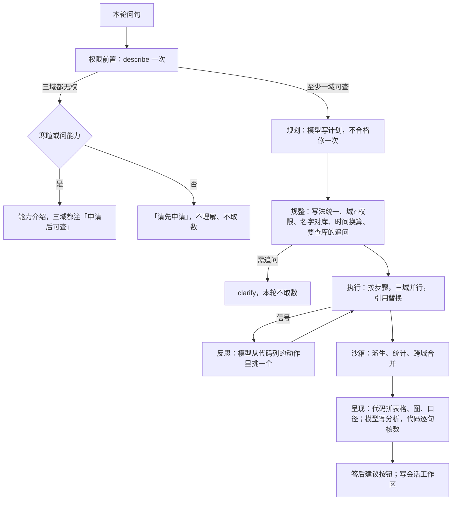

# 2026-10-27 模块技术设计

> **状态：草案，未评审。** G4b 照本稿写代码，偏离即回改本稿。版本：`paxsz-forge-core` 0.3.7、`paxsz-forge-data` 0.3.2、`paxsz-forge-platform` 0.3.7。文中「实测」是不连库脚本或规划器实测，各处注明。
>
> 业务口径以 `docs/2_landed/` 为准，本稿只写怎么实现。数据侧形态（用哪些源、mart 12 张表、向量声明、同步策略）以决策 2026-10-20「G2 数据源与治理决策」（下称 G2）为准，不重写。引用写法：「总述『X』」指 `2_landed/business_description.md` 的 X 节，「国内『X』」等指各域业务描述。

## 0 结论先行

1. **受控代理**。每轮模型只做一次理解：把问句写成一份计划（技能 + 照抄用户说法的参数 + 步骤间引用）。取数、名字对库、时间换算、权限、计数都由代码和确定性执行器完成。模型另外只在这几处出场：写表格下的分析段（代码逐句核数）、浓缩清单里的问题描述、文字查找时挑说法和判断第三组「可能相关」、写临时统计脚本、出现信号时从代码列好的动作里挑一个（§1.2）。
2. **计划格式只定义一处**。G4b 用 pydantic 定义计划，规划提示里的格式说明、校验、执行都从它来（§5）。实测 Qwen3-Fast（平台配置的型号）用 p2 提示词，经代码规整与校验后 183 条问句、915 次运行全对 99.9%，同一问句多次一致 97.8%，全部达到通过标准；这批问句偏整齐。另加 25 条不整齐输入、带校验打回后，208 条全对 98.9%、一致 98.1%，错的几乎都会转成追问（§1.3）。
3. **取数只做过滤，派生和数字都进沙箱**。`ctx.data.fetch` 只做过滤、子表关联和排序；当前状态、结案时间、机型拼接这类派生字段，以及一切计数、分档、Top N、跨域合并，都在 `ctx.stats` 沙箱里算，每步一次调用。`handle()` 只拼 spec、搬数据帧、读沙箱结果（§6、§8）。
4. **三域并行，按域分开**。每域一个适配器，同一步的三域取数并行；跨域合并在沙箱里做。国内工厂在 `erp`，单独整表取，在沙箱里按工厂码对应（§6.4）。
5. **权限**。每轮开头调一次 `describe()`，定出可查的域、CAR 报告权限、各域文字查找是否可用。计划不按权限裁剪，执行时取「用户点的域 ∩ 可查的域」。待办任务表行规则用表级映射 `ftable → ftable`，实测编译正确，缺映射时 fail-closed（§3、§4.1）。
6. **文字查找**。按词一路先在 SQL 里用一列去空格文字做超集预筛，再在沙箱里按 `topic_terms.md`「怎么读」精确匹配、屏蔽、分组、计数。按意思一路照 G2 ③④ 调 `ctx.retrieval.search`。第三组最多判断 30 张，分批交模型（§7）。有两处细化 G2：分段表加一列 `seg_compact`；N1、N2 改由沙箱计数（§7.2）。
7. **配置**。声明 5 份 `config_files`。表格形态的内置默认值直接解析随 wheel 分发的 `2_landed`，代码里不抄第二份；`glossary`、`intents`、`clarify_dimensions`、`analysis_dimensions` 也在导入时从 `2_landed` 生成（§2.3、§11）。
8. **已定与未决**。G59–G64 开发者 2026-10-27 同意建议，已落盘（决策 2026-10-27「G4a 设计时补的口径」及其补记）；链接参数写死在代码里、命名混淆（§9.1）；自然期间由代码换算日期不算越过数字红线，换算不了的说法追问（§6.1）；对照另一套助手的架构材料后，采纳了规整与校验的准入准则、号码直通、执行快照等几条（§19）。预匹配的结果实测后不附给规划器（§1.3）。探测 W1（处理步骤内容的人名前缀）已执行，结论进了 §12。

## 1 架构

### 1.1 一轮怎么走



### 1.2 谁做什么

| 环节 | 模型 | 代码 / 确定性执行器 |
|---|---|---|
| 理解问句、拆步骤、多轮指代 | 写计划，参数照抄用户说法 | 校验计划，不合格修一次；规整同义写法（§5.3） |
| 名字（机型、系列、工厂、部门、人员、物料、供应商） | 不碰 | 对库里的取值；对不上或对上多个时按总述「必要澄清项」追问（§6.5） |
| 时间 | 照抄原话 | 换成起止日期或 `$relative`（§6.1） |
| 权限 | 看不到 | `describe()` 判域；无权的域不取数；话术按 `privileges.md` |
| 取数 | 不碰 | 按技能模板组 `QuerySpec`（§6） |
| 数字 | 不报数 | SQL 与沙箱（§8） |
| 分析段 | 写 3–6 句 | 只给沙箱产出的事实；逐句核数（§8.3） |
| 文字查找 | 挑说法（话题本身之外）；逐张判断第三组 | 话题范围、候选、上限、排序、计数（§7） |
| 计划外的统计 | 写沙箱脚本（「临时统计」） | AST 检查、输出形状检查（§5.5） |
| 异常信号 | 从列出的动作里挑一个 | 列出动作，预先算好每个动作的结果，再执行（§5.4） |

每轮的模型调用：规划 1 次（不合格再 1 次）；分析段 1 次；清单有问题描述列时摘要 1 次。文字查找另加挑说法 1 次和第三组判断（每批 10 张，至多 3 批并行）。反思、临时统计各至多 1 次。平台单轮预算 300 秒（`request_budget_seconds`）。

### 1.3 为什么这样分

| 备选 | 否决理由 |
|---|---|
| 固定流水线（意图分类 + 槽位） | 一问多段、先算条件、链式引用都要逐个写死，问法一变就接不住 |
| ReAct，细粒度工具逐步调用 | 每步一次模型往返，延迟随步数涨；模型看得到中间数字，容易顺手算 |
| 多智能体 | 本助手只读、口径固定，没有需要分工的角色，只多出调用和不一致 |
| 模型直接写 `QuerySpec` 或 SQL | 31 张表、三域口径各不相同，派生规则写在 `2_landed` 里几百条；权限和 JOIN 白名单拦得住越权，拦不住口径写错，写错就是错数 |
| 原生工具调用 | 一次回复里写不出「先算 s1，再拿 s1 的第一名查 s2」这种依赖 |

实测用 `scripts/planner_spike/`（对照集 c3 共 183 条，c4 在它上面加 25 条不整齐输入；内网网关与 `ctx.llm` 是同一服务；原始结果在 `runtime/planner_spike/`，不入库）：

| 模型 / 提示词版本 | 计划全对 | 同一问句多次一致 | 其他 |
|---|---|---|---|
| Qwen3-Fast（平台配置）/ p2 + 校验打回，c4 208 条 | 98.9%（模型原样 90.3%） | 98.1% | 每条 5 次共 1,040 次；规划耗时中位数 2.4 秒、P90 3.6 秒（含打回重写）。错的见下文 |
| Qwen3-Fast（平台配置）/ p2 | 99.9%（模型原样 91.7%） | 97.8% | 每条 5 次共 915 次，格式全部一次合格；规划耗时中位数 2.1 秒、P90 2.9 秒 |
| Qwen3-Fast / p1 | 98.9% | 92.2% | — |
| qwen3.8-27b / p1 | 97.7% | 97.8% | 分析段 98.8%；反思全对（p0）；临时统计 10 题全对（p0） |

- p2 的分数按 §5.3 现行的规整与校验，用同一批模型输出重算（不重新调用模型）。p2 跑完后加的几条（规整第 6、8–11 条、校验第 13 条）纠正了原来错的 4 个问句里的 3 个；剩下 V-13「今年结案了多少单」有 1 次按建单时间算，由校验第 13 条拦下。不加这几条时全对 98.3%、一致 97.3%，也已达标。
- 剩下的不一致都不影响结果：「其他」类详情的说明措辞不同；统计多给了「占比」一列；BR-005「…有哪些？改善措施写了什么？」有 2 次把改善措施拆成第二步按单查详情，3 次写成清单的一列，按 §5.3 第 5 条两种写法执行出来是同一张表。
- **这批问句偏整齐**：号码前大多写明是什么号，只有号码的问句 1 条；名字对库只在 16 个示意名字上试过；打分只看取值有没有照抄、栏放没放对，不检验能否对到库里那一条。所以对照集 c4 另加了 25 条「不整齐输入」（只有号码、几种号码混在一起、不带类别词的名字、跨类同名、名字与现象写在一起），名字取自条数与真实库同一量级的合成主数据。
- **预匹配提示不附给规划器**（`20261027-p2-预匹配`）。附提示的组跑全部 208 条，不附的组跑其中 104 条，各 5 次。打分前把 M-20 的期望改为也接受「亮亮工厂」，与 V-03 接受「柯尔斯工厂」一致，名字对库时去掉「工厂」二字（§6.5）；重算结果在 `20261027-p2-预匹配-评2`。
  - 同一批 104 条上：整份全对附提示 97.1%、不附 98.1%；一致 98.1%、97.1%。25 条不整齐输入去掉号码直通接走的 9 条，剩下 16 条：附提示 81.3%，不附 93.8%。
  - 提示只修好了 M-16「TT 今年多少单」的栏：不附时写成机型，附了写成加工厂。不附时这是唯一的错，执行时机型对不上，请用户核对名称并给「TT：巴西的加工厂」选项（§6.5），不会出错数。
  - 附提示带出的错有 5 条问句，每条 5 次全错。M-16、M-20「亮亮工厂今年的问题」把提示里名字所属的域抄成用户点的域，违反「没点明域即三域都查」。V-05「张三负责的单」因「张三：人员」从责任人退回跟进人。CN-043 因 15 位数字提示「料号或 PN 编码」改成料号、PN 两个同时成立的条件，违反两处分开查。M-19「亮亮供应的物料出过哪些问题」多加了问题类型「物料问题」，用户没点类型。V-05、CN-043 不在 104 条里，p2 那次不附提示时 5 次全对。
  - 两组耗时差近一倍，但输入 token 几乎相同，与提示无关，不作依据。
- **校验打回实测**（`20261027-p2-校验`，全部 208 条，校验第 13、15 条不过就打回重写一次）：1,040 次里打回 1 次，是 V-13 按建单时间算的那种错，重写后改成按结案，改对了；第 15 条没有拦下任何一次。剩下 11 次错：
  - M-08「202510」5 次都追问是年月还是编号：线上由号码直通接走（§4.2 第 4 步），不进规划。
  - M-16「TT 今年多少单」5 次都把 TT 写成机型：同上，追问并给选项，不出错数。
  - CN-002 有 1 次把整套参数又包了一层 `params`，外层只剩 `domains: null`；当时的格式校验忽略未知的键，这份计划会不加条件地列出三域全部单。§5.3 第 12 条因此改为未知的键打回（加在本次实测之后，打回后改没改得过来未实测）。
  - 不算号码直通接走的 16 条问句，960 次里错 6 次，99.4%；其中 5 次会追问，只有 CN-002 那 1 次会出错数。原有 183 条只错 CN-002 那 1 次。
- 开发者 2026-10-27 定：沿用平台配置的 Qwen3-Fast。两种型号都不输出思考内容，不需要开关。调用参数：temperature 0，JSON 模式，校验不过修一次。
- 提示词每改一次都要重跑全部对照集，这套工具在 G4b 继续当规划回归用。G4b 写完规划层后，spike 改为调用 `src` 里的计划格式、规整与校验，自己只留打分与报告：两套规则并存时，对照集测的就不是线上那套。

### 1.4 包结构（G4b 照此建文件）

```text
src/factory_issue_module/
├─ module.py          FactoryIssueModule：manifest、handle()（只调 orchestrator）、validate_config()、jobs()
├─ declarations.py    data_sources、joins、vectorize、config_files、keywords（纯声明）
├─ landed.py          读随 wheel 的 2_landed：术语、场景、澄清项、分析维度、说法清单、部门简称、地区说法、显示名
├─ textnorm.py        剥图去标签、归一化、去空格；治理任务、查询期、沙箱脚本共用，只用 re 与内建函数（沙箱禁止 import html、unicodedata，实测）
├─ turn/              gate.py  orchestrator.py  greeting.py  workspace.py  errors.py（业务话术）
├─ plan/              schema.py  prompt.py  planner.py  prematch.py  normalize.py  names.py  timespan.py  clarify.py  reflect.py
├─ domains/           base.py  domestic.py  brazil.py  overseas.py  shared.py（主数据）  numbers.py（认号）  enums.py
├─ skills/            list_issues.py  aggregate.py  issue_detail.py  lookup_numbers.py  text_search.py  custom_stats.py
│                     verify_previous.py  rerender.py  introduce.py
├─ text/              terms.py  keyword.py  semantic.py  judge.py
├─ stats/             runner.py  lib/（派生与统计函数）  tasks/（各技能的脚本模板）  custom.py（临时统计检查）
├─ present/           columns.py  tables.py  charts.py  caliber.py  narrative.py  summaries.py  links.py  export.py  suggestions.py
├─ config/            files.py（槽位、解析、缓存、校验）  defaults.py
└─ jobs/              text_sync.py  fingerprint.py  clean.py  steps.py  segment.py  ddl.py  write.py
```

- `stats/lib/` 的函数只 import 沙箱白名单里的库：单测直接 import 它们测，运行时把源码拼进沙箱脚本。这样派生规则只有一份。

## 2 manifest 草案

```python
manifest = ModuleManifest(
    code="FACTORY_ISSUE", name="制程问题查询助手", description=DESCRIPTION, version=MODULE_VERSION,
    profiles=["structured-query", "semantic-retrieval", "governance-etl", "stats-sandbox"],
    intents=landed.intents(),                     # §2.1
    keywords=KEYWORDS,                            # §2.1
    dependencies=[],
    require_privileges=True,                      # 决策 2026-10-18「没拉到权限时拒绝本轮」
    data_sources=DATA_SOURCES,                    # §2.2
    field_mappings={"info": {"info.dbo.tbTask": {"ftable": "ftable"}}},   # §3
    vectorize=VECTORIZE,                          # G2「向量表」的 3 条，原样
    config_files=CONFIG_FILES,                    # §11
    clarify_dimensions=landed.clarify_dimensions(),
    analysis_dimensions=landed.analysis_dimensions(),
    glossary=landed.glossary(),
)
```

- 平台运维在测试环境建好 mart 库、登记别名、首轮建出向量表之前，发到测试环境的预发布包不声明 `forge_mart_factory_issue` 别名、`vectorize` 与 `jobs()`：声明了未登记的别名，平台拒绝启动（`DATA_SOURCE_NOT_REGISTERED`，`docs/dev/04`「启动即校验」、`08`「四点五」）；向量表不存在同样拒绝启动（§16）。同一测试环境上的其他模块会一起起不来。G4b 分片顺序见 `docs/handoffs/2026-10-27-G4b编码任务单.md`。

### 2.1 intents 与 keywords

- `intents`：解析总述「常用查询场景」表的「示例问题」列，按「 / 」拆开，约 20 句，不另写。
- `keywords`：代码常量，只收本助手独有、用户真会说的词：制程问题、制程单、问题单、国内制程、巴西制程、海外制程、停线、重启、结案、不良率、跟进部门、当前责任人、加工厂、CAR 编号、8D、投诉单号、发货单号、问题现象、类似问题。「机型」「物料」这类通用词不收，免得抢别的模块的问题。G4b 接平台路由后再调。

### 2.2 data_sources 与 JOIN 边

| 别名 | kind | tables | joins |
|---|---|---|---|
| `info` | sqlserver | 31 张，三段名，照 `privileges.md`「权限里要列出的表」去掉实例段 | 主表 ↔ 本域每张子表，共 14 条，只允许 INNER |
| `erp` | sqlserver | `paxbase.dbo.PaxFactory` | 无 |
| `forge_mart_factory_issue` | postgres | 9 张：三域各 `_issue_text`、`_issue_seg`、`_issue_vec`；`_issue_vseg` 不列（G2） | 无 |

| 左表 | 右表 | 关联列 |
|---|---|---|
| `CoreINFO.dbo.ZCTracking_ProblemList` | `ZCTracking_ProductNames`、`ZCTracking_ProblemSteplog`、`ZCTracking_ProblemOrders`、`ZCTracking_XBOrders`、`ZCTracking_OtherOrder`、`ZCTracking_RiskStream`、`ZCTracking_CheckReason`、`ZCTracking_PossibleInvCode`、`ZCTracking_ProblemFiveWhy`（均 `CoreINFO.dbo.`） | `ID` = `ProblemId` |
| `CoreINFO.dbo.BrazilProblemList` | `BrazilProblemProcess`、`BrazilProblemCost`、`BrazilProblemPO` | `ID` = `ProblemID` |
| `CoreINFO.dbo.OverseasProblemDetail` | `OverseasProblem_StepLog`、`OverseasProblem_DeliveryOrder` | `Id` = `ProblemId` |

- 只声明这 14 条，用途只有一个：子表取数带上主表的筛选条件（§6.2），省得先取主表 ID 再分块 `IN`。
- 主数据（人员、部门、工厂、存货、供应商、产品、PN、现象）都单独取，在沙箱里翻译。这些关联多是文本键或逗号多值，写不成等值连接（`table_relations.md`「不能写成一条普通等值连接的关联」）；剩下几列单值关联不值得各审一条边。CAR 报告（单独授权）、待办任务（文本键、全公司共用）、文档清单（全公司共用）都不连。
- 实测（与 §3 同一脚本）：边按表名尾段匹配；`CoreINFO.dbo.*` 与 `info.dbo.*` 在同一别名下可以互连；子表的继承权限编进它自己的 `ON`，形如 `AND EXISTS (SELECT 1 FROM [CoreINFO].[dbo].[ZCTracking_ProblemList] AS _forge_st0 WHERE _forge_st0.[ID] = [ZCTracking_ProductNames].[ProblemId] AND …)`；没声明的边抛 `JoinNotDeclared`。

### 2.3 从 2_landed 生成的声明与防漂移

- `landed.py` 读随 wheel 分发的 `factory_issue_module/_landed_docs/`（`pyproject.toml` 的 force-include）；源码树里没打包时读仓库的 `docs/2_landed/`。
- 解析的表：`glossary.md` 术语表 → `glossary`；总述「常用查询场景」→ `intents`；总述「必要澄清项」→ `clarify_dimensions`；总述「初步分析维度」→ `analysis_dimensions`；`topic_terms.md`「清单」、总述「部门名称怎么对」的简称表、国内「加工厂」的地区说法表 → 三份配置的内置默认值（§11）；`db_description/` 各表字段表的「用户可见显示名」→ 列显示名（§9.1）。
- 防漂移：信源只有 `2_landed` 一份，代码里没有副本。标题改名或列数变了，解析在导入时抛错，模块加载失败；单测逐张表断言解析得出、行数与源文件一致，CI 先拦住。`glossary.md` 头部那句「改本文件须同步 module.py」在 G4b 改成「module.py 在导入时读本文件」。
- 规划提示只拼 `glossary_section`，不拼澄清项：重名、多工厂、系列对不上这些情形要查库才知道，由代码判断（§5.3）。写分析的提示拼 `analysis_section`。

## 3 field_mappings 逐列锚定

| 别名 | 表 | 协议字段 | 物理列 | 映射级别 | 依据 |
|---|---|---|---|---|---|
| `info` | `info.dbo.tbTask` | `ftable` | `ftable` | 表级 | `db_info_dbo_tbTask.md`「ftable」；`privileges.md`「风险订单流程表与流程待办任务表的配法」 |

- 用表级映射：同一 `info` 别名下的其他表没有 `ftable` 列，源级映射会让以后任何表上同名字段的规则都编到这一列上。
- 协议字段名与物理列同名，映射是恒等的。权限平台实际下发的字段名若不是 `ftable`，只改这一行的键。
- 本模块取数时另外自带同样的业务表名条件（决策 2026-10-26「待办任务表行规则只放行两类」），并加 `fstat` 为「已接受」、`frecID IN (国内单 ID 的十进制文本)`。
- mart 别名不填（G2）。主表、子表、主数据上没有行列规则，不需要映射。

实测（不连库：`ScopedDataAccess` + 只记录 SQL 的假连接器，SQL Server 方言；权限照 `privileges.md` 的 v1.3 写法构造；G4b 收进单测 J-P12）：

```text
① 有行规则，有表级映射
SELECT [tbTask].[frecID], [tbTask].[ftable], [tbTask].[fuserID] FROM [info].[dbo].[tbTask] AS [tbTask]
WHERE (([tbTask].[ftable] IN (:_forge_p_0, :_forge_p_1) AND [tbTask].[fstat] = :_forge_p_2
        AND [tbTask].[frecID] IN (:_forge_p_3, :_forge_p_4)))
  AND (([tbTask].[ftable] IN (:t0s_0, :t0s_1)))
ORDER BY (SELECT NULL) OFFSET 0 ROWS FETCH NEXT 10001 ROWS ONLY
params: t0s_0/t0s_1 = ZCTracking_ProblemSoftware3 / ZCTracking_PreventionConfirm（权限段）；_forge_p_* 为本模块自带条件
② 有行规则，缺映射
MappingMissingError SCOPE_MAPPING_MISSING：协议权限字段 'ftable' 缺少物理列映射（fail-closed 拒绝整个查询）
③ 平台「全放开」权限（测试通道、调试对话）
同 ①，权限段编成 AND 1 = 1；本模块自带的业务表名条件照样在
```

## 4 每轮编排与事件序列

### 4.1 权限前置（`turn/gate.py`）

- 每轮开头调一次 `ctx.data.describe()`。它按当前用户的权限过滤、不访问数据库，与取数共用同一段表级判定。由此得出 `DomainAccess`：三张主表各自可见 → 该域可查；`info.dbo.tbIQCreportOut` 可见 → 有 CAR 报告权限；本域 `_issue_text`、`_issue_seg`、`_issue_vec` 三张都可见 → 该域文字查找可用。规则见 `privileges.md`「域闸门」。
- 整轮复用这一结果。取数时若仍撞上 `TableDenied`，以拒绝为准，把该域改记为无权，回答与无权相同。
- 没拉到权限时，平台在模块执行前就中断本轮（`privileges.md`「没拿到权限时」），模块不处理。

### 4.2 一轮的步骤（`turn/orchestrator.py`）

1. **权限前置**，见上。
2. **三域都无权**：用代码规则判断是不是寒暄或问能力（问句去掉标点后是问候语，或含「你能」「你会」「能做什么」「怎么用」一类说法）。是就做能力介绍（§9.4）；不是就只答「您还没有任何域的查看权限，请先申请」。这一步不调模型、不取数。
3. **读会话工作区**（§10）。本轮问句与上一轮追问某个选项的 `query` 完全相同时，直接把选项填进上一轮的计划，跳过规划。
4. **号码直通与预匹配**（`plan/prematch.py`）：
   - 号码直通（开发者 2026-10-27 同意）：问句去掉号码之后，只剩号的种类词（订单号、CAR 编号、投诉单号、PN……）和固定套话（查一下、这张单、是哪张单、关联了哪些制程问题……）时，不调规划。只有一个问题编号时走单张详情，其余按号查单，号码原样交认号表（总述「按编号查单」）。问句里还有别的意思（时间、域、「现在谁在处理」）就不直通，交规划器。种类词与套话是代码里的固定清单，不放配置；每次直通记一条日志。离线：对照集 208 条里命中 16 条，全部判对，没有误命中。
   - 预匹配：在可查的域的主数据里找问句里整串相同的工厂、部门（含简称）、人员、机型、系列、供应商名与地区说法，按写法认号码。只给校验第 15 条和名称对不上时的追问选项（§6.5）用，不写成事实附给规划器：实测附了反而更差（§1.3）。
5. **规划**（§5）：一次模型调用，格式校验或 §5.3 的校验不过时修一次。
6. **规整**（§5.3）：写法统一；每步的域取「用户点的域 ∩ 可查的域」（用户没点域时即可查的全部域）；名字对库（§6.5）；时间换算（§6.1，换算不了的说法产生追问）；要查库才知道的追问（重名、多工厂、系列对不上、名称对不上、手填订单号、认不出的号、按地区对上多家）。
7. **追问**：计划本身是 clarify，或规整产生了追问 → 发 `Event.clarify`，本轮结束（§4.4）。
8. **执行**：按步骤依赖顺序执行，没有依赖的步骤并行；每步内各域的取数并行，然后一次沙箱调用（§6、§8）。出现信号时反思（§5.4）。
9. **呈现**（§9），**答后建议**（§9.5），**写工作区**（§10）。

### 4.3 各技能的事件顺序

| 技能 | 事件顺序 |
|---|---|
| `introduce` | `delta`（能力介绍，或只读请求、超出范围的说明）→ `suggestions` |
| `clarify` | `clarify`（只发这一个） |
| `list_issues` | `delta`（开头：各域张数与合计、无权的域、「按 X 理解」）→ 每域一个 `table` → `delta`（分析）→ `delta`（统计口径）→ `delta`（导出链接，超阈值或用户要导出时）→ `suggestions` |
| `aggregate`、`custom_stats` | `delta`（开头：点名第一或给总数；临时统计注明）→ `table` → `chart`（分组 2 组及以上）→ `delta`（分析）→ `delta`（统计口径）→ `suggestions` |
| `issue_detail` | `delta`（抬头）→ 各块 `delta`，处理过程、订单、发货单、费用明细用 `table` → `suggestions`；没有数字结论时不附统计口径 |
| `lookup_numbers` | `delta` → `table`（几个号合成一张表）→ `suggestions` |
| `text_search` | `delta`（三组张数、本次用的说法）→ 每域每组一个 `table` → `delta`（分析）→ `delta`（统计口径，含时效一句）→ 导出链接 → `suggestions` |
| `verify_previous` | 按工作区里上一轮规整后的计划重新执行一遍，一次沙箱调用把新结果与存下的单 ID、张数比对 → `delta`（复核结论：一致，或哪些单多了、少了）→ 有变化时 `table`（变化的单）→ `delta`（当时按什么理解、按什么口径算）→ `suggestions`（其他理解）。上一轮计划读不到时按「接不上上一轮」追问（总述「接着上一轮问」） |
| `rerender` | 用工作区里上一轮的图数据按新图型重画 → `chart` → 改了图型时 `delta` 说明原因；图数据读不到时重跑上一轮的计划（总述「什么时候配图」） |

- 处理中可发 `progress`（不进历史）。
- **一问多段**：每步一段，段首 `delta` 是小标题；统计口径合并成一段放在最后（总述「一问多段」）。某段失败或无权，就在原位置用一句业务话说明，用 `delta`，不发 `error`。整轮都没有结果时才发 `Event.error(code, message, fatal=True)`（§14）。
- 链式步骤里某一步没有结果（引用的 `top1` 为空、清单为 0 张），写明并停在这一步，后面依赖它的步骤不执行。

### 4.4 追问的形状

- `Event.clarify(question, recommendations=[{id, name, label, query}, …])`。每个选项的 `query` 是能单独成立的完整问句：本轮原话加选定的值，如「上个月惠州工厂的问题有哪些（工厂选惠州百富）」，点了之后能路由回本助手。
- 同时把 `{计划, 待填的参数, 选项}` 写进工作区 `pending_clarify`。下一轮问句与某个选项的 `query` 完全相同时直接填参数、不重新规划；工作区没了，就当普通问句规划，问句本身已说全。

## 5 计划格式

### 5.1 形状与字段

```json
{"understanding": "一句话说明按什么理解", "alternatives": ["其他可能的理解"],
 "steps": [{"id": "s1", "skill": "list_issues", "when": null, "params": {}}]}
```

最多 5 步。技能 10 个：`list_issues`（按条件列清单）、`lookup_numbers`（按号码找单，或一次给了几个问题编号）、`issue_detail`（一张单的详情）、`aggregate`（计数、分组、排名、趋势、对比、合计不良率、结案周期、停线时长、费用合计）、`text_search`（按文字找单）、`custom_stats`（以上覆盖不到的计算）、`verify_previous`（质疑上一轮）、`rerender`（只换呈现）、`introduce`（寒暄、问能力、只读之外的请求、管不着的事）、`clarify`（追问，用了就只有这一步）。

| 参数 | 用于 | 写法 |
|---|---|---|
| `domains` | 条件类技能 | `{"value": ["国内"], "from": "user"}`；没点明域时不写 |
| `time` | 同上 | `[{"said": 原话, "basis": 建单 / 现场发现 / 停线 / 重启 / 结案 / 统计日期, "from"}]`；一项一个时间条件，可以有两项（「6 月建单、7 月结案」）；没给时间不写 |
| `compare` | `aggregate` | 只有 `"时段"`：比较两个时段，`time` 按用户说的先后写两项 |
| `filters` | 条件类技能 | `[{"field", "op", "value", "from"}]`；`field` 取 27 个条件名之一（取「其他」时另写 `column`）；`op` 取 是、不是、属于、不属于、包含、大于、小于、不小于、不大于、介于；`value` 照抄原话，几个值写成数组 |
| `columns`、`add_columns`、`export` | `list_issues`、`text_search` | 点名的列（照用户叫法）、「再加上 X」、要导出或要全部 |
| `sort`、`limit` | `list_issues` | `{"by": 建单时间 / 现场发现日期 / 停线日期 / 结案时间 / 不良率 / 不良数量 / 影响数量, "order": 升序 / 降序}`；只要前几张时写 `limit` |
| `group_by`、`metrics`、`ranking`、`top` | `aggregate` | 分组维度（23 个之一）；指标（单数、占比、未结案数、合计不良率、结案周期、停线时长、费用美元、费用雷亚尔、扣款）；问「哪个最多」时 `ranking`；给了名次数时 `top` |
| `numbers` | `lookup_numbers` | `[{"raw": 号码原样, "kind_said": 用户说的号的种类或 null}]` |
| `issue`、`aspects` | `issue_detail` | `issue` 一律 `{"value": 单号或引用, "from"}`；`aspects` 取 26 项之一或「其他:…」，没说要看什么时不写 |
| `mode` 等 | `text_search` | `mode` 取 关键词 / 话题 / 类似问题 / 点名字段；`terms`、`logic`（两个词以上才写，和 / 或）、`fields`、`topic`（话题原话）、`phenomenon`（不看上文也能懂的一句现象）、`ask`（只在问做法时写「做法」）、`approach`（问做法时用户说的做法） |
| `describe` | `custom_stats` | 一句话写清要算什么 |
| `chart`、`kind`、`reason`/`question`/`options` | `rerender`、`introduce`、`clarify` | 图型；介绍的种类；追问原因（「其他」指什么、接不上上一轮、现象太泛、缺时间）、追问的话、选项 |

步骤间引用：`{"ref": "s1.输出名"}`。可引用的输出：`aggregate` 的 `top1`、`top_values`、`increased`、`total`；`list_issues` 的 `issues`、`max_defect_rate_issue`、`count`；`text_search`、`lookup_numbers` 的 `issues`。`within` 表示在前一步的结果里找，`when` 表示条件成立才执行。所有参数都可带 `from`：`user` 是本轮说的，`previous` 是沿用上一轮的。

枚举的完整取值以 `plan/schema.py` 为准，规划提示从它生成；当前取值见 `scripts/planner_spike/prompts.py`（p2）。

### 5.2 为什么是这个形状

- **只放要懂语言才能定的东西**。用户说的值一律照抄（`said`、`value`、`raw`、`topic`），不放表、列、日期、库里的取值、数字、权限和呈现方式。模型不用知道库，提示词按权限也不用变。
- **`from` 分开本轮说的和沿用的**。沿用的条件回答里要写明（总述「接着上一轮问」）；名字对不上时，也知道该追问本轮还是说明上一轮的条件在新的域里对不上。
- **引用代替模型算数**。「问题最多的工厂各有哪些单」写成 `s2.filters 加工厂 属于 {"ref": "s1.top_values"}`，第一名由沙箱算。
- **一个意思只留一种写法**（p2，开发者 2026-10-27 同意）。「A 和 B 哪个多」写成筛选 `属于 [A, B]` 加分组，不写对象对比；比较两个时段写 `compare: "时段"`；`ask` 缺省即问现象；没说要看什么不写 `aspects`；`issue` 一律 `{value, from}`；`logic` 只在两个词以上时写；分组取值是点名的几个时不写 `ranking`；时间按停线、结案、重启算时不再加同义的状态条件。p1 实测里 Qwen3-Fast 多次不一致的问句约三成只是写法不同，统一后消失。

### 5.3 规整与校验（`plan/normalize.py`，确定性）

原型是 `scripts/planner_spike/resolve.py`，实测分数是「模型 + 规整」一起的结果。

**准入准则**（开发者 2026-10-27 同意）：

- 代码规则只判闭集：判据是写死的词表、库里的取值，或 `2_landed` 写明的说法，每条写明依据。
- 规整分两种。不改口径、只统一写法或结构的，直接改写。改口径条件的，判据能证明时才改写，而且回答里要让用户看得见（开头「按 X 理解」或统计口径写明）；判据靠词的位置或短语、可能误判的，不改写，打回让模型重写（「校验」）。
- 每条规则配固定用例，并用对照集离线重算，确认不把期望计划改错。
- 新错例先看：校验是不是漏了；规划器是不是缺了能核对的事实（如 §10 的执行快照；附预匹配已实测不采纳，§1.3）；再考虑改提示或加示例。为某一种问法加改写规则排在最后。

**规整：不改口径，直接改写**

1. **话题范围**：话题本身、比话题小、组合说法、清单外，对照说法清单判断，不用模型填的值（`text/terms.py::topic_scope`）。
2. **合并重复统计**：几步统计的范围（域、时间、条件、对比）与分组都相同时合成一步。
3. **追问与取数混在一起**时只留追问。
4. **写法统一**：p2 那几条的旧写法改成新写法（模型偶尔还会写出来）。
5. **详情并进前一步**：`issue_detail` 引用前一步的 `issues`、只要原因或措施时（「找到的那几张当时是什么原因」），执行时并进前一步的结果：清单加对应列，文字查找本来就带回原因与措施（总述「命中后带回什么与时效」），不另出详情块。这样「拆成两步」与「写成清单的一列」答出来一样。
6. **检索文字里去掉条件值**：同一步里，现象描述或话题里出现了该步机型、系列、工厂、供应商、人员、部门条件的取值（「A960 煲机时屏幕显示异常」），从检索用的文字里去掉这个取值；条件仍在 `filters` 里。去掉后不足 2 个字时不动。物料名称不在此列（「喇叭」既是物料也是现象）。p2 里 CN-012 五次都犯，离线没有误命中。

**规整：改口径，判据可证明，改写并让用户看得见**

7. **名字归类**：名字放进了人员、部门、工厂、供应商、系列中的某一类条件（如跟进人），库里这一类对不上、另一类恰好对上唯一一项时，改到对得上的那一类，开头写「按 X 理解」。机型不在此列：机型对不上按总述「机型与系列怎么对」请用户核对名称，选项见 §6.5。
8. **写成时间的状态改回条件**：时间原话里没有时间词（「停过线」），日期依据却是停线、结案或重启时，去掉这项时间，改成状态条件（曾经停线、已结案、已重启），统计口径照常写明。
9. **「X 各款」「X 各型号」**：改成机型包含 X、按机型分组，不按系列查（总述「机型与系列怎么对」）；开头写明按哪些机型统计。
10. **栏目要点名**：文字查找（点名字段那种除外）的 `fields` 里，问句没提到的栏目去掉，回到比对范围（总述「关键词搜索与类似问题」）；统计口径「文字查找」写明在哪些文字里找。
11. **安全问题两路**：问句说了「安全问题」「涉及安全」一类、没说 A+，而计划只有一步清单或文字查找时，改成问题等级 A+ 与话题「安全」两步，条件相同（总述「三域共用的说法」安全问题一行）。回答本来就分两段，用户看得见；模型 5 次都没照提示拆，打回大概率还是同样的错，所以保留改写。

**校验：不合格交模型重写一次**

12. **格式**：引用的步骤要在前面、输出名要合这个技能的引用表。`params` 里出现格式之外的键时打回（pydantic `extra="forbid"`）：照忽略处理，错层的参数或模型自造的条件键会被静默丢掉，查出来的是没加条件的结果（CN-002，§1.3）。例外两个，丢掉不打回：参数层的 `from`（`from` 只挂在各参数上），以及 `topic_scope`（由代码判，第 1 条；多轮时模型从上文抄来）。p2 三次实测的全部运行（约 3,500 次）里，格式之外的键只有这两个和 CN-002 那一次；对照集的期望计划与只改写法的计划都不被拦。
13. **事件词与日期依据**：问句里时间原话后面紧跟着事件词（「今年结案了多少」「6 月建单、7 月结案」），计划里这项时间的日期依据却不是这件事时（总述「按哪个日期筛」），打回并写明差异，如「问句里『今年』后面是『结案』，日期依据应为结案」。重写后仍不一致，按模型的计划执行，开头写明按什么日期理解，并给另一种理解的按钮。中间隔了别的词（「今年国内结案的」）不查。
14. **问句里的时间要进计划**：时间换算模块（`plan/timespan.py`）认得出的时间说法，不在任何一步的 `time` 里时打回。G4b 写完换算模块后，用对照集量误拒率再启用。
15. **问句里的号码与机型名要进计划**：问题编号，或在可查的域里对得上的机型名，不在任何一步的条件、号码、单号里时打回。与 §4.2 第 4 步的预匹配共用同一套匹配。
16. **本轮说的值要在问句里**：标为本轮说的机型、工厂、部门、人员、供应商取值，在问句里找不到时只记日志，不打回。p2 里 345 个这样的值全部找得到，没有证据需要硬拦；G5 看日志再定。

### 5.4 反思（`plan/reflect.py`）

只在出现信号时调用，每步至多一次。代码列出允许的动作，每个动作都预先算好结果（如「放宽到近 90 天：找到 3 张」），模型只回 `{"action": 动作编号, "say": "给用户的一句说明，不写数字"}`；代码执行该动作，`say` 同样过核数（§8.3）。模型输出不合格时执行默认动作。

| 信号 | 可选动作（第一项为默认） |
|---|---|
| 用户给的名字对不上 | 说明对不上并列出相近的取值请用户选；对上唯一近似值时按它答并写明 |
| 引用的上一步为空 | 写明为空并停在这一步 |
| 结果为空，且条件里有默认读法（「最近」按近 30 天、没说日期按建单时间） | 照实说为空，再从代码列出的放宽选项里挑至多 2 个做成按钮（总述「结果为空时」）。代码只列放宽默认读法的选项（如近 90 天、今年），每个预先查好张数，张数为 0 的不列 |
| 第三组候选超过判断上限 | 只判最相近的，建议加时间、机型等条件（总述「涉及某个话题怎么找」） |

用户明说的条件不改；模型不比大小、不算数。

### 5.5 临时统计（`stats/custom.py`）

开发者 2026-10-27 同意开放，带以下约束：

- 只在计划技能为 `custom_stats` 时用；固定统计都走代码模板（§8.1）。
- 输入：该步条件取到的派生数据帧（列名用显示名）、列说明、3 行样例（真实数据，只交本地模型）、`describe`。
- 模型写 `def run(data)`，返回固定形状 `{"columns": [...], "rows": [[...]], "chart": {"type": "bar|line|pie|none", "x": 列名, "series": [列名]}}`。
- 运行前做 AST 检查：只许沙箱白名单里的 import；不许访问 `__` 开头的属性；不许 `open`、`exec`、`eval`、`compile`、`__import__`、`getattr`、`globals`。运行后检查形状：键齐、`rows` 每行长度等于 `columns`、值是原生数字、字符串或 None、行数不超过表格条数。
- 不合格修一次；每轮至多一次；`answer_params.toml` 的 `custom_stats_enabled` 可关。
- 回答开头写「以下为临时统计」，统计口径写「按本次临时编写的统计脚本计算」。脚本是模型输出，随审计归档 `llm.json` 留存。

### 5.6 提示词怎么拼（前缀缓存）

适用于本模块全部模型调用：规划与修一次、分析段、摘要、挑说法、第三组判断、反思、临时统计。

- **为什么**：规划每次输入约 9,650 个 token、输出约 110 个（§1.3 实测），其中平台 policy、规划说明、计划格式、话题清单、示例每轮相同。推理服务开了前缀缓存时，从第一个 token 起逐字相同的部分可以复用，不必重算；中间任何一个字节不同，其后全部重算（以 vLLM 为例，按块对「本块加之前全部内容」做哈希，只缓存整块，见 [vLLM 前缀缓存设计](https://docs.vllm.ai/en/v0.9.0/design/v1/prefix_caching.html)）。平台 policy 是常量（`forge_platform/policy.py` 的 `POLICY_SYSTEM`，platform 0.3.7），由 `ctx.llm` 并在首条 system 最前，不破坏前缀。
- **消息形状固定**：`[system, user]`。修一次是 `[system, user, assistant（上次输出）, user（打回说明）]`，前两条原样沿用，不重拼。第三组判断分批时各批 system 相同。
- **会变的只放最后一条 user**：规划的最近几轮、上一轮执行快照、本轮问题；分析段的事实与表格列名；摘要的本批描述；判断的候选单与上下文；反思的动作清单；临时统计的列说明与样例。
- **system 里不放**：日期时间、用户名与部门、权限与可查的域、会话号与请求号、按问句挑选的示例。规划器不需要日期，时间由代码换算（§6.1）；以后某个调用确需「今天」时放进 user 末尾。
- **拼装要确定**：话题、术语、枚举、示例按 `2_landed` 与 `plan/schema.py` 里的顺序输出，不遍历 `set`。Python 的字符串哈希每个进程随机，多进程部署时遍历 `set` 拼出的顺序各不相同：缓存打不中，示例顺序变了规划结果也可能漂。JSON 的序列化参数固定。
- **按版本缓存 system 串**：每种调用的 system 由代码里的模板加用到的配置版本（如 `topic_terms.md` 的 `ctx.config.version`）决定，进程内按版本缓存，与 §11 的配置缓存同一机制。管理员改了配置，之后第一次调用重算一次。
- **历史写进最后一条 user**（与 spike 相同），不拆成多条 user / assistant 消息。拆开后同一会话下一轮能多复用上一轮的消息，但规划输入里历史只占几百个 token、system 占九千多，收益小，改消息形状还要重跑对照集。
- **不为缓存改写提示内容**：压缩、重排现有提示会改变模型行为，要重跑对照集，收益没有测过。
- 推理服务有没有开前缀缓存、多副本时是否按前缀分发，待问平台（T8）。上面几条不依赖答复：没开缓存时也没有代价。

## 6 取数设计

### 6.1 通用约束

- **一律 `ctx.data.fetch(QuerySpec)`**，不用 `.query(where=…)` 和 `.raw()`。治理任务经 `ctx.etl` 发 SQL，不在此列（§12）。
- **并行**：`fetch` 是同步调用，放进 `asyncio.to_thread` 并行。`to_thread` 会复制当前上下文，平台的取数录制列表在新线程里仍是同一个，`queries.json` 照常归档；G4b 用假连接器核对一次。
- **日期**：滚动窗口（「最近 14 天」「近 30 天」）写 `{"$relative": "-14d"}`。自然期间（「上个月」「今年 Q2」「2026 年上半年」）`$relative` 表达不了（文法只有 `now`、`today`、`±N` 天 / 周 / 月 / 年），由 `plan/timespan.py` 按总述「时间说法怎么换算」换成起止日期字面量：纯函数，单测覆盖，换算出的起止日期写进统计口径。开发者 2026-10-27 定：这是参数换算，与把机型名对到库里的取值同类，不算越过数字红线。换算模块认不出的说法（「国庆以来」「年中」）不换算，规整产生追问，按总述「必要澄清项」那一行请用户给起止日期，本轮不取数；选项「近 30 天」「今年」的 `query` 是原话加选定的时间（§4.4）。
- **表名一律三段**。经 `info` 发出的 SQL 不用 `TRY_CONVERT`、`STRING_SPLIT`（G2「平台 / 运维侧前置」第 1 项）。`fetch` 只编出比较谓词，用不到这两个函数；文本转整数、按逗号拆段都在沙箱里做。
- **不取叙述原文**：清单、汇总、按编号查单的 `select` 只列标识、枚举、数量、日期、人员 ID。清单的问题描述摘要从分段表取（§9.2）；原文只在单张详情和文字查找带回原因与措施时取（§13）。
- **未删除**：每域主表取数都带未删除条件，照各域「查询范围」。国内写成 `{"field": "IsDelete", "operator": "EQ", "value": 0, "include_nulls": true}`，正好是「为 0 或空」。
- **行数上限**：不给 `limit` 时超过 10,000 行抛 `RowLimitExceeded`。三域主表未删除合计 2,689 张，子表取数都带主表条件或单 ID，正常碰不到。国内处理步骤（15,105 行）、其他在线订单（18,283 行）不加条件时会超，走 `fetch_all()`：显式 `limit=5000`、按主键排序、`offset` 翻页，每步合计不超过 5 万行，超了按 §14 答。
- **ID 列表**：`IN` 每块不超过 1,000 个。SQL Server 单条语句最多 2,100 个参数，`fetch` 不替你分块。
- **`handle()` 的边界**：只拼 spec、收集关联键（去重、按逗号拆段）、拼接分块取回的帧、读沙箱结果。比大小、排序、计数、求和、取最新一条，一律在 SQL 或沙箱里做。

### 6.2 每域的取数单元（`domains/<域>.py`）

每域适配器给出四种 spec，技能按需组合：

| 取数 | 怎么取 |
|---|---|
| 基础帧 | 本域主表；`select` 本步要用的列（默认列、筛选列、派生要的列）；`filter` = 落在主表列上的条件 + 未删除 |
| 子表帧 | 子表 INNER JOIN 本域主表（§2.2 的边），`filter` 与基础帧相同，再加子表自己的条件（如国内机型名称属于对上的取值）；`select` 只取子表要用的列 |
| 主数据 | 小表整表取：部门 50 行、供应商 978、产品 480、巴西工厂 12、国内工厂 10（`erp`）、现象分类 65、现象主数据 1,106、现象可能原因 436。大表按键取：人员 15,091、存货 95,097、PN 95,171、巴西申请单 5,307，按帧里收集到的键分块 `IN` |
| 待办任务 | `info.dbo.tbTask`，`frecID IN 基础帧全部 ID 的十进制文本`（分块），加两个业务表名、`fstat` 为「已接受」（§3）。不在代码里先挑出状态 30、36、37 的单：并行阶段的已接受待办全系统只有 123 条，取全部 ID 对应的就够 |

- 落在子表上的条件（国内机型、订单号、巴西 PO 等）不先查 ID 再回头查主表：基础帧与带条件的子表帧都取回，在沙箱里做半连接。主表帧最多两千多行，这样只有一种写法。
- 派生在沙箱里做，规则写在 `stats/lib/derive_<域>.py`：国内当前状态与当前责任人（国内「当前状态」「当前责任人」，用到主表、待办任务、风险订单流程）、责任人（国内「人员与部门」）、结案时间（各域处理步骤表「派生：结案时间」）、停线状态、机型拼接、巴西不良率现算、巴西与海外文本日期、海外与巴西 JSON 展平、多值拆段、人员与部门与工厂翻译。当前状态与环节名称的对应（如状态「IQC意见」对环节「IQC填写意见」，用于判断「该环节已退回重新处理」）写在 `domains/enums.py`。
- 名字条件先对库（§6.5），用对上的取值或编码过滤。

### 6.3 每种问法读哪些表

| 技能 | 读哪些表 | SQL 做什么 | 沙箱做什么 |
|---|---|---|---|
| `list_issues` | 本域主表；按需加机型子表、主数据；默认列的问题描述摘要读本域分段表 `desc` 段 | 过滤 | 半连接、派生、按 `sort` 或建单时间倒序、取前 N、张数与分析事实 |
| `aggregate` | 同清单，只取分组与指标要用的列 | 过滤 | 派生、分组计数、Top N 与并列、时段对比与增减、结案周期、停线时长、合计不良率、费用合计、跨域归并 |
| `issue_detail` | 本域主表（含叙述列，一次一张）、全部子表（按单 ID）、待办任务、主数据；有 CAR 报告权限、物料问题且 CAR 报告 ID 有值时读 CAR 报告；文档清单按单上登记的附件 ID 取 | 按单取 | 剥图（§13）、派生、各块显示条件（各域「单张单详情」） |
| `lookup_numbers` | 先认号（`domains/numbers.py`，总述「按编号查单」），再按号种类读主表编号列、国内生产订单与小板订单、国内主表 CAR 编号列、海外涉及发货单、巴西主表投诉单号、料号与 PN 各处 | 精确匹配 | 一号多单合表；巴西投诉单号要去空格比较，`fetch` 写不出，取巴西主表全部投诉单号（203 行）在沙箱里比 |
| `text_search` | 见 §7 | | |
| `custom_stats` | 同 `aggregate` | 过滤 | 模型写的脚本 |

- **不下推 GROUP BY**。多数维度是派生出来的或一单多值（国内机型在子表，巴西加工厂逗号多值，国内环节按当前状态各行），三域还要归并；数据量也小。口径只在沙箱里写一份，比按维度分两条路好查错。
- 物料名称按包含匹配：国内、巴西先在存货档案上 `CONTAINS` 取料号，再按料号过滤主表（分块）；海外在沙箱里按物料 JSON 的描述包含匹配。

### 6.4 三域并行与跨实例

- 每步对 `domains`（用户点的 ∩ 可查的）里的每个域并行取数，然后一次沙箱调用，输入本步各域的全部帧：`{"cn_main": …, "cn_models": …, "br_main": …, "factories": …, "employees": …}`。跨域小计、合计、同名归并（总述「跨域归并」）在同一个脚本里完成。
- 某域取数失败时，该域的帧不传，脚本把它记为「本段未查到」，其余域照常（总述「一问多段」）。
- 国内工厂（`erp`）整表 10 行，本轮要用时取一次，国内、海外共用，在沙箱里按工厂码对应（小板订单按名称）；名字对库也用它。

### 6.5 名字对库（`plan/names.py`）

- 只用可查的域的表，规则照 `2_landed`：机型、系列按总述「机型与系列怎么对」；加工厂按国内「加工厂」（含地区说法配置）、巴西「加工厂」、海外「加工厂」；部门按总述「部门名称怎么对」（含部门简称配置）；人员按姓名对人员表，重名追问部门。
- 取值清单（机型名称、系列、工厂、部门）每轮按需取一次；比较是字符串处理，不产生给用户的数字。
- 工厂名末尾带「工厂」（「亮亮工厂」「TT 工厂」）时，先整串对，对不上再去掉这两个字对。巴西「加工厂」原文这样写，国内、海外的「相近匹配」也这样做。
- 对上多个、对不上时按总述「必要澄清项」追问；追问的候选只列可查的域里的取值。
- 对不上、要请用户核对名称时（§5.3 第 7 条没改写的情形：机型；另一类对上不止一项或不止一类），用预匹配（§4.2 第 4 步）在可查的域里找与它整串相同的其他类名称，每个做成一个选项（开发者 2026-10-27 同意；总述「必要澄清项」）：`label` 如「TT：巴西的加工厂」，`query` 是原话加选定的理解（§4.4），最多 3 个；没有整串相同的就只请用户核对。这里只认整串相同，不用各类的包含、相近匹配：这一步给选项，不替用户选。

## 7 文字查找

### 7.1 每域的流程（三域并行，各自跑 ①–⑥）

**① 定说法**（`text/terms.py`）

- 话题：`topic_scope()` 判范围。话题本身 → 说法清单里该话题的全部说法，不调模型；比话题小 → 一次模型调用，从该话题的说法里挑意思相同的几个（输出必须是清单里的说法）；组合说法、清单外 → 同一次调用让模型提几个说法（中文至少 2 个字，代码校验）。挑到的说法在清单里时沿用清单的 ＊ 与不算的说法。
- 关键词搜索只用用户给的词，`logic` 为和 / 或；点名字段：比对范围内的字段两路都走，以外的字段只按词、读文字表的该列（总述「点名字段时怎么找」）；问做法：说法取 `approach` 的，只在措施类字段里找（总述「按问法分工」）。还说了现象时（计划里 `ask` 为做法，`approach` 与 `topic` 都有），做法、现象各跑一遍 ②，在沙箱里取交集；「现象只按意思相近」那部分以做法按词命中、不在交集里的单为候选跑 ③④⑤，最多 10 张；交集为 0 时两个选项的张数也由同一次沙箱给出（总述「涉及某个话题怎么找」问做法一条）。
- **检索前补全问句（D-10）**：按意思一路的问句只取计划里的 `phenomenon`（类似问题）、话题的一句话说明（话题本身），或「涉及 + 用户说法原话 + 的问题」（比话题小、清单外）。规划提示要求 `phenomenon`、`topic` 写成不看上文也能懂的说法，所以消解在规划这一步就完成了，不另调模型改写。`phenomenon` 里仍有「这个」「那种」「上面」一类指代词时（代码规则判断），按「接不上上一轮」追问。

**② 按词一路**（`text/keyword.py` + 沙箱 `stats/tasks/keyword_match.py`）

- 候选范围：有附加条件时，先用该域的清单取数单元拿候选单 ID（沙箱出列表）；没有条件时不限。
- 预筛：`fetch` 本域分段表，`select [issue_id, field, seg_text, seg_norm]`，`filter` 两组以 AND 相连：第一组 `field IN 本次比对的字段代号`、`issue_id IN 候选`（分块）；第二组以 OR 相连，中文和夹英文的说法写 `seg_compact CONTAINS 去空格的说法`，纯英文缩写写 `seg_norm CONTAINS 说法`。这是超集：屏蔽只会去掉命中，造不出命中。
- 点名比对范围以外的字段：`fetch` 本域文字表 `[issue_id, 该列]`（候选范围内），不预筛。
- 沙箱逐段精确判断（`topic_terms.md`「怎么读」、G2 ② 三点）：先把不算的说法换成去空格也删不掉的占位，再做中文说法去空格包含、纯英文缩写前后不是字母或数字；命中段按 `field` 归组（字段分组来自分段规则配置），一张单命中第一组栏目就归第一组；关键词「和」要求每个词都在这张单里出现。输出每单的组别、命中的说法与栏目、命中处前后约 80 字的上下文（从 `seg_text` 截），以及 N1、N2，和「带 ＊ 的说法只在第一组栏目命中、且不在前两组」的候选。

**③ 按意思一路**（`text/semantic.py`）

```python
hits = await ctx.retrieval.search(
    query, source="forge_mart_factory_issue", table=f"{domain}_issue_vec",
    top_k=50, top_n=10,
    restrict_ids=candidates,                      # 有条件时：主表 ID 的十进制文本；无条件时 None
    restrict_column="issue_id" if candidates is not None else None,
    filters={"field": fields} if fields else None,  # 点名比对范围内的字段；问做法时为措施类字段
    group_by="issue_id",
)
```

- 条件筛出 0 张候选时不检索，写明候选为空。
- `RetrievalRestrictTooLarge`：去掉限定，`top_k` 加到 200，取回后按候选单过滤，回答注明不保证完整（G2 ③）。
- 命中从 `h.metadata["issue_id"]`、`h.metadata["field"]` 取单与栏目。三域分别检索、按域分组呈现；要跨域比较时按 `rerank_score`，为 None 时退回 `score`。

**④ 第三组候选重排**

- 候选 = ③ 的单 + ② 里带 ＊ 的候选，去掉已在前两组的单。
- 段数：`fetch` 本域向量表 `select [{"agg": "COUNT"}]`、`issue_id IN 候选`，由数据库数出候选单共有多少段（向量表在 `data_sources` 里声明过，可经 `ctx.data` 读）；候选超过 1,000 张时不数，直接按超过上限处理。不超过重排上限（配置，默认 500）时再检索一次：`restrict_ids=候选, restrict_column="issue_id", group_by="issue_id", top_k=段数, top_n=候选单数`，问句同 ③；超过时只用 ③ 的结果。
- ② 来的候选在向量表里没有段（如带 ＊ 的说法只命中国内预设现象），重排拿不到，带按词命中处的上下文直接进 ⑤，排在有重排分的之后。

**⑤ 第三组判断**（`text/judge.py`）

- 初筛：`rerank_score` 低于阈值的丢掉；阈值放配置，缺省不启用，`rerank_score` 为 None 时也不筛。
- 按 ④ 的顺序取前 30 张（配置），每批 10 张一次 `ctx.llm.chat`，至多 3 批并行。输入：话题的一句话说明，或类似问题的现象描述；每张候选的上下文（按词命中处，或重排最相关那段的 `h.text`）。输出 `{"results": [{"no": 批内序号, "related": true/false}]}`，序号是批内 1–10，不是单号。
- 判为相关的按 ④ 的顺序取前 10 张进第三组。判为不相关、没判到、某批超时的都不列、不计数（总述「涉及某个话题怎么找」）。

**⑥ 收拢与呈现**

- 一次沙箱调用把三域的前两组、第三组标签合起来，数出各组张数（N1、N2、S）与合计，排好序（前两组按建单时间倒序，第三组按 ④ 的顺序），截到表格条数。
- 回源取展示字段：问题编号、所属域、现象或描述摘要，以及原因与措施（总述「原因与措施怎么给」）。原因与措施实时取（总述「命中后带回什么与时效」），只取表格里列出的单，剥图同 §13。
- 本次用的说法、每行的命中方式与上下文进统计口径与表格；呈现见 §9。

**域闸门**：主表可查而文字查找不可用的域，文字查找答「暂不可用」，不说成「没有找到」，其余域照常（`privileges.md`「域闸门」）。

**⑦ 后续演进**（入库打标签、按重排分阈值代替逐张判断）不在本稿实现，前提与做法见 G2 ⑦。

### 7.2 对 G2 的两处细化（评审通过后在 G2 记补记）

1. **分段表加 `seg_compact`**（`seg_norm` 去掉全部空白），只作 SQL 预筛用。中文说法按业务规则忽略空格匹配，在带空格的 `seg_norm` 上做包含预筛会漏「非 接触」这类写法；不预筛就每次要把一域约一万段全部取回。分段表由治理任务自建，首轮建表前加列没有代价；向量表、按意思找的段表不受影响。
2. **N1、N2 由沙箱计数**（G2 写的是「由数据库计数」）。屏蔽与英文边界写不进 `QuerySpec` 的过滤（只有比较，没有函数），只能取回候选段后在沙箱里判；沙箱与 SQL 同属确定性执行器。

## 8 数字与沙箱

### 8.1 调用形状（`stats/runner.py`）

- 每步一次 `ctx.stats.run(script, datasets, return_frames=…)`。`script` = 公共库源码（`textnorm.py`、`stats/lib/*.py`）+ 本技能的任务模板；参数（Top N、表格条数、分档边界、本步条件的回显）以 JSON 字面量写进脚本头部。
- 返回的 `result`（上限 20 万字符）只放呈现与分析要用的东西：

```json
{"segments": [{"title": "…", "domain": "国内",
  "table": {"columns": ["问题编号", "机型", "…"], "rows": [["ZC…", "A920", "…"]]},
  "chart": {"dimension": "问题类型", "rows": [{"问题类型": "硬件问题", "单数": 12}]},
  "facts": {"总数": 37, "按问题类型": [["硬件问题", 12]], "并列": []},
  "caliber": {"未计入": [["没有结案时间", 3]], "多值归属": true}}],
 "refs": {"s1.top1": ["A920"], "s1.increased": true},
 "missing_domains": []}
```

- 列名直接用显示名（`present/columns.py`），呈现层不再翻译。
- 所有排序都带次键：排序值相同（同一建单时间、同一单数）时按问题编号或分组名排，同一查询两次给出的前 N 条一样。
- `return_frames=True` 只在要导出全量或往工作区存结果单 ID 时开，帧在 `outcome.frames`（每次调用合计 16 MB）；导出与工作区直接用这个帧，不拆成行塞进 `result`。
- 各技能的模板：`list.py`、`aggregate.py`（含概况：单数、问题类型分布、未结案、停线中，用于「X 最近咋样」）、`detail.py`、`lookup.py`、`keyword_match.py`、`text_merge.py`。

### 8.2 图表（`present/charts.py`）

- `to_chart` 只认 `outcome.result` 顶层为 `{"rows": [...]}` 或行列表。一个结果里有几段图，就为每段构造 `SandboxOutcome(ok=True, result={"rows": 段的 chart.rows})` 再调 `ctx.stats.to_chart(…)`：只是搬数，不另算。
- 配不配图、用什么图按总述「初步分析维度」与「什么时候配图」，由 `choose_chart(维度, 组数, 点数, 用户说不要图, 用户要的图型)` 判断：用户点名了图型就用它，只有一单多值的维度要饼图时改柱状并返回说明。
- 各维度的样式（`style` 直通 echarts，只管长相，不带数据键）：

| 维度 | 图型 | `style` |
|---|---|---|
| 域、加工厂、跟进部门 | 并列柱（单数、未结案数） | `{"series": {"label": {"show": True, "position": "top"}}, "legend": {"bottom": 0}}` |
| 机型、停线、结案周期、状态（每域一张） | 柱状 | `{"series": {"label": {"show": True, "position": "top"}}, "legend": {"show": False}}`；类目超过 6 个时加 `{"xAxis": {"axisLabel": {"interval": 0, "rotate": 30}}}` |
| 问题类型、问题等级 | 饼图（超过 8 组改柱状） | `{"series": {"radius": ["40%", "70%"], "label": {"formatter": "{b}：{c}"}}}`，不用 `{d}%`：百分比会在前端现算 |
| 时间（3 点及以上） | 折线 | `{"series": {"symbol": "circle", "label": {"show": True}}}` |
| 费用（巴西） | 柱状，美元、雷亚尔各一张 | 同柱状 |

### 8.3 分析段与核数（`present/narrative.py`）

- 输入：用户问题、已展示表格的列名、`facts`（沙箱产出）、代码的说明（如「按 X 理解」）。提示词为 `scripts/planner_spike/prompts.py` 的写分析提示（n1）加 `analysis_section`。
- 核数：抽出分析段里每个数（阿拉伯数字、小数、百分数、中文数字），每个都要能在 `facts` 或问句里找到同一个值；问题编号、机型名、日期里的数字，以及「这 / 那 + 数词」「前 N 名」（N 来自 `facts`）、「A 和 B 两类」不算。
- 问题编号另查：分析段里点名的每个问题编号，都要出现在本轮结果（`facts` 或已展示的表格）里，否则这句按核数不过处理。离线用 p1 存下的 60 段分析重算，没有编出来的单号。
- 不合格的句子删掉；删了第一句，或剩不到 2 句时，带着错处重写一次；仍不合格就用代码模板句（「共 N 张，最多的是 X（M 张）」，数字取自 `facts`）。

### 8.4 统计口径（`present/caliber.py`）

- 每轮最后一段，合并各段（总述「一问多段」）。逐项照总述「统计口径说明」的表：每项一个代码模板，数字只取沙箱 `caliber`，域的范围取自权限前置，条件回显取自规整后的计划（用户原话与对上的取值）。

## 9 呈现

照 `docs/dev/09` 的自检清单逐项落到下面几处代码。

### 9.1 列名、取值与标识

- 列显示名只有一个来源：`landed.py` 在导入时解析 `db_description/` 各表字段表的「用户可见显示名」，生成「（表, 列）→ 显示名」；标「内部字段，不返回」的列不进任何表格、正文与导出文件。术语的叫法取 `glossary.md`。
- 枚举翻成人话的对照写在 `domains/enums.py`；单测断言每个对照的显示文字都出现在对应的表文件里，防两边漂移。空值、占位值写「未填」。
- 不出现表名、字段名、数据源别名、SQL、脚本与内部异常：所有给用户的句子出自 `turn/errors.py` 与各模板，异常文本只进日志。
- 清单不加序号列；用户要「第几条」时在沙箱输出里现编 1..N（总述「表格列名」）。业务标识（问题编号、订单号、料号、PN）给全。
- 链接按 `link_rules.md` 生成（`present/links.py`）。站点地址、附件摘要的盐值、巴西加密的两项参数按开发者 2026-10-27 的决定写死在代码里，约束如下：
  - 放在一个名字不带用途的私有模块里，只有 `present/links.py` 引用。
  - 变量、函数、模块名不出现 key、secret、salt、iv、aes、cipher、crypt、password、token、密钥一类的词，用无含义的名字；不写说明用途的注释。
  - 值不以整串明文出现：拆成几段，各段做可逆变换（如 base64 后倒序），用到时拼回。
  - 不进日志、异常文本、事件和审计。
  - 这只能防一眼认出，不是加密：拿到代码或安装包的人仍能还原，值也留在 git 历史里，换值要发版。平台日后提供密钥配置时迁过去。
  - 值由开发者在 G4b 提供，本仓文档不记。

### 9.2 清单与摘要

- 默认 6 列按总述「清单默认列」。问题描述摘要：取表格里列出的单在本域分段表里的 `desc` 段 `seg_text`（已剥净），一次模型调用把这批描述各浓缩成一两句（输出按批内序号对应）。代码校验摘要里的每串数字都出现在原文里，不过就退回原文前约 60 个字。
- 导出文件里问题描述给剥净后的全文（总述「清单默认列」），取同一张分段表。
- 该域文字查找不可用时（§4.1），问题描述一列写「暂不可用」，开头说明一次，不发摘要的模型调用（总述「清单默认列」）。

### 9.3 回答怎么组织

- 一问多段、共用条件、统计口径合并、并列、条件依赖、链式步骤：按总述「回答怎么组织」，落在 `turn/orchestrator.py` 的分段与 §4.3 的事件顺序里；并列名次由沙箱给出（`facts.并列`）。
- 排名默认 10 名、导出阈值 100 张、表格 20 张，从 `answer_params.toml` 读（§11）。
- 导出（`present/export.py`）：每域一页的 xlsx 用 openpyxl 自己写，再 `ctx.files.save_bytes(…)`（`save_dataframe` 只写一页）；正文追加 `ref.markdown` 与「（24 小时内有效）」。表头同样用显示名。openpyxl 是否已在平台运行环境里，G4b 核对，没有就加进依赖。几十万行级的后台导出（`submit_export`）本助手用不到。

### 9.4 寒暄与能力介绍（`turn/greeting.py`）

- 一句话说明本助手管什么（取 `manifest.description` 的第一句），再按总述「常用查询场景」逐行列出「场景：能回答什么」。三域都介绍，没有权限的域注「申请后可查」；三域都没有权限时另加一句先申请（`privileges.md`「域闸门」）。
- `suggestions` 给 3 个按钮，取「问题单清单」「汇总统计」「类似问题」三行的示例问题；示例里点了某个域而该域没有权限时，换同一行的下一个示例。
- 只读之外的请求、管不着的事，按总述「业务定位」答。不取数，不介绍别的模块。

### 9.5 答后建议（`present/suggestions.py`）

- 先放计划的 `alternatives`（其他理解）。G4b 改规划提示，让每条 `alternatives` 写成一句能单独发送的完整问句，改后重跑对照集。
- 再按技能补模板按钮，如清单后「按问题类型统计这些单」「导出全部」，汇总后「列出第一名的单」。
- 按钮总数不超过 4 个；只为可查的域生成；每项是 `{id, name, label, query}` 对象，`label` 不超过 15 个字。

## 10 多轮与会话工作区（`turn/workspace.py`）

- **历史**：`conversation_messages(ctx, request, turns=3)`，格式化成规划输入里的「最近几轮」；上一轮计划取工作区里的执行快照。
- **工作区存什么**（平台按模块与会话隔离；最后一次写入后 168 小时整体过期）：

| 键 | 内容 | 用途 |
|---|---|---|
| `turn` | 本轮问句原话；**实际执行的条件**（开发者 2026-10-27 同意）：每步的技能、对库后的标准名、换算出的起止日期连同原话、实际查了哪些域、追问选项填进去的值、反思动作改过的默认读法；各步各域的张数；时间 | 下一轮的「上一轮计划」，写成用户认得的说法交给规划器；判断「隔了很多轮」；质疑时复核（§4.3） |
| `charts` | 本轮各段图的数据行（沙箱产出，原样） | 换图（§4.3） |
| `results` | 每步每域的结果单 ID（每域至多 5,000 个）、文字查找用的说法 | 递进筛选、按单引用 |
| `focus` | 最近一张被单独说到的单（域、问题编号、主键） | 「这单」「它」 |
| `pending_clarify` | 追问时的计划、待填参数、选项 | §4.4 |

- **隔了很多轮**：`turn` 里的问句原话不在 `conversation_messages(turns=3)` 的用户发言里，就当作隔了很多轮，不给规划器上一轮计划；问句说不全时规划器按「接不上上一轮」追问（总述「接着上一轮问」）。
- **递进筛选**（「再看看里面停过线的」）：上一轮是结构化清单时，按上一轮的条件加新条件重查，结果完整且是当前数据；上一轮是文字查找或按号查单时，在存下的单 ID 里筛（重跑第三组判断既慢又不确定）。工作区读不到时，规划器只能从历史文字里复原条件，复原不出就追问。
- **换域**：其余条件照样沿用（决策 2026-10-27「换域时沿用上一轮条件」）；存下的单 ID 按域分开，换了域自然用不上。
- **沿用以快照为准**：模型标为沿用（`from: previous`）的条件，取值以快照里的标准名和起止日期为准，回答里「沿用了哪些」与上一轮完全一致；本轮重新说了的条件按本轮换算。为什么不存规整后的计划：追问选项填进去的值、对库后的标准名、换算出的日期都不在计划里，下一轮只能从原话重新猜。
- `ctx.workspace` 为 None（没有会话号）或读不到时按没有上文处理。写入超限（`WorkspaceQuotaExceeded`）时不存、记日志；本助手只存 ID 与计划，正常只有几 KB 到几百 KB。

## 11 配置文件（`config/files.py`）

| 文件名 | 格式 | 内容 | 内置默认值 | `validate_config()` 查什么 |
|---|---|---|---|---|
| `topic_terms.md` | Markdown 表，列同 `topic_terms.md`「清单」 | 说法清单 | 解析随 wheel 的 `topic_terms.md` | G2「查询期怎么用」的五条：能解析；每个话题有说明和至少一个算的说法；中文说法至少 2 个字；同一话题内不重复、不同时算又不算；＊ 写法正确 |
| `segmentation.toml` | TOML | 分段规则（`whole` / `field` / `field_split`）与切段长度、重叠；各字段代号归哪一组；国内环节编码清单、海外环节名称清单 | 代码常量，取自 G2「整理规则」与总述「比对范围」，单测对照两处原文 | 规则取值合法；长度为正且下限不大于上限；分组覆盖全部字段代号、互不重叠；编码为整数 |
| `dept_aliases.md` | Markdown 表，两列 | 部门简称 | 解析总述「部门名称怎么对」的简称表 | 两列；一个简称只对一个部门 |
| `factory_regions.md` | Markdown 表，两列 | 地区说法 | 解析国内「加工厂」的地区说法表 | 两列；工厂名用「、」分隔 |
| `answer_params.toml` | TOML | `top_n`（10）、`export_threshold`（100）、`table_rows`（20）、`judge_max`（30）、`rerank_max_segments`（500）、`rerank_score_threshold`（缺省不启用）、`custom_stats_enabled`（true） | 括号内即默认值，取自决策 2026-10-26「回答组织方式默认值」与 G2 | 类型与范围：正整数；阈值在 0–1 之间 |

- 都不是必填（`required=False`）。读不到（`text()` 为 None，`version` 为 0）时用内置默认值；读到却解析失败（平台升级前存下的旧版本等）时同样回退，记 WARNING。
- `validate_config(name, text)` 只做上表的快速检查，不读库：它在网关进程里同步执行，没有超时保护。
- 解析结果按 `(文件名, await ctx.config.version(文件名))` 缓存在进程内。每轮用的版本由平台记入审计 `configs.json`。
- 治理任务从 `JobContext.config` 读 `segmentation.toml`，查询期也读它的字段分组。改了分段规则要手动跑一次全量重建（G2）；其余配置下一轮生效。
- 发版前把 Console 上的当前版本回写 `2_landed` 对应文件（`topic_terms.md` 等），在 `docs/decisions/` 记一句（G2）。
- **管理员怎么看到常用的临时说法**：模型每次临时提说法时打一条结构化日志 `factory_issue_temp_terms`，只含用户的说法原话、所用说法、域，不含单号与问句全文；这次模型调用本身也在审计 `llm.json` 里。管理员在平台 Console 按事件名检索这条日志（开发者 2026-10-27 确认 Console 支持），挑常用的补进清单。
- 链接参数不放配置文件（Console 会明文预览），写在代码里（§9.1）。

## 12 治理任务（`jobs/`）

`sync_issue_text`（`*/30 * * * *`）与 `rebuild_issue_text`（`30 2 * * *`）共用一条流水线，区别只在第 3 步挑哪些单。三域依次处理。

1. **建表**（`jobs/ddl.py`，每轮开头，`CREATE TABLE IF NOT EXISTS`，下文）。
2. **算指纹**（`jobs/fingerprint.py`，经 `ctx.etl.read("info").query(sql, params)`）：
   - 主表每单一行：`HASHBYTES('SHA2_256', CAST(ISNULL(叙述列1, N'') AS NVARCHAR(MAX)) + NCHAR(31) + ISNULL(叙述列2, N'') + …)`，同时取 `ISNULL(DATALENGTH(叙述列1), 0) + …` 作本单原文字节数；带未删除条件。首项转成 `NVARCHAR(MAX)`，免得拼接结果被截在 4,000 字；用 `+` 拼而不用 `CONCAT`，理由同下一条。
   - 子表每行一行：国内、海外处理步骤取 `ProblemId, ID, Step 或 StepStr, AddUser, HASHBYTES(意见、内容、结论)`；巴西处理过程取全部叙述列；巴西费用取备注；国内已选现象取 `ProblemId, PhenomenonID`。都 JOIN 主表并带未删除条件。三域合计约 2 万行，每行几十字节。
   - 在任务里用 `hashlib.sha256` 把「主表指纹 + 按子表、子表 ID 排好的子表指纹」合成本单指纹。现象主数据的文字改了不会改变指纹，靠凌晨全量重建兜底。分段规则不进指纹（G2）。
   - 覆盖的列 = G2「涉及数据与数据量」表「需向量化的非结构化字段」一列所列的全部叙述列；G4b 按各域「叙述文字」逐列写进指纹 SQL，单测断言指纹列与文字表列一致。
   - `info` 连接默认进哪个库还没定（G2「平台 / 运维侧前置」第 1 项），SQL 按兼容级别 100 写：`TRY_CONVERT`、`STRING_SPLIT` 已实测在这一级别下不可用；`CONCAT`、`STRING_AGG`、`CONCAT_WS` 没测过，一并不用。长文本 `HASHBYTES` 在两个库下都实测可用（G2 F8）。
3. **挑单**：读 mart 文字表的 `issue_id, text_fingerprint`。增量取新增与指纹变了的单；全量取全部未删除的单。源上已不存在或已删除的单单独列出。
4. **按单分批读原文**：按第 2 步的字节数组批，每批原文合计不超过约 20 MB 且不超过 200 张；单张超过 20 MB 的单独一批（最大约 48 MB）。`WHERE ID IN (…)` 取主表叙述列与本批的子表行，另按 `AddUser` 取人员姓名。
5. **清洗与整理**（`jobs/clean.py`、`jobs/steps.py`，规则见 `dirty_data.md`「富文本」与 G2「整理规则」）：
   - 先把段落类标签换成换行，再删掉内嵌图片（`` 与残留的 `data:image/…;base64,…`）、其余标签，还原实体，压连续空白。
   - 归一化（`textnorm.normalize`：全角转半角、转小写、连续空白压成一个空格）与去空格（`textnorm.compact`）的函数查询期也用，两边写法一致。
   - 现象 JSON 按各域主表文件的展平规则；巴西、海外编号小于 0 的手填现象另作标记，只有它们进按意思找的段表。
   - 处理步骤：每个环节取 ID 最大的一条，只取配置里的分析类环节；条目 = 「环节名称：」+ 意见（内容里已含意见时不加）+ 去掉人名前缀的内容 + 工厂制程分析的结论；同单内相同条目只留一条；条目间用换行分隔。
   - **去人名前缀**：内容以本条操作人姓名开头时去掉姓名；姓名后紧跟「，」「,」「：」「:」「、」或空白时，连这一个分隔符一起去掉。姓名不在开头的不动。
     - 依据探测 W1（业务方 2026-10-27 正式镜像计数，分析类环节全部记录）：国内 4,133 条、海外 19 条非空内容里，只有国内 8 条不以操作人姓名开头（姓名在中间 3 条、不含姓名 5 条）。姓名后多是逗号；责任人确认的姓名后直接接「确…」（国内 819 条、海外 9 条），预防对策确认接「预…」（24 条），所以不能要求后面必须是分隔符。
     - 「内容包含意见时只留内容」照旧：SQE跟进、设计变更、IQC填写意见、工厂制程分析、预防对策确认的内容几乎都含意见；国内责任人确认、工程确认的意见多半不在内容里（235 条有意见的只有 1 条被内容包含），两样都留。
     - 统计行里照报每个环节去掉与没去掉的条数，上线首轮再核一次。
   - **不做与主表重复的去重**：责任人确认的内容会把主表原因、措施、对策再写一遍。比对按单分组、按单计数，重复的段不改变结果；按意思找有 `group_by="issue_id"`；「原因与措施」按总述照给处理步骤，不看主表写没写。所以比对与呈现都不去重（G2 留给 G4a 的一问）。
6. **分段**（`jobs/segment.py`）：分段表每个字段一段；按意思找的段表去掉剥净后不超过 10 个字的段与处理步骤条目，再按分段规则切。`field_split`：超过约 500 字按段落切成约 300–500 字，单段过长再按句末标点切，相邻段重叠一句。段编号 `<issue_id>:<字段代号>:<序号>`，两张表各自编号。
7. **写入**（`jobs/write.py`，经 `ctx.etl.write("forge_mart_factory_issue").execute(sql, params)`；它每次调用开一个自动提交的连接，没有批量接口）：每批一条语句，用数据修改型 CTE 把整批写成一个事务，行数据以 JSON 传入、`jsonb_to_recordset` 展开：

```sql
WITH t AS (
  INSERT INTO domestic_issue_text (issue_id, issue_no, <各叙述列>, text_fingerprint, synced_at)
  SELECT r.* , now() FROM jsonb_to_recordset(CAST(:text_rows AS jsonb)) AS r(issue_id text, issue_no text, <…>, text_fingerprint text)
  ON CONFLICT (issue_id) DO UPDATE SET <各列> = EXCLUDED.<各列>, synced_at = now()
  RETURNING 1),
 sd AS (DELETE FROM domestic_issue_seg  WHERE issue_id = ANY(CAST(:ids AS text[])) AND NOT (seg_id = ANY(CAST(:seg_ids AS text[]))) RETURNING 1),
 su AS (INSERT INTO domestic_issue_seg  SELECT * FROM jsonb_to_recordset(CAST(:seg_rows AS jsonb)) AS r(<分段表各列>)
        ON CONFLICT (seg_id) DO UPDATE SET <各列> = EXCLUDED.<各列> RETURNING 1),
 vd AS (DELETE FROM domestic_issue_vseg WHERE issue_id = ANY(CAST(:ids AS text[])) AND NOT (seg_id = ANY(CAST(:vseg_ids AS text[]))) RETURNING 1),
 vu AS (INSERT INTO domestic_issue_vseg SELECT * FROM jsonb_to_recordset(CAST(:vseg_rows AS jsonb)) AS r(<段表各列>)
        ON CONFLICT (seg_id) DO UPDATE SET seg_text = EXCLUDED.seg_text, issue_id = EXCLUDED.issue_id, field = EXCLUDED.field, seq = EXCLUDED.seq
        WHERE domestic_issue_vseg.seg_text IS DISTINCT FROM EXCLUDED.seg_text RETURNING 1)
SELECT 1
```

   - 删除只删「这批单里新段集合以外」的段，插入只碰新段集合，两者不碰同一行；同一语句里各 CTE 的执行先后不确定，这样写与先后无关。
   - 按意思找的段表只在文字真变了时更新，内容哈希不变就不触发重嵌。
   - 已删除或已不存在的单：一条语句从三张表一起删。平台回填随后删掉对应向量（G2）。
8. **统计行与进度**：每批 `ctx.progress(done, total, message)`；结束时最后一次 `progress` 的 `message` 与一条结构化日志 `factory_issue_text_sync_stats` 写出 G2「上线首轮核对」列的各项计数与耗时，另加每个环节去人名前缀的条数、清单外环节的编码或名称。只有计数，没有文字。

**失败与重跑**：每批一条语句、一个事务，指纹与段同批写入。任务中途失败，已写的批完整，没写的单指纹没变，下一轮增量自然补上。增量与全量在 02:30 会同时触发；两者都是幂等的覆盖写，交错时最坏是一张单短暂停在较早读到的文字上，指纹也随之是旧的，下一轮增量会再写一遍。所以不加锁。

**三张治理表的 DDL**（`<域>` 为 `domestic` / `brazil` / `overseas`）：

```sql
CREATE TABLE IF NOT EXISTS <域>_issue_text (
  issue_id text PRIMARY KEY, issue_no text NOT NULL,
  <各叙述字段列，一字段一列，text，列名用字段代号>,
  text_fingerprint text NOT NULL, synced_at timestamptz NOT NULL);
CREATE TABLE IF NOT EXISTS <域>_issue_seg (
  seg_id text PRIMARY KEY, issue_id text NOT NULL, field text NOT NULL, seq int NOT NULL,
  seg_text text NOT NULL, seg_norm text NOT NULL, seg_compact text NOT NULL);
CREATE INDEX IF NOT EXISTS <域>_issue_seg_issue ON <域>_issue_seg (issue_id);
CREATE TABLE IF NOT EXISTS <域>_issue_vseg (
  seg_id text PRIMARY KEY, issue_id text NOT NULL, field text NOT NULL, seq int NOT NULL, seg_text text NOT NULL);
```

- 文字表各域的叙述列不同，列名用字段代号，G4b 按各域「叙述文字」逐列定，写进 mart 表族文件的「成员差异」（§16）。
- 不建 `seg_compact` 的 trigram 索引：一域约一万段，顺序扫描是毫秒级；数据量涨十倍再说。

## 13 叙述原文的取数（核对 G2 留的两道限制）

- **单张详情**：一次只取一张单的主表叙述列与子表叙述列，交沙箱剥图后再展示或交模型。核对结果：
  - 沙箱输入的数据帧不受帧通道 16 MB 的限制（那是 `return_frames` 的输出上限）；剥净后一张单的文字在几千字量级，远低于 `result` 的 20 万字符。最坏一个值约 48 MB，沙箱内存 1,024 MB、超时 60 秒足够。本机实测（2026-10-27，`forge_sandbox.run_script`，合成的约 5,000 万字富文本，内嵌 base64 图片）：含沙箱启动与传入数据共 2.8 秒，剥净后只剩那两句话。
  - 单轮预算 300 秒。其余环节是几次模型调用（规划中位数 2.3 秒，见 §1.3，其他调用同一量级）加几次取数与沙箱，装得下。
  - 结论：不需要 G2 设想的 mart 去图展示副本，也就不用再向业务方确认时效。
- 防护：剥净后单个字段仍超过 2 万字时，沙箱截断并标记，回答写「内容较长，完整内容请到管理页面查看」。有没有这种值没有统计过，只作兜底。
- 文字查找带回的原因与措施（§7.1 ⑥）也这样取：只取表格里列出的单，每批 50 张，剥图在沙箱里做。

## 14 错误与降级

给用户的句子都出自 `turn/errors.py`，业务语言，不带表名、字段名、异常文本；异常只进日志。

| 情形 | 怎么发现 | 回答 |
|---|---|---|
| 没拉到权限 | 平台在模块执行前中断本轮 | 由平台答，模块不参与 |
| 三域都无权 | 权限前置 | 「您还没有任何域的查看权限，请先申请」；寒暄与问能力除外（§9.4） |
| 部分域无权 | 权限前置 | 开头写「X 无权限，未计入」，统计口径「统计范围」同写 |
| 给了无权域的单号 | 认号 + 权限前置 | 只答「您没有该域的查看权限」，不查、不透露有没有这张单；号可能在几个域时只查可查的域并写明（`privileges.md`「域闸门」） |
| 取数时 `TableDenied`（与前置判断不一致） | 异常，不可重试 | 该域改记无权，同上；记 WARNING |
| 没有 CAR 报告权限 | 权限前置 | 按 `privileges.md`「CAR 报告」的说法并附链接；不读报告表 |
| `ColumnNotPermitted` | 异常 | 本助手没有列级规则，出现即权限配置漂移：该段答「这一部分暂时没查到，请稍后再试」；ERROR 日志带异常的 `detail` 供运维 |
| `JoinNotDeclared`、`GroupByIncomplete`、spec 不合法 | 异常 | 代码缺陷，同上；每个取数模板都有单测，正常碰不到 |
| `RowLimitExceeded` | 异常 | 改走 `fetch_all()` 翻页；翻页超过 5 万行时答「结果太多，请加上时间或其他条件再查」 |
| 本域文字查找表无权 | 权限前置 | 该域文字查找答「暂不可用」；其余查询照常 |
| `ctx.retrieval` 为 None，或检索、重排服务出错 | 启动配置；异常 | 按意思一路跳过：关键词搜索、话题与点名字段的按词结果照给；类似问题与第三组答「暂不可用」 |
| `RetrievalRestrictTooLarge` | 异常 | 按 G2 ③ 降级，注明不保证完整 |
| 规划超时，或修一次仍不合格 | 模型调用 | 「没能理解这个问题，可以换个说法」，附能力介绍的 3 个按钮 |
| 分析段核数不过 | §8.3 | 重写一次，仍不过用模板句 |
| 第三组判断某批超时 | 模型调用 | 只用判断完的批，没判到的不列、不计数 |
| 沙箱失败（`outcome.ok` 为 False） | 返回值 | 该段「这一部分暂时没查到，请稍后再试」；ERROR 日志带脚本错误开头 |
| 配置写错 | 保存时 `validate_config()` 抛错 | Console 当场提示哪里不对，不保存；运行期仍解析失败就用内置默认值，记 WARNING |
| 导出失败 | `ctx.files` 异常 | 表格照给，正文写「完整清单导出失败，请稍后再试」 |
| 工作区为 None 或读不到 | — | 按没有上文处理 |
| 整轮所有段都失败 | 编排 | `Event.error(code, "这次没查到结果，请稍后再试", fatal=True)` |

## 15 测试设计

- **假 `ctx`**（`forge_core.testing` 只有能力调用契约的工具，所以自己搭 `ModuleContext`）：
  - `ctx.data` 用真的 `ScopedDataAccess`，配一个假连接器：按 SQL 里的 `FROM` 表名返回构造好的数据帧，并记下每条 SQL。权限用 `AgentNode(privileges=…)` 按 `privileges.md` 的 v1.3 写法注入。这样权限分支走的是平台真实的 `describe()`、`TableDenied` 与 WHERE 编译。
  - `ctx.stats` 直接调 `forge_sandbox.run_script`（同一个沙箱库，本机单进程跑）；派生函数另可直接 import 测。
  - `ctx.llm` 按调用顺序回放写好的 JSON；没给回放就调用时报错，用来断言「不调模型」。`ctx.retrieval` 记下调用参数、回放命中。`ctx.workspace`、`ctx.config`、`ctx.files` 用字典实现。
  - 假数据照 `docs/testcases/seed/单测夹具清单.md` 的约定（假单号、测试人名、15 个 9 的编码）。
- **夹具 → 承接的函数**：

| 夹具 | 承接 | 断言要点 |
|---|---|---|
| J-D01 重启审核中 | `stats/lib/derive_domestic.py` 详情停线块 | 不给重启方案、审核意见与重启操作日志 |
| J-D02 5Why 待答复 | 同上，5Why 块 | 待答复的写「待答复」；随所在环节显示或隐藏 |
| J-D03 15 位编码两处命中 | `domains/numbers.py` + `stats/tasks/lookup.py` | 料号、PN 两处都查，分开列 |
| J-D04 IQC 段 | `derive_domestic.current_state` | IQC 单独一行，成员算当前责任人，同名在该环节只计一次 |
| J-D05 退货 / 退库段 | 同上 | 只占一行、取最早一条进行中记录、人员按员工 ID 去重 |
| J-D06 结案后改分类 | `derive_domestic.responsible` | 按改之前的类型取责任人 |
| J-D07 A+ 与安全 | 规整（「安全问题」两步）+ `keyword_match.py` | 两路分开列；明说 A+ 时只按等级 |
| J-D08 只有雷亚尔 | `stats/lib/derive_brazil.py` 费用 | 美元合计另附只有雷亚尔的单数与合计 |
| J-D10 海外驳回未重提 | `stats/lib/derive_overseas.py` 详情块 + `domains/enums.py` | 该块不给驳回前内容，答「该环节已退回重新处理」 |
| J-D11 海外结构问题 | 同上 | 按单上走过的环节逐块给 |
| J-D12 巴西测试值 0 | `domains/brazil.py` 条件映射 | 明说是 / 否时 0 不计入 |
| J-P01 部分域 | `gate` + `orchestrator` | 巴西、海外表没有 SQL；开头有「无权限，未计入」 |
| J-P02、J-P03 无域 | `gate` + `greeting` | 没有 SQL、不调模型；寒暄时介绍三域并提示申请 |
| J-P04 部分域寒暄 | `greeting` | 巴西、海外注「申请后可查」；按钮只用国内示例 |
| J-P05 无权域单号 | `numbers` + `gate` | 没有 SQL；固定说法 |
| J-P06 多域号码 | `lookup_numbers` | 只查国内，写明另两域未查 |
| J-P07、J-P08 无 CAR | `issue_detail`、`lookup_numbers` | 不对报告表发 SQL；编号、链接、计数照常 |
| J-P09 前置与取数不一致 | `orchestrator` | 假连接器对国内主表抛 `TableDenied`：按无权答，不报内部错误 |
| J-P10 主表拒、子表放 | `gate` | 国内子表没有 SQL |
| J-P11 文字查找只国内 | `text/semantic.py` | 只检索国内向量表 |
| J-P12 待办任务两类 | `domains/domestic.py` + §3 的编译断言 | 每条待办任务 SQL 都带两个业务表名 |

- **其余单测**：`landed.py` 每张表都解析得出；规整与校验的每条规则，校验另断言对照集的期望计划一律不被拦下（被拦就是误拒）；号码直通命中的问句集合固定、直通出的计划判对；时间换算（含认不出的说法产生追问）；名字对不上时的其他类选项（只认整串相同、只看可查的域、机型不改写）；按词匹配的三点（英文边界、去空格、屏蔽不粘连）；核数；配置解析与 `validate_config`；治理任务的清洗、去人名前缀、分段、指纹列与文字表列一致、写入 SQL 能被 `pglast` 解析（dev 依赖加 `pglast`）。
- 不写锁提示词原文的测试（开发者 2026-10-27 同意）：提示词从计划格式生成，锁原文证明不了计划与回答对，只会挡改动。
- **system 不变性**（§5.6）：同一配置版本下，两个不同问句（有无历史、修一次）拼出的 system 逐字节相同；在子进程里用两个不同的 `PYTHONHASHSEED` 各拼一次，结果也相同。测的是「不随问句变」，不锁原文。
- **护栏测试**（`tests/test_guardrails.py`，从 G4b 第一片起每次都跑）。这几类错单测照样能过，所以单独查：
  - 不露字段名：每个技能用假 `ctx` 跑一遍，表头、正文、图表轴、导出表头、错误话术里都不含 `db_description` 的物理表名与列名，也不含数据源别名。
  - 不直算：AST 检查 `src`，`stats/lib/`、`stats/tasks/` 与 `jobs/` 之外没有 `.groupby`、`.value_counts`、`.nunique`、`.agg`、`.pivot_table`、`.sum`、`.mean` 这类属性调用。用 `len()` 拼给用户的数查不出来，评审时看。
  - 取数写法：`src` 里没有 `.query(` 与 `.raw(`（§6.1）。
  - 按钮形状：`Event.suggestions` 与 `Event.clarify` 的每个选项都是带 `id`、`name`、`label`、`query` 的对象。
  - 只有一条 system，且在最前（`docs/dev/02`「本地模型客户端」）。
  - 链接参数的任何片段不出现在日志里（§9.1）。
- **只能 golden 或人工验的**：规划理解（`scripts/planner_spike` 对照集 + G3 golden）、分析段好不好、检索效果（G2「检索评测」）、真实账号的权限（G5、G6，`privileges.md`「上线前核对」）、耗时。本稿不写 G3 的案例内容。

## 16 db_description 与 mart 表

- **要补表文件**：`data_sources` 声明了 `forge_mart_factory_issue`，AGENTS.md 要求各表 `source` 的并集与之一致，guard 也查每个表文件有没有 `source`。
- **怎么补**：三个表族文件，代表成员取国内：
  - `db_forge_mart_factory_issue_public_domestic_issue_text.md`：表族 `public.<域>_issue_text`（域 = domestic、brazil、overseas）；各域叙述列不同，写进「成员差异」。
  - `db_forge_mart_factory_issue_public_domestic_issue_seg.md`、`db_forge_mart_factory_issue_public_domestic_issue_vec.md`：三域同构。
  - 头部 `source` 写 `forge_mart_factory_issue`，物理表名写 `public.domestic_issue_…`。按意思找的段表不声明、不读，不写表文件，结构以本稿 §12 为准。
- **什么时候补**：与 manifest 加上 mart 别名同一次改动（G4b 文字查找那一片，§2）。早补了，表文件的 `source` 并集就比 `data_sources` 多一个别名。它们是 `2_landed` 文件，由编程助手写。
- **首轮建表之前**：`forge data check` 对这三族报「表不存在」，属预期，这期间用 `--source info --source erp` 只查原始表；首轮全量重建之后全量查一次。平台启动时治理表不存在只告警；向量表不存在会拒绝启动，所以按 G2「平台 / 运维侧前置」第 4 项的顺序上线（先全量重建、再三个向量化任务、再重启）。

## 17 带入项对账

开工时从各文档收齐的带入项。出处简写：「README G1 / G2」= README「G 流程进度」两段「带入后续阶段」；「启动指令」= `docs/handoffs/2026-10-26-G4a技术设计启动指令.md`；决策写日期加标题。

| 编号 | 出处 | 内容 | 落在 |
|---|---|---|---|
| C01 | README G1；决策 2026-10-18「域权限判断前置」「权限默认效果取允许」；G2「查询期怎么用」域闸门；`privileges.md`「域闸门」 | 每轮 `describe()` 判三张主表、CAR、本域三张 mart 表；取数接住 `TableDenied` | §4.1 |
| C02 | 决策 2026-10-18「域权限判断前置」补充 | 三域都无权直接答请先申请；能力介绍读前置结果 | §4.2 第 2 步、§9.4 |
| C03 | 决策 2026-10-18「没拉到权限时拒绝本轮」；README G1 | `require_privileges=True`；三种空权限情形不自查 | §2、§14 |
| C04 | README G1；决策 2026-10-26「待办任务表行规则只放行两类」；权限测试账号文档；启动指令 | 待办任务表行规则的 `field_mappings` 与实测 | §3 |
| C05 | README G2；G2「权限承载列清单」 | mart 别名不填映射，「（无）」是预期 | §2.2、§3 |
| C06 | README G2；G2「查询期怎么用」①–④；启动指令 | 文字查找 ①–④ 的具体调用 | §7.1 |
| C07 | 决策 2026-10-26「回答组织方式默认值」D-10；缺口报告 | 检索前补全问句 | §7.1 ① |
| C08 | G2 评审；平台反馈「语义检索查询侧缺少任务说明」 | 反馈里的临时做法与 G2 ③ 冲突 | 按 G2 ③ 不拼说法串（§7.1 ③）；反馈那一句待改（T6） |
| C09 | README G1；决策 2026-10-26「说法清单按全量标注修订」；G2 ② | 按词匹配与屏蔽的三点；点名范围外字段读文字表 | §7.1 ② |
| C10 | 决策 2026-10-23「G1 四次复核修订」；G2「按意思找的段表」 | 不超过 10 个字的值不进向量、仍能按词找 | §12 第 6 步 |
| C11 | G2「待定项」、⑤；决策 2026-10-22「涉及某个话题的找法与呈现」 | 判断上限、重排上限、重排分阈值放配置 | §11、§7.1 ④⑤ |
| C12 | G2 ⑤⑥ | 备好命中方式、上下文、所用说法；计数由执行器 | §7.1 ②⑥、§8 |
| C13 | 探测「话题应命中集」；README G2 | 应命中集用于分段规则评测 | 默认 `field_split` 不变，按 G2「检索评测」再调（§11） |
| C14 | `open-questions.md` G59 | 问做法时还说了现象 | G59 已定；§7.1 ① |
| C15 | G2「整理规则」；决策 2026-10-23「G1 三次复核修订」；启动指令 | 处理步骤内容去人名前缀 | §12 第 5 步、探测 W1 |
| C16 | G2「整理规则」 | 责任人确认内容与主表重复要不要去重 | §12 第 5 步：不去重 |
| C17 | 启动指令；G2「同步策略」「上线首轮核对」 | 两个治理任务的步骤 | §12 |
| C18 | README G2；G2「整理规则」「结论」 | 收齐 `config_files`，定文件名与格式 | §11 |
| C19 | README G1；G2「查询期怎么用」配置 | 说法清单配置的机制 | §11、§2.3 |
| C20 | G2「查询期怎么用」配置；启动指令 | 管理员怎么看到临时说法 | §11 |
| C21 | README G1；决策 2026-10-26「回答组织方式默认值」D-05、D-06 | Top N、导出阈值、表格条数可配 | §11 |
| C22 | 决策 2026-10-24「测试案例梳理补充口径」 | 部门简称、地区说法的配置 | §11 |
| C23 | README G1；启动指令 | `glossary` 同步与防漂移 | §2.3 |
| C24 | README G1 | 各分析维度的图表样式 | §8.2 |
| C25 | 决策 2026-10-26「回答组织方式默认值」；README G1 | 一问多段等用户看得到的部分怎么实现 | §4.3、§9.3 |
| C26 | 决策 2026-10-26「回答组织方式默认值」带入 G4a | 答前澄清事件、答后建议按钮；失败段不发终止性错误 | §4.3、§4.4、§9.5 |
| C27 | 决策 2026-10-26「回答组织方式默认值」D-02、D-09 | 工作区存什么、多久失效、换域怎么办 | §10 |
| C28 | 决策 2026-10-27「换域时沿用上一轮条件」 | 换域照样沿用条件 | §10 |
| C29 | README G2；G2「叙述原文的取数」；启动指令 | 叙述原文取数的两道限制 | §13：都装得下，不需要 mart 副本 |
| C30 | README G2；G2「结论」 | manifest 按 G2「结论」写 | §2 |
| C31 | README G2；G2 平台前置第 1 项；启动指令 | 不用 `TRY_CONVERT`、`STRING_SPLIT` | §6.1、§12 第 2 步 |
| C32 | 决策 2026-10-23「G1 四次复核修订」 | 当前状态与环节名称的对应 | §6.2（`domains/enums.py`）、§15 J-D10 |
| C33 | 启动指令 | 三段名在 `info` 下能否声明 JOIN 边 | §2.2 实测：能 |
| C34 | 启动指令；`db_description/README.md` | mart 表文件与 `forge data check` | §16 |
| C35 | G2 ③；启动指令 | 检索不可用、模型超时、配置写错等降级 | §14 |
| C36 | 决策 2026-10-26「回答组织方式默认值」D-15；缺口报告 | 20 条设计探针的映射 | §18 |
| C37 | 单测夹具清单；决策 2026-10-18「权限默认效果取允许」；启动指令 | 单测夹具逐个承接 | §15 |
| C38 | 缺口报告；G3 写作约束 | 案例集扩量放到本稿定稿之后 | G3 的事，本稿不处理 |
| C39 | README G2；G2「平台 / 运维侧前置」；启动指令 | 依赖的平台前置 | §19 |

## 18 设计探针映射（D-15）

探针见 `docs/testcases/seed/` 工作簿「设计探针」页。

| 探针 | 探的问题 | 落在 |
|---|---|---|
| P-01 | 跨域两段、时间是否共享、口径写几次 | §5.1（每步写全共用条件）、§4.3 一问多段、§8.4 口径合并 |
| P-02 | 计数加分组两段共享范围 | §5.3 合并重复统计；同一步的沙箱同时给总数与分组（§8.1），多值维度写进口径 |
| P-03 | 同一范围两次分组 | 拆成两步（§5.1 `group_by` 规则）、两张表、口径写一次 |
| P-04 | 递进筛选存 ID 还是存条件、过期与换域 | §10：结构化清单存条件重查，文字查找与按号查单存 ID |
| P-05 | 三步链式与中间结果传递 | §5.1 引用（`top1`、`max_defect_rate_issue`）、最多 5 步；§4.3 某步为空即停 |
| P-06 | 先算条件再分支 | §5.1 `when` 与 `increased`，由沙箱算 |
| P-07 | 补集与「其他」 | 规划规则（`不属于` 上文点过的取值）+ 沙箱分组；说不清是哪一维时追问 |
| P-08 | 纠正并覆盖条件 | 规划规则（只换被纠正的条件，`from: previous`）、§10 |
| P-09 | 「那上个月呢」与检索前自足 | §10、§7.1 ① D-10 |
| P-10 | 每个时间条件各有自己的日期 | §5.1 `time` 每项带 `basis`；日期为空的单不计入并写进口径（§8.4） |
| P-11 | 两个机型对比 | `属于 [A, B]` 加分组（§5.2）、§8.2 图表 |
| P-12 | Top N、并列、多值计数 | §11 `top_n`、沙箱给并列（§9.3）、多值写进口径 |
| P-13 | 「A920 最近咋样」 | 概况模板（§8.1）；其他理解进 `alternatives` 与按钮（§9.5） |
| P-14 | 话题三组、上限 10 | §7.1 ①②⑤ |
| P-15 | 类似问题的截断与排序稳定 | §7.1 ③：`group_by` 按单、`top_n=10`；排序按 `rerank_score`，同分按问题编号 |
| P-16 | 关键词「和」「或」 | 计划 `logic`（§5.1）、§7.1 ② 沙箱判断 |
| P-17 | 点名字段两路合并、字段清单可配 | §7.1 ①②③、§11 `segmentation.toml` 的字段分组 |
| P-18 | 单号定域、无权段降级、其他段照常 | §4.1、§4.3 一问多段、§14 |
| P-19 | 缺时间时追问、不取数 | §5.1 `clarify`（缺时间）、§4.4 |
| P-20 | 汇总后下钻沿用范围 | §10（沿用条件）；巴西状态口径照总述「跨域归并」 |

## 19 待确认与平台缺口

**已定**（开发者 2026-10-27）：

- G59–G63 同意建议，已落盘，见决策 2026-10-27「G4a 设计时补的口径」；本稿 §4.3、§5.4、§7.1 ①、§8.2、§9.2 已按它写。
- T1 链接参数：先写死在代码里，命名混淆（§9.1）；`link_rules.md` 随之改。暂不写平台反馈。
- T2 自然期间由代码换算起止日期，不算越过数字红线（§6.1）。
- T3 规划 p2 内网实测：全部达标，不出 p3（§1.3）。
- G64 换算不了的时间说法：追问起止日期，不由模型改写成日期；「上上周」补进换算规则（§6.1）。已落盘，见决策 2026-10-27「G4a 设计时补的口径」补记。
- B9 预匹配的结果不附给规划器（§1.3）：事先定的采纳条件是不整齐输入的全对率明显提升、原有问句不降，实测两条都没满足。
- T7 校验打回实测：第 13 条打回的 1 次重写后改对（§1.3）。实测中发现的错层参数，按 §5.3 第 12 条改为打回。
- 名称对不上、要请用户核对时，把整串相同的其他类名称做成选项（§6.5）；已落盘，见决策 2026-10-27「G4a 设计时补的口径」补记。
- T4 平台 Console 可以按事件名检索模块日志（§11）。
- T6 平台反馈「语义检索查询侧缺少任务说明」的「业务仓的临时做法」与方案 1 示例里的问句，已按 G2「查询期怎么用」③ 改成一句自足的现象描述，不拼说法串。
- 探测 W1 已执行，去人名前缀的规则按结果放宽为「姓名在开头就去掉」（§12 第 5 步）。
- 对照另一套已上线助手的架构材料后采纳的几条：规整与校验的准入准则，以及「改写还是打回」的分法（§5.3）；检索文字里去掉条件值（§5.3 第 6 条）；问句里的时间、号码与机型名要进计划，本轮说的值要在问句里（§5.3 第 14–16 条）；号码直通（§4.2 第 4 步）；工作区存实际执行的条件（§10）；分析段核对问题编号（§8.3）；排序带次键（§8.1）；不写锁提示词原文的测试（§15）。

**未决**：

| 编号 | 事项 | 现状 |
|---|---|---|
| T5 | §7.2 两处细化 G2 | 评审通过后在 G2 记补记 |
| T8 | 推理服务有没有开前缀缓存；多副本时是否按前缀分发请求；`usage` 能否回报命中缓存的 token 数（§5.6） | 待问平台，不阻塞 G4b。也可在 spike 里加探针自测：同一段 system 换问句连发，与 system 开头加随机串连发，各约 10 次，流式记首字耗时比较 |

- 平台与运维的前置（建库、登记别名、权限平台配 9 张 mart 表、DBA 确认正式库版本与索引、上线首轮跑数）照 G2「平台 / 运维侧前置」与 `docs/platform-feedback/2026-10-26-申请建产物库与上线前置.md`，本稿不新增。
