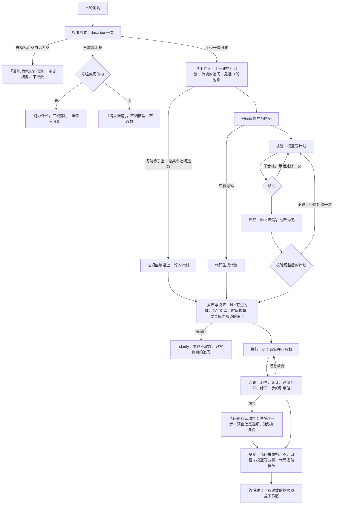

# 2026-10-27 模块技术设计

> **状态：评审通过（2026-10-28）。** 独立评审（`docs/reviews/2026-10-28-G4a模块技术设计独立评审.md`，评的是提交 `5c99cdf`）结论「修后再评」；按评审修订（提交 `9ec35a9`，各条怎么处理的见 §19 末表）后复评通过（同一评审稿末节「复评」）。复评另提的两条重要（N1、N2）、小项与风险 R8、R9 已改进本稿（§19 末表「复评」），不必再评；其中三点口径开发者 2026-10-28 定为 G67、G68。复评通过后另补了 §10 两条（工作区的值带版本号、测试通道的多轮），开发者同意；随后按 `2_landed` 全量复核改了 §6.4（小板订单的订单工厂不与工厂表合并）与 §9.2（还没整理进文字的单，G69），并把 §1.1、§4.2 的步骤先后改成与实测一致。G4b 照本稿写代码，偏离即回改本稿。版本：`paxsz-forge-core` 0.3.7、`paxsz-forge-data` 0.3.2、`paxsz-forge-platform` 0.3.7。文中「实测」是不连库脚本或规划器实测，各处注明。
>
> 业务口径以 `docs/2_landed/` 为准，本稿只写怎么实现。数据侧形态（用哪些源、mart 12 张表、向量声明、同步策略）以决策 2026-10-20「G2 数据源与治理决策」（下称 G2）为准，不重写。引用写法：「总述『X』」指 `2_landed/business_description.md` 的 X 节，「国内『X』」等指各域业务描述。

## 0 结论先行

1. **受控代理**。每轮模型只做一次理解：把问句写成一份计划（技能 + 照抄用户说法的参数 + 步骤间引用）。取数、名字对库、时间换算、权限、计数都由代码和确定性执行器完成。模型另外只在这几处出场：写表格下的分析段（代码逐句核数）、浓缩清单里的问题描述、文字查找时挑说法和判断第三组「可能相关」、写临时统计脚本、从代码列的候选里挑答后建议并写问句（§1.2、§9.5）。执行中出现的信号（引用的上一步为空、结果为空、第三组候选太多）由代码执行默认动作，不调模型（§5.4，开发者 2026-10-31 定）。
2. **计划格式只定义一处**。G4b 用 pydantic 定义计划，规划提示里的格式说明、校验、执行都从它来（§5）。实测 Qwen3-Fast（平台配置的型号）用 p2 提示词，经代码规整与校验后 183 条问句、915 次运行全对 99.9%，同一问句多次一致 97.8%，全部达到通过标准；这批问句偏整齐。另加 25 条不整齐输入、带校验打回后，208 条全对 98.9%、一致 98.1%，错的几乎都会转成追问（§1.3）。这些分数多半是样本内的：几条规整规则是看到错例后加的。
3. **取数只做过滤，派生和数字都进沙箱**。`ctx.data.fetch` 只做过滤、子表关联和排序；当前状态、结案时间、机型拼接这类派生字段，以及一切计数、分档、Top N、跨域合并，都在 `ctx.stats` 沙箱里算，每步一次调用。`handle()` 只拼 spec、搬数据帧、读沙箱结果（§6、§8）。
4. **三域并行，按域分开**。每域一个适配器，同一步的三域取数并行；跨域合并在沙箱里做。国内工厂在 `erp`，单独整表取，在沙箱里按工厂码对应（§6.4）。
5. **权限**。每轮开头调一次 `describe()`，定出可查的域、CAR 报告权限、各域文字查找是否可用。计划不按权限裁剪，执行时取「用户点的域 ∩ 可查的域」。待办任务表行规则用表级映射 `ftable → ftable`，实测编译正确，缺映射时 fail-closed（§3、§4.1）。
6. **文字查找**。按词一路先在 SQL 里用一列去空格文字做超集预筛，再在沙箱里按 `topic_terms.md`「怎么读」精确匹配、屏蔽、分组、计数。按意思一路照 G2 ③④ 调 `ctx.retrieval.search`。第三组每域最多判断 30 张，分批交模型（§7）。有三处细化或改正 G2：分段表加一列 `seg_compact`；N1、N2 改由沙箱计数；第三组按单检索时平台先按向量距离每单留一段再重排（§7.2，G2 已记补记）。
7. **配置**。声明 6 份 `config_files`（第 6 份是本环境的 INFO 站点地址 `link_sites.toml`，G4b S2 加）。表格形态的内置默认值直接解析随 wheel 分发的 `2_landed`，代码里不抄第二份；`glossary`、`intents`、`clarify_dimensions`、`analysis_dimensions` 也在导入时从 `2_landed` 生成（§2.3、§11）。
8. **已定与未决**。G59–G69、G71–G75 开发者同意建议，已落盘（G70「我」按当前用户查在 G4b 收尾时做，决策 2026-11-03「『我』按当前用户查」）（决策 2026-10-27「G4a 设计时补的口径」及其补记）；链接的盐值、密钥写在代码里、命名混淆，站点地址随环境不同、放模块配置（§9.1，决策 2026-10-29「链接站点地址放模块配置」）；自然期间由代码换算日期不算越过数字红线，换算不了的说法追问（§6.1）；对照另一套助手的架构材料后，采纳了规整与校验的准入准则、号码直通、工作区存执行计划等几条（§19）。2026-10-28 独立评审与复评的处理见 §19 末两表。预匹配的结果实测后不附给规划器（§1.3）。探测 W1（处理步骤内容的人名前缀）已执行，结论进了 §12。

## 1 架构

### 1.1 一轮怎么走



- 各步的细节见 §4.2。格式与校验两处打回合计只修一次，修后仍不合格怎么办见第 5 步。
- 介绍不取数，规划前的主数据也不取（§4.2 第 6 步）；换图在图数据仍可用时不取数（§4.3）。

### 1.2 谁做什么

| 环节 | 模型 | 代码 / 确定性执行器 |
|---|---|---|
| 理解问句、拆步骤、多轮指代 | 写计划，参数照抄用户说法 | 查格式、规整、校验规整后的计划，不合格合计修一次（§4.2 第 5 步、§5.3） |
| 名字（机型、系列、工厂、部门、人员、物料、供应商） | 不碰 | 对库里的取值；对不上或对上多个时按总述「必要澄清项」追问（§6.5） |
| 时间 | 照抄原话 | 换成起止日期或 `$relative`（§6.1） |
| 权限 | 看不到 | `describe()` 判域；无权的域不取数；话术按 `privileges.md` |
| 取数 | 不碰 | 按技能模板组 `QuerySpec`（§6） |
| 数字 | 不报数 | SQL 与沙箱（§8） |
| 分析段 | 写 3–6 句 | 只给沙箱产出的事实；逐句核数（§8.3） |
| 文字查找 | 挑说法（话题本身之外）；逐张判断第三组 | 话题范围、候选、上限、排序、计数（§7） |
| 计划外的统计 | 写沙箱脚本（「临时统计」） | 取数与派生、AST 检查、输出形状检查、呈现（§5.5） |
| 异常信号 | 不碰 | 执行默认动作（§5.4） |
| 答后建议（接着问） | 从代码列的候选里挑几条、写问句 | 候选、按会话去重、核对、点了执行存下的计划；纠偏类按钮代码直出（§9.5） |

每轮的模型调用上限：
- 规划 1 次，不合格再 1 次。
- 分析：每段 1 次（一问多段时每段一次，段数不超过步数）。摘要：每张带问题描述列的清单表 1 次（§9.2）。
- 文字查找：每步挑说法 1 次，三域共用一套说法（§7.1 ①）；第三组判断每域至多 3 批、每批 10 张，一步里各域的批次合计至多 3 个同时进行。
- 临时统计每轮至多 1 次，不合格再 1 次（AST 检查、运行出错、形状检查三处合计只修一次）；质疑、换图时照存下的脚本重算，不调模型（§5.5）。
- 答后建议每个取数轮至多 1 次，不重试；在最后一步的事件发出时就开始，与正文分段发出重叠（§9.5）。点了接着问按钮的那一轮不调规划。

最长的常见情形是三域都查的话题查找：规划、挑说法、判断 9 批（分 3 轮）、分析、摘要（三域并行），串行约 7 轮调用，按 §1.3 的单次耗时估约 15–20 秒，S6 实测。平台的 `FORGE_REQUEST_BUDGET_SECONDS`（默认 300 秒）是跨模块调用的熔断阈值，不会中途打断 `handle()`（`docs/dev/04`「取数」）；真正的上限是反代与客户端的超时，待问平台（T8）。

### 1.3 为什么这样分

| 备选 | 否决理由 |
|---|---|
| 固定流水线（意图分类 + 槽位） | 一问多段、先算条件、链式引用都要逐个写死，问法一变就接不住 |
| ReAct，细粒度工具逐步调用 | 每步一次模型往返，延迟随步数涨；模型看得到中间数字，容易顺手算 |
| 多智能体 | 本助手只读、口径固定，没有需要分工的角色，只多出调用和不一致 |
| 模型直接写 `QuerySpec` 或 SQL | 31 张表、三域口径各不相同，派生规则写在 `2_landed` 里几百条；权限和 JOIN 白名单拦得住越权，拦不住口径写错，写错就是错数 |
| 原生工具调用 | 一次回复里写不出「先算 s1，再拿 s1 的第一名查 s2」这种依赖 |

实测用 `scripts/planner_spike/`（对照集 c3 共 183 条，c4 在它上面加 25 条不整齐输入；内网网关与 `ctx.llm` 是同一服务；原始结果在 `runtime/planner_spike/`，不入库）：

| 模型 / 提示词版本 | 计划全对 | 同一问句多次一致 | 其他 |
|---|---|---|---|
| Qwen3-Fast（平台配置）/ p2 + 校验打回，c4 208 条 | 98.9%（模型原样 90.3%） | 98.1% | 每条 5 次共 1,040 次；规划耗时中位数 2.4 秒、P90 3.6 秒（含打回重写）。2026-10-28 按评审后的规整规则重算（`20261028-p2-校验-评3`），复评后再按第 7、17 条新写法与第 7 条的校验重算（`-评4`），分数都不变；第 7 条的追问与校验在这 1,040 份计划上都没触发 |
| Qwen3-Fast（平台配置）/ p2 | 99.9%（模型原样 91.7%） | 97.8% | 每条 5 次共 915 次，格式全部一次合格；规划耗时中位数 2.1 秒、P90 2.9 秒 |
| Qwen3-Fast / p1 | 98.9% | 92.2% | — |
| qwen3.8-27b / p1 | 97.7% | 97.8% | 分析段 98.8%；反思全对（p0）；临时统计 10 题全对（p0） |
| Qwen3-Fast / 临时统计 §5.5 固定形状（S7） | — | — | 临时统计 10 题各 3 次（`20261101-s7-stats`）：一次跑对 83.3%，修一次后 100%（门槛 70%、85%）；要修的 5 次都是运行出错（S-02 三次、S-06 两次），没有被 AST 或形状检查拦下的；写脚本单次耗时中位数 3.9 秒、最长 6.5 秒 |
| Qwen3-Fast / 临时统计提示加「『未填』不参加排名」（2026-11-04） | — | — | 同一 10 题各 3 次（`20261104-s7-stats`）：一次跑对 96.7%（29/30），修一次后 100%；最终没有错例。比上次高可能只是采样波动，不归功于这句提示；10 题都不考「未填」的排名 |
| Qwen3-Fast / p0 | — | — | 反思 45 次全对；临时统计 10 题各 3 次都一次跑对（`20261027-p0`）。两次（含上一行）量的都是旧形状：临时统计每题各给一种输出格式，不是 §5.5 的固定形状；反思的信号多数已改由规整、代码或质疑重查处理，反思不再调模型（§5.4） |

- 分数都按 §5.3 现行的规整与校验，用同一批模型输出重算（不重新调用模型）。剩下的不一致都不影响结果：「其他」类详情的说明措辞不同；统计多给了「占比」一列；BR-005 有时把改善措施拆成第二步按单查详情，有时写成清单的一列，按 §5.3 第 5 条执行出来是同一张表。
- **分数多半是样本内的**：规整第 6、8–11 条与校验第 13 条是看到 p2 的错例后加的，第 6、8、9、11、13 条各只来自一条问句，验证也只是在同一批输出上重算。对照集问句偏整齐（号码前大多写明是什么号；名字对库只在示意名字上试过）。样本外的证据只有 c4 另加的 25 条「不整齐输入」，名字取自条数与真实库同一量级的合成主数据：不算号码直通接走的 9 条，余下 16 条不附提示时全对 93.8%。G5 起按规则编号记下每次改写与打回（§5.3），抽查。
- **另外两次对比**（结果目录在 `runtime/planner_spike/`）：

| 实测 | 结论 | 要点 |
|---|---|---|
| 附不附预匹配提示（`20261027-p2-预匹配-评2`，同一批 104 条各 5 次） | 不附（§4.2 第 4 步） | 整份全对附 97.1%、不附 98.1%；上面那 16 条附 81.3%、不附 93.8%。提示只修好 M-16「TT 今年多少单」的栏，却带出 5 条问句各 5 次全错：把提示里名字所属的域抄成用户点的域（M-16、M-20），「张三：人员」让「张三负责的单」退回跟进人（V-05），15 位数字提示让料号、PN 变成同时成立（CN-043），多加用户没点的问题类型（M-19）。打分前 M-20 的期望放宽为也接受「亮亮工厂」，与 V-03 一致 |
| 校验第 13、15 条打回（`20261027-p2-校验`，208 条各 5 次） | 保留打回 | 打回 1 次（V-13 按建单时间算），重写后改对；第 15 条没拦下过。余下 11 次错：M-08 线上由号码直通接走；M-16 执行时机型对不上，追问并给「TT：巴西的加工厂」选项（§6.5）；CN-002 一次把整套参数又包了一层 `params`，原格式校验会放过、查出不加条件的全部单，§5.3 第 12 条已改为打回（打回后的效果未测） |

- 2026-10-28 的重算另看出：P-07「除了物料问题，其他类型各多少」、P-11「A920 和 A920PRO 哪个问题多」这两句汇总没给时间，模型 10 次都没追问。原打分假设「代码会检查时间缺失」，设计里却没有这条；现由 §5.3 第 17 条改为追问。
- **通用输入**（对照集 c5 = c4 加 32 条，按业务方通用测试案例集改写；`20261028-p4` 跑这 32 条各 5 次，与 `-评4` 合并后离线重出在 `20261028-p4-合并2`）：
  - 非业务输入 18 条（问能力、天气、纯标点、乱码、指令注入、导出身份证、写邮件、算术、入职、销售额、缺关键信息）90 次全对，没有一次写成取数；业务问句被写成寒暄、能力或超出范围的，1,100 次里 0 次；c4 原有 208 条仍为 98.9%。所以**不另加专门判断是不是业务问题的模型调用**（开发者 2026-10-28 同意），这件事留在规划这一次调用里。
  - 没过的都不是这类判断：「一部今年有哪些问题」5 次写成按文字找（S1 在规划提示里补部门说法的示例）；「其中已完成的有多少」5 次写成先列上一轮的清单、再在里面统计，执行时会多一段清单，§5.3 第 5 条后半改为并进统计，离线重算 5 次全对、c4 不变；上一轮没查到时「其中按状态统计」5 次沿用了更早那一轮的条件，原因是交给模型的「上一轮计划」就是更早那一轮的，按 G74 改为由工作区 `last` 给上一轮与结局（§10），并由 §5.3 第 18 条改为追问。
  - 纯标点、乱码模型都转为追问，原因写成「接不上上一轮」，追问的话术可用；去掉标点后为空的输入改由代码先接住，不调模型（§4.2 第 2 步）。3,286 字的合成会议纪要 5 次都抽对了条件。
- **写分析**（Qwen3-Fast，20 条合成事实各 3 次共 60 次，都按 §8.3 现行核数重算；结果目录 `20261028-p0-核数3`、`20261028-n2-fast-核数3`；复评后「这 / 那 + 两」改为比对项数，`-核数4` 重算新提示仍是 100%）：

| 提示 | 含数字的句子里数字都出自事实 | 被拦的句子 | 其中真违规 |
|---|---|---|---|
| 原提示（p0 那批输出） | 95.9% | 7 句 | 7 句：「超过一半」4 句、自定门槛「连续三个月 30 单以上」2 句、自己归纳成「A 系列」1 句 |
| 补三句后（`20261028-n2-fast`，T9） | 100%，门槛 98% | 0 句 | 0 句 |

  补测出来时按旧核数是 98.3%，被拦的 3 句都是误判：「最相近的两张分别是 A 和 B」「采取了两项改进：一是…二是…」数的是事实里一个列表的项数，「前两名明显高于第三名」的「第三名」是名次。按 T10 改核数（§8.1 列表附项数、§8.3「第 N 名」）后这 3 句不再被拦，而原提示那批的 7 句真违规照样拦下，qwen3.8-27b 原提示那批的 3 句真违规（「连续三个月 30 单以上」1 句、「过半数」2 句）也照样拦下，改动没有放过真违规。另有 1 段数字对、意思说虚了（事实「其中已完成的单 1 张」写成「已有 1 张完成相关流程」），核数查不出这类问题，留给 G5 人工看。
- 开发者 2026-10-27 定：沿用平台配置的 Qwen3-Fast。两种型号都不输出思考内容，不需要开关。调用参数：temperature 0，JSON 模式，校验不过修一次。
- 提示词每改一次都要重跑全部对照集，这套工具在 G4b 继续当规划回归用。G4b 写完规划层后，spike 改为调用 `src` 里的计划格式、规整与校验，自己只留打分与报告：两套规则并存时，对照集测的就不是线上那套。S1 已改（2026-10-29）：规划提示、计划格式、号码直通与预匹配、规整与校验都调 `src/factory_issue_module/plan/`；改之前先把 p2 的规划提示逐字搬进 `src`（system 与 240 条问句的 user 逐字相同），改完拿 `20261028-p4-合并3` 的原始结果离线重算，汇总与错例逐字不变。

### 1.4 包结构（G4b 照此建文件）

```text
src/factory_issue_module/
├─ module.py          FactoryIssueModule：manifest、handle()（只调 orchestrator）、validate_config()、jobs()
├─ declarations.py    data_sources、joins、vectorize、config_files、keywords（纯声明）
├─ landed.py          读随 wheel 的 2_landed：术语、场景、澄清项、分析维度、说法清单、部门简称、地区说法、显示名
├─ textnorm.py        剥图去标签、归一化、去空格；治理任务、查询期、沙箱脚本共用，只用 re 与内建函数（沙箱禁止 import html、unicodedata，实测）
├─ turn/              gate.py  orchestrator.py  execute.py（第 6、8、9 步：对库、执行、呈现，S2 加）  greeting.py  workspace.py  errors.py（业务话术）
├─ plan/              schema.py  prompt.py  planner.py  prematch.py  normalize.py  names.py  timespan.py  clarify.py
│                     （原稿的 reflect.py 不建：执行中的信号由代码执行默认动作，§5.4）
├─ domains/           base.py（含翻页取数 fetch_all）  domestic.py  brazil.py  overseas.py  shared.py（主数据）  numbers.py（认号）  enums.py
├─ skills/            list_issues.py  aggregate.py  issue_detail.py  lookup_numbers.py  text_search.py  custom_stats.py
│                     verify_previous.py  rerender.py  introduce.py
├─ text/              terms.py  keyword.py  semantic.py  judge.py
├─ stats/             runner.py  lib/（common.py、views.py、derive_<域>.py、domains.py；detail.py 只拼进详情脚本，S4；custom.py 只拼进临时统计的两次脚本：整理输入帧、口径函数、收尾，S7）  tasks/（各技能的脚本模板；verify.py 是质疑重查的比对，S5；custom_frame.py、custom_run.py 是临时统计的两次调用，S7）  custom.py（临时统计的 AST 检查与形状检查，在 `handle()` 一侧，只查不算）
├─ present/           columns.py  tables.py  charts.py  caliber.py  narrative.py  summaries.py  links.py（站点地址取模块配置 `link_sites.toml`；巴西参数、附件摘要用的三个私有模块只由它引用，§9.1）  export.py  suggestions.py
├─ config/            files.py（槽位、解析、缓存、校验）  defaults.py
└─ jobs/              text_sync.py  spec.py（每域读哪些源列，S6 加）  fingerprint.py  read.py（按单分批读原文，S6 加）
                      clean.py  steps.py  segment.py  ddl.py  write.py
```

- `stats/lib/` 的函数只 import 沙箱白名单里的库：单测直接 import 它们测，运行时由 `stats/runner.py` 按源码文本拼进沙箱脚本。这样派生规则只有一份。`src` 里其他地方不 import `stats.lib`、`stats.tasks`，否则就是在 `handle()` 进程里算数（§15 护栏查）。S2 实测补的三条：沙箱没有 `__build_class__`、`getattr`、`hasattr`，`stats/lib` 不定义类、不用这几个；各文件之间的 `from factory_issue_module… import` 与 `from __future__` 由 runner 拼接时去掉，所以各文件的顶层名字带前缀（`fi_`、`vw_`、`cn_`、`br_`、`os_`、`dm_`、`ag_`、`ls_`）免得重名；任务模板里写一行 `PARAMS = {}`，runner 换成本步参数的 JSON 字面量。

## 2 manifest 草案

```python
manifest = ModuleManifest(
    code="FACTORY_ISSUE", name="制程问题查询助手", description=DESCRIPTION, version=MODULE_VERSION,
    profiles=["structured-query", "semantic-retrieval", "governance-etl", "stats-sandbox"],
    intents=landed.intents(),                     # §2.1
    keywords=KEYWORDS,                            # §2.1
    dependencies=[],
    require_privileges=True,                      # 决策 2026-10-18「没拉到权限时拒绝本轮」
    data_sources=DATA_SOURCES,                    # §2.2
    field_mappings={"info": {"info.dbo.tbTask": {"ftable": "ftable"}}},   # §3
    vectorize=VECTORIZE,                          # G2「向量表」的 3 条，原样
    config_files=CONFIG_FILES,                    # §11
    clarify_dimensions=landed.clarify_dimensions(),
    analysis_dimensions=landed.analysis_dimensions(),
    glossary=landed.glossary(),
)
```

- 平台运维在测试环境建好 mart 库、登记别名、首轮建出向量表之前，发到测试环境的预发布包不声明 `forge_mart_factory_issue` 别名、`vectorize` 与 `jobs()`：声明了未登记的别名，平台启动期体检把**本助手整个隔离下线**（`module_quarantined`，`reason=data_source_missing`），连不依赖 mart 的结构化查询也用不了；声明的向量表在连得上的库里不存在，同样隔离（`reason=vector_scope_missing`，§16）。平台与其他模块照常启动。`docs/dev/04`「启动即校验」、`08`、`11` 写的是「拒绝启动」，与 platform 0.3.7 的代码（`main.py` 调 `registry.enforce_startup`）不符，已写平台反馈（`docs/platform-feedback/2026-10-30-启动期体检是隔离模块而文档写拒绝启动.md`）；本条按代码写，不连库脚本实测（2026-10-30）。G4b 分片顺序见 `docs/handoffs/2026-10-27-G4b编码任务单.md`。

### 2.1 intents 与 keywords

- `intents`：解析总述「常用查询场景」表的「示例问题」列，按「 / 」拆开，现为 25 句，不另写。
- `keywords`：代码常量，只收本助手独有、用户真会说的词：制程问题、制程单、问题单、国内制程、巴西制程、海外制程、停线、重启、结案、不良率、跟进部门、当前责任人、加工厂、CAR 编号、8D、投诉单号、发货单号、问题现象、类似问题。「机型」「物料」这类通用词不收，免得抢别的模块的问题。G4b 接平台路由后再调。

### 2.2 data_sources 与 JOIN 边

| 别名 | kind | tables | joins |
|---|---|---|---|
| `info` | sqlserver | 31 张，三段名，照 `privileges.md`「权限里要列出的表」去掉实例段 | 主表 ↔ 本域每张子表，共 14 条，只允许 INNER |
| `erp` | sqlserver | `paxbase.dbo.PaxFactory` | 无 |
| `forge_mart_factory_issue` | postgres | 9 张：三域各 `_issue_text`、`_issue_seg`、`_issue_vec`；`_issue_vseg` 不列（G2）。表名在这里、检索的 `table=` 与 `VectorizeSpec` 三处都写不带 `public.` 的形式，同 G2 | 无 |

| 左表 | 右表 | 关联列 |
|---|---|---|
| `CoreINFO.dbo.ZCTracking_ProblemList` | `ZCTracking_ProductNames`、`ZCTracking_ProblemSteplog`、`ZCTracking_ProblemOrders`、`ZCTracking_XBOrders`、`ZCTracking_OtherOrder`、`ZCTracking_RiskStream`、`ZCTracking_CheckReason`、`ZCTracking_PossibleInvCode`、`ZCTracking_ProblemFiveWhy`（均 `CoreINFO.dbo.`） | `ID` = `ProblemId` |
| `CoreINFO.dbo.BrazilProblemList` | `BrazilProblemProcess`、`BrazilProblemCost`、`BrazilProblemPO` | `ID` = `ProblemID` |
| `CoreINFO.dbo.OverseasProblemDetail` | `OverseasProblem_StepLog`、`OverseasProblem_DeliveryOrder` | `Id` = `ProblemId` |

- 只声明这 14 条，用途只有一个：子表取数带上主表的筛选条件（§6.2），省得先取主表 ID 再分块 `IN`。
- 主数据（人员、部门、工厂、存货、供应商、产品、PN、现象）都单独取，在沙箱里翻译。这些关联多是文本键或逗号多值，写不成等值连接（`table_relations.md`「不能写成一条普通等值连接的关联」）；剩下几列单值关联不值得各审一条边。CAR 报告（单独授权）、待办任务（文本键、全公司共用）、文档清单（全公司共用）都不连。
- 实测（与 §3 同一脚本）：边按表名尾段匹配；`CoreINFO.dbo.*` 与 `info.dbo.*` 在同一别名下可以互连；子表的继承权限编进它自己的 `ON`，形如 `AND EXISTS (SELECT 1 FROM [CoreINFO].[dbo].[ZCTracking_ProblemList] AS _forge_st0 WHERE _forge_st0.[ID] = [ZCTracking_ProductNames].[ProblemId] AND …)`；没声明的边抛 `JoinNotDeclared`。

### 2.3 从 2_landed 生成的声明与防漂移

- `landed.py` 读随 wheel 分发的 `factory_issue_module/_landed_docs/`（`pyproject.toml` 的 force-include）；源码树里没打包时读仓库的 `docs/2_landed/`。
- 解析的表：`glossary.md` 术语表 → `glossary`；总述「常用查询场景」→ `intents`；总述「必要澄清项」→ `clarify_dimensions`；总述「初步分析维度」→ `analysis_dimensions`；`topic_terms.md`「清单」、总述「部门名称怎么对」的简称表、国内「加工厂」的地区说法表 → 三份配置的内置默认值（§11）；`db_description/` 各表字段表的「用户可见显示名」→ 列显示名（§9.1）。
- 防漂移：信源只有 `2_landed` 一份，代码里没有副本。标题改名或列数变了，解析在导入时抛错，模块加载失败；单测逐张表断言解析得出、行数与源文件一致，CI 先拦住。`glossary.md` 头部那句「改本文件须同步 module.py」在 G4b 改成「module.py 在导入时读本文件」。
- 规划提示只拼 `glossary_section`，不拼澄清项：重名、多工厂、系列对不上这些情形要查库才知道，由代码判断（§5.3）。写分析的提示拼 `analysis_section`。

## 3 field_mappings 逐列锚定

| 别名 | 表 | 协议字段 | 物理列 | 映射级别 | 依据 |
|---|---|---|---|---|---|
| `info` | `info.dbo.tbTask` | `ftable` | `ftable` | 表级 | `db_info_dbo_tbTask.md`「ftable」；`privileges.md`「风险订单流程表与流程待办任务表的配法」 |

- 用表级映射：同一 `info` 别名下的其他表没有 `ftable` 列，源级映射会让以后任何表上同名字段的规则都编到这一列上。
- 协议字段名与物理列同名，映射是恒等的。权限平台实际下发的字段名若不是 `ftable`，只改这一行的键。
- 本模块取数时另外自带同样的业务表名条件（决策 2026-10-26「待办任务表行规则只放行两类」），并加 `fstat` 为「已接受」、`frecID IN (国内单 ID 的十进制文本)`。
- mart 别名不填（G2）。主表、子表、主数据上没有行列规则，不需要映射。

实测（不连库：`ScopedDataAccess` + 只记录 SQL 的假连接器，SQL Server 方言；权限照 `privileges.md` 的 v1.3 写法构造；G4b 收进单测 J-P12）：

```text
① 有行规则，有表级映射
SELECT [tbTask].[frecID], [tbTask].[ftable], [tbTask].[fuserID] FROM [info].[dbo].[tbTask] AS [tbTask]
WHERE (([tbTask].[ftable] IN (:_forge_p_0, :_forge_p_1) AND [tbTask].[fstat] = :_forge_p_2
        AND [tbTask].[frecID] IN (:_forge_p_3, :_forge_p_4)))
  AND (([tbTask].[ftable] IN (:t0s_0, :t0s_1)))
ORDER BY (SELECT NULL) OFFSET 0 ROWS FETCH NEXT 10001 ROWS ONLY
params: t0s_0/t0s_1 = ZCTracking_ProblemSoftware3 / ZCTracking_PreventionConfirm（权限段）；_forge_p_* 为本模块自带条件
② 有行规则，缺映射
MappingMissingError SCOPE_MAPPING_MISSING：协议权限字段 'ftable' 缺少物理列映射（fail-closed 拒绝整个查询）
③ 平台「全放开」权限（测试通道、调试对话）
同 ①，权限段编成 AND 1 = 1；本模块自带的业务表名条件照样在
```

## 4 每轮编排与事件序列

### 4.1 权限前置（`turn/gate.py`）

- 每轮开头调一次 `ctx.data.describe()`。它按当前用户的权限过滤、不访问数据库，与取数共用同一段表级判定。由此得出 `DomainAccess`：三张主表各自可见 → 该域可查；国内可查且 `info.dbo.tbIQCreportOut` 可见 → 有 CAR 报告权限（CAR 只在国内物料问题上展示）；本域 `_issue_text`、`_issue_seg`、`_issue_vec` 三张都可见 → 该域文字查找可用。规则见 `privileges.md`「域闸门」。表按（数据源别名, 声明的表名）比对。
- 整轮复用这一结果。取数时若仍撞上 `TableDenied`，以拒绝为准，把该域改记为无权，回答与无权相同。
- 没拉到权限时，平台在模块执行前就中断本轮（`privileges.md`「没拿到权限时」），模块不处理。
- `ctx.data` 为 None，或 `describe()` 抛 `PermissionDenied`（含 `PrivilegesRequiredError`、`InvalidTableScopeError`）时，拿不到可用的权限判断，按「没拿到权限」答，见 §14。G4b S0 实测（platform 0.3.7）：Admin 调试对话与 `forge dev serve` 默认授权树给的是空权限 `{}`，本模块声明了 `require_privileges=True`，`describe()` 即抛 `PrivilegesRequiredError`；测试通道给的是全放开权限，不受影响。已写平台反馈（`docs/platform-feedback/2026-10-28-调试对话与本机平台的授权树带空权限.md`）；本机 `forge dev serve` 用 `--tree` 指一份带权限的授权树来验。

### 4.2 一轮的步骤（`turn/orchestrator.py`）

1. **权限前置**，见上。
2. **代码先接住的两种**，都不调模型、不取数：
   - 问句去掉标点与空白后为空（「？？？」「……」）：按 §14「规划超时或修一次仍不合格」答，有可查的域时附能力介绍的 3 个按钮。三域都无权时同样这样答，不再当寒暄。
   - 三域都无权：用代码规则判断是不是寒暄或问能力（问句去掉标点后是问候语，或含「你能」「你会」「能做什么」「怎么用」一类说法）。是就做能力介绍（§9.4）；不是就只答「您还没有任何域的查看权限，请先申请」。
3. **读会话工作区与最近几轮对话**（§10）。上一轮的执行计划交给规划器，§5.3 第 17 条也要用它。本轮问句与上一轮追问某个选项的 `query` 完全相同时，直接把选项填进上一轮的计划，跳过第 4、5 步；填好的计划照常过第 6 步（域 ∩ 本轮可查的域、名字对库、时间换算）。本轮问句与上一轮某个接着问按钮的 `query` 完全相同时，同样跳过第 4、5 步，直接用那个按钮存下的计划（§9.5）。
4. **号码直通与预匹配**（`plan/prematch.py`）：
   - 号码直通（开发者 2026-10-27 同意）：问句去掉号码之后，只剩号的种类词（订单号、CAR 编号、投诉单号、PN……）和固定套话（查一下、这张单、是哪张单、关联了哪些制程问题……）时，不调规划。只有一个问题编号时走单张详情，其余按号查单，号码原样交认号表（总述「按编号查单」）。问句里还有别的意思（时间、域、「现在谁在处理」）就不直通，交规划器。直通生成的计划不经第 5 步，照常过第 6 步：号只属于无权的域时不查（§14、J-P05）。种类词与套话是代码里的固定清单，不放配置；每次直通记一条日志。离线：对照集 208 条里命中 16 条，全部判对，没有误命中。认作「PN 名称或海外 PO」的串去掉连字符后像机型名（「A920-PRO」即 A920PRO，总述「机型与系列怎么对」忽略连字符），用户又没说是 PN、PO 时不直通，交规划器；S2 起再传可查的域的机型清单，对得上的同样不直通（S1 评审 M2）。不直通的代价只是一次规划调用。机型清单只会多拒几种直通，所以先不带清单判断，会直通时才取主数据、带上清单再判断一遍（第 6 步「主数据按需取」）。
   - 预匹配：在可查的域的主数据里找问句里整串相同的工厂、部门（含简称）、人员、机型、系列、供应商名与地区说法，按写法认号码。只给校验第 15 条、§5.3 第 7 条和名称对不上时的追问选项（§6.5）用，不写成事实附给规划器：实测附了反而更差（§1.3）。它按子串找名字，两个字的人名会误中常用词（「上周国内」里的「周国」），所以不拿它校验人名。
5. **规划、规整与校验**（§5、§5.3）：一次模型调用写计划，先查格式（第 12 条）；格式合格后按 §5.3 规整（改写，或改为追问，如第 7、17 条），再对规整后的计划做其余校验（第 7 条的校验一半、第 13–16 条）。格式或校验不过时带着错处修一次，两者合计只修一次，修后的计划再规整一遍。修后格式仍不合格：第一次只是校验被打回的，用第一次的计划，否则按 §14 答；只是校验仍不过，按修后的计划执行（第 13 条写明了这时怎么告诉用户）。顺序同 spike 的 `run_plan`，§1.3 的分数按它得出。
6. **对库与换算**：每步的域取「用户点的域 ∩ 可查的域」（用户没点域时即可查的全部域）；名字对库（§6.5）；时间换算（§6.1，换算不了的说法产生追问）；要查库才知道的追问（重名、多工厂、系列对不上、名称对不上、手填订单号、认不出的号、按地区对上多家）。S2 起：按可查的域取一次主数据（`domains/shared.py`：机型与系列的取值清单、部门、国内工厂、供应商整表，人员按问句里 2–4 个汉字的连续片段与英文词取姓名完全相同的人；S3 起另取巴西、海外的，见 §6.2「主数据」），交规划器作第 7 条的 `classes`、第 15 条与选项的 `entities`、号码直通的机型清单。主数据按需取、一轮至多一次（`turn/orchestrator.py::_LazyMaster`，经 `Planner.plan` 的 `enrich` 补进规划输入，决策 2026-11-01「寒暄不取主数据与追问用例的取数断言」）：号码直通会直通时、模型写的计划不只有不带条件的 `introduce` 时、追问选项直填时取；模型第一次写的计划只有不带条件（没有 `filters`、`compare`）的 `introduce` 时不取，寒暄、问能力、只读请求、管不着的事一条 SQL 都不发（第 7 条只看 `filters`，第 4 条把对象写法的 `compare` 改成 `filters`，校验遇到 `introduce` 在第 13 条之后就返回，不带条件时不带主数据规整出来一样）。第一次格式不合格的在修一次之前取，修后才写成介绍的也取过了。计划里沿用、问句里没有的姓名在这一步再按姓名取。对库在 `turn/execute.py::prepare` 交各域适配器（`domains/<域>.py::resolve`），引用前一步结果的条件到执行时再对。枚举说法（问题类型、等级、状态、产品在制属性、处理结果、IQC 意见）对不上时同样在这一步追问，列出可选值（总述「通用筛选规则」）。几个域一起查时（S3）：名称或取值只在某些域对不上（「柯洱斯」只是国内的工厂、「待提交」只是巴西的状态），对不上的域不计入并写明（「巴西没有加工厂『柯洱斯』，巴西未计入」），不追问；各域都对不上才照常追问；某一域要追问（对上多家工厂、重名）时照常追问，问话里先写明其余域没对上的（XC-010「国内没有加工厂『伊朗工厂』，巴西没有……。海外『伊朗工厂』对上了这几家工厂」）。本域没有对应列的条件（巴西的当前责任人、海外的系列、国内的统计日期、点名的类型本域一个都没有）同样整域不计入（`DomainStep.excluded`，总述「通用筛选规则」默认范围）。机型、系列、加工厂的取值来自前一步（`{"ref": …}`）时（G90，决策 2026-11-04「『未填』不参加排名」）：各域只用本域对得上的，加工厂按名称完全相同对（引用值就是库里的名字，不走包含、相近匹配，免得对上多家又去追问），对不上的写进开头（「国内没有加工厂「CA」「TT」」），一个都对不上的域不计入；用户自己说的名称照上面的规则追问。条件取值是「未填」「没填」「空」一类说法时（问题等级除外，G89）不去对库，追问一句「目前不能筛出没填机型的单（单上的『未填』表示没填）」（`base.blank_ask`，带 `missing`，几个域一起时不加域名前缀）。
7. **追问**：计划本身是 clarify，或第 5、6 步产生了追问 → 发 `Event.clarify`，写 `pending_clarify`，本轮结束（§4.4）。
8. **执行**：按步骤依赖顺序执行，没有依赖的步骤并行；每步内各域的取数并行，然后一次沙箱调用（§6、§8）。后一步引用的值（`top1` 等）取自前一步沙箱给的 `refs`；反思的信号也出自沙箱结果，出现时反思（§5.4）。执行与呈现除了规整后的计划，还要用规划结果（`plan/planner.py::PlanResult`）上的两样，S2 已接上：`inferred`（第 7 条按库里的取值定的类，开头写「「X」按 Y 理解」；模型本来就放对了类时也有）；`check_errors`（修一次仍不过的校验，第 13 条时开头写「「今年」按建单时间理解」，答后按钮「按结案时间算」（问句「改按结案时间算」，§9.5）；第 13 条的比较由 `normalize.basis_mismatches` 给，校验与执行共用）。只拿最终计划去执行就写不出这两句（S1 评审 A4）。
9. **呈现**（§9），**答后建议**（§9.5），**写工作区**（§10，只有取过数的轮次覆盖 `turn`、`results`、`charts`）。

### 4.3 各技能的事件顺序

| 技能 | 事件顺序 |
|---|---|
| `introduce` | `delta`（能力介绍，或只读请求、超出范围的说明）→ `suggestions` |
| `clarify` | `clarify`（只发这一个） |
| `list_issues` | `delta`（提示行：无权的域、「按 X 理解」（第 7 条定的类、第 20 条助手按意思定的取值与默认张数）、沿用的条件，有才给）→ `delta`（结论，模型写；只有一两张、没写出来时 `list_issues.conclusion` 的模板句，带上第 20 条定的条件，只列了前几张时先说一共几张、列了哪几张）→ 每域一节：`delta`（小标题「国内问题单（N 张）」，只列了前几张时「国内问题单（共 N 张，列出不良率最高的 10 张）」）→ `table`（不带标题）→ `delta`（表格只列了前几张时那句）；几域时没有单的域原位置一句 → `delta`（统计口径）→ `delta`（导出链接，超阈值或用户要导出时）→ `suggestions` |
| `aggregate`、`custom_stats` | `delta`（提示行；临时统计「以下为临时统计」在最前）→ `delta`（结论；问「哪个最多」时第一名必须点到，模板句是 `aggregate.opening`）→ 每张表一节：`delta`（小标题「按问题类型统计（合计 N 张）」）→ `table` → `delta`（第 N 名并列那句）→ `chart`（分组 2 组及以上）→ `delta`（统计口径）→ `suggestions` |
| `custom_stats`（S7 的细节，§5.5） | `delta`（开头「以下为临时统计。」，再给计入的域、时间与张数，几域时各域张数，数来自沙箱 ①）→ `delta`（分析，3 行以上时）→ `table`（标题「临时统计：时间」，表头由模型起，问题编号不带链接）→ `chart`（模型给的图型只作首选，`charts.choose_custom`）→ 本步有海外、脚本用到不良率时海外原文那一句与逐单原文表（同统计）→ 统计口径（整轮合并）→ `suggestions`（「最近」的放宽或换时间范围在前；接着问只有换时间，§9.5）。0 张时照实说没有、不调模型；关掉时、没算出来时、一轮里的第二个只答一句，前两种附能力介绍的 3 个按钮 |
| `issue_detail` | `delta`（抬头）→ 各块 `delta`，处理过程、订单、发货单、费用明细、5Why 用 `table` → `suggestions`；没有数字结论时不附统计口径，给了发货单订单数量合计、费用合计时附一段（S4）。不写分析段（用户在问某一张单的细节，AGENTS.md「不分析的三种情形」） |
| `lookup_numbers` | `delta` → `table` → `suggestions`。几个问题编号合成一张表（一号一行，列用清单默认列另加所属域与当前状态，查不到、无权的在该行注明）；其余每种号每个域一张表，开头写按什么号找到几张、问题类型与是否结案的分布（沙箱给的数），料号、PN 两处都命中时分开列（J-D03）；号是几种都没有时写明按哪几种号查过（S4） |
| `text_search` | `delta`（提示行：无权、文字查找暂不可用、本域没有点名栏目而未计入的域，按意思找暂不可用或不保证完整，本次按哪些说法找；用户问的正是说法清单「说明」里「问『X』：…」那种问法时照写那一句）→ `delta`（结论，合计 3 张以上时加粗的结论句加要点，见下文「结论的结构」；模板句是 `text_search.fallback`）→ 每域一节：`delta`（小标题「国内与非接有关的单（35 张，另有 3 张可能相关）」「国内最相近的问题（5 张）」）→ `table`（几组合在一张表里，「分组」一列标明）→ `delta`（各组几张与含义、表格只列了前几张）；几域时没有单的域原位置一句 → `delta`（说法有模型挑的或提的时可以增减那句、候选太多时加条件那句）→ `delta`（查找说明，一轮里还有别的问法时为统计口径，含「文字查找」一项与时效一句）→ 导出链接 → `suggestions`（最小版的几个在前，S6b，见 §19「G4b S6b 实现时补定的几处」；再接着问，§9.5） |
| `verify_previous` | 按工作区 `turn` 里上一轮的执行计划（§10）重新执行一遍，域取「上一轮查过的域 ∩ 本轮可查的域」；一次沙箱调用把新结果与存下的单 ID、张数比对，只比本轮可查的域 → `delta`（复核结论：一致，或哪些单多了、少了）→ 有变化时 `table`（变化的单）→ `delta`（当时按什么理解、按什么口径算）→ `suggestions`（其他理解）。上一轮计划读不到时按「接不上上一轮」追问（总述「接着上一轮问」）。S5：重放用存下的起止日期，只跑到沙箱为止、不写分析（这一轮只有规划一次模型调用）；比对在 `stats/tasks/verify.py`，存下的单到了每域 5,000 张的上限时这一域只比张数、不逐张比（不把截掉的那截报成新查到，S5 评审 A1）；变化的单表头「问题编号、所属域、变化」，「变化」写「这次新查到」「这次没查到」，有「这次没查到」的单时表格下面说可能的原因（已删除，或改了状态、类型等），不替用户猜是哪一种（开发者 2026-10-30 定，总述「表格列名」）；上一轮查过、本轮已无权的域写「现在没有查看权限，这次没有重查」；详情照这张单现在的样子重新给出 |
| `rerender` | 先把图数据所属的域与本轮可查的域比对：都还可查，就用工作区里上一轮的图数据按新图型重画；有已无权的域，就按上一轮的执行计划在本轮可查的域里重跑，并写明不再包含哪个域 → `chart` → 改了图型时 `delta` 说明原因；图数据读不到时同样重跑（总述「什么时候配图」）。S5：只有一组时说画不了图；「不要图」只答一句；上一轮是清单、单张单详情时照实说没有图可换 |

- **先给结论**（开发者 2026-11-02 定，总述「先给结论」）：清单、统计、文字查找、临时统计的结论在表格与图之前；一段里几张表（统计按域分别给的几张）共用一段结论。结论要等模型写完、核完数，所以表格比原先晚出来一会儿。
- **结论的结构**（开发者 2026-11-03 定，决策 2026-11-03「结论的要点与需关注的单」，§8.3）：上表各行的「结论」那个 `delta` 是加粗的结论句、至多 4 条要点、「需关注」一小段，块之间空一行，仍是一个 `delta`。要点与需关注的单由沙箱给（结果里的 `insights`）；一问里几段统计时只在第一段给。类似问题是加粗的结论句加它专用的要点（时间、结案后又出现、共同点、未结案），没有需关注（G86，同一决策的补记）。只有一两张时照旧是一句话。
- **回答骨架**（开发者 2026-11-03 定，决策 2026-11-03「回答骨架与排版」，`present/layout.py`）：提示行 → 结论 → 每域（每表）一节 → 结尾。原先程序写的开头一句不再与结论并列，改作模型没写出来时的模板句；各域张数写在小标题上，不在开头逐域说。小标题由程序写成正文（`layout.heading`），表格事件不带标题：实时显示与落库回读是同一个样子，golden 的 `answer_contains`（只拼正文）也看得到小标题。块之间的空行只由 `turn/execute.py::run` 里的 `layout.Spacer` 放：各处产出的正文去掉前后空行，块前加一个空行；表格、图前后的空行由平台投影时自己带，这里不补。一问多段的段标题用三级标题（`### 1. …`），比各域小标题（粗体）高一级；结尾的统计口径或查找说明前加一条 `---`（开发者 2026-11-03 看样例后定，`layout.SECTION_STYLE`、`layout.FOOT_RULE`）。`---` 前面总有 `Spacer` 给的空行：紧贴一段文字的 `---` 会把那段文字变成标题。
- **进度与分段发出**（同上）：规划之前发 `progress`（`plan`，「正在理解问题」），执行之前发 `progress`（`query`，「正在查询并整理结果」）。`handle()` 经 `present/pacing.py::paced` 转发：已定稿的 `delta` 切成小段、每段 1–8 个字随机（开发者 2026-11-02 建议，固定字数看着像一格格吐字）、隔 0.02 秒发一段（Markdown 链接不切开），一轮最多为此多花 2.5 秒，超过之后照常一次发出；其他事件原样转发。模型调用仍是一次拿回整段，分析段照旧核完数才放出（§8.3），所以这是显示上的效果，第一个字出现的时间不提前。单测的假环境关掉这两样（`module.live = False`），分段与进度另有单测。
- **一问多段**：每步一段，段首 `delta` 是段标题（`layout.section_title`）；提示行只在第一段；统计口径合并成一段放在最后（总述「一问多段」）。某段失败或无权，就在原位置用一句业务话说明，用 `delta`，不发 `error`。整轮都没有结果时才发 `Event.error(code, message, fatal=True)`（§14）。
- 链式步骤里某一步没有结果（引用的 `top1` 为空、清单为 0 张），写明并停在这一步，后面依赖它的步骤不执行。引用值为空时在执行之前拦下（`turn/execute.py::_ref_gaps`），写「前一步没有得出可以承接的机型，这一步和后面依赖它的步骤都不再查」，不取数：各域对库会跳过取值为空的条件，不拦就成了查全部。重放（质疑重查、换图）同样跳过这一步。
- **排名不含占位取值**（G87、G88，决策 2026-11-04「『未填』不参加排名」）：维度说明带 `unranked`（「未填」「未识别机型」「其他（未识别）」，`domains/base.py::UNRANKED`，`build_dims` 给除时间维度外的每个维度）。沙箱排名、前 N 名、并列、`top1`、`top_values`、比较两个时段的「增加的」都只看其余取值，占位取值的行排在表格最后、不占名次，张数（与国内机型、系列下的物料单张数）放在段上的 `unranked`，不进 `facts`；呈现时程序在结论句后写「另有 N 张没填机型（其中物料单 M 张）」，同一句也作【说明】交写结论的模型，免得它再写一遍（`skills/aggregate.py::unranked_note`）。只有占位取值一组时模板句写「这 N 张单都没填机型，没有可以排名的机型」，不调模型写结论。`top_values` 没写名次数时同 `top1`。清单、概况、按文字找单交模型的分布（「按问题类型」「按加工厂」「按机型（前五）」）同样只放参加排名的取值，占位取值放「不参加排名的 X」（沙箱 `stats/lib/common.py::fi_named_facts`，`FI_UNRANKED` 与 `UNRANKED` 同一份，单测比对）；模板句接着写「另有 N 张没填问题类型」（`skills/aggregate.py::distribution_blanks`）。按号查单的分布照列全部，占位取值排最后。巴西、海外大机型有值但一段都对不上时视图另带 `_machines_unknown`，机型维度的 `unknown_col` 让这张单归「未识别机型」而不是「未填」。临时统计的提示加一句「『未填』这一组不参加排名：放在 rows 最后」（开发者 2026-11-04 内网重跑 `20261104-s7-stats`，Qwen3-Fast、10 题各 3 次：一次跑对 96.7%，修一次后 100%，达标；这 10 题都不考「未填」的排名，只说明这句没把原来会写的脚本写坏，见 §5.5「实测」）。
- **详情与按号查单的几处**（S4，`skills/issue_detail.py`、`lookup_numbers.py`、`turn/execute.py`）：
  - 认号在第 6 步（`domains/numbers.py`）：一个能查的号都没有、又有认不出或位数不对的，追问、不取数（XC-012、XC-013）。认不出时给「订单号」「料号或 PN」「投诉单号」「发货单号」四个选项；点了发回「原话（订单号）」，下一轮模型多半仍写 `kind_said: null`，`numbers.recognize` 按问句末尾认回选项，不再追问。
  - 几步详情各给一个问题编号、只问当前状态、当前责任人、概况、跟进人（或没说要看什么）时，执行前并成一步按号查单（`execute.merge_details`）：对照集 XC-005、M-03 两种写法都判对，执行出来是同一张表（总述「按编号查单」一次给多个号）。
  - 详情引用前一步的结果：`s1.issues` 给前 3 张（`DETAIL_MAX`，多了写明只给前 3 张）、`s2.max_defect_rate_issue` 给那一张；只要原因或措施时按 §5.3 第 5 条并进清单。
  - 国内手填的带连字符的订单号：给的号查不到、但有以「该号-」开头的号时，只有这一个号就追问（按钮是候选号），点了之后沙箱按问句末尾的号查（`base.trailing`），不再追问；几个号时在原位置列出候选。
  - 详情、按号查单在 `run` 里各走自己的执行函数（`_run_detail`、`_run_lookup`），不经清单与统计的对库（`_resolve`）：号与单号不对名字，按号定域。
- **文字查找的几处**（S6b，`skills/text_search.py`、`turn/execute.py`）：
  - 第 6 步的条件照清单那一套对库（`execute.RESOLVED`），引用前一步结果的到执行时再对；`run` 把这一步交 `text_search.run_step`，返回同一个 `StepOut`：`extra` 记找的是什么与用的说法（写进工作区 `results.texts`，§10），`buttons` 是本步的可点选项，排在模板按钮的位置。
  - 结果为空、时间是「最近」的默认读法时，不预查放宽选项的张数：重跑一遍要再判断第三组，只有清单、统计、临时统计这样做（`_relax_buttons`；临时统计只跑沙箱 ①）。
  - 第三组候选太多（S7，§5.4）：某域按意思找取回的张数到了上限，或带 ＊ 的候选并进来后超过 `judge_max` 时，第二段的「本次按这些说法找」之后加一句「『可能相关』一组的候选较多，来不及逐张看完，只看了最相近的一批；可以加上时间、机型等条件再查」，只点用户还没给的条件（时间、机型、加工厂里的前两个，都给了时说把条件再收窄）。不写进统计口径。这句判据比的是取回的张数与上限，不产出给用户的数（`text_search.crowded_hint`）。

### 4.4 追问的形状

- `Event.clarify(question, recommendations=[{id, name, label, query}, …])`。按钮的 `query` 有两种（S5 提交后改，开发者 2026-10-30 定，§19「S5 提交后 INFO 前端按钮显示问题的处理」：INFO 网页前端把 `query` 当按钮文字显示、点了照发）：
  - **问句全文**：本轮原话加选定的值，如「上个月惠州工厂的问题有哪些（惠州百富）」，能单独成立、点了之后能路由回本助手，重新规划也说得全。模型写的追问、第 17、18 条改成的追问用它（点了要重新规划）；代码给的追问在工作区写不进去时也用它。
  - **选项本身**：代码给的追问、`pending_clarify` 写进去了（`turn/workspace.py::write_pending` 返回写成了）时，`query` 就是选项文字（「惠州百富」「是」「订单号」「990002-1」「近 30 天」「TT：巴西的加工厂」，`plan/clarify.py::short_recommendations`）。问句全文照下面几条拼好，存在 `pending_clarify` 该选项的 `full` 里。所以编排先写 `pending_clarify`、再按写没写成挑按钮；执行时才知道的追问（手填订单号候选）也由编排在写完之后发（`turn/orchestrator.py::_write_after`）。
- 模型自己写的追问分两种（开发者 2026-10-29 定，§19「拆开量」）：
  - **接不上上一轮**：`query` 直接用选项文字，不拼原话。原话多是「？？？」、乱码或「帮我看一下详情」（对照集 U-04、U-05、U-15 都落在这一种），拼出来没有意义。
  - **「其他」指什么、现象太泛**：发问句全文，原话加选项（「以前有没有类似的情况（开机花屏）」「有哪些其他问题（问题类型为『其他』）」）。这两种的原话总有意思；实测模型写的选项多是「问题类型为『其他』」「除某些工厂以外的单」这类短语，与总述「必要澄清项」的示例回答（「开机花屏、按键失灵、外壳刮伤」）同一写法，单独发出去不成问句。在规划提示里要求模型写成完整问句，会让别的问句回退，没有采用。
  代码给的选项（缺时间、名称对不上、重名、多工厂）的问句全文同样是原话加选项。
- 时间说法认不出时（§6.1），问句全文是把原话里那段说法换成选定的时间（「国庆以来国内有多少单」→「近 30 天国内有多少单」），不在句末追加：追加的话新问句里仍带着认不出的说法，规划器照抄进 `time`，又会追问一次（G4b S1）。原话里找不到那段说法时照上一条追加。
- 按钮至多 4 个。`label` 是一句说完的话，不超过 30 个字（`plan/clarify.py`，决策 2026-11-04「按钮文字不截断」）：不超过就用选项全文，不用省略号截断。
- 同时把 `{计划, 待填的参数, 选项}` 写进工作区 `pending_clarify`。下一轮问句与某个选项的 `query` 完全相同时直接填参数、不重新规划；工作区写不进去时按钮发的是问句全文，就当普通问句规划。按钮只写了选项、隔了一轮才点（`pending_clarify` 已删）时，「惠州百富」这几个字也当普通问句规划，规划器靠会话历史与上一轮计划理解，理解不了就追问；用户看得见，代价是多问一轮。S5 的实现（`turn/workspace.py::write_pending`、`fill`、`apply_fill`）：
  - 只有代码给的追问写 `pending_clarify`：第 6 步的追问（名称对不上、对上多个、重名、类型 / 状态 / 等级 / 取值对不上、是否类、币种、认不出的号）、时间认不出、执行时才知道的手填订单号候选。追问在 `domains/base.py::Ask` 上带着对不上的那个取值（`said`）与怎么填（`fill`）：替换取值（`value`，含「某部门的某人」与「A、B」两家工厂）、「名称：类别」改条件名（`kind`）、取值后面补上币种（`append`）、号的种类（`kind_said`）、候选号（`number`）、时间原话（`time`）。单号位数不对没有选项，不写。
  - 模型自己写的追问与规整改成的追问（第 17、18 条）计划本身就是追问，没有可填的计划，按钮的问句本来就说全了，照常规划。
  - 填好的计划照常过第 6 步（域 ∩ 本轮可查的域、名字对库、时间换算），第 7 条的「按 X 理解」与第 13 条修一次仍不一致的说明随 `pending_clarify` 带过来。每轮开头读到 `pending_clarify` 就删掉，只认紧接着的那一轮。
  - 直填的轮次按问句全文理解（`Filled.asked`，取自选项的 `full`；旧值没有 `full` 时用按钮的 `query`）：按姓名取人、对库（是否类、币种、认号看问句末尾的选项）、写分析段、答后按钮、第 13 条的比较、填不进去时重新规划都按它，免得只拿「惠州百富」几个字去做这些事（「最近」的放宽按钮、分析段的核数都要看原话）。`last.query` 仍记用户发来的原话（隔了很多轮的判断要拿它比会话历史）；`turn.query` 与 `last.earlier_query` 记问句全文（重放、第 18 条要一句说全的问句）。
  - 不循环：填不进去（计划里找不到那个取值）就照常规划；填进去之后第 6 步又问出同一句（同一个问话），记一条日志、按问句全文规划一次。
  - 工作区写不进去时的退路照旧（按钮发问句全文）：是否类与币种看问句末尾的「（是）」「（否）」「（美元）」（`domains/base.py::yes_no_or_chosen`、`chosen`），认不出的号看问句末尾的选项（`numbers.recognize` 的 `query`），手填订单号的候选由沙箱按 `base.trailing` 取回（BR-004，§19「S3 提交后 golden 实测补的」）。两条路都有单测证明点了按钮那一轮不再追问。

## 5 计划格式

### 5.1 形状与字段

```json
{"understanding": "一句话说明按什么理解", "alternatives": ["其他可能的理解"],
 "steps": [{"id": "s1", "skill": "list_issues", "when": null, "params": {}}]}
```

最多 5 步（这是对模型的期望；格式校验按规划器实测时的 6 步拦，`schema.MAX_STEPS`，§1.3 的分数按 6 步得出）。技能 10 个：`list_issues`（按条件列清单）、`lookup_numbers`（按号码找单，或一次给了几个问题编号）、`issue_detail`（一张单的详情）、`aggregate`（计数、分组、排名、趋势、对比、合计不良率、结案周期、停线时长、费用合计）、`text_search`（按文字找单）、`custom_stats`（以上覆盖不到的计算）、`verify_previous`（质疑上一轮）、`rerender`（只换呈现）、`introduce`（寒暄、问能力、只读之外的请求、管不着的事）、`clarify`（追问，用了就只有这一步）。

| 参数 | 用于 | 写法 |
|---|---|---|
| `domains` | 条件类技能 | `{"value": ["国内"], "from": "user"}`；没点明域时不写 |
| `time` | 同上 | `[{"said": 原话, "basis": 建单 / 现场发现 / 停线 / 重启 / 结案 / 统计日期, "from"}]`；一项一个时间条件，可以有两项（「6 月建单、7 月结案」）；没给时间不写 |
| `compare` | `aggregate` | 只有 `"时段"`：比较两个时段，`time` 按用户说的先后写两项 |
| `filters` | 条件类技能 | `[{"field", "op", "value", "from"}]`；`field` 取 27 个条件名之一（取「其他」时另写 `column`）；`op` 取 是、不是、属于、不属于、包含、大于、小于、不小于、不大于、介于；`value` 照抄原话，几个值写成数组 |
| `columns`、`add_columns`、`export` | `list_issues`、`text_search` | 点名的列（照用户叫法）、「再加上 X」、要导出或要全部 |
| `sort`、`limit` | `list_issues` | `{"by": 建单时间 / 现场发现日期 / 停线日期 / 结案时间 / 不良率 / 不良数量 / 影响数量, "order": 升序 / 降序}`；只要前几张时写 `limit` |
| `group_by`、`metrics`、`ranking`、`top` | `aggregate` | 分组维度（23 个之一）；指标（单数、占比、未结案数、合计不良率、结案周期、停线时长、费用美元、费用雷亚尔、扣款）；问「哪个最多」时 `ranking`；给了名次数时 `top` |
| `numbers` | `lookup_numbers` | `[{"raw": 号码原样, "kind_said": 用户说的号的种类或 null}]` |
| `issue`、`aspects` | `issue_detail` | `issue` 一律 `{"value": 单号或引用, "from"}`；`aspects` 取 26 项之一或「其他:…」，没说要看什么时不写 |
| `mode` 等 | `text_search` | `mode` 取 关键词 / 话题 / 类似问题 / 点名字段；`terms`、`logic`（两个词以上才写，和 / 或）、`fields`、`topic`（话题原话）、`phenomenon`（不看上文也能懂的一句现象）、`ask`（只在问做法时写「做法」）、`approach`（问做法时用户说的做法） |
| `describe` | `custom_stats` | 一句话写清要算什么 |
| `chart`、`kind`、`reason`/`question`/`options` | `rerender`、`introduce`、`clarify` | 图型；介绍的种类；追问原因（「其他」指什么、接不上上一轮、现象太泛、缺时间）、追问的话、选项 |

步骤间引用：`{"ref": "s1.输出名"}`。可引用的输出：`aggregate` 的 `top1`、`top_values`、`increased`、`total`；`list_issues` 的 `issues`、`max_defect_rate_issue`、`count`；`text_search`、`lookup_numbers` 的 `issues`。`within` 表示在前一步的结果里找，`when` 表示条件成立才执行。所有参数都可带 `from`：`user` 是本轮说的，`previous` 是沿用上一轮的。

枚举的完整取值以 `plan/schema.py` 为准，规划提示（`plan/prompt.py`）从它生成。计划在规整前后都以 JSON 对象流转（规整要合并步骤、拆两路、改为追问，在 dict 上做最直接，也与 §1.3 实测同一套处理）；pydantic 模型只用来拦格式之外的键（第 12 条），其余取值由 `check_format` 逐项查，报错文字原样发回给模型。

### 5.2 为什么是这个形状

- **只放要懂语言才能定的东西**。用户说的值一律照抄（`said`、`value`、`raw`、`topic`），不放表、列、日期、库里的取值、数字、权限和呈现方式。模型不用知道库，提示词按权限也不用变。
- **`from` 分开本轮说的和沿用的**。沿用的条件回答里要写明（总述「接着上一轮问」）；名字对不上时，也知道该追问本轮还是说明上一轮的条件在新的域里对不上。
- **引用代替模型算数**。「问题最多的工厂各有哪些单」写成 `s2.filters 加工厂 属于 {"ref": "s1.top_values"}`，第一名由沙箱算。
- **一个意思只留一种写法**（p2，开发者 2026-10-27 同意）。「A 和 B 哪个多」写成筛选 `属于 [A, B]` 加分组，不写对象对比；比较两个时段写 `compare: "时段"`；`ask` 缺省即问现象；没说要看什么不写 `aspects`；`issue` 一律 `{value, from}`；`logic` 只在两个词以上时写；分组取值是点名的几个时不写 `ranking`；时间按停线、结案、重启算时不再加同义的状态条件。p1 实测里 Qwen3-Fast 多次不一致的问句约三成只是写法不同，统一后消失。

### 5.3 规整与校验（`plan/normalize.py`，确定性）

原型是 `scripts/planner_spike/resolve.py`，实测分数是「模型 + 规整」一起的结果。

**准入准则**（开发者 2026-10-27 同意）：

- 代码规则只判闭集：判据是写死的词表、库里的取值，或 `2_landed` 写明的说法，每条写明依据。
- 规整分两种。不改口径、只统一写法或结构的，直接改写。改口径条件的，判据能证明时才改写，而且回答里要让用户看得见（开头「按 X 理解」或统计口径写明）；判据靠词的位置或短语、可能误判的，不改写，打回让模型重写（「校验」）。
- 每条规则配固定用例，并用对照集离线重算，确认不把期望计划改错。
- 新错例先看：校验是不是漏了；规划器是不是缺了能核对的事实（如 §10 的执行计划；附预匹配已实测不采纳，§1.3）；再考虑改提示或加示例。为某一种问法加改写规则排在最后。
- 每次改写、打回各打一条结构化日志 `factory_issue_plan_rule`，只含规则编号、技能与改前改后的条件名，不含问句与取值。G5 起按编号抽查，看规则在样本外是否成立（§1.3）。

**规整：不改口径，直接改写**

1. **话题范围**：话题本身、比话题小、组合说法、清单外，对照说法清单判断，不用模型填的值（`plan/normalize.py::topic_scope`，S6 的 `text/terms.py` 引用它）。
2. **合并重复统计**：几步统计的范围（域、时间、条件、对比）与分组都相同时合成一步。
3. **追问与取数混在一起**时只留追问。
4. **写法统一**：p2 那几条的旧写法改成新写法（模型偶尔还会写出来）。人员条件里指当前用户的「本人」「自己」统一成「我」（`plan/names.py::is_self`，G70）；状态「草稿」「未提交」统一成「待提交」（`_status_values`，p2.3 实测 BR-009）。
5. **详情并进前一步，沿用的清单并进后一步**：`issue_detail` 引用前一步的 `issues`、只要原因或措施时（「找到的那几张当时是什么原因」），执行时并进前一步的结果：清单加对应列，文字查找本来就带回原因与措施（总述「命中后带回什么与时效」），不另出详情块。这样「拆成两步」与「写成清单的一列」答出来一样。前半在执行层（S4，`turn/execute.py::_fold_reasons`）：判据是详情的 `aspects` 只有原因、措施（对照集里模型还写过「处理结果」，同算），引用的是 `list_issues` 的 `issues`；清单最后加一列「原因与措施」，只取表格里列出的单的叙述原文（§13），沙箱 `detail` 任务以 `mode=reasons` 按总述「原因与措施怎么给」合成一格（每项截到 200 字），再浓缩成一两句摘要放进表格（§9.2，决策 2026-11-04「表格里的原因与措施给摘要」）。文字查找那一半随 S6。反过来，一步清单只为后一步提供范围（后一步的 `within` 引用它的 `issues`，别处不引用），且清单的域、时间、条件全是沿用上一轮的（`from: previous`，本轮用户没要这张清单）时，把清单的条件并进后一步、去掉清单：「其中已完成的有多少」写成「先列上一轮清单，再在里面统计」时，执行出来会多一段清单（§1.3 通用输入）。后一步自己写了时间或域时不并。
6. **检索文字里去掉条件值**：同一步里，现象描述或话题里出现了该步机型、系列、工厂、供应商、人员、部门条件的取值（「A960 煲机时屏幕显示异常」），从检索用的文字里去掉这个取值；条件仍在 `filters` 里。去掉后不足 2 个字时不动。物料名称不在此列（「喇叭」既是物料也是现象）。p2 里 CN-012 五次都犯，离线没有误命中。

**规整：改口径，判据可证明，改写并让用户看得见**

7. **名字归类**（总述「三域共用的说法」只给名称一行，G65、G68、G91）：名字放进了人员、部门、工厂、供应商、系列中某一类条件（如跟进人）时，看问句里有没有这五类的类别词（五类的词表合起来看）：
   - **没有类别词**（用户只给了名称）：在可查的域里数一数，所有取值都完全相同的有几类。恰好一类就按这一类查，开头写「按 X 理解」，不论它是不是模型所选的那一类；两类及以上，规整产生追问，每类一个选项（§6.5）；一类都没有，看哪几类照自己的包含规则对得上（`normalize._contained`：工厂、部门、供应商按名称包含，比较前去掉末尾「工厂」，取值至少 2 个字；人员、系列不参加；工厂一类里巴西工厂也按包含看，只用来定类，真正对库仍照各域的规则）。模型所选那一类对得上就照它，对不上而另外恰好只有一类对得上就改过去，这两种都开头写「按 X 理解」；另有不止一类对得上、所选那一类又对不上时不改。之后照所选（或改到）那一类自己的规则对（§6.5），仍对不上照该类对不上时的答法（G91，决策 2026-11-04「只给名称时按各类自己的规则定类」；手动测试「普瑞特今年问题单」等五句：模型放进加工厂，供应商主数据存全称，照完全相同不改类，答成没找到加工厂）。
   - **有类别词**：问句里有模型所选那一类的类别词，就是用户说了类别，不改类，对不上时按 §6.5 请用户核对并给选项。例外是「跟进」：它同时是人员与部门的类别词（总述「某部门跟进的」即跟进部门），所选那一类对不上、而另一类恰好对得上时改过去，开头写「按 X 理解」；仍不改到工厂、供应商。问句里只有别的类的类别词时照旧：所选那一类没有完全相同的、而另外恰好只有一类有时改过去，开头写「按 X 理解」；另外一类都没有完全相同的，同上按包含规则定类（G91）。
   - **校验的一半**：名字在问句里紧挨着某一类的类别词（「普瑞特工厂」「供应商普瑞特」「跟进人是柯洱斯」），计划却放进另一类时，打回重写。这一半看词的位置，按准入准则不改写。
   - 完全相同：去掉空格与大小写差异，工厂、系列去掉末尾的「工厂」「系列」；部门简称、国内工厂的地区说法与配置里的说法整串相同也算该类完全相同。数完全相同的几类时不用包含或相近匹配；包含只在一类都没有完全相同时用来定类（见上）。
   - 机型不在此列，机型对不上照总述「机型与系列怎么对」请用户核对，选项见 §6.5。
   类别词是代码里的固定清单。固定用例：「亮亮今年多少单」配加工厂、供应商、跟进人三份计划，都改为追问、选项含工厂与供应商；V-53、CN-029 按加工厂查并写「按加工厂理解」；「工程部跟进的单」放进跟进人时改到跟进部门；「普瑞特工厂的物料问题」放进供应商时打回。p2-校验的 1,040 次里本条改写 10 次（V-53「柯洱斯和亮亮」从跟进人改到加工厂、M-15「普瑞特」从加工厂改到供应商，各 5 次）。
8. **写成时间的状态改回条件**：时间原话里没有时间词（「停过线」），日期依据却是停线、结案或重启时，去掉这项时间，改成状态条件（曾经停线、已结案、已重启），统计口径照常写明。判据是时间原话里有没有固定时间词表里的字，不看词的位置，所以归改写；误判的后果是时间条件变成状态条件，统计口径里看得见。
9. **「X 各款」「X 各型号」**：计划改成「机型 包含 X」、按机型分组，不按系列查。这里的「包含」只表示总述「机型与系列怎么对」那一种说法：执行时取 X 与「X + 字母」的机型，A800 这类后接数字的、IM30 这类名称里夹着 X 的不算（§6.5）。开头写明按哪些机型统计。
10. **栏目要点名**：文字查找（点名字段那种除外）的 `fields` 里，问句没提到的栏目去掉，回到比对范围（总述「关键词搜索与类似问题」）；统计口径「文字查找」写明在哪些文字里找。判据是栏目名及其别称在不在问句里，同第 8 条归改写；误判只让查找范围变宽或变窄，统计口径里看得见。
11. **安全问题两路**：问句说了「安全问题」「涉及安全」一类、没说 A+，而计划只有一步清单或文字查找时，改成问题等级 A+ 与话题「安全」两步，条件同原步骤。回答本来就分两段，用户看得见；模型 5 次都没照提示拆，打回大概率还是同样的错，所以保留改写。

**校验：不合格交模型重写一次**

12. **格式**：引用的步骤要在前面、输出名要合这个技能的引用表。`params` 里出现格式之外的键时打回（pydantic `extra="forbid"`）：照忽略处理，错层的参数或模型自造的条件键会被静默丢掉，查出来的是没加条件的结果（CN-002，§1.3）。例外两个，丢掉不打回：参数层的 `from`（`from` 只挂在各参数上），以及 `topic_scope`（由代码判，第 1 条；多轮时模型从上文抄来）。p2 三次实测的全部运行（约 3,500 次）里，格式之外的键只有这两个和 CN-002 那一次；对照集的期望计划与只改写法的计划都不被拦。
13. **事件词与日期依据**：问句里时间原话后面紧跟着事件词（「今年结案了多少」「6 月建单、7 月结案」），计划里这项时间的日期依据却不是这件事时（总述「按哪个日期筛」），打回并写明差异，如「问句里『今年』后面是『结案』，日期依据应为结案」。重写后仍不一致，按模型的计划执行，开头写明按什么日期理解，并给另一种理解的按钮。中间隔了别的词（「今年国内结案的」）不查。
14. **问句里的时间要进计划**：时间换算模块（`plan/timespan.py`）认得出的时间说法，不在任何一步的 `time` 里时打回。比的是「同一段时间」：写法互相包含，或换算出的起止日期相同。不带「最近」「近」的「30 天以内」在问句里多半说的是时长（结案周期分档），不找；「三个月以来」「30 天来」是滚动窗口，照常找（S1 评审 M3）；问句超过 400 字不扫。S1 已启用（2026-10-29）：对照集 c5 全部期望计划（`said_has` 冒充模型时写成问句里的原话）误拒 0；p2-校验-评2、p2-校验-评4、p4-合并3 三次实测的原始计划各打回 1 次，都是 CN-002 漏了「2025 年」，打分本来就判错。量的时候发现 CN-032 的期望太宽（只写一项时间时只要求「6 月」），改为这一项里「今年」与「6 月」都在，三次实测的分数不变。
15. **问句里的号码与机型名要进计划**：问题编号，或在可查的域里对得上的机型名，不在任何一步的条件、号码、单号里时打回。与 §4.2 第 4 步的预匹配共用同一套匹配。
16. **本轮说的值要在问句里**：标为本轮说的机型、工厂、部门、人员、供应商取值，在问句里找不到时只记日志，不打回。p2 里 345 个这样的值全部找得到，没有证据需要硬拦；G5 看日志再定。
19. **指上一轮那张单的问句写成超出范围**（2026-11-02，golden CN-053）：上一轮单独说到一张问题单（上一轮计划的步骤里恰好一个问题编号；读不到计划时看上一轮的用户问句），本轮问句里有指一张单的说法（「这张物料单」「这单」「该单」「它」，代码里的固定写法；「这些单」「这几张单」「其它」不算），计划却写成 `introduce` 的「超出范围」时打回，说明里写出那张单，请模型改用 `issue_detail`（`from: previous`），只读之外的请求、本助手没有的数据项仍可写介绍。判据靠词，按准入准则只打回不改写；重写后仍是介绍就照答介绍。只读请求、寒暄、能力不查。`p2.2`、`p2.1`、`p4-合并3` 三次实测各 1,200 个计划（各含 85 个介绍）离线重算，本条拦下 0 次；对照集的期望计划误拒 0（`--self-check`）。实现在 `normalize.tagged_checks`、`previous_issue`，规划器在 `_checks` 里给上一轮那张单。
20. **助手按意思定的条件与张数**（2026-11-04，G92–G94，决策 2026-11-04「按什么理解写在开头」；总述「必要澄清项」之后「按 X 理解」一条与「程度说法怎么理解」）：最后一步规整，`normalize.reading_rule`。
   - **取值**：问题等级、状态、问题类型三类条件，本轮说的（`from` 不是 `previous`，不是引用），有一个取值在问句里找不到依据，就把这一条记进 `inferred`（种类「取值」），开头写「按问题等级 A+、A 理解」「按状态『未结案』理解」，否定的带比较方式（「按问题类型不属于『物料问题、硬件问题』理解」）。依据与对库同一份说法表：状态取 `enums.status_sayings`（判据种类的全部说法、环节名与同义说法），等级取 `levels_in`（字母前后不能紧挨字母数字，A920 不算；不带「级」「类」「+」的单个字母只在问句里说到了等级时才算；「安全」算 A+，同第 11 条），问题类型取类型名或去掉末尾「问题」「类」后的说法。只记、不改，误判的后果是多写一句对的话。名字类不查（第 16 条）。
   - **张数**：清单的 `limit` 在问句里找不到（阿拉伯数字与汉字数都看），改成 `default_limit`（模块配置 `top_n`，编排在规划前读，`PlanInputs.default_limit`），记进 `inferred`（种类「张数」），开头写「没说要几张，按不良率从高到低列出前 10 张」。判据可证明，按准入准则改写并写明。
   - **程度说法**：问题等级恰好写成 A+、A 时，问句里的「严重」（可带「比较」「特别」等副词）作原话带上（「『比较严重』按问题等级 A+、A 理解」）；张数改写、又按不良率从高到低时，「不良率特别高」一类作原话带上。认出了说法、计划却没按落盘读法写（「严重」没写成 A+、A 且问句里没说等级；「不良率高」没有按不良率从高到低并写张数）时只记日志（规则 20「只记日志」，不含问句与取值）。
   - 规划器给了其他理解（`alternatives`）、规整后 `inferred` 为空时，规划器打一条日志（规则 20、「有其他理解、开头没写」），不写开头，看日志再定（开发者 2026-11-04 定）。
   - p2.3 对照集 1,230 个原始计划离线重算：多写开头的 2 句（V-17b、V-47）都对；张数改写 0 次；「有其他理解、开头没写」238 个（51 句）。

**规整：改为追问，判据看计划结构**

17. **汇总没给时间**（总述「必要澄清项」时间范围一行，G66、G67）：整份计划没有一项时间，而有一步 `aggregate` 或 `custom_stats` 不在前一步结果里算（没有 `within`、不引用前一步）时，整份改为追问「要统计哪个时间段」。下面几种不改：
   - **问当前状态**：条件里有状态为未结案、停线中、待提交一类，或当前责任人；分组里有状态、停线状态、结案与否、处理环节、当前责任人；指标只有未结案数（OS-006「单数和未结案数」这类还带别的指标的不算）。
   - **明说不限时间**：词表是代码里的固定清单，总述列出的说法都在其中，另含「迄今」「有史以来」一类同义说法，以及「不限」「所有」「全部」后接「时间」「日期」；「所有工厂」这类说的是范围，不在词表里。「累计」后接指标名（「累计不良率」「累计停线时长」）说的是怎么算，不算明说不限时间（S1 评审 A1）。
   - **沿用上一轮**：沿用上一轮的时间也算有时间。计划沿用了上一轮的条件（有 `from: previous` 的参数），而工作区 `turn` 里上一轮的执行计划本来就没有时间时（点「按问题类型统计这些单」接着一张没给时间的清单），按不限建单时间统计。`turn` 读不到时照常追问。
   - **有的步骤有时间、有的没有**：那多半是模型漏写了共用条件（§5.1 要求每步写全），不是用户没给时间；记日志（`factory_issue_plan_rule`，规则 17、「只记日志」），G5 看了再定要不要加校验。在前一步结果里算的步骤（`within`、引用、`when`）不算没时间。
   追问的选项由代码给，模型自己写的「缺时间」追问也换成这一套：今年、近 30 天、上半年（7 月起为今年上半年，1–6 月为去年上半年）、不限时间。每个选项的 `query` 是原话加选定的时间（§4.4 问句全文：计划本身是追问，点了要重新规划）；「不限时间」一项带这四个字，点了之后按词表不再追问，`timespan` 把它认作不限、不产生日期条件，统计口径写「不限建单时间」。固定用例：「现在各状态各有多少单」「停线中和已经重启的各有多少单」「不限时间，按问题类型统计一下」「所有时间里各工厂的问题数」，以及上一轮没给时间时的「按问题类型统计这些单」，都不追问；「现在还有多少单停线」照旧不追问，P-07、P-11 照旧追问。p2-校验里本条改写 10 次（P-07、P-11 各 5 次，模型都没追问），对照集的期望计划都不被它改错。

18. **上一轮没有结果时「其中」**（总述「接着上一轮问」，G74）：工作区 `last` 的结局是追问、查出 0 张或整轮出错，本轮问句含「其中」「这些」「里面」「刚才那些」一类说法（代码里的固定词表），计划又沿用了上一轮（有 `from: previous` 的参数或 `within`）时，整份改为追问：「上一轮没有查到结果，没有可以接着统计的范围」。`last` 里有最近一次查到结果的问句时，给一个选项，`query` 为那句原话接上本轮原话（「查询今年 A920 的记录，其中按状态统计一下」），`label`「按更早那次的条件查」；没有就只请用户重新给条件。判据是词表加计划结构，误判的后果是多问一轮，用户看得见。「那上个月呢」这类只换条件、不含词表里说法的不改。

### 5.4 执行中的信号（代码的默认动作）

原稿这里是「反思」：出现信号时调一次模型，从代码列好的动作里挑一个。S7 开工时对了一遍：三种信号里两种只有一个动作，结果为空时的放宽选项代码只列两个，模型没有可挑的；要让它有得挑，就得多列放宽说法，每多一个就多预查一遍张数，还要先定哪些说法算「只放宽默认读法」。开发者 2026-10-31 定反思不调模型（决策 2026-10-31「反思不调模型与临时统计的说法」），三种信号都执行代码的默认动作，不另建 `plan/reflect.py`：

| 信号 | 默认动作 | 落在 |
|---|---|---|
| 引用的上一步为空 | 写「这一步没有结果，后面依赖它的步骤不再执行」并停在这一步 | `turn/execute.py::run` |
| 清单、统计、临时统计的一步结果为空（2026-11-03 起不再只看「最近」，决策 2026-11-03「结果为空时放宽一个条件」） | 照实说为空，再只放宽一个条件、每种预先查好张数（只跑到沙箱；临时统计只跑沙箱 ①，不写脚本），至多 4 种、并行：时间放长一档（近 90 天、近半年、近一年里第一个包含原范围、本会话又没查过的）、各去掉一个筛选条件、不限时间（只在按建单、现场发现、统计日期筛时）。本会话问过、推荐过的那几种不查。「没有查到单」之后写一句「只放宽一个条件时：…有 N 张」；列清单时不限时间那一项另写最近建单的一张单。张数不为 0 的交答后建议做成按钮（§9.5「放宽」）。一轮只对第一个为空的步骤做；时间段整段还没到、比较两个时段的不试时间、引用前一步结果的步骤不做（总述「结果为空时」） | `turn/execute.py::_relax_neighbors`、`relax_note` |
| 第三组候选超过判断上限 | 只判最相近的 `judge_max` 张；某域按意思找取回的张数到了上限（`max(judge_max, THIRD_MAX)`），或带 ＊ 的候选并进来后超过 `judge_max` 时，开头加一句「候选较多、来不及逐张看完，可以加上时间、机型等条件再查」，只点用户还没给的条件（总述「涉及某个话题怎么找」） | `skills/text_search.py::_semantic`、`_present` |

用户明说的条件不改。名字对不上、对上多个不是信号：名字归类与对库在执行之前做完（§4.2 第 5、6 步），对不上就在第 7 步追问（§6.5），不按相近的名称作答。spike 的反思一项（`--parts reflect`）不再使用，用例与提示留在 spike 里，不迁进 `src`。

### 5.5 临时统计（`skills/custom_stats.py`、`stats/custom.py`、`stats/lib/custom.py`）

开发者 2026-10-27 同意开放，带以下约束（S7 实现，用户看到的说法见总述「回答怎么组织」「临时统计」，决策 2026-10-31「反思不调模型与临时统计的说法」）：

- 只在计划技能为 `custom_stats` 时用；固定统计都走代码模板（§8.1）。条件照统计那一套对库（`execute.RESOLVED`）、各域并行取数，每域要的帧见各适配器的 `CUSTOM_NEEDS`。
- **输入帧**（沙箱 ①，`stats/tasks/custom_frame.py`）：本步的条件照统计那一套筛（`dm_view`、`vw_filter`、`vw_time`），每域整理成显示名列的行、合成一张一单一行、带「所属域」的帧，按建单时间从新到旧、同时间按问题编号排。列见 `custom_stats.COLUMNS`：列名是 `present/columns.py` 的显示名；多值列（机型、加工厂、处理环节、当前责任人等）用「、」连成一格；日期是日期；是否类（已结案、曾经停线、停线中、涉及费用）是布尔；结案周期、停线时长是可空整数；本域没有的列为空（如生产数量只有国内、费用只有巴西、不良率只有国内与巴西，`TRAITS` 算不了的指标该域为空）。单 ID、权限承载列、内部编码、`_` 开头的辅助列都不进这张帧；靠没取到的主数据才写得出来的列（`MASTER_USES`）不进帧，不写成一整列「未填」。帧经数据帧通道回传，另给 3 行样例（真实数据，只交本地模型）、各域张数与结果单（`ids_<域>`，工作区存下供质疑重查比对，同统计）、时间依据没填与已结案却没有结案时间的张数（形状与统计的跨域各段相同：「未计入」是 `[[日期依据, 张数], …]`、几域同一依据相加，「没有结案时间」几域相加成一个整数，S7 评审 M1、M2），有海外时另给逐单原文的不良率（`views.vw_rate_list`，与统计同一个函数）。0 张时照实说没有，不调模型。
- **列说明**取自术语表：列名（去掉括号里的单位）是规范词或别称时取口径定义的第一句，否则取某条口径定义里以列名开头的那一句（「停线时长 = 重启日期 − 停线日期」）；另加类型与「只有国内、巴西有，其余为空」。代码里不另写口径。
- **提示**（§5.6）：system 固定（能做什么、不能做什么、口径函数的签名与说明、几条用法、输出形状）；口径函数的签名与说明从 `stats/lib/custom.py` 的源码文本取（`runner.helper_doc`），不给函数体。user 放要算什么（`describe`）、用户问题、列说明与样例。
- **口径函数只有一份**：`拆多值`、`合计不良率` 在 `stats/lib/custom.py`（名字照给模型的说法用中文）；合计不良率复用 `views.vw_rate`，分母国内是生产数量、巴西是影响数量，海外的单不参与，几个域混在一起时报错（「国内、巴西的分母不同，请按『所属域』分开调用」），报错交模型修。护栏「不直算」照查 `stats/lib/` 之外。
- 模型写 `def run(data)`，返回固定形状 `{"columns": [...], "rows": [[...]], "chart": {"type": "bar|line|pie|none", "x": 列名, "series": [列名]}}`。
- **AST 检查**（运行前，`stats/custom.py::check_script`）：只许沙箱白名单里的 import；不许相对 import、`class`、访问 `__` 开头的属性与名字、`global` / `nonlocal`、重新定义或赋值口径函数；沙箱 builtins 白名单之外的内建名字（`open`、`exec`、`eval`、`compile`、`getattr`、`hasattr`、`vars`、`globals`、`type` 等）脚本自己没定义就用了的拦下。import 白名单与 builtins 白名单抄自 `forge_sandbox/harness.py`（sandbox 0.2.0；运行时不 import 它，单测断言两份相同）。AST 检查只为在运行前报一句能照着改的错，不是安全边界：脚本仍能经已 import 的库够到别的模块（S7 评审实测经 `pd.io.common.os` 拿到 `os`、用 `np.loadtxt` 读文件），隔离靠平台沙箱子进程（无凭据、无网络、超时强杀，harness 自己也写明了残余面）。
- **调用形状**（与 §8.1「每步一次沙箱调用」不同）：沙箱 ① 取帧（`return_frames=True`）→ 模型写脚本 → 沙箱 ② 跑脚本（这张帧作为数据集 `issues`）。② 的脚本 = 口径函数要的公共库 + 模型的代码 + `cs_user_run = run` + 外壳（`stats/tasks/custom_run.py`，`runner.custom_script`）：harness 只认 `run(data)`，模型的 `run` 改名后由外壳调用，返回值经 `cs_finish` 整理（numpy 标量转原生、NaN 与 NaT 转 None、日期转文本、是否转「是」「否」、行写成字典或元组的转列表）。
- **形状检查**（运行后，`check_result`）：三个键齐、没有别的键；列名不重复、是中文业务说法（纯英文或代码名的拦下，显示名里本来就有的 CAR、PN、PO 除外，护栏「不露字段名」在运行时这一关）；每行的值个数等于列数，值是原生数字、字符串或 None，没有无穷大；行数不超过 `ROWS_MAX`（60：按月看五年不被拦；表格条数 20 会误拦按月看两年的 24 行，另设）；`chart` 的 `x`、`series` 是表里的列、`series` 是数值列、不含横轴那一列；`type` 是四种之一。
- **修一次**：AST 检查、运行出错、形状检查任一不过，把错处交模型修一次（三处合计一次）；运行报错的行号换成模型代码里的行号（减去拼在前面的行数），外壳与口径函数的那几帧不在模型代码里、整行去掉（S7 复核后改：原先也减去前面的行数，spike 实测里交给模型的报错出现过模型代码里不存在的第 66 行），只留末尾 1,500 字。错误原文只给模型看、只进日志。修一次仍不过、调用超时或出错，答「这个统计暂时没算出来……」并附能力介绍的 3 个按钮（§14）。消息形状 `[system, user, assistant, user]`（§5.6）。
- **每轮至多一个**：一轮里第二个临时统计那一段答「这一段也要临时统计，请单独再问一次」，不取数、不调模型。`answer_params.toml` 的 `custom_stats_enabled = false` 时答「这一类统计暂时没有开放……」并附 3 个按钮，不取数。这三种都用业务话说明了，整轮没有别的结果时不再发整轮失败（`StepOut.handled`），`last` 记「出错」。
- **呈现**：见 §4.3 `custom_stats` 一行。图：模型给的图型只作首选，照总述「什么时候配图」（2 组及以上才画；时间点少于 3 个用柱状；饼图超过 8 组改柱状；用户点名了图型照用户的）。分析段的事实是总单数、各域单数与结果表（3 行以上才写，`present/narrative.py` 核数照旧）。统计口径：时间范围、统计范围、筛选条件照统计那一套；脚本里出现了哪些派生列与口径函数（字符串常量与名字，`stats/custom.py::referenced`），就补上统计那一套的对应项（结案、停线、结案时间与没有结案时间的张数、停线时长、不良率、跟进部门 / 跟进人、责任归属部门、当前责任人、处理环节、问题等级、费用、扣款）；最后一项「统计方法：按本次临时编写的统计脚本计算」。
- **多轮**：脚本连同 `describe` 存进工作区 `turn.steps` 的 `custom`（版本号 3，§10）。质疑重查、换图的重放照存下的脚本算，不调模型（质疑重查这一轮只有规划一次调用，§4.3）；存下的脚本跑不通时重放只给张数与结果单的比对，换图没有图。「那上个月呢」这类沿用、`describe` 与上一轮相同的，同样照存下的脚本算；不同的照常让模型写。
- 脚本是模型输出，随审计归档 `llm.json` 留存。
- **实测**：spike 的临时统计一项已改成这套固定形状（`scripts/planner_spike/stats_tasks.py` 的 10 题与参考脚本、合成帧的列与线上相同；system、user、修一次的说法与检查都调 `src`），自检通过。内网实测（`20261101-s7-stats`，Qwen3-Fast，10 题各 3 次）：一次跑对 83.3%（25/30），修一次后 100%，门槛 70%、85% 都过；没有一次被 AST 检查或形状检查拦下，要修的 5 次都是脚本运行出错，修一次后都对：S-02 三次都把 `dt.isocalendar()` 的整张表赋给一列，S-06 两次把月份表与自己合并、丢了单数列（温度 0，同一道题错法相同）。写脚本单次耗时中位数 3.9 秒、最长 6.5 秒；输入约 2,100 个 token、输出约 350 个。见 §1.3。

### 5.6 提示词怎么拼（前缀缓存）

适用于本模块全部模型调用：规划与修一次、分析段、摘要、挑说法、第三组判断、临时统计与修一次。

- **为什么**：规划每次输入约 9,650 个 token、输出约 110 个（§1.3 实测），其中平台 policy、规划说明、计划格式、话题清单、示例每轮相同。推理服务开了前缀缓存时，从第一个 token 起逐字相同的部分可以复用，不必重算；中间任何一个字节不同，其后全部重算（以 vLLM 为例，按块对「本块加之前全部内容」做哈希，只缓存整块，见 [vLLM 前缀缓存设计](https://docs.vllm.ai/en/v0.9.0/design/v1/prefix_caching.html)）。平台 policy 是常量（`forge_platform/policy.py` 的 `POLICY_SYSTEM`，platform 0.3.7），由 `ctx.llm` 并在首条 system 最前，不破坏前缀。
- **消息形状固定**：`[system, user]`。修一次是 `[system, user, assistant（上次输出）, user（打回说明）]`，前两条原样沿用，不重拼。第三组判断分批时各批 system 相同。
- **会变的只放最后一条 user**：规划的最近几轮、上一轮执行计划、本轮问题；分析段的事实与表格列名；摘要的本批描述；判断的候选单与上下文；临时统计的列说明、样例与要算什么（列说明随本步的域变，不放 system）。
- **system 里不放**：日期时间、用户名与部门、权限与可查的域、会话号与请求号、按问句挑选的示例。规划器不需要日期，时间由代码换算（§6.1）；以后某个调用确需「今天」时放进 user 末尾。
- **拼装要确定**：话题、术语、枚举、示例按 `2_landed` 与 `plan/schema.py` 里的顺序输出，不遍历 `set`。Python 的字符串哈希每个进程随机，多进程部署时遍历 `set` 拼出的顺序各不相同：缓存打不中，示例顺序变了规划结果也可能漂。JSON 的序列化参数固定。
- **按版本缓存 system 串**：每种调用的 system 由代码里的模板加用到的配置版本（如 `topic_terms.md` 的 `ctx.config.version`）决定，进程内按版本缓存，与 §11 的配置缓存同一机制。管理员改了配置，之后第一次调用重算一次。规划的实现（S1）：`config/files.py` 按（文件名, 版本）缓存解析结果，`plan/prompt.py` 再按（术语段, 话题解析结果）缓存 system，版本变了解析结果就不同，效果相同。
- **历史写进最后一条 user**（与 spike 相同），不拆成多条 user / assistant 消息。拆开后同一会话下一轮能多复用上一轮的消息，但规划输入里历史只占几百个 token、system 占九千多，收益小，改消息形状还要重跑对照集。
- **不为缓存改写提示内容**：压缩、重排现有提示会改变模型行为，要重跑对照集，收益没有测过。
- 推理服务有没有开前缀缓存、多副本时是否按前缀分发，待问平台（T8）。上面几条不依赖答复：没开缓存时也没有代价。

## 6 取数设计

### 6.1 通用约束

- **一律 `ctx.data.fetch(QuerySpec)`**，不用 `.query(where=…)` 和 `.raw()`。治理任务经 `ctx.etl` 发 SQL，不在此列（§12）。
- **并行**：`fetch` 是同步调用，放进 `asyncio.to_thread` 并行。`to_thread` 会复制当前上下文，平台的取数录制列表在新线程里仍是同一个，`queries.json` 照常归档；G4b 用假连接器核对一次。
- **日期**：滚动窗口「最近 N 天」含今天（总述「时间说法怎么换算」），写 `GE {"$relative": "-(N-1)d"}`：「最近 14 天」是 `-13d`，「近 30 天」与只说「最近」是 `-29d`。`$relative` 的日单位对齐到当天 0 点，`-14d` 是字面的「今天减 14 天」，会多出一天（`docs/dev/04`「`$relative`」）。这个换算也放在 `plan/timespan.py`，统计口径里打印的起止日期由同一个函数给出，单测锁 N = 1、14、30。「最近 / 近 N 周」「最近 / 近 N 个月」先换成 7N、30N 天再照此写（总述「时间说法怎么换算」）：「最近一周」是 `-6d`，单测另锁「最近一周」「近三个月」。自然期间（「上个月」「今年 Q2」「2026 年上半年」）`$relative` 表达不了（文法是 `now`、`today`、`yesterday`、`tomorrow` 与 `±N` 天、周、月、年、小时、分钟），由 `plan/timespan.py` 按总述「时间说法怎么换算」换成起止日期字面量：纯函数，单测覆盖，换算出的起止日期写进统计口径。开发者 2026-10-27 定：这是参数换算，与把机型名对到库里的取值同类，不算越过数字红线。换算模块认不出的说法（「国庆以来」「年中」「6 月之前」）不换算，§4.2 第 6 步产生追问，按总述「必要澄清项」那一行请用户给起止日期，本轮不取数；选项「近 30 天」「今年」的 `query` 是把原话里那段说法换成选定的时间（§4.4）。「近 N 年」按 365N 天、「近半年」「近半个月」按 180、15 天；起止说法（「25 年到现在」「截止 2026 年 6 月」「2026 年 1 到 6 月」「今年截止 6 月」「24 年和 25 年」）取前一段的期初到后一段的期末，「和」只合相连的两段；「X 之前」「X 以后」不换算（G76，开发者 2026-10-29 同意，总述「时间说法怎么换算」）。同一步里同一依据写了几项时间、又不是比较两个时段（CN-032「截止 2026 年 6 月，A8900 今年……」，规划器写成「截止 2026 年 6 月」「今年」两项）时几项都要满足，换算后合成一段（后起的期初到先到的期末，即总述「今年截止 6 月」），统计口径只写这一段；滚动窗口、不限时间、没有重叠的几段照原样（`plan/timespan.py::_intersect_same_basis`；golden 实测时口径写成了「截至 2026-06-30；2026-01-01 至今天」，取数本来就是两项都满足）。期末还没到的（3 月问「今年截止 6 月」）照样换算，止于今天、写「截至今天」，与总述「还没结束的期间」同一条；起止说法拼的是后一段本来的期末，再截到今天。写明了年份、整段都还没到的（10 月问「2026 年 12 月」）照原样给起止并标 `future`，不当认不出去追问，查不到单时答这段时间还没到（S2 起）；没写年份的仍指去年的（S1 评审 M1；G77，开发者 2026-10-29 同意，总述「时间说法怎么换算」）。
- **表名一律三段**。经 `info` 发出的 SQL 不用 `TRY_CONVERT`、`STRING_SPLIT`（G2「平台 / 运维侧前置」第 1 项）。`fetch` 只编出比较谓词，用不到这两个函数；文本转整数、按逗号拆段都在沙箱里做。
- **不取叙述原文**：清单、汇总、按编号查单的 `select` 只列标识、枚举、数量、日期、人员 ID。清单的问题描述摘要从 mart 库的文字表取（§9.2）；原文只在单张详情和文字查找带回原因与措施时取（§13）。
- **未删除**：每域主表取数都带未删除条件，照各域「查询范围」。国内写成 `{"field": "IsDelete", "operator": "EQ", "value": 0, "include_nulls": true}`，正好是「为 0 或空」。
- **行数上限**：不给 `limit` 时超过 10,000 行抛 `RowLimitExceeded`。主表、子表的行数（总述「数据量声明」）都在这之下，子表取数又都带主表条件或单 ID，正常碰不到；国内处理步骤、其他在线订单两张子表不加条件时会超。这时走模块自己的翻页函数 `domains/base.py::fetch_all()`（不是 SDK 接口）：显式 `limit=5000`、按主键排序，下一页取「主键大于上一页最后一行的主键」的行（SQL 已排好序，直接取最后一行，不在 `handle()` 里求最大值），每步合计不超过 5 万行，超了按 §14 答。不用 `offset` 翻页：连接是 READ UNCOMMITTED（`forge_data` 的 SQL Server 连接器），翻页期间有写入时 `offset` 会重行或漏行。
- **ID 列表**：`IN` 每块不超过 1,000 个。SQL Server 单条语句最多 2,100 个参数，`fetch` 不替你分块。
- **`handle()` 的边界**：只拼 spec、收集关联键（去重、按逗号拆段）、拼接分块取回的帧、读沙箱结果。比大小、排序、计数、求和、取最新一条，一律在 SQL 或沙箱里做。

### 6.2 每域的取数单元（`domains/<域>.py`）

每域适配器给出四种 spec，技能按需组合：

| 取数 | 怎么取 |
|---|---|
| 基础帧 | 本域主表；`select` 本步要用的列（默认列、筛选列、派生要的列）；`filter` = 落在主表列上的条件 + 未删除 |
| 子表帧 | 子表 INNER JOIN 本域主表（§2.2 的边），`filter` 与基础帧相同，再加子表自己的条件（如国内机型名称属于对上的取值）；`select` 只取子表要用的列 |
| 主数据 | 小表整表取：部门 50 行、供应商 978、产品 480、巴西工厂 12、国内工厂 10（`erp`）、现象分类 65、现象主数据 1,106、现象可能原因 436。大表按键取：人员 15,091、存货 95,097、PN 95,171、巴西申请单 5,307，按帧里收集到的键分块 `IN`。海外加工厂没有工厂表（直接存名称、是闭集），取值清单取海外主表未删除的单上去重的加工厂一列（S3） |
| 待办任务 | `info.dbo.tbTask`，`frecID IN 基础帧全部 ID 的十进制文本`（分块），加两个业务表名、`fstat` 为「已接受」（§3）。不在代码里先挑出状态 30、36、37 的单：并行阶段的已接受待办全系统只有 123 条，取全部 ID 对应的就够 |

- 落在子表上的条件（国内机型、订单号、巴西 PO 等）不先查 ID 再回头查主表：基础帧与带条件的子表帧都取回，在沙箱里做半连接。主表帧最多两千多行，这样只有一种写法。
- 派生在沙箱里做，规则写在 `stats/lib/derive_<域>.py`：国内当前状态与当前责任人（国内「当前状态」「当前责任人」，用到主表、待办任务、风险订单流程）、责任人（国内「人员与部门」）、结案时间（各域处理步骤表「派生：结案时间」）、停线状态、机型拼接、巴西不良率现算、巴西与海外文本日期、海外与巴西 JSON 展平、多值拆段、人员与部门与工厂翻译。当前状态与环节名称的对应（如状态「IQC意见」对环节「IQC填写意见」，用于判断「该环节已退回重新处理」）写在 `domains/enums.py`。
- 名字条件先对库（§6.5），用对上的取值或编码过滤。

### 6.3 每种问法读哪些表

| 技能 | 读哪些表 | SQL 做什么 | 沙箱做什么 |
|---|---|---|---|
| `list_issues` | 本域主表；按需加机型子表、主数据；默认列的问题描述摘要读本域文字表 `f_desc`（S6b） | 过滤 | 半连接、派生、按 `sort` 或建单时间倒序、取前 N、张数与分析事实 |
| `aggregate` | 同清单，只取分组与指标要用的列 | 过滤 | 派生、分组计数、Top N 与并列、时段对比与增减、结案周期、停线时长、合计不良率、费用合计、跨域归并 |
| `issue_detail` | 本域主表（含叙述列，一次一张）、全部子表（按单 ID）、待办任务、主数据；有 CAR 报告权限、物料问题且 CAR 报告 ID 有值时读 CAR 报告；文档清单按单上登记的附件 ID 取 | 按单取 | 剥图（§13）、派生、各块显示条件（各域「单张单详情」） |
| `lookup_numbers` | 先认号（`domains/numbers.py`，总述「按编号查单」），再按号种类读主表编号列、国内生产订单与小板订单、国内主表 CAR 编号列、海外涉及发货单、巴西主表投诉单号、料号与 PN 各处 | 精确匹配 | 一号多单合表；巴西投诉单号要去空格比较，`fetch` 写不出，取巴西主表全部投诉单号（203 行）在沙箱里比 |

- **详情的取数**（S4，各适配器 `detail_fetch`）：清单与统计那条路的 `select` 不动（§6.1 不取叙述原文），详情另有一份主表列（`DETAIL_COLUMNS`）。子表都 INNER JOIN 主表、带「编号属于本步的号」或「单 ID 属于前一步给的」的条件，一轮并行取完，再按收集到的键取第二轮。国内：机型、处理步骤（含意见、内容、附件）、生产订单、小板订单、其他在线订单、风险订单流程、已选现象、可能的问题物料、5Why；第二轮待办任务、存货、文档（步骤附件 ID）、现象三张查表（按键）、人员；物料问题且 CAR 报告 ID 有值、又有 CAR 报告权限时才取 CAR 报告（J-P07），报告表取数时被拒只当没有报告权限，问题单其余照常。巴西：处理过程全部取（8D 报告、设计更改附件挂在全部处理过程上），费用、关联申请单；第二轮申请单、存货、文档（限定三种业务名称，按主表 ID 与处理过程 ID 取）、人员，再取 PN。海外：处理步骤、涉及发货单、现象可能原因（整表 436 行）；第二轮文档（只从单上登记的附件 ID 出发，沙箱再核业务记录 ID 等于本单）、人员、PN。
- **按号查单的取数**（S4，各适配器 `lookup_fetch`）：第一轮按号精确匹配取挂着号的行（国内主表的编号、CAR 编号、料号一条 `OR`；生产订单的订单号、PN 编码、PN 名称一条 `OR`，6 位数字另加「以该号- 开头」；小板订单的订单号；海外涉及发货单的发货单号与 PO；巴西 PN 名称先对 PN 主数据），国内再按对上的单 ID 取清单那一套帧（不取叙述原文）。巴西投诉单号、扣款单号、入库单号与海外料号、PN 在单内多值或要去空格比，取该域全部未删除的单（巴西约 200 张、海外十几张），在沙箱里比；只按问题编号（或巴西只按料号）查时仍下推 SQL。假连接器不执行 WHERE，沙箱对每种号都再精确比一遍。
| `text_search` | 见 §7 | | |
| `custom_stats` | 同 `aggregate` | 过滤 | 模型写的脚本 |

- **不下推 GROUP BY**。多数维度是派生出来的或一单多值（国内机型在子表，巴西加工厂逗号多值，国内环节按当前状态各行），三域还要归并；数据量也小。口径只在沙箱里写一份，比按维度分两条路好查错。
- 物料名称按包含匹配：国内、巴西先取本域基础帧（其余条件照常）里的料号，再按这些料号分块取存货档案的名称，在沙箱里做名称包含匹配；海外在沙箱里按物料 JSON 的描述包含匹配。不在存货档案上直接 `CONTAINS`：存货档案近 10 万行，常见的词会对上上万个料号，撞上行数上限，答成「结果太多」，而实际只有几张单。
- **哪些条件进 SQL**（S2 国内）：落在主表列上、写成比较就够的进 SQL：未删除、建单时间、加工厂（工厂码，同名的码一起）、问题类型、料号、供应商（编号）、问题跟进部门（部门 ID）、问题跟进人（员工 ID 文本）、产品在制属性、处理结果、IQC 意见、是否设计变更、不良率 / 不良数量 / 影响数量、发现工位（包含）。其余在沙箱里按派生列筛：状态（未结案、停线中、曾经停线、已经重启、某个处理环节……，说法对照在 `domains/enums.py`）、当前责任人、责任人、责任归属部门（物料问题不计入）、机型与系列（机型子表半连接）、物料名称、PN（生产订单）、问题等级（「未填」与具体等级可同时选，空值有 NULL 与空串两种）、原因分类。建单以外的日期依据（现场发现、停线、重启、结案）也在沙箱里筛：这样才数得出「该日期没填而未计入」的张数（总述「按哪个日期筛」），每种依据只数它该数的那批单（停线看停过线的、重启看已经重启的、结案看已完成的）。比较两个时段时，两段的时间都在沙箱里筛。
- **按需取的帧**（S2 国内）：主表与机型子表每次都取；处理步骤（只取编码 3、4、6、10、29、31 与「修改问题分类」）在要结案时间、重启日期、责任人、结案周期、停线时长时取；风险订单流程与待办任务在要当前状态、当前责任人、处理环节时取；存货在要物料名称、规格型号时取；生产订单在按 PN 筛时取；人员按收集到的员工 ID 取。部门、国内工厂、供应商沿用本轮取的主数据。
- **哪些条件进 SQL**（S3 巴西）：未删除（状态不是 -1，草稿与已终止仍在）、建单时间、料号、供应商（编号）、不良数量 / 影响数量、发现工位（包含）、是否需要回复 8D、用户明说的「是否涉及费用」（只比 1、2，测试值 0 不计入，J-D12）。其余在沙箱里按派生列筛：问题类型（「其他|备注」也算「其他」）、等级、状态（未结案不含待提交、已终止）、加工厂（逗号多值逐段相等）、机型与系列（大机型逐段）、问题跟进人与跟进部门（最新一条处理过程上的跟进人、跟进人现在所在的部门）、不良率（现算）、PN（关联申请单，编码 0 不算）、物料名称、建单以外的日期（文本日期只认 `YYYY-MM-DD`）、「涉及费用」（费用明细合计大于 0，不看标记）。
- **哪些条件进 SQL**（S3 海外）：未删除、建单时间、加工厂（对上的海外工厂名称）、国内工厂（工厂码）、问题类型、问题跟进部门、IQC 意见、处理结果、是否设计变更、数量、发现工位（包含）。其余在沙箱里：等级、状态、机型（大机型逐段）、问题跟进人（逗号多值）、当前责任人（主表上的成员 ID）、不良率（原文统一成百分数才比，‰ 除以 10）、物料名称（物料清单的描述包含）、料号（物料清单任一条）、供应商（物料清单上的名称包含，不查供应商表）、PN、建单以外的日期。
- **按需取的帧**（S3）：巴西主表与处理过程每次都取（处理过程 204 行，跟进人、跟进部门、结案日期、扣款都靠它）；费用明细在要费用、「涉及费用」时取；关联申请单在要 PN 时取，再按键取申请单与 PN 主数据；存货在要物料名称时取；人员按处理过程跟进人、填单人、初始责任人取。海外主表每次都取；处理步骤（只取编号、单 ID、环节名称、时间）在要结案时间时取；PN 主数据在要 PN 时取；人员按跟进人、填单人取。产品、部门、国内工厂、供应商沿用本轮取的主数据。不取叙述原文（巴西问题描述、补料备注、备注；海外问题描述、改善建议、原因、措施、对策、效果确认）。
- **本域没有的列**（S3）：巴西没有当前责任人、停线重启时间、产品在制属性、IQC 意见、原因分类、处理结果；海外系列不作查询条件，没有产品在制属性、原因分类、是否需要回复 8D；国内没有统计日期、是否需要回复 8D，海外单上的「国内工厂」国内、巴西都没有。按它们筛、按它们统计时该域整域不计入并写明；巴西、海外的「责任归属部门」按问题跟进部门、巴西只说「责任人」按问题跟进人、海外只说「责任人」按当前责任人解释，并写明（各域「人员与部门」）。指标同理：巴西才有费用与扣款，巴西没有停线时长；本域连一个要的指标都算不了时整域不计入。

### 6.4 三域并行与跨实例

- 每步对 `domains`（用户点的 ∩ 可查的）里的每个域并行取数，然后一次沙箱调用，输入本步各域的全部帧：`{"cn_main": …, "cn_models": …, "br_main": …, "factories": …, "employees": …}`。跨域小计、合计、同名归并（总述「跨域归并」）在同一个脚本里完成。
- 帧的名字（S3）：各域自己的表带前缀（`cn_`、`br_`、`os_`）；人员、存货、PN 主数据各域按自己收集的键取，同名的帧在 `handle()` 一侧拼成一个再交沙箱（`turn/execute.py::_put`，只是拼接分块取回的帧，§6.1），后取的不覆盖先取的；部门、国内工厂、供应商、产品是本轮取的同一份主数据，不重复拼。
- 跨域合并的形状（S3，总述「表格列名」）：按域统计或不分组时一域一行再加「合计」一行（单数、未结案数、停线中、未结案占比（%），要不良率、结案周期等时各域各自一列值，合计行的不良率写「—」；含巴西时合计行的结案周期平均、中位数也写「—」，只有国内、海外时照算，两域的结案时间都取最新一条结案确认，总述「结案时间与结案周期」，`stats/tasks/aggregate.py::ag_same_close`）；按可以同名合并的维度（问题类型、问题等级、机型、系列、加工厂、跟进部门、跟进人、当前责任人、结案与否、年季月周；维度说明里 `merge` 为真）合成一张表，每域一列（该域的单数，该域没有这一项写「—」，取值表在维度说明的 `universe`）、最后一列「单数」是合计，排名、Top N、并列都按合计，问题等级 A+、A、B、C 没有单也列出（`fill`）；处理环节、状态、停线状态、责任人、责任归属部门、原因分类、处理结果这类各域取值或口径不同的维度按域分别给，每域一张。要不良率又分组时不合并、按域分别给（国内、巴西分母不同，总述「汇总不良率」）；含巴西又要结案周期时同样不合并（合并表每行的天数会把两种结案时间混在一起），统计口径写「巴西的结案时间取法与国内、海外不同，结案周期分域给出」。比较两个时段时各组两段的单数按域相加。
- 某域取数失败时，该域的帧不传，脚本把它记为「本段未查到」，其余域照常（总述「一问多段」）。
- 国内工厂（`erp`）整表 10 行，本轮要用时取一次，国内、海外共用，在沙箱里按工厂码对应；名字对库也用它。小板订单的订单工厂存的就是名称，直接展示，不与工厂表合并：同名的工厂有两个码，按名称合并会让订单行翻倍（国内业务描述「关联」）。

### 6.5 名字对库（`plan/names.py`）

- 只用可查的域的表，规则照 `2_landed`：机型、系列按总述「机型与系列怎么对」；加工厂按国内「加工厂」（含地区说法配置）、巴西「加工厂」、海外「加工厂」；部门按总述「部门名称怎么对」（含部门简称配置）；人员按姓名对人员表，重名追问部门。人员取值是「我」时不按姓名对：按 `ctx.user.user_id`（平台给出的工号，即人员表员工 ID）取这名员工（`domains/shared.py::current_user`，一轮至多一次，在 `execute.add_people` 里取）；工号不是数字或人员表里没有时追问「请告诉我您的姓名」（没有选项，`reason` 为「认不出当前用户」，不加域名前缀）；人员表取不到时按 §14 该段查不到答。第 7 条名字归类跳过「我」（G70，§19「G4b 收尾：『我』按当前用户查」）。
- 取值清单（机型名称、系列、工厂、部门）每轮按需取一次；比较是字符串处理，不产生给用户的数字。S1 的 `names.py` 只有比较规则（纯函数，取值清单由调用方传进来）；按可查的域取清单、接进第 6 步随 S2 的 `domains/shared.py`。国内、海外加工厂的「相近匹配」实现为下一条的去掉「工厂」再对，加上被名称包含，不做错别字容忍。
- 工厂名末尾带「工厂」（「亮亮工厂」「TT 工厂」）时，先整串对，对不上再去掉这两个字对。巴西「加工厂」原文这样写，国内、海外的「相近匹配」也这样做。
- 国内按地区说的工厂（国内「加工厂」：「惠州的工厂」「惠州的三个工厂」）：先整串对地区说法配置，对不上再去掉末尾那半句（「地区」「的」「这 / 那」「全部 / 所有 / 各 / 几 / 数字」「个 / 家」「加工厂 / 工厂」，依次可有可无）再对，去掉后要与配置里的地区说法整串相同才算，所以「惠州百富工厂」仍按工厂名称对。规划器对 CN-011 写的就是「惠州的三个工厂」（对照集 p2.2 五次都是），S2 只认「惠州」「惠州的工厂」，golden 实测时答成了没有找到（`plan/names.py::region_items`）。
- 对上多个、对不上时按总述「必要澄清项」追问；追问的候选只列可查的域里的取值。
- 计划里的「机型 包含 X」只来自 §5.3 第 9 条，执行时取名称为 X 或「X + 字母」的机型（总述「机型与系列怎么对」），不是字面的包含匹配；`names.py` 单测带后接数字（A800 之于 A80）与名称里夹着 X（IM30 之于 M30）两个反例。
- 部门按包含匹配对上几个时不追问：按全部对上的部门合计，各部门的张数由沙箱另算（`DomainStep.breakdowns` → `views.vw_breakdowns`），开头写「按以下几个部门统计：研发一部 2 张、研发二部 1 张」（总述「部门名称怎么对」第 3 条；S2 评审 M5）。供应商整名对不上时按名称包含找（总述「通用筛选规则」名称一行），包含对上几家就追问选哪一家，不静默扩大范围（S2 评审 A4）。
- 问题类型按 `domains/base.py::problem_types` 对：先整串，再去掉「类」，再在末尾补「问题」（「软件」即软件问题，「结构类问题」即结构问题）；不做包含匹配，「制程」照旧追问。是否类条件按 `base.yes_no` 认。两处都要认得规划器对照集按同义计对的写法（`scripts/planner_spike/common.py::VALUE_SYNONYMS`），`tests/test_plan_values.py` 逐条查：对照集判对、执行层却追问，用户看到的就是答错（golden CN-025）。
- 对库要用的主数据没取到（取数出错或无权，`MasterData.failed`）时，用到它的那一段答「这一部分暂时没查到，请稍后再试」，不答成「没有找到这个名字」（S2 评审 A5）。展示同理（S3 评审 A1）：清单要的列或分组用的维度靠这份主数据才写得出来时（巴西、海外的大机型与巴西系列靠产品，跟进部门、国内责任归属部门靠部门，国内加工厂与海外单上的国内工厂靠国内工厂，国内、巴西的供应商名称靠供应商；各适配器的 `MASTER_USES`），该域这一段同样答查不到，不把整列写成「未填」「未识别机型」；只是清单分析事实要用时（国内的「按加工厂」、巴西海外的「按机型」），清单照给，分析事实不按它分（沙箱参数 `blind`）。
- 对不上、要请用户核对名称时（机型；用户说了类别却对不上），以及 §5.3 第 7 条遇到完全相同的不止一类时，用预匹配（§4.2 第 4 步）在可查的域里找与它整串相同的各类名称，每个做成一个选项（开发者 2026-10-27 同意；总述「必要澄清项」）：`label` 如「TT：巴西的加工厂」，`pending_clarify` 写进去了时 `query` 就是这几个字，写不进去时是原话加选定的理解（§4.4），最多 3 个；没有整串相同的就只请用户核对。这里只认整串相同，不用各类的包含、相近匹配：这一步给选项，不替用户选。

## 7 文字查找

### 7.1 流程（① 与 ⑥ 每步一次；②–⑤ 每域各一次，三域并行）

各问法走哪几步照 G2「查询期怎么用」开头：关键词搜索、点名字段按词找只用 ②，类似问题用 ③⑤（2026-11-03 起也逐张判断），涉及某个话题用 ②–⑤。点名字段时带 ＊ 的说法怎么用见总述「点名字段时怎么找」；问做法时不分前两组，见总述「涉及某个话题怎么找」问做法一条。

**① 定说法**（`text/terms.py`，每步一次，三域共用一套说法，回答里列出的「本次用了哪些说法」只有一份）

- 话题：`topic_scope()` 判范围。话题本身 → 说法清单里该话题的全部说法，不调模型；比话题小 → 一次模型调用，从该话题的说法里挑意思相同的几个（输出必须是清单里的说法）；组合说法、清单外 → 同一次调用让模型提几个说法（中文至少 2 个字，代码校验）。挑到的说法在清单里时沿用清单的 ＊ 与不算的说法。
- 说法清单「## 说明」里点名带 ＊ 说法的条目（`config/files.py::TermNote`），本次用到这些说法时整条交给 ⑤ 的判断；用户问的正是其中「问『X』：…」那种问法时，回答在所用说法之后照写那一句（决策 2026-10-31「说法清单的说明用于判断与回答」，CN-056）。都从说法清单读，管理员改了「说明」下一次提问生效。
- 组合说法按词组找、不拆开（总述「按哪些说法找」）：用户原话本身总在说法里；模型提的说法若是原话的一部分（「电池卡扣」里的「卡扣」），代码丢掉并记一条日志，G5 抽查。
- 关键词搜索只用用户给的词，`logic` 为和 / 或；点名字段：比对范围内的字段两路都走，以外的字段只按词、读文字表的该列（总述「点名字段时怎么找」）。点名的栏目先找名称完全相同的；只说了栏目名的一部分时先对比对范围内的栏目（「原因」是原因分析，「改善」是改善建议与改善措施两栏），对不上才对文字表的其他列（`terms.resolve_fields`，决策 2026-10-31「文字查找的选项与分组叫法」）；问做法：说法取 `approach` 的，只在措施类字段里找（总述「按问法分工」）。还说了现象时（计划里 `ask` 为做法，`approach` 与 `topic` 都有），做法、现象各跑一遍 ②，在沙箱里取交集；「现象只按意思相近」那部分以做法按词命中、不在交集里的单为候选跑 ③④⑤，最多 10 张；交集为 0 时两个选项的张数也由同一次沙箱给出（总述「涉及某个话题怎么找」问做法一条）。
- **检索前补全问句（D-10）**：按意思一路的问句只取计划里的 `phenomenon`（类似问题）、话题的一句话说明（话题本身），或「涉及 + 用户说法原话 + 的问题」（比话题小、清单外）。规划提示要求 `phenomenon`、`topic` 写成不看上文也能懂的说法，所以消解在规划这一步就完成了，不另调模型改写。`phenomenon` 里仍有「这个」「那种」「上面」一类指代词时（代码规则判断），按「接不上上一轮」追问。

**② 按词一路**（`text/keyword.py` + 沙箱 `stats/tasks/keyword_match.py`）

- 候选范围：与清单同一个取数单元取本域主表（含条件与时间），沙箱里照清单的视图、条件、时间定出本步范围内、源上仍在的单，按词匹配只认这些单（S6b）。分段表预筛不按候选单分块 `IN`：候选单可能上千张，范围在沙箱里定结果相同。没有条件时同样取主表：已删除的单不列，表格的列也从主表来。有条件时这批单另作按意思一路的候选（`cand_<域>`）。
- 说法先归一化：过 `textnorm.normalize`（与治理任务写 `seg_norm` 同一个函数：小写、全角转半角、空白压成一个），中文和夹英文的再去掉全部空白，然后才进 spec。PG 方言的 `CONTAINS` 编成区分大小写的 `LIKE`，而 `seg_norm`、`seg_compact` 都是小写，说法清单里却有「IC卡」「NFC天线」「Wi-Fi」这类写法；不归一，预筛会静默漏单。单测断言 spec 里的取值是归一后的。
- 预筛：`fetch` 本域分段表（`base.fetch_all` 按 `seg_id` 翻页），`select [seg_id, issue_id, field, seg_text]`；`filter` 中说法一组以 OR 相连，中文和夹英文的说法写 `seg_compact CONTAINS 去空格的说法`，纯英文缩写写 `seg_norm CONTAINS 说法`；只在某些栏目里找时另以 AND 加 `field IN 栏目代号`。这是超集：屏蔽只会去掉命中，造不出命中。
- 点名比对范围以外的字段：`fetch` 本域文字表 `[issue_id, 该列]`，不预筛。处理步骤三列按条目（换行）拆开逐条比。
- 沙箱逐段精确判断（`stats/lib/textmatch.py`，`topic_terms.md`「怎么读」、G2 ② 三点）：先把不算的说法换成去空格也删不掉的占位，再做中文说法去空格包含、纯英文缩写前后不是字母或数字；命中段按 `field` 归组（字段分组来自分段规则配置），一张单命中第一组栏目就归第一组；关键词「和」要求每个词都在这张单里出现。输出（数据帧通道）每单的组别、命中的说法与栏目、第一处命中前后各约 40 字的上下文（命中的说法用【】标出），以及各组张数，和「带 ＊ 的说法只在第一组栏目命中、且不在前两组」的候选。
- 上下文从 `seg_text` 截：先去掉开头的字段名前缀，再逐字归一化并记下每个字在原文里的位置，命中位置据此换回原文。不用 `seg_norm` 的偏移：它压过空白，与 `seg_text` 对不上。文字表的列同样从原文截。
- 国内停线状态为重启审核中、责任人填写重启方案的单（按本轮取到的停线状态），重启方案一列与处理步骤三列里停线重启、停线重启审核、停线重启发起、责任人填写重启方案几个环节的条目不参与匹配（国内「停线」）。

**③ 按意思一路**（`text/semantic.py`）

```python
hits = await ctx.retrieval.search(
    query, source="forge_mart_factory_issue", table=f"{domain}_issue_vec",
    top_k=50, top_n=top_n,                        # 类似问题 50（表格仍只列 10 张）；要判断的一组 max(judge_max, 10)，缺省 30
    restrict_ids=candidates,                      # 有条件时：主表 ID 的十进制文本；无条件时 None
    restrict_column="issue_id" if candidates is not None else None,
    filters={"field": fields} if fields else None,  # 点名比对范围内的字段；问做法时为措施类字段
    group_by="issue_id",
)
```

- 条件筛出 0 张候选时不检索，写明候选为空。
- 类似问题的 `top_n` 取 `top_k`（50）：重排服务本来就给 `top_k` 张候选都打分，`top_n` 只决定回几行，多回不多算。表格由 ⑥ 的沙箱截到 `SIM_MAX` 张；本步范围内全部候选的 [重排分, 向量分, 判断]（判断 1 相近、0 不相近、None 没交去判断或那一批出错）按相近程度由沙箱带回（段里的 `sem_scores`），`handle()` 每域记一行 `factory_issue_sim_scores` 日志（另带 `listed` 与 `floor`；只有分数，不记文字与单号）后从段里拿掉，不进呈现与工作区。2026-11-02 为探测 Z1 加，测完留着，供以后调下限（决策 2026-11-03「类似问题逐张判断与分数下限」）。
- `RetrievalRestrictTooLarge`：去掉限定，`top_k` 加到 200，取回后按候选单过滤，回答注明不保证完整（G2 ③）。
- 命中从 `h.metadata["issue_id"]`、`h.metadata["field"]` 取单与栏目，`issue_id` 认不出整数的丢掉。三域分别检索、按域分组呈现；排序按 `rerank_score`（为 None 时按 `score`），同分按问题编号，同一查询两次给出的前 10 张一样。这个排序在 ⑥ 的沙箱里做（`text_merge.tm_order`），`handle()` 只照平台给的先后搬。要跨域比较时同样按 `rerank_score`。
- `ctx.retrieval` 为 None、检索或重排服务出错：这一路跳过，按词的结果照给，开头与统计口径写「按意思找暂不可用，…没有列出」（§14）。

**④ 第三组候选重排**

- 候选 = ③ 的单 + ② 里带 ＊ 的候选，去掉已在前两组的单。没有带 ＊ 的候选时不再检索：③ 已按同一问句重排过（S6b）。
- 再检索一次：`restrict_ids=候选, restrict_column="issue_id", group_by="issue_id", top_n=min(候选单数, rerank_max)`、`top_k` 取 50 与 `top_n` 中大的，问句与栏目限定同 ③。`rerank_max` 起点 100 张（§11）：重排是一次请求把全部候选交过去（`forge_data` `retrieval/rerank.py`），`forge_core` 的 `RerankClient` 默认超时 60 秒（平台可能另配），超时或出错时平台退回向量顺序、只记一条 `rerank_fallback` 告警，`rerank_score` 为 None，⑤ 的阈值也就不筛；⑤ 每域只判前 30 张，多交的只增加超时的机会。超过上限时按向量距离只留最近的这些单。S6 检索评测时记下重排耗时与回退次数。带 `group_by` 时平台在 SQL 里按向量距离每单只留最近的一段，然后才重排，`top_k`、`top_n` 数的都是单数（`forge_data` 0.3.2 `retrieval/index.py`、`retrieval/pipeline.py`）。所以重排看到的是每单向量最近的那一段，不是逐段重排后最相关的一段；要逐段重排就得去掉 `group_by`、在 500 段以内取回再在沙箱里每单取重排分最高的一段，值不值得看检索评测（G2 补记）。候选超过 5,000 张时按 ③ 的 `RetrievalRestrictTooLarge` 处理。
- ② 来的候选在向量表里没有段（如带 ＊ 的说法只命中国内预设现象），重排拿不到，带按词命中处的上下文直接进 ⑤，排在有重排分的之后。

**⑤ 第三组判断**（`text/judge.py`）

- 初筛：`rerank_score` 低于阈值的丢掉；阈值放配置，`rerank_score` 为 None 时不筛。「可能相关」用 `rerank_score_threshold`，缺省不启用；类似问题用自己的 `similar_rerank_floor`，缺省 0.2（2026-11-03，两者互不影响，§11）。比大小不在 `handle()` 里做，所以这一筛放在 ⑥ 的沙箱里、判断之后（S6b）：低于阈值的几张也会交去判断，只是不列。
- 要判断的是按意思找到的每一组：话题、点名字段、问做法（含又说了现象的）的「可能相关」（S6b），以及类似问题（2026-11-03 起，决策 2026-11-03「类似问题逐张判断与分数下限」）。
- 类似问题：每域按平台给的先后取前 `SIM_JUDGE`（10）张，一批一次 `ctx.llm.chat`，system 用 `judge.SIM_SYSTEM`（判断标准照总述「类似问题：什么算相近」），输入是计划里的 `phenomenon` 与每张候选向量最近那段的 `h.text`；判为相近、重排分不低于下限的按 ③ 一条的排序取前 `SIM_MAX` 张。那一批出错、超时或没有 `ctx.llm` 时，这几张按相近程度照列（下限照筛），开头与统计口径写 `errors.SIMILAR_UNJUDGED`。只判前 10 张：类似问题本来只列最相近的几张，Z1 里相近的单都在前 10 名之内。
- 每域按 ④ 的顺序取前 30 张（`judge_max`），每批 10 张一次 `ctx.llm.chat`；一步里各域的批次合计至多 3 个同时进行（§1.2）。输入：话题的一句话说明，或「涉及 X 的问题」「用 X 处理、解决的问题」；说法清单「说明」里讲本次带 ＊ 说法的条目（「判断说明」，有的话）；每张候选的上下文（按词命中处，或 ④ 带回的向量最近那段的 `h.text`）。输出 `{"results": [{"no": 批内序号, "related": true/false}]}`，序号是批内 1–10，不是单号。
- 判为相关的按 ④ 的顺序取前 10 张进第三组。判为不相关、没判到、某批超时的都不列、不计数（总述「涉及某个话题怎么找」）。

**⑥ 收拢与呈现**

- 一次沙箱调用（`stats/tasks/text_merge.py`）把三域的前两组、第三组标签合起来，数出各组张数（N1、N2、S）与合计，排好序（前两组按建单时间倒序，第三组按 ③ 一条的排序），前两组各截到表格条数（S6b 评审 M1：合起来截时第一组会把第二组整组挤出表格），第三组至多 10 张全给；要导出时全部行与结果单经数据帧通道回传。一步因此是两次沙箱调用：②（`keyword_match`）与 ⑥；类似问题又没有条件时只有 ⑥。
- 每域一张表，列为问题编号、分组（话题、点名字段带补充、问做法时才有）、机型、问题描述（摘要，§9.2）、命中处、原因与措施（摘要，§9.2；总述「表格列名」）；用户点名了列时按点名的列，「命中处」照加、不加原因与措施。原因与措施实时取（总述「命中后带回什么与时效」），只取表格里列出的单，剥图同 §13；问题描述摘要与原因与措施两样并行（`turn/execute.py::fill_cells`）。导出文件没有原因与措施一列（决策 2026-11-04「表格里的原因与措施给摘要」）。
- 合计只有一两张时结论用模板句，接着点名这一两张：问题编号带链接，括号里写机型与结案没有（`text_search.named`；总述「先给结论」）。问「单号是多少」时第一句就是答案。
- 本次用的说法、每行的命中方式与上下文进统计口径与表格；呈现见 §9。

**域闸门**：主表可查而文字查找不可用的域，文字查找答「暂不可用」，不说成「没有找到」，其余域照常（`privileges.md`「域闸门」）。

**⑦ 后续演进**（入库打标签、按重排分阈值代替逐张判断）不在本稿实现，前提与做法见 G2 ⑦。

### 7.2 对 G2 的细化与改正

三处已记入 G2 文末「补记（2026-10-28）」，理由写在那里：分段表加一列 `seg_compact`（`seg_norm` 去掉全部空白，只作按词找的 SQL 预筛）；N1、N2 改由沙箱计数；改正 G2 ④ 对 `group_by` 的说法。都不动向量表、按意思找的段表与已申请的建库。§7.1 ②④ 按补记写。

## 8 数字与沙箱

### 8.1 调用形状（`stats/runner.py`）

- 每步一次 `ctx.stats.run(script, datasets, return_frames=…)`。`script` = 公共库源码（`textnorm.py`、`stats/lib/*.py`）+ 本技能的任务模板；参数（Top N、表格条数、分档边界、本步条件的回显）以 JSON 字面量写进脚本头部。
- 返回的 `result`（上限 20 万字符）只放呈现与分析要用的东西：

```json
{"segments": [{"title": "…", "domain": "国内",
  "table": {"columns": ["问题编号", "机型", "…"], "rows": [["ZC…", "A920", "…"]]},
  "chart": {"dimension": "问题类型", "rows": [{"问题类型": "硬件问题", "单数": 12}]},
  "facts": {"总数": 37, "按问题类型": [["硬件问题", 12]], "并列": []},
  "caliber": {"未计入": [["没有结案时间", 3]], "多值归属": true}}],
 "refs": {"s1.top1": ["A920"], "s1.increased": true},
 "missing_domains": []}
```

- 列名直接用显示名（`present/columns.py`），呈现层不再翻译。S3 起参数 `names` 按域给（同一内部键对各域表文件的显示名，三域的机型一列都叫「机型」），`traits` 写各域能算哪些指标、不良率怎么汇总（海外原文不汇总）。三域一起时 `segments` 里合并的那一段带 `cross` 与 `domains`；海外要不良率时另带逐单原文的 `rate_list`（三域一起的概况是 `rate_lists`）。
- 所有排序都带次键：排序值相同（同一建单时间、同一单数）时按问题编号或分组名排，同一查询两次给出的前 N 条一样。
- `facts` 里每个列表都附上项数（键名为「列表名（项数）」），由 `stats/lib/` 的一个公共函数在各模板返回前统一加，不在各模板里各写一份。分析段说「最相近的两张」「两项改进」时，这个数出自沙箱，核数查得到（§8.3，开发者 2026-10-28 同意，T10）。
- `return_frames=True` 只在要导出全量或往工作区存结果单 ID 时开，帧在 `outcome.frames`（每次调用合计 16 MB）；导出与工作区直接用这个帧，不拆成行塞进 `result`。
- 各技能的模板：`list.py`、`aggregate.py`（含概况：单数、问题类型分布、未结案、停线中，用于「X 最近咋样」）、`detail.py`、`lookup.py`、`keyword_match.py`、`text_merge.py`。详情各块的规则在 `stats/lib/detail.py`，只拼进 `detail` 的脚本（`runner.TASK_LIBS`），清单与统计的脚本不带它（S4）。
- **临时统计是例外**（S7，§5.5）：一步两次沙箱调用。① `custom_frame.py`（公共库 + `stats/lib/custom.py`）派生、筛选、整理输入帧，帧经数据帧通道回传；② `runner.custom_script` 拼的脚本（口径函数要的公共库 + 模型的代码 + 外壳 `custom_run.py`），这张帧作为数据集 `issues` 传入。① 与 ② 之间是模型写脚本与 AST 检查；修一次时 ② 再跑一次。`handle()` 一侧只把帧从 ① 搬到 ②。海外逐单原文的不良率（`ag_rate_list`）挪进 `views.vw_rate_list`、清单的结果单（`ls_ids`）挪进 `views.vw_ids`，统计、清单与临时统计共用。

### 8.2 图表（`present/charts.py`）

- `to_chart` 只认 `outcome.result` 顶层为 `{"rows": [...]}` 或行列表，只读 `ok`、`result`、`error` 三个属性。一个结果里有几段图，就为每段构造一个只带这三个属性的小对象（`result={"rows": 段的 chart.rows}`）再调 `ctx.stats.to_chart(…)`：只是搬数，不另算。不 import `forge_sandbox` 的 `SandboxOutcome`：它在本仓只是 dev 依赖，运行时不一定装着。
- 配不配图、用什么图按总述「初步分析维度」与「什么时候配图」，由 `choose_chart(维度, 组数, 点数, 用户说不要图, 用户要的图型)` 判断：用户点名了图型就用它，只有一单多值的维度要饼图时改柱状并返回说明。
- 各维度的样式（`style` 直通 echarts，只管长相，不带数据键）：

| 维度 | 图型 | `style` |
|---|---|---|
| 域 | 柱状（单数）；总述「初步分析维度」要看的未结案占比由沙箱算成表格的一列（「未结案占比（%）」），写进分析，不与单数画在同一根轴上 | `{"series": {"label": {"show": True, "position": "top"}}, "legend": {"bottom": 0}}` |
| 加工厂、跟进部门 | 并列柱（单数、未结案数） | `{"series": {"label": {"show": True, "position": "top"}}, "legend": {"bottom": 0}}` |
| 机型、停线、结案周期、状态（每域一张） | 柱状 | `{"series": {"label": {"show": True, "position": "top"}}, "legend": {"show": False}}`；类目超过 6 个时加 `{"xAxis": {"axisLabel": {"interval": 0, "rotate": 30}}}` |
| 问题类型、问题等级 | 饼图（超过 8 组改柱状） | `{"series": {"radius": ["40%", "70%"], "label": {"formatter": "{b}：{c}"}}}`，不用 `{d}%`：百分比会在前端现算 |
| 时间（3 点及以上） | 折线 | `{"series": {"symbol": "circle", "label": {"show": True}}}` |
| 比较两个时段 | 并列柱：横轴是分组维度，两段时间各一个系列（列名即这段时间，如「2024 年全年」）；合计不画，增减量、变化率只在表里；没有分组时横轴是「时段」、两段各一根柱子。沙箱 `ag_compare` 给画图行，`charts.choose_compare` 定图型（要饼图改柱状并说明，要折线照给）；golden 实测 CN-025 只有表、没有图后补 | `{"series": {"label": {"show": True, "position": "top"}}, "legend": {"bottom": 0}}` |
| 费用（巴西） | 柱状，美元、雷亚尔各一张 | 同柱状 |

- 三域一起（S3）：按域统计时横轴是域、一个系列（单数），合计不画；同名合并的表按合计一列画（系列名「单数」），图型照该维度的规则（问题类型、等级不超过 8 组用饼图）；加工厂、跟进部门照旧并列柱（单数、未结案数）；按域分别给的维度每域一张图。

### 8.3 结论段与核数（`present/narrative.py`）

- 输入：用户问题、表格的小标题与列名、`facts`（沙箱产出）、程序写在结论上面的提示行（【说明】，不让模型重复）。提示词为写结论提示加 `analysis_section`：S2 起由 `present/narrative.py` 持有，spike 反过来 import（2026-10-28 补过约数、日期、不自己归纳名称三句；迁移核对见 §19「G4b S2」）。温度 0.2，同实测。点名的机型、工厂等用本轮可查的域的主数据核（`entities`）。
- 2026-11-03 起（决策 2026-11-03「回答骨架与排版」）：
  - 这一段是回答最前面的结论，由它一个作者写；提示开头与第 1、7 条改写（各域张数在小标题上，不逐域报；【说明】不重复），另加第 8、9 条（【列出的单】、【写法】）。
  - （已由下面「结论句、要点与需关注」取代）按文字找单原先另给【列出的单】（每域表格前 5 张的内容）与【写法】。2026-11-03 起非类似问题改走结论句与要点，2026-11-04 起类似问题也改走（G86），【列出的单】、`ROWS_GUIDE`、`listed_rows` 已去掉；`narrative.write`、`check` 的 `rows` 参数留着，现在没有调用方传它。
  - 类似问题原先用不带 `analysis_section` 的 system（`dims=False`）；现在与其余找法同用 `POINTS_SYSTEM`，另给【写法】`text_search.SIM_GUIDE`（第一行答有没有出现过、列出几张、几张未结案，不点名、不复述各单的原因与措施）。
  - 问「哪个最多」（计划里 `ranking` 或 `top`）时，事实里的「第一」（并列的全部）必须出现在保留下来的文字里（`must`），没点全按不合格重写一次，仍不行用模板句。
- 2026-11-04 起（决策 2026-11-04「按什么理解写在开头」）：
  - 另给【本次查的是】（`execute.reading_of`）：实际查的域、条件（各域 `DomainStep.echo`，与统计口径「筛选条件」同一份）、清单的列法（「列出不良率最高的 10 张（符合条件的共 2447 张）」「列出全部 31 张」）。`POINTS_SYSTEM` 加第 8 条：第一行照它称呼这些单，不照搬问句里的形容词；只列了前几张时说列法，不把列出的张数说成一共几张。核数时【本次查的是】里的数与名称也算出处。
  - 开头写了第 20 条「取值」的问题等级、问题类型时，取值必须出现在结论句里（`cover`，`execute.cover_of`）；没点到同样重写一次（「第一行要照【本次查的是】写明…」），仍不行用模板句。状态不算（「曾经停线」常写成「停过线的」）。
  - 清单只列了前几张时，沙箱事实的「张数」换成「符合条件的张数」「列出的张数」（几域时「符合条件的合计张数」「合计列出的张数」）；模板句先说一共几张、列了哪几张，问题类型与未结案按列出的单说，开头写了第 20 条的条件时照它称呼（「国内问题等级为 A+、A 的单共 628 张」）。
  - 清单、统计、按文字找单、临时统计都经 `_conclude` 交这两样。
- 核数逐句做，下面任一条不过，这句就不合格：
  - 数：阿拉伯数字、小数、百分数、中文数字都要能在 `facts`（含 §8.1 附上的列表项数）、表格或问句里找到同一个值。「前 N 名」「第 N 名」不查，但 N 不能超过 `facts` 里最长的列表（排名表只有 3 行却说「第五名」照查）；「A 和 B 两类」不查；「这三张」「那五家」照查；「这 / 那 + 两」本句前文用「和」「与」「、」点过名时指那两项，不查，否则同「这三张」照查（「这两张都在惠州」，`facts` 里没有项数为 2 的列表、也没有 2 这个值时不合格）。
  - 约数与比值：「一半」「过半」「三成」「翻倍」「几个百分点」「中旬」这类说法只能是模型自己算或估的，`facts` 里没有同样的说法就不合格。
  - 日期：年、月、日要在 `facts` 里出现过，或落在 `facts` 给的起止范围内；年月日里的数不再按「数」查。
  - 名字：点名的问题编号、机型、系列、工厂、部门、供应商都要出现在本轮 `facts` 或已展示的表格里。人员与常用词撞名，不查。
- 实测见 §1.3「写分析」。
- 不合格的句子删掉；删了第一句，或剩不到 2 句时，带着错处重写一次；仍不合格就用代码模板句（原先的开头一句：清单 `list_issues.conclusion`、统计 `aggregate.opening`、按文字找单 `text_search.fallback`、临时统计 `custom_stats.opening`，数字取自沙箱）。只有一两张、不写分析时同样用模板句。上面这一条是 `narrative.write` 的做法，2026-11-04 起线上已没有调用方（`turn/execute.py::_narrate` 去掉；spike 的写分析一项仍按它，要按新提示重跑）；清单、统计、按文字找单（含类似问题）、临时统计都按下一条。
- **结论句、要点与需关注**（2026-11-03 起，决策 2026-11-03「结论的要点与需关注的单」；类似问题 2026-11-04 起，同一决策的补记）：
  - 类似问题：文字查找收拢按列出的相近问题调 `stats/lib/insights.py::in_similar`，给时间、结案后又出现、共同点、未结案四项（总述「类似问题的要点」），`focus` 为空；共同点的门槛是 `similar_common_min`（§11）。列出的不到 2 张时为空。
  - 沙箱：`stats/lib/insights.py::in_insights` 由清单（列出的单）、文字查找收拢（直接找到的单）、统计（计入的单，比较两个时段时不给）、临时统计 ①（计入的单）调用，按总述「结论里的要点与需关注的单」判断六项要点、排好需关注的单，放在结果的 `insights`（`points`、`focus`）。参数由 `present/insights.py::params` 给：门槛取自 `answer_params.toml`（§11），今天的日期，用户已按它筛选或分组的项（`skips`）；不呈现的重放与预查张数不给参数，沙箱不算。合计不超过 2 张时为空。
  - 模型：一次调用，system 是 `narrative.POINTS_SYSTEM`（固定，不拼 `analysis_section`），user 是原先那几段加【要点】（JSON）。模型写第一行加粗的结论句、每条要点一行。
  - 核数（`narrative.write_points`）：结论句照上面的规则逐句核、要点名的第一名照 `must` 核，不过时带着错处重写一次，仍不过用模板句（加粗）；要点在模型写的条数与【要点】项数相同时一条对一条地核，不过的那一条换成程序的模板句（`present/insights.py::point_text`），条数对不上时全部用模板句。模型出错时结论句用模板句、要点用模板句。
  - 需关注：程序写（`present/insights.py::focus_block`）：问题编号带链接，理由取自沙箱，摘要同清单「问题描述」一列（表格里已有的直接用，没有的按单 ID 调 `summaries.cells`，本域文字查找不可用时不给摘要）。
  - 取数：清单、文字查找、统计另取国内待办任务与处理步骤、海外处理步骤（各适配器的 `INSIGHT_NEEDS`），给积压的处理环节与时效的结案时间。

### 8.4 统计口径（`present/caliber.py`）

- 每轮最后一段，合并各段（总述「一问多段」）。逐项照总述「统计口径说明」的表：每项一个代码模板，数字只取沙箱 `caliber`，域的范围取自权限前置，条件回显取自规整后的计划（用户原话与对上的取值）。
- 一轮里只有按文字找单时这一段叫「查找说明」：时间范围、查找范围（含「已删除的单不查」）、筛选条件与其余项，不写计数单位（决策 2026-11-03「回答骨架与排版」）。`Caliber.domains(…, kind="text")` 由文字查找那一步记，其余步骤记 `stat`；只有 `text` 时 `search_only`。「文字查找」一项不再重复「按哪些说法找」（已在提示行），类似问题写「按现象描述找意思相近的单」。
- S3 起各项按本步计入的域写（结案、停线、结案时间、跟进部门、责任人、当前责任人、处理环节、问题等级、不良率各一个按域拼的模板，只有国内时与 S2 逐字相同）；按域分别给的几张表共用一条定义，张数按段。另加：本域不计入的原因进「统计范围」；巴西另列的待提交、已终止张数；跨域归并一句；巴西费用与扣款；巴西、海外按年季月周统计、该域单数不到 10 张时写样本量一句（总述「统计口径说明」样本量一行的「单数很少」，S3 取 10，开发者 2026-10-29 确认）。

## 9 呈现

照 `docs/dev/09` 的自检清单逐项落到下面几处代码。

### 9.1 列名、取值与标识

- 列显示名只有一个来源：`landed.py` 在导入时解析 `db_description/` 各表字段表的「用户可见显示名」，生成「（表, 列）→ 显示名」；标「内部字段，不返回」的列不进任何表格、正文与导出文件。派生列与统计列（当前状态、结案时间、单数、占比（%）、费用（美元）等）的列名取自总述「表格列名」、术语表与各表文件的「派生」条目：这些名字散在正文里、解析不出结构，`present/columns.py` 写出名字，导入时逐个断言它在 `2_landed` 正文里出现过，对不上模块加载失败（G4b S2）。术语的叫法取 `glossary.md`。
- 枚举翻成人话的对照写在 `domains/enums.py`；单测断言每个对照的显示文字都出现在对应的表文件里，防两边漂移。空值、占位值写「未填」。
- 不出现表名、字段名、数据源别名、SQL、脚本与内部异常：所有给用户的句子出自 `turn/errors.py` 与各模板，异常文本只进日志。
- 清单不加序号列；用户要「第几条」时在沙箱输出里现编 1..N（总述「表格列名」）。业务标识（问题编号、订单号、料号、PN）给全。
- 计划里点名的项（`columns`、`add_columns`，以及 `aspects` 的「其他:…」）先对显示名与术语表的别称；对不上的不取数、不拿相近的列顶替，回答开头写「本助手没有『X』这一项」，其余照常（总述「业务定位」）。点名的项全都对不上、计划里又没有别的要查的时，按超出范围答（§9.4）。
- 链接按 `link_rules.md` 生成（`present/links.py`）。S4 加了 CAR 报告（对所有用户生成，站点沿用国内 / 海外制程单那一项，`car`）与附件预览（`attachment`：摘要照「GetDigest」，可点击文字是文档名称，方括号转义）。附件摘要要的那一项值放在 `present/` 下另一个名字不带用途的私有模块里，放法同下面巴西两项值；值开发者 2026-10-30 在对话里给出、已写进代码（本仓文档不记），没有值时附件只给文档名称，这条退路留着。CAR 报告 ID、文档 ID 只进链接参数，沙箱结果里带着它们只为在 `handle()` 一侧拼链接（那一项值不进沙箱脚本）。
- **站点地址**（国内 / 海外制程单与 CAR 报告、巴西制程单、附件预览三项）测试环境与正式环境不同，放模块配置 `link_sites.toml`（§11），编排每轮读一次交给呈现；没传时问题编号只给文字，不报错；传了就必须写出 `issue`，否则保存时拒绝（开发者 2026-10-29 定，决策 2026-10-29「链接站点地址放模块配置」）。
- **附件摘要的盐值、巴西加密的两项参数**是凭据，平台约定不放模块配置（Console 明文预览，`docs/dev/02`「自管配置文件」）。按开发者 2026-10-27 的决定写在代码里，约束如下。测试环境与正式环境先按同一组值处理（开发者 2026-10-29 定，§19 T14），S3（巴西链接）、S4（附件链接）用到时由开发者给值；以后发现两个环境不同再改：
  - 放在一个名字不带用途的私有模块里，只有 `present/links.py` 引用。
  - 变量、函数、模块名不出现 key、secret、salt、iv、aes、cipher、crypt、password、token、密钥一类的词，用无含义的名字；不写说明用途的注释。
  - 值不以整串明文出现：拆成几段，各段做可逆变换（如 base64 后倒序），用到时拼回。
  - 不进日志、异常文本、事件和审计。
  - 这只能防一眼认出，不是加密：拿到代码或安装包的人仍能还原，值也留在 git 历史里，换值要发版。平台日后提供密钥配置时迁过去。
  - 值由开发者在 G4b 提供，本仓文档不记。S2 只用站点地址，代码里还没有这一类值。
- **巴西链接的实现**（S3）：照 `link_rules.md`「巴西参数加密」，原文 UTF-8、分组链接、PKCS7 补齐、结果转大写十六进制。平台运行环境与本模块依赖里都没有现成的分组变换库（`paxsz-forge-platform` 0.3.7 的依赖树里没有），S3 用标准库写了一个只做正向变换的实现（`present/` 下名字不带用途的私有模块），单测（`tests/test_s3_review.py`）用 FIPS-197 附录 C.3 与 SP 800-38A F.2.5 的公开测试向量核对，两组都逐字节相同；输入正好是 16 字节的整数倍时 PKCS7 再补一整组。开发者 2026-10-29 拿 INFO 上一张巴西单的链接比过 `type` 参数，与代码算出的相同。没有另加运行依赖：链接参数只有十几个字节，不涉及解密，换成第三方库只是多一个要平台运行环境装的包；以后平台环境有了再换不影响调用方。两项值放在另一个私有模块里，按上面的约束拆段、各段 base64 后倒序；两项值开发者 2026-10-29 在对话里给出、已写进代码（本仓文档不记）；没有值时 `pair()` 返回空、巴西问题编号只给文字，这条退路留着。不另加运行依赖、用标准库实现，开发者 2026-10-29 确认。出错时只给编号文字，日志只记异常类型；护栏测试走正常与出错两条路径，查日志（structlog、标准 logging、标准输出）与事件里都没有这两项值的片段。

### 9.2 清单与摘要

- 默认 6 列按总述「清单默认列」。问题描述摘要（`present/summaries.py`，S6b）：按单 ID 取表格里列出的单在本域文字表里的 `f_desc`（已剥净），不超过约 60 个字的照抄、不调模型；更长的一次模型调用把这批描述各浓缩成一两句（输出按批内序号对应），每张带问题描述列的表至多一次、各域并行。代码校验摘要里的每串数字都出现在原文里、长度不超过 120 字，不过、缺了或模型出错就退回原文前约 60 个字。
- 还没整理进去的单（本域文字表里没有这张单）：问题描述写「新建不久，稍后可见」，不发摘要调用，也不回源取原文（总述「清单默认列」，G69）。文字表里有这张单、只是描述为空的，才写「未填」。这是按单 ID 对文字、换掉表格里的一格，不算数，在 `handle()` 里做。
- **原因与措施摘要**（`present/summaries.py::reason_texts`，决策 2026-11-04「表格里的原因与措施给摘要」）：文字查找的表格与第 5 条前半加的那一列，一格放沙箱 `detail`（`mode=reasons`）合成的内容浓缩后的一两句。空的照空、不超过约 60 个字的照抄（「这张单上和处理过程里都没有写原因与措施」这类说明多在这里）；更长的每 10 张一次模型调用（每张交前 800 字）、各批并行，system 与问题描述摘要分开（单测假模型按「原因与措施各写成一句话」认，回放单独记，不占规划、分析的回放）。核对同问题描述摘要：数字都在原文里、不超过 120 字，不过就退回原文前约 60 个字加「…」。没有 CAR 报告权限的那句说明先从要浓缩的文字里拿掉，摘要之后照原样接上并附报告链接（`issue_detail.reason_body`、`reason_cell`）。全文看单张单详情或「某单的原因与措施」。
- 导出文件里问题描述给剥净后的全文（总述「清单默认列」），同样取文字表的 `f_desc`，按导出帧旁同序的结果单（`ids_<域>`）对；还没整理进去的单同样写「新建不久，稍后可见」，读文字表出错时整列写「暂不可用」。
- 该域文字查找不可用时（§4.1），沙箱里问题描述一列就写「暂不可用」，开头说明一次（几域时只点不可用的那几域），不发摘要的模型调用（总述「清单默认列」）。可用的域沙箱里先留空，呈现前换成摘要（`execute.desc_placeholder`）。
- 按号查单的表（一号一行、很多个号按清单呈现）里的问题描述同样换成摘要，导出给全文（S6b）。单张单详情给的是单上原文，不走摘要。
- **三域一起列清单**（S3，总述「跨域规则」清单呈现）：开头一句「国内、巴西、海外……合计 N 张：国内 a 张、巴西 b 张、海外 c 张」（张数来自沙箱），问题描述暂不可用只在这里说一次；每域一张表，没有结果的域写「X 没有查到单」；分析段整步写一次，事实按域分开给。用户点名的列某域没有时（巴西没有当前责任人、海外没有原因分类），该域的表不放这一列，开头写一句（「巴西不提供当前责任人」）；巴西只说「当前状态」给主表状态，只说「责任人」给问题跟进人，海外只说「责任人」给当前责任人与问题跟进人两列（`KEY_ALIAS`）。
- **用户没点名列时，条件对应的列加在默认 6 列后面**（G4b S2 定）：按加工厂、供应商、问题等级、跟进部门 / 跟进人、当前责任人、责任人、责任归属部门等筛时加上那一列，按停线、结案、重启、现场发现的日期筛时加上停线状态与停线日期、结案时间、重启日期、现场发现日期，状态条件是「未结案」或某个环节时加当前状态（巴西、海外加主表状态，S3：术语表「当前状态」巴西、海外为主表状态；golden OS-005 的列也这样期望）。用户看得到按什么筛的；golden CN-006、CN-015、CN-018、CN-033 的列也照这样期望。用户点名了列（`columns`）时只给点名的列，问题编号总在第一列。

### 9.3 回答怎么组织

- 一问多段、共用条件、统计口径合并、并列、条件依赖、链式步骤：按总述「回答怎么组织」，落在 `turn/orchestrator.py` 的分段与 §4.3 的事件顺序里；并列名次由沙箱给出（`facts.并列`）。
- 排名默认 10 名、导出阈值 20 张、表格 20 张，从 `answer_params.toml` 读（§11；导出阈值 2026-11-02 由 100 改为 20）。
- 导出（`present/export.py`）：每域一页的 xlsx 用 openpyxl 自己写，再 `ctx.files.save_bytes(…)`（`save_dataframe` 只写一页）；正文追加 `ref.markdown` 与「（24 小时内有效）」。表头同样用显示名。openpyxl 是否已在平台运行环境里，G4b 核对，没有就加进依赖：S0 查过包元数据，`paxsz-forge-platform` 0.3.7 声明了 `openpyxl>=3.1`，平台运行环境里有；本模块直接 import 它，S5 已把它写进本模块自己的运行依赖（`pyproject.toml`）。几十万行级的后台导出（`submit_export`）本助手用不到。S5 的实现：
  - 清单：沙箱判断要不要导出（用户明说导出、或某域列出的超过 `export_threshold` 张；列出的指 `limit` 之后的，「最新的 5 张」就是 5 张，2026-11-02 改，原先比的是截取之前的张数），要导出时列出的每个域都导出（原先只导出超过阈值的域），把全部行（`limit` 之后、列与表格相同、列名是显示名）放在返回值顶层，编排用 `return_frames=True` 从 `outcome.frames` 取，不塞进 `result`（§8.1）。一个文件、每域一页；正文「完整 N 张见附件：链接（24 小时内有效）」，几域时「完整清单见附件（每域一页：国内 a 张、巴西 b 张）」，张数取自沙箱；这句放在统计口径之后（§4.3）。问题编号在文件里给文字、不带链接；空值写「未填」。
  - 一次给很多个问题编号（总述「按编号查单」超过约 20 个，按 `table_rows`）：照总述按清单呈现（S5 评审 A4）：开头「按问题编号逐个查，共找到 N 张：国内 a 张、…」，再写没找到的号、所在域无权未查的号；找到的单每域一张表，域内按建单时间从新到旧，表格给前 `table_rows` 张；全量导出、每域一页，链接与清单导出同一句、同在统计口径之后。排序、张数、导出的行都在沙箱（`stats/tasks/lookup.py::lk_as_list`）。不超过时照旧一号一行合成一张表（`skills/lookup_numbers.py`）。
  - 导出失败（`ctx.files` 为 None 或保存出错）：表格照给，正文「完整清单导出失败，请稍后再试」（§14）。

### 9.4 寒暄与能力介绍（`turn/greeting.py`）

- 一句话说明本助手管什么（取 `manifest.description` 的第一句），再按总述「常用查询场景」逐行列出「场景：能回答什么」。三域都介绍，每域一行取总述「三个域」的「管什么」，没有权限的域注「申请后可查」；三域都没有权限时另加一句先申请（`privileges.md`「域闸门」）。
- `suggestions` 给 3 个按钮，取「问题单清单」「汇总统计」「类似问题」三行的示例问题；示例里点了某个域（写了域名，或带 ZC / BR / HW 开头的单号）而该域没有权限时，换同一行的下一个示例，一行都换不出就少一个按钮。可查的域都用不了文字查找时（§4.1，含 S6 之前 manifest 还没声明 mart 的版本），「类似问题」换成「停线查询」那一行：「单张单详情」的示例单号只示意问法（总述「常用查询场景」表下那句），点了多半查不到这张单。按钮的 `label` 是示例去掉句末标点，超过 15 个字时用场景名。三域都没有权限时不给按钮：点了也只会答请先申请。
- 只读之外的请求、管不着的事，按总述「业务定位」答（管不着的问题照「本助手管不着的问题、看不懂的输入」那段的话术），附上面这 3 个按钮。不取数，不介绍别的模块。`introduce` 的 `kind` 为寒暄时（「嗯」「测试」「讲个笑话」）照能力介绍答。

### 9.5 答后建议（`present/suggestions.py`、`present/moves.py`、`present/suggest.py`）

开发者 2026-11-02 定（决策 2026-11-02「答后建议改由模型挑」）：代码按本轮结果列出点了能答的候选并按会话去重，模型看对话挑几条、写问句，代码核对；点了之后直接执行存下的计划。原先每种技能后接一两个固定模板、只看本轮，问过的、推荐过的照样再推（「ZC2604012 的详情」→「完整处理过程」→「原因与措施」之后又推「完整处理过程」），措辞也每次一样。

- **按钮的 `query` 写短、动作在前，不拼本轮原话**（S5 提交后改，开发者 2026-10-30 定，§19「S5 提交后 INFO 前端按钮显示问题的处理」）：INFO 网页前端把 `query` 当按钮文字显示、点了照发，拼了原话的按钮显示成「这单的 5Why 和库存处理数量是什么（看原因与措施）」，选项被截在句末看不见，发出去的也是这一整句。接的是哪一问由规划器从会话历史与上一轮计划看出来（§10）；这类问句点了之后靠平台路由「上一轮路由过谁就粘回谁」回到本助手。`docs/dev/03` 要求 `query`「离开上下文也能看懂」，与这一条相冲突，已写平台反馈（`docs/platform-feedback/2026-10-30-INFO网页前端把按钮的query当按钮文字.md`）；前端改成显示 `label` 之后这一条也不改回：点了之后它就是用户那条消息，短的更自然。开发者 2026-11-03 告知前端已改为显示 `label`（反馈文末「答复」），这一条照旧。
- **两类按钮**，总数不超过 4 个，纠偏类在前；只为可查的域生成；每项是 `{id, name, label, query}` 对象，`label` 是一句说完的话，不超过 30 个字，不用省略号截断（接着问的 `label` 由模型另写，见「模型挑」，决策 2026-11-04「按钮文字不截断」）：
  - **纠偏类**：代码直出，不交模型，点了照常规划。见下面的「纠偏类按钮」。
  - **接着问**：代码列候选、模型挑，至多 3 个，点了直接执行存下的计划。见下面「候选」到「耗时」几条。
- **纠偏类按钮**（顺序即优先级，同一个问句只留一个）：
  1. 其他理解：「这个月比上个月」时的「按上月同期比」（总述「时间说法怎么换算」：本月按月初到今天、上个月按完整自然月，回答开头写「本月截至今天」；按钮把原话里的「上个月」换成「上月同期」，`timespan` 认作上月 1 日到上月的今天这一天，上月没有这一天时到上月最后一天）。只认这两种说法（`timespan.is_this_month`、`is_last_month`）：写明了年月的「2026 年 10 月和 9 月比」日期一样也不算（S5 评审 A2）。今天的日子已到或超过上月的天数时（10 月 30、31 日对 9 月），上月同期就是上月整月、与原来的比法一样，不给这个按钮，开头写「今天已到上月月底这一天，上月同期就是上月整月」（开发者 2026-10-30 定，总述「时间说法怎么换算」）。原话里找不到那段说法时问句写「改按上月同期比」。再放计划的 `alternatives`：`label` 是这条理解的全文，`query` 是「换个理解：」加这条理解（「换个理解：『普瑞特』指物料名称」），规划器拿到这句时按这条理解重新规划上一问（`plan/clarify.py::alternative_recommendations`）。G4b S1 试过在规划提示里要求每条 alternatives 写成能单独发送的问句（p3），内网实测让 CN-013、M-15、U-10 每次都错，没有采用（§19 拆开量）。再放第 13 条修一次仍不一致时的另一种日期依据（`label`「按结案时间算」，问句「改按结案时间算」，`present/suggestions.py::basis_switch`）。
  2. 有结果、只说「最近」时的「看近 90 天」「看今年」（S2）：问句是原话里那段时间说法换掉（「国内近 90 天的问题」）。结果为空时的放宽 2026-11-03 起改走接着问（下面「放宽」一行），不再是纠偏类。
  3. 这一步自己的选项：文字查找的那几个（见下面「文字查找」一条）；临时统计关掉、没算出来时的能力介绍 3 个按钮（§14）。
  4. 不带任何条件的清单（「帮我查下制程问题」「我想查点制程」：计划里没有域、时间、条件）：开头照总述「必要澄清项」表后那句说明，不给接着问，给能力介绍的 3 个按钮（§9.4）。

  质疑重查的按钮是上一轮的其他理解（「换个理解：…」），换图不给按钮；这两种轮次不列接着问的候选。能力介绍的 3 个按钮是 `intents` 里的示例问题，本来就说全，不改。
- **候选**（`present/moves.py`）：对本轮实际执行的每一步套几种「走一步」，参数取自计划格式（`plan/schema.py`）与本轮沙箱产物，不另取数。动作作用在计划上，不按场景写模板：计划格式就是规划器能执行的全部能力，以后加了可看项、维度，动作照样用得上。每条候选带：意图键（去重用）、点了执行的计划（一步，或文字查找加一步统计）、代码写的默认问句、问句里必须原样出现的取值（单号、机型、工厂、维度名、时间说法，下称「必带」）、给模型看的依据（里面的数取自沙箱）。引用前一步结果的步骤（`within`、`{"ref": …}`）不套条件类动作，只给下钻。

  | 动作 | 在哪些技能之后 | 改计划的哪里 | 参数从哪来 |
  |---|---|---|---|
  | 下钻 | 清单、文字查找、按号查单 → 某张单的详情；统计 → 某一组的清单 | 换成详情；或加一个条件、换成清单 | 清单：沙箱标出的停线中的单、不良率最高的单，共不超过 3 张时另加列出的这几张，同一张单只算一次，至多 3 张；文字查找、按号查单：列出的前两张；统计：只按一个非时间维度分组、没比较时段时的前两组（`facts` 的分组取值，「未填」一类不给） |
  | 换角度 | 清单、统计、文字查找 | 换成统计、换分组维度；统计另给「各组平均多久结案」 | 问题类型、加工厂、机型、状态、问题等级、跟进部门里本步没用来分组、也没按单个取值筛的，且本步各域都能按它统计，至多 3 个；时间跨 3 个月以上时另给按月。文字查找是「这些单」：照抄这一步、后一步在它的结果里统计（§10 递进筛选，直接用存下的单 ID） |
  | 收窄 | 清单 | 加一个条件 | 还没结案的、还在停线的（张数在 0 与总数之间，取自沙箱）；最多的问题类型、加工厂、机型（有两种以上取值时；加工厂只在一域时把域也限定到它）。点名了张数的清单（`limit`）不给，换角度同理 |
  | 换时间 | 清单、统计、临时统计 | 换时间说法，日期依据不变 | 近 30 天、近 90 天、今年、去年里与本步不同的前两个；只有一项时间、不是比较时段时才给。只说「最近」的已有纠偏类按钮，不给 |
  | 比较 | 统计、清单 | 加上一期，比较两个时段 | 今年→去年、去年→前年、本月→上个月、本季度→上季度、本周→上周 |
  | 换域 | 清单、统计 | 换域 | 本步点了域、条件只有问题类型、问题等级、状态时，可查的其余域 |
  | 导出 | 清单 | `export: true` | 表格没列全、又还没导出时 |
  | 看另一面 | 单张单详情、按号查单、文字查找 | 换要看的项 | 这张单上有内容、本会话还没看过的块：完整处理过程、原因与措施、其他在线订单、附件、8D、费用、发货单、补料、库存处理、设计更改；只看了几项时另给整张详情。按号查单不知道单上有什么，给详情、完整处理过程、原因与措施。文字查找没点名列时（表格里原因与措施只有摘要）给列出的第一张的原因与措施（决策 2026-11-04「表格里的原因与措施给摘要」） |
  | 上卷 | 单张单详情 | 换成清单：这张单的域、近 90 天，加机型、加工厂、供应商或问题类型之一 | 这张单抬头上的取值（「物料」「未填」与几个机型的不给） |
  | 找类似 | 单张单详情（该域文字查找可用时） | 换成文字查找的类似问题 | 现象那一句由模型读这张单的问题描述写；没写时用这张单的第一个预设现象（国内），都没有就不给 |
  | 下一张 | 单张单详情、按号查单 | 换成另一张单的详情 | 上一份清单、文字查找里标出、没点开的那几张（工作区 `suggest.carry`，§10） |
  | 放宽 | 清单、统计、临时统计的结果为空时（只有这一种） | 时间放长一档、不限时间，或去掉一个筛选条件 | 执行层预先查好的张数（§5.4），只给不为 0 的。默认 `label` 带张数（「看近 90 天（2 张）」「不限加工厂（3 张）」），模型写的 `label` 里没有这个张数时用默认的 |

  同一步上的收窄、换角度、换时间、比较、换域可以两两叠加，不能改同一处（两个都加同一个条件、两个都改时间）；上卷的几条之间可以叠加（同机型又同加工厂）；下钻、看另一面、找类似、导出、下一张不叠加。叠加出的计划过一遍 `check_format`，不过的不用。
- **去重**：
  - 意图键：清单、统计、文字查找、临时统计按计划算（域、时间说法与日期依据、条件；统计另加分组维度、指标与比较；导出另记一种），名字按 `names.key` 归一；详情按「单号 + 块」：整张详情记它给出的各块，另记「原因与措施」（单上有 CAR 报告内容时不记，详情里只给了 CAR 编号）；按号查单记单号。
  - 会话里记两样（工作区 `suggest.seen`，§10）：本会话执行过的每一步的意图键，与用户怎么说无关；推荐过的每个按钮的意图键与问句，另记用户每轮的问句。候选的意图键或默认问句在里面就不进候选。推荐过没点的也不再推（换了单、换了条件，意图键就不同，不算重复）。
- **模型挑**（`present/suggest.py`）：有候选、`ctx.llm` 在、`suggest_model` 没关时调一次，不重试。
  - 输入：最近几轮对话（与规划同一份 `conversation_messages`，助手每条截到 300 字）；本轮问句；本轮回答的开头（正文 `delta` 拼起来截到 600 字，不含表格）；候选，按代码的默认顺序至多 12 条，每条写编号、动作、默认问句、依据、必带、能不能叠加、要不要写现象；要挑几条。
  - 提示要求：按对话的方向挑，盯着一张单深挖时先挑这张单没看过的与和它相关的单，在看整体时先挑换角度、收窄与最该关注的单；问句是用户会说的一句短话，不超过 20 个字，必带的原样写出；不写候选与对话里没有的数、单号与名称，不写结论；几条之间意思不重复；没有合适的就少挑，可以不挑。找类似另写现象：不看上文也懂、不超过 20 个字，只写现象。
  - 输出 `{"suggestions": [{"ids": ["c1"], "query": "…", "label": "…", "phenomenon": "…"}]}`。`label` 是按钮上显示的文字。尽量不超过 15 个字，说不完可以到 30 个字，必须是完整的一句，不要用省略号（问句本身不超过 30 个字时可以照抄；带张数的候选写上张数）：INFO 网页前端 2026-11-03 起显示 `label`（平台反馈 2026-10-30 的答复，决策 2026-11-04「按钮文字不截断」）。温度 0.3，要 JSON。system 固定（§5.6）。
- **核对**（每条单独核，不过的丢掉）：编号都在候选里，一条至多两个且能叠加；问句去空白后 2–30 个字，必带的都出现（去空白、不分大小写比）；问句里的数与问题编号都出现在这条候选的默认问句、必带、依据或计划里；不含表名、字段名（§8.3 的同一个检查）；不与会话里问过、推荐过的问句相同，几条之间不同；找类似的现象去空白后 2–30 个字，不含问题编号，数要出现在这张单的问题描述里。`label` 单独核（不过不丢这一条）：1–30 个字、不以省略号结尾，数与问题编号同问句那样核，不含表名字段名；带张数的候选 `label` 里要有这个张数。不过时用候选的默认 `label`，没有就把问句原文当作按钮文字；问句超过 30 字时用候选上准备好的完整短标签。
- **退路**：模型出错、超时、关掉、没有 `ctx.llm`，或挑的全被丢掉时，按代码的默认顺序取前几条、用默认问句（要写现象又没有默认现象的跳过）。模型挑了 0 条时不给接着问。
- **点了之后**：发出的接着问按钮连同计划存进工作区 `suggest.offered`（只存本轮的）。下一轮问句与其中一个的 `query` 完全相同时不调规划，直接用存下的计划（`PlanResult.source = "suggested"`），照常过第 6 步（对库、时间换算、本轮权限，§4.2）。条件沿用上一轮的写 `from: previous`，开头照常写「沿用上一轮的条件：…；本轮换成：…」，沿用的时间按上一轮换算出的日期（§10）。本轮按按钮的问句理解（`turn.query`、`last.query`、分析段）。`offered` 只存最近一个写 `suggest` 的轮次的按钮（寒暄、追问、质疑重查、换图的轮次不写，留着上一份），点的是更早的按钮或纠偏类按钮时照常规划。代码追问的选项直填优先（§4.4）。
- **耗时**：最后一步算完、还没发它的事件时就开始调，与正文分段发出重叠（§4.3）；等到 `suggest_seconds`（默认 5 秒），超时走退路。有候选的取数轮多一次模型调用，点按钮的那一轮少一次规划调用。
- **日志**：`factory_issue_suggest`（候选数、模型挑了几条、丢了几条与原因、走没走退路）；`factory_issue_suggest_clicked`（点的是哪种动作）。不记问句全文与单号。
- **文字查找**（S6b，最小版，开发者 2026-10-30 定；`skills/text_search.py::buttons`）的纠偏类按钮只在两种情形给：比话题小（只用了意思相同的几个说法）时「按整个话题找」，问句「按整个非接话题找」；问做法又说了现象、两边都命中 0 张时「只看用换料处理过的（3 张）」「只看外壳开裂的（5 张）」两个，问句不带张数，张数来自按词匹配那次沙箱，为 0 的一边不给。说法有模型挑的或提的时，正文在「本次按这些说法找」之后说可以「再加上『某个说法』」「去掉『某个说法』」重新找，不做按钮。清单外的话题、问题本身涉及与处理中提到两组都有单时给「只看问题本身涉及的」，问句「问题现象、问题描述、原因分析里提到 X 的单」（栏目名取分段规则配置的第一组），规划器照点名字段写计划，计划格式与规划提示不动（开发者 2026-10-31 定，决策 2026-10-31「文字查找的选项与分组叫法」）。这句问句比别的按钮长；点了之后说法重新提一遍，可能与上一轮的不完全相同。

## 10 多轮与会话工作区（`turn/workspace.py`）

- **历史**：`conversation_messages(ctx, request, turns=3)`，格式化成规划输入里的「最近几轮」；上一轮计划取工作区 `last`：结局是查到结果时用 `turn` 里的执行计划，其余结局把 `last` 里的计划连同一行「上一轮结局：追问 / 查出 0 张 / 出错，没有查到结果」交给规划器（总述「接着上一轮问」，G74）。
- **工作区存什么**（平台按模块与会话隔离；最后一次写入后 168 小时整体过期）：

| 键 | 内容 | 用途 |
|---|---|---|
| `turn` | 本轮问句原话（点追问按钮直填的轮次是问句全文，§4.4）；**执行计划**（开发者 2026-10-27 同意存实际执行的条件，2026-10-28 按评审补成可重放的计划）：`plan` 是规整后、并过之后（几步详情并成按号查单）、追问选项填进去之后的计划；`steps` 是每步实际查了哪些域、换算出的起止日期连同原话与日期依据、各域张数，临时统计的步骤另记要算什么与那份脚本（`custom`，S7，版本号 3）；时间 | `plan` 是下一轮的「上一轮计划」，原样交给规划器（与对照集里「上一轮计划」同一形状，S5 定）；`steps` 只给执行层：质疑重查、换图时原样重放，沿用上一轮的时间按它（§4.3） |
| `charts` | 本轮各段图的数据行（沙箱产出，原样） | 换图（§4.3） |
| `results` | 每步每域的结果单 ID（每域至多 5,000 个）；文字查找的步骤另记找的是什么与用的说法（`texts`，S6b） | 递进筛选、按单引用 |
| `focus` | 最近一张被单独说到的单（域、问题编号、主键） | 「这单」「它」 |
| `pending_clarify` | 追问时的计划、待填参数、选项（每个选项：按钮的 `query`、问句全文 `full`、怎么填） | §4.4 |
| `last` | 本轮问句原话；结局（查到结果、查出 0 张、追问、整轮出错）；本轮计划（追问轮为待填参数之前的计划）；最近一次查到结果的问句原话（本轮查到结果就是本轮，否则照抄上一份 `last` 的；点追问按钮直填的轮次记问句全文） | 规划器的「上一轮」与它的结局；§5.3 第 18 条判断上一轮有没有结果、拼「按更早那一轮的条件」的选项；判断「隔了很多轮」 |
| `suggest` | `seen`：本会话执行过的每一步的意图键、推荐过的每个按钮的意图键与问句、用户每轮的问句（最近 300 条）；`offered`：本轮发出的接着问按钮，每个带问句、意图键与点了执行的计划；`carry`：最近一份清单、文字查找里标出、没点开的单的下钻候选（至多 5 张） | 答后建议去重；点了接着问按钮直接执行存下的计划；看详情时接着推清单里的下一张（§9.5） |

- **隔了很多轮**：`last` 里的问句原话不在 `conversation_messages(turns=3)` 的用户发言里，就当作隔了很多轮，不给规划器上一轮计划；问句说不全时规划器按「接不上上一轮」追问（总述「接着上一轮问」）。
- S1 只读 `last` 与 `turn`（`turn/workspace.py::read_previous`），写入随 S5。读的形状：`last` 为 `{"v", "query", "outcome", "plan", "earlier_query"}`，`outcome` 取「查到结果」「查出 0 张」「追问」「出错」；`turn` 里取 `plan`。S5 照这个形状写；`last` 的结局是查到结果或查出 0 张时，`read_previous` 另带回整条 `turn`（质疑重查、换图、沿用上一轮的时间用）。
- **S5 的写法**（`turn/workspace.py`）：执行层边执行边记 `TurnRecord`（每步查了哪些域、换算后的时间、各域张数取自沙箱的 `found`、结果单 ID 由沙箱经数据帧通道回传（清单、统计都是 `ids_<域>`，统计在比较两个时段时是两段的并集，§8.1；按号查单的单少，仍在 `result` 里）；看原话才定下来的判据（`decided`，现在只有巴西「涉及费用」按单上标记还是按费用明细）；图的数据；单独说到的那张单），编排在本轮结束时写。`results` 每域至多 5,000 个单 ID 与问题编号；单张单详情记给出的那几张。`focus` 在详情只给了一张单、按号查单只找到一张单时写，本轮没有就留着上一张；规划器写不出单号（「这单」、空、沿用上一轮却不是单号）时详情取它。
- **递进筛选**（「再看看里面停过线的」）：上一轮是结构化清单时，按上一轮的条件加新条件重查，结果完整且是当前数据；上一轮是文字查找或按号查单时，在存下的单 ID 里筛（重跑第三组判断既慢又不确定）。工作区读不到时，规划器只能从历史文字里复原条件，复原不出就追问。S5 接上按号查单这一半：规划器把上一轮的号照抄成一步按号查单、后一步 `within` 引用它时，号与上一轮的按号查单相同就直接用 `results` 里存下的单 ID，不重查、不再列一遍那张表（`turn/execute.py::_use_stored_lookups`）；存下的读不到就照常查。S6b 接上文字查找那一半（`_use_stored_texts`）：`results` 另记每步文字查找「找的是什么」（`text/terms.py::key`：找法、说法、栏目、问做法的现象与做法、时间与条件原话）与用的说法（`results.texts`，工作区版本号随之为 2）；规划器把上一轮的文字查找照抄成一步、后一步 `within` 引用它，「找的是什么」相同、要查的域都在上一轮查过的域里时，直接用存下的单 ID，那一步不重找、不单独成段，记录照样写回 `texts`，再往下一轮还能接着用。某域存满 5,000 张的不用（存下的不全），照常找。只照抄、没有 `within` 的（「那上个月呢」换了时间）照常重找。重放（质疑重查、换图）时这种步骤同样给后一步提供存下的单 ID（S5 的重放漏了这一处：直接用存下单 ID 的按号查单在重放里被跳过、后一步的 `within` 取不到范围，S6b 一起改了）。
- **换域**：其余条件照样沿用（决策 2026-10-27「换域时沿用上一轮条件」）；存下的单 ID 按域分开，换了域自然用不上。
- **选了地区里的几家之后问另外的**（总述「『其他』『剩下的』指什么」，G43；2026-11-02 起）：按地区说法对上多家工厂而追问（国内加工厂、海外单上的国内工厂），用户点了其中几家直填时，`turn.steps` 记 `scopes`：`{field, said, candidates, chosen}`（「惠州的三个工厂」、三家、选定的惠州百富）。下一轮这个条件的取值带「另外 / 其余 / 剩下 / 其他」（「惠州另外两个工厂」），或写成「不属于 上一轮选定的那几家」且问句里有这类说法时，按候选减去选定的查，开头写「按柯洱斯、亮亮统计（上一轮「惠州的三个工厂」里除惠州百富以外的工厂）」（`domains/base.py::rest_of`）；本轮照它查了的，`scopes` 照样写进本轮的 `turn.steps`，质疑重查、换图重放时还认得。上一轮没有记下 `scopes` 时照常对库。只做地区说法这一种（开发者 2026-11-02 定）。不靠模型：带按钮的追问在多轮上下文里整条消失（平台反馈 `docs/platform-feedback/2026-11-02-多轮上下文里带按钮的追问整条消失.md`），直填又把计划里的「惠州的三个工厂」换成了「惠州百富」，模型看不出另外是哪几家。
- **沿用以执行计划为准**：模型标为沿用（`from: previous`）的条件，取值以 `turn` 里的标准名和起止日期为准，回答里「沿用了哪些」与上一轮完全一致；本轮重新说了的条件按本轮换算。只存规整后的计划不够：追问选项填进去的值、对库后的标准名、换算出的日期都不在计划里，下一轮只能从原话重新猜。分组、指标、排序、列、文字查找的说法在计划里，所以两样一起存。S5 的实现：追问选项直接填进存下的计划（`plan` 里就是选定的标准名），沿用的名字照常对库，与上一轮对出同一组取值，计划里的姓名在第 6 步按姓名补取（重放同样补取，S5 评审 M2）；沿用的时间原话与日期依据都和上一轮某一项相同时，用上一轮换算出的起止日期（`workspace.follow_spans`，滚动窗口也按当时的起止日期）；看原话才定下的判据（巴西「涉及费用」：用户明说「是否涉及费用」时按单上标记，否则按费用明细）沿用条件（`from: previous`）与重放时照 `turn.steps` 里记下的，不看本轮问句（`Resolver.carried`、`replay`，S5 评审 M1）。重放时认号与按钮带回的选项看上一轮的问句。沿用了上一轮的条件时开头写「沿用上一轮的条件：国内、时间「近 30 天」；本轮换成：问题类型 硬件问题」（取值是计划里照抄的说法，`execute.carried_notes`）。
- **哪些轮写**：只有取过数的轮次覆盖 `turn`、`results`、`charts`；寒暄、能力介绍、追问、整轮都失败的轮次不覆盖，免得下一轮「那上个月呢」接到的是寒暄。追问的轮次另写 `pending_clarify`。`last` 除寒暄、能力介绍、没看懂的轮次外每轮都写：上一轮是追问或查出 0 张时，「那上个月呢」沿用的是那一轮的条件，「其中按状态统计」按第 18 条答没有结果，都不接到更早那一轮（规划器实测 5 次都接到了更早那一轮，§1.3）。S5 补定：「取过数」指至少一步真的发了业务数据的取数（查出 0 张也算；只因无权、本域不计入而没取的不算）；整轮都失败（结局「出错」）的不覆盖。质疑重查、按上一轮计划重跑的换图取过数，覆盖 `turn`，`plan` 仍是上一轮那份；用存下的图重画、说没有图可换的换图不取数、不覆盖，结局记「查到结果」（上一轮的结果还在）。重放时又要追问（如上一轮的名字这次对上了两个人），记「追问」、写 `pending_clarify`，问句全文是上一轮问句加选项（按钮只写选项，§4.4）；重放每步都没查成记「出错」（S5 评审 A3）。临时统计关掉、没算出来、一轮里的第二个这三种只答一句的，整轮没有别的结果时记「出错」，不覆盖 `turn`（S7）。
- **`suggest` 什么时候写**（2026-11-02 起，§9.5）：走到执行这一步、又不是执行时追问的轮次都写，整轮都失败的也写（`seen` 照加，`offered` 清空）；寒暄、能力介绍、追问、质疑重查、换图不写，上一轮的 `offered` 留着。`carry` 在清单、文字查找的轮次换成本轮的，统计、临时统计的轮次清空，详情、按号查单的轮次留着（去掉本轮点开的那张）。新加这个键不改其余键的形状，`VERSION` 不加。
- `ctx.workspace` 为 None（没有会话号）或读不到时按没有上文处理。写入超限（`WorkspaceQuotaExceeded`）时不存、记日志；本助手只存 ID 与计划，正常只有几 KB 到几百 KB。
- **值带版本号**：每个键的值都是 `{"v": 版本, …}`，版本是 `turn/workspace.py` 里的一个常量，计划格式（`plan/schema.py`）或这几个键的结构改了就加一。读到的 `v` 与当前不同，按没有上文处理，记一条日志。平台只兜住「类路径变了读不出来」（值是 pickle，`docs/dev/02`「会话工作区」），我们存的是 dict，发版后旧会话里的值还读得出来，形状却可能已经不对；不带版本号就会拿旧形状去重放。
- **同一会话的并发写**：两个请求几乎同时到达（连点两个按钮）时后写的覆盖先写的 `turn`，下一轮可能沿用另一个问题的条件。回答里写明了「沿用了哪些」，用户看得见，不另加锁。
- **测试通道**：`/test/*` 的轮次用平台网关进程内的临时工作区，按会话号存在内存里（platform 0.3.7 `forge_platform/bus.py`）。测试环境的网关有多个进程时，同一会话的下一轮可能落到别的进程、读不到上一轮，只能退回从对话文字里复原条件或追问，与正式环境不一样。跑多轮 golden 用例前先问平台测试环境网关的进程数（§19 T8）；多于一个时，多轮用例的结果不作 G5 的通过依据，改在单进程的 `forge dev serve` 或人工手册里验。

## 11 配置文件（`config/files.py`）

| 文件名 | 格式 | 内容 | 内置默认值 | `validate_config()` 查什么 |
|---|---|---|---|---|
| `topic_terms.md` | Markdown 表，列同 `topic_terms.md`「清单」 | 说法清单 | 解析随 wheel 的 `topic_terms.md` | G2「查询期怎么用」的五条：能解析；每个话题有说明和至少一个算的说法；中文说法至少 2 个字；同一话题内不重复、不同时算又不算；＊ 写法正确 |
| `segmentation.toml` | TOML | 分段规则（`whole` / `field` / `field_split`）与切段长度、重叠；各字段代号归哪一组；国内环节编码清单、海外环节名称清单 | 代码常量，取自 G2「整理规则」与总述「比对范围」，单测对照两处原文 | 规则取值合法；长度为正且下限不大于上限；分组覆盖全部字段代号、互不重叠；编码为整数 |
| `dept_aliases.md` | Markdown 表，两列 | 部门简称 | 解析总述「部门名称怎么对」的简称表 | 两列；一个简称只对一个部门 |
| `factory_regions.md` | Markdown 表，两列 | 地区说法 | 解析国内「加工厂」的地区说法表 | 两列；工厂名用「、」分隔 |
| `link_sites.toml` | TOML | 本环境 INFO 站点地址：`issue`（国内、海外制程单与国内 CAR 报告页面）、`brazil`（巴西制程单）、`attachment`（附件预览） | 没有：地址随环境不同，没传时不生成链接；`brazil`、`attachment` 不写时与 `issue` 相同 | 只认这三项；`issue` 必写（空文件、只有注释、只写另两项都拒绝：平台的必填只看文件传没传过，不看里面写了什么）；值是主机名（可带端口）或 `http(s)://主机名`，不带路径、参数与末尾的 `/`；端口 1–65535 |
| `answer_params.toml` | TOML | `top_n`（10）、`export_threshold`（20）、`table_rows`（20）、`judge_max`（每域 30）、`rerank_max`（每域 100 张）、`rerank_score_threshold`（「可能相关」的重排分阈值，缺省不启用）、`similar_rerank_floor`（类似问题的重排分下限，0.2；写 0 即不按分数筛）、`similar_rows`（类似问题每域列几张，5；1 到 10，不超过每域逐张判断的张数，决策 2026-11-03「回答骨架与排版」）、`custom_stats_enabled`（true）、`suggest_model`（true：答后建议由模型挑；false 时按代码的默认顺序，§9.5）、`suggest_seconds`（5：等模型挑答后建议的秒数）；结论里的要点与需关注的单（决策 2026-11-03「结论的要点与需关注的单」，§8.3）：`points_max`（4，0–6，写 0 即不给要点）、`focus_max`（3，0–5）、`concentrate_share`（40，1–100）、`repeat_min`（3，≥2）、`trend_months`（3，≥2）、`close_min`（5，≥1）、`similar_common_min`（2，2–10：类似问题的「共同点」至少几张，G86），都是整数 | 括号内即默认值，取自决策 2026-10-26「回答组织方式默认值」与 G2；后两项取自决策 2026-11-02「答后建议改由模型挑」 | 类型与范围：正整数；阈值在 0–1 之间；两个开关是 true 或 false；`suggest_seconds` 在 1–30 之间 |

- G2 的「重排约 500 段」改为按单数计的 `rerank_max`：第三组按单检索，重排的是每单一段（§7.1 ④、G2 补记）。
- **格式**（管理员一旦按某种写法上传，日后改格式就要重新上传，所以 G4b 开工前定住；`validate_config` 的报错文字照下面写）：
  - `topic_terms.md`：上传整份文件，可以直接用 `2_landed/topic_terms.md` 改。只解析「## 清单」标题下的第一张表，表头四列「话题 | 一句话说明 | 算的说法（＊ = 有歧义） | 不算的说法」；说法之间用「、」分隔，有歧义的说法前加全角「＊」，没有不算的说法写「—」。其余段落原样保留，不解析。
  - `dept_aliases.md`：一张两列的表，表头「正式部门名称 | 简称、日常说法」，简称之间用「、」分隔，同总述「部门名称怎么对」的简称表。
  - `factory_regions.md`：一张两列的表，表头「地区说法 | 对到的工厂」，工厂之间用「、」分隔，同国内「加工厂」的地区说法表。
  - `segmentation.toml`、`answer_params.toml`：

```toml
# segmentation.toml（下面是默认值的写法；环节清单的默认值即总述「比对范围」两份清单，此处只示意）
rule = "field_split"            # whole / field / field_split
split_over = 500                # 剥净后超过这么多字才切
seg_min = 300
seg_max = 500
overlap = "sentence"            # 相邻段重叠一句
[groups]                        # 字段代号归「涉及某个话题」的哪一组
first  = ["phen", "desc", "reason"]
second = ["improve", "measure", "prev", "sqe", "step"]
[steps]
domestic_codes = [3, 4, 6, 10, 11, 13, 14, 35]
overseas_names = ["SQE跟进", "IQC意见", "…"]

# answer_params.toml
top_n = 10
export_threshold = 20
table_rows = 20
judge_max = 30
rerank_max = 100
similar_rerank_floor = 0.2
similar_rows = 5
custom_stats_enabled = true
suggest_model = true
suggest_seconds = 5
points_max = 4                  # 结论里的要点至多几条
focus_max = 3                   # 「需关注」至多几张
concentrate_share = 40          # 「集中」：最多的一类占比不低于这么多（%）
repeat_min = 3                  # 「重复」：某一个机型、加工厂、供应商不少于这么多张
trend_months = 3                # 「时间」：建单跨这么多个月及以上
close_min = 5                   # 「时效」：某域已结案、有结案时间的单不少于这么多张
similar_common_min = 2          # 类似问题的「共同点」：某一项不少于这么多张
# rerank_score_threshold = 0.3  # 检索评测定下之前不写，不写即不启用
```

- G4b S0 实现时补定的几处（上表之外）：
  - 内置默认值与上传内容走同一套解析函数（`config/defaults.py` 只给来源：三份表格形态取 `2_landed` 原文，两份 TOML 形态是代码常量），所以内置默认值本身也过一遍校验。
  - 两份 TOML 只写要改的项即可，没写的项取内置默认值；写了不认识的项（多半是拼错）拒绝保存。`overlap` 取 `sentence` 或 `none`。
  - `topic_terms.md` 另拒绝同一话题写了两行；「中文说法至少 2 个字」也查不算的说法；＊ 只能写在算的说法开头且只写一个，半角 `*` 要求改成全角。`factory_regions.md` 另拒绝同一地区说法写了两行。
- 只有 `link_sites.toml` 标必填（`required=True`）：没上传时平台启动告警一次，不阻断启动（`forge_core.config_files.ConfigFileSpec`，core 0.3.7），模块照常答、只是不带链接。其余五份不必填。读不到（`text()` 为 None，`version` 为 0）时用内置默认值；读到却解析失败（平台升级前存下的旧版本等）时同样回退，记 WARNING。
- `validate_config(name, text)` 只做上表的快速检查，不读库：它在网关进程里同步执行，没有超时保护。
- 解析结果按 `(文件名, await ctx.config.version(文件名))` 缓存在进程内。每轮用的版本由平台记入审计 `configs.json`。
- 治理任务从 `JobContext.config` 读 `segmentation.toml`，查询期也读它的字段分组。改了分段规则要手动跑一次全量重建（G2）；其余配置下一轮生效。
- 发版前把 Console 上的当前版本回写 `2_landed` 对应文件（`topic_terms.md` 等），在 `docs/decisions/` 记一句（G2）。
- **管理员怎么看到常用的临时说法**：模型每次临时提说法时打一条结构化日志 `factory_issue_temp_terms`，只含用户的说法原话、所用说法、域，不含单号与问句全文；这次模型调用本身也在审计 `llm.json` 里。管理员在平台 Console 按事件名检索这条日志（开发者 2026-10-27 确认 Console 支持），挑常用的补进清单。
- 站点地址放 `link_sites.toml`；盐值、密钥不放配置文件（Console 会明文预览），见 §9.1。

## 12 治理任务（`jobs/`）

`sync_issue_text`（`*/30 * * * *`）与 `rebuild_issue_text`（`30 2 * * *`）共用一条流水线，区别只在第 3 步挑哪些单。三域依次处理。

1. **建表**（`jobs/ddl.py`，每轮开头，`CREATE TABLE IF NOT EXISTS`，下文）。
2. **算指纹**（`jobs/fingerprint.py`，经 `ctx.etl.read("info").query(sql, params)`）：
   - 主表每单一行：`HASHBYTES('SHA2_256', CAST(ISNULL(叙述列1, N'') AS NVARCHAR(MAX)) + NCHAR(31) + ISNULL(叙述列2, N'') + …)`，同时取 `ISNULL(DATALENGTH(叙述列1), 0) + …` 作本单原文字节数；带未删除条件。首项转成 `NVARCHAR(MAX)`，免得拼接结果被截在 4,000 字；用 `+` 拼而不用 `CONCAT`，理由同下一条。
   - 子表每行一行：国内、海外处理步骤取 `ProblemId, ID, Step 或 StepStr, AddUser, HASHBYTES(意见、内容、结论)`；巴西处理过程取全部叙述列；巴西费用取费用类型与备注（费用条目带类型前缀，见下文「文字表的列」）；国内已选现象取 `ProblemId, PhenomenonID`。都 JOIN 主表并带未删除条件。三域合计约 2 万行，每行几十字节。
   - 在任务里用 `hashlib.sha256` 把「主表指纹 + 按子表、子表 ID 排好的子表指纹」合成本单指纹。现象主数据的文字改了不会改变指纹，靠凌晨全量重建兜底。分段规则不进指纹（G2）。
   - 覆盖的列 = 文字表各列的来源（文字表表族文件「成员差异」，即各域「叙述文字」的全部字段与问题现象），加上拼条目用到的环节编码 / 名称、操作人（去人名前缀）、费用类型、已选现象 ID；巴西处理过程取全部行（最新一条是哪条也随之变）。`fingerprint.hashed_columns` 给出这张清单，单测拿它与表族文件每列写的来源列对照（`tests/test_s6_jobs.py::test_fingerprint_covers_every_text_column_source`）。
   - `info` 连接默认进哪个库还没定（G2「平台 / 运维侧前置」第 1 项），SQL 按兼容级别 100 写：`TRY_CONVERT`、`STRING_SPLIT` 已实测在这一级别下不可用；`CONCAT`、`STRING_AGG`、`CONCAT_WS` 没测过，一并不用。长文本 `HASHBYTES` 在两个库下都实测可用（G2 F8）。
3. **挑单**：读 mart 文字表的 `issue_id, text_fingerprint`。增量取新增与指纹变了的单；全量取全部未删除的单。源上已不存在或已删除的单单独列出。
4. **按单分批读原文**（`jobs/read.py`）：按第 2 步的字节数组批，每批原文合计不超过约 20 MB 且不超过 200 张；单张超过 20 MB 的单独一批（最大约 48 MB）。`WHERE ID IN (:i0, …)` 取主表叙述列与本批的子表行，另按 `AddUser` 取人员姓名（每块不超过 1,000 个 ID）。读原文时刚被删掉的单跳过，下一轮按已删除处理。
5. **清洗与整理**（`jobs/clean.py`、`jobs/steps.py`，规则见 `dirty_data.md`「富文本」与 G2「整理规则」）：
   - 先把段落类标签换成换行，再删掉内嵌图片（`` 与残留的 `data:image/…;base64,…`）、外链图片、其余标签，还原实体，行内连续空白压成一个（`textnorm.strip_rich`；与详情展示的 `rich_display` 共用一段代码，差别只在外链图片留不留、截不截断）。
   - 归一化（`textnorm.normalize`：全角转半角、转小写、连续空白压成一个空格）与去空格（`textnorm.compact`）的函数查询期也用，两边写法一致。
   - 现象 JSON 按各域主表文件的展平规则（`textnorm.phen_parts`，S6 从 `stats/lib/detail.py` 挪到 `textnorm`，详情展示与治理任务共用一份；`stats/lib` 不许被沙箱以外 import）；巴西、海外编号小于 0 的手填现象另作标记，只有它们进按意思找的段表。
   - 处理步骤（`jobs/steps.py`）：每个环节取 ID 最大的一条。文字表三列取全部环节（见「文字表的列」）；分段表的「处理步骤」只取配置里的分析类环节，条目 = 「环节名称：」+ 意见（内容里已含意见时不加）+ 去掉人名前缀的内容 + 工厂制程分析的结论（内容里已含时不加），几部分之间用「；」，「含」按去空白后的子串判；同单内相同条目只留一条；条目间用换行分隔。
   - **去人名前缀**：内容以本条操作人姓名开头时去掉姓名；姓名后紧跟「，」「,」「：」「:」「、」或空白时，连这一个分隔符一起去掉。姓名不在开头的不动。
     - 依据探测 W1 的结论（`docs/probes/2026-10-27-处理步骤内容人名前缀探测说明.md` 文首「执行状态」一行与其下的结论表）：几乎所有内容都以操作人姓名开头；姓名后多是逗号，但责任人确认、预防对策确认的姓名后直接接正文，所以不要求后面必须是分隔符。
     - 「内容包含意见时只留内容」照旧；国内责任人确认、工程确认的意见多半不在内容里，两样都留（同一份探测）。
     - 统计行里照报每个环节去掉与没去掉的条数，上线首轮再核一次。
   - **不做与主表重复的去重**：责任人确认的内容会把主表原因、措施、对策再写一遍。比对按单分组、按单计数，重复的段不改变结果；按意思找有 `group_by="issue_id"`；「原因与措施」按总述照给处理步骤，不看主表写没写。所以比对与呈现都不去重（G2 留给 G4a 的一问）。
6. **分段**（`jobs/segment.py`）：分段表每个字段一段；按意思找的段表去掉剥净后不超过 10 个字（不算空白）的段与处理步骤条目，再按分段规则切。`field_split`：超过 `split_over`（500）字的按句末标点拆成句子、按段落保留换行，贪心拼成不超过 `seg_max`（500）字的段；一段不到 `seg_min`（300）字而下一句放不下时把下一句截开补满，单句超过 `seg_max` 时硬切；相邻段重叠一句，重叠后会超过 `seg_max` 时不重叠（硬切出来的整块之间就是这样），守字数上限；最后一段是剩下的，可以不到 `seg_min`。`whole` 整单一段，栏目代号记 `whole`（评测对照组，按栏目找对它不起作用）。段编号 `<issue_id>:<字段代号>:<序号>`，两张表各自编号；每段开头带栏目名，栏目名取分段表表族文件「字段代号」。
7. **写入**（`jobs/write.py`，经 `ctx.etl.write("forge_mart_factory_issue").execute(sql, params)`；它每次调用开一个自动提交的连接，没有批量接口）：每批一条语句，用数据修改型 CTE 把整批写成一个事务，行数据以 JSON 传入、`jsonb_to_recordset` 展开：

```sql
WITH t AS (
  INSERT INTO domestic_issue_text (issue_id, issue_no, <各叙述列>, text_fingerprint, synced_at)
  SELECT r.* , now() FROM jsonb_to_recordset(CAST(:text_rows AS jsonb)) AS r(issue_id text, issue_no text, <…>, text_fingerprint text)
  ON CONFLICT (issue_id) DO UPDATE SET <各列> = EXCLUDED.<各列>, synced_at = now()
  RETURNING 1),
 sd AS (DELETE FROM domestic_issue_seg  WHERE issue_id IN (SELECT jsonb_array_elements_text(CAST(:ids AS jsonb))) AND seg_id NOT IN (SELECT jsonb_array_elements_text(CAST(:seg_ids AS jsonb))) RETURNING 1),
 su AS (INSERT INTO domestic_issue_seg  SELECT * FROM jsonb_to_recordset(CAST(:seg_rows AS jsonb)) AS r(<分段表各列>)
        ON CONFLICT (seg_id) DO UPDATE SET <各列> = EXCLUDED.<各列> RETURNING 1),
 vd AS (DELETE FROM domestic_issue_vseg WHERE issue_id IN (SELECT jsonb_array_elements_text(CAST(:ids AS jsonb))) AND seg_id NOT IN (SELECT jsonb_array_elements_text(CAST(:vseg_ids AS jsonb))) RETURNING 1),
 vu AS (INSERT INTO domestic_issue_vseg SELECT * FROM jsonb_to_recordset(CAST(:vseg_rows AS jsonb)) AS r(<段表各列>)
        ON CONFLICT (seg_id) DO UPDATE SET seg_text = EXCLUDED.seg_text, issue_id = EXCLUDED.issue_id, field = EXCLUDED.field, seq = EXCLUDED.seq
        WHERE domestic_issue_vseg.seg_text IS DISTINCT FROM EXCLUDED.seg_text RETURNING 1)
SELECT 1
```

   - 写入前去掉文字里的 NUL 字符：PG 的 `jsonb` 与 `text` 都不收 `\u0000`，源库富文本里有一个就整批写不进。
   - 单 ID、段编号的集合也以 JSON 数组传入（S6 实现时改，原稿是 `= ANY(CAST(:ids AS text[]))`）：空集合与非空走同一种写法，不靠驱动从 Python 列表推断数组类型；本机没有 PG，没法实测空列表的绑定。SQL 里没有 `%`、没有带冒号的字面量（§19「G4b S6 开工核对」）；单测把 `:name` 换成 `$n` 后用 `pglast` 解析每一条写入、删除、建表语句。
   - 删除只删「这批单里新段集合以外」的段，插入只碰新段集合，两者不碰同一行；同一语句里各 CTE 的执行先后不确定，这样写与先后无关。
   - 按意思找的段表只在文字真变了时更新，内容哈希不变就不触发重嵌。
   - 已删除或已不存在的单：一条语句从三张表一起删。平台回填随后删掉对应向量（G2）。
8. **统计行与进度**：每批 `ctx.progress(done, total, message)`；结束时写一条结构化日志 `factory_issue_text_sync_stats`，是完整的统计行：G2「上线首轮核对」列的各项计数与耗时，另加每个环节去人名前缀的条数、清单外环节的编码或名称。最后一次 `progress` 的 `message` 是它的摘要：Console 任务页把进度句存进一个 256 字的列、超出截掉（platform 0.3.7 `job_queue.MAX_PROGRESS_MESSAGE_CHARS`），放不下逐环节、逐步的数，所以这两项只给合计，为 0 的项不写，开头写明细在哪条日志；照本助手首轮全量的量级约 230 字，真放不下时自己截并以「…」结尾（S6a 评审 A2）。只有计数，没有文字。
   - 日志每域一组：`issues`（未删除单数）、`pulled`（拉全文整理的单数）、`removed`、`seg_rows`、`vseg_rows`、`chars_raw` / `chars_clean`（清洗前后字符数）、`with_inline_images`、`empty_text`（比对文字全空）、`no_vseg`（没有按意思找的段）、`name_prefix`（环节 → [去掉, 没去掉]）、`outside_steps`、`ms`（建表、指纹、读原文、整理、写入各步耗时）。除 `issues`、`removed` 外都只数本轮整理的单，增量时是变了的那几张，全量重建时是全部。
   - `name_prefix` 数的是每个环节最新一条、内容非空的记录，**全部环节**：去姓名作用于全部环节的内容，它们都进文字表的处理步骤内容（S6a 评审 A1）。分析类以外的环节（任务转移、驳回）内容本来多不以姓名开头，「没去掉」多是正常的。
   - `chars_raw` 与 `with_inline_images` 只看真正整理进文字表的值：处理步骤只数每个环节最新一条，巴西处理过程只数最新一条，国内已选现象按现象去重后的那些（S6a 评审 A3）。这样 `chars_raw` 与 `chars_clean` 是同一批值清洗前后的字数，差的就是 HTML 与图片。
   - 取数与写入是同步调用，放进线程跑（`asyncio.to_thread`），免得挡住 jobs worker 上同时到点的其他任务。

**失败与重跑**：每批一条语句、一个事务，指纹与段同批写入。任务中途失败，已写的批完整，没写的单指纹没变，下一轮增量自然补上。增量与全量在 02:30 会同时触发；两者都是幂等的覆盖写，交错时最坏是一张单短暂停在较早读到的文字上，指纹也随之是旧的，下一轮增量会再写一遍。所以不加锁。

**三张治理表的 DDL**（`<域>` 为 `domestic` / `brazil` / `overseas`）：

```sql
CREATE TABLE IF NOT EXISTS <域>_issue_text (
  issue_id text PRIMARY KEY, issue_no text NOT NULL,
  <各叙述字段列，一字段一列，text NOT NULL，列名 f_ + 字段代号，见文字表表族文件>,
  text_fingerprint text NOT NULL, synced_at timestamptz NOT NULL);
CREATE TABLE IF NOT EXISTS <域>_issue_seg (
  seg_id text PRIMARY KEY, issue_id text NOT NULL, field text NOT NULL, seq int NOT NULL,
  seg_text text NOT NULL, seg_norm text NOT NULL, seg_compact text NOT NULL);
CREATE INDEX IF NOT EXISTS <域>_issue_seg_issue ON <域>_issue_seg (issue_id);
CREATE TABLE IF NOT EXISTS <域>_issue_vseg (
  seg_id text PRIMARY KEY, issue_id text NOT NULL, field text NOT NULL, seq int NOT NULL, seg_text text NOT NULL);
```

- **文字表的列**以文字表表族文件为准（`2_landed/db_description/db_forge_mart_factory_issue_public_domestic_issue_text.md`「成员差异」，三域逐列写了来源）；`jobs/spec.py` 只补「从哪一列来、怎么整理」，导入时与那张表逐列核对，多一列、少一列模块加载即失败。S6 开工时列的草案开发者 2026-10-30 确认，有五处要说明：
  - **列名是 `f_` 加字段代号**（`f_desc`、`f_confirm`、`f_step_opinion`）：`desc` 是 PostgreSQL 保留字，写入语句与 `jsonb_to_recordset` 的列定义都得加引号，漏一处就是语法错；加前缀后所有列一个规则。分段表 `field` 列存的仍是不带前缀的代号。
  - **只剥净、不归一化**（与 G2「文字表」不同，已记入 G2 补记）：比对范围以外的字段按 §7.1 ② 不在 SQL 里预筛，整列取回后在沙箱里逐字归一化再匹配（与 `seg_text` 同一段代码），归一化存储用不上；命中处的上下文要从这一列截，存归一化的文字会把「USB」显示成「usb」。空值、剥净后为空的存空串。
  - **巴西处理过程每列只取最新一条**（与 G2「文字表」的「按记录先后拼成一段」不同，按 `2_landed` 巴西处理过程表「只取最新一条」，已记入 G2 补记）；G2 另列的「巴西最新处理过程两列」并进了这张表。
  - **处理步骤三列**：每个环节最新一条、全部环节都取（总述「点名字段时怎么找」），条目「环节名称：」开头；结论只取工厂制程分析，其余环节的结论是代码、日期、员工 ID 或空。
  - **重启方案与重启三个环节**照存；停线状态为重启审核中、责任人填写重启方案的单按词找时不匹配它们，按实时的停线状态在查询期判（国内「停线」，S6b）。命中的分析类环节当前已退回重新处理时注明（总述「比对范围」末条），也在查询期判。
- `jobs/ddl.py` 每轮建表后经 `ctx.etl.read("forge_mart_factory_issue").query(…)` 读 `information_schema.columns`，核对与声明的列是否一致（写句柄的 `execute` 只回影响的行数，读不回列）；不一致时任务在写入之前失败，并报出缺哪几列、多出哪几列，一列都读不到时提示可能是只读账号没被授权读这张表（`IF NOT EXISTS` 不会给已存在的表补列，`docs/dev/11` 排查表）。
- 不建 `seg_compact` 的 trigram 索引：一域约一万段，顺序扫描是毫秒级；数据量涨十倍再说。

## 13 叙述原文的取数（核对 G2 留的两道限制）

- **单张详情**：一次只取一张单的主表叙述列与子表叙述列，交沙箱剥图后再展示或交模型。核对结果：
  - 沙箱输入的数据帧不受帧通道 16 MB 的限制（那是 `return_frames` 的输出上限）；剥净后一张单的文字在几千字量级，远低于 `result` 的 20 万字符。最坏一个值约 48 MB，沙箱内存 1,024 MB、超时 60 秒足够。本机实测（2026-10-27，`forge_sandbox.run_script`，合成的约 5,000 万字富文本，内嵌 base64 图片）：含沙箱启动与传入数据共 2.8 秒，剥净后只剩那两句话。
  - 耗时：其余环节是几次模型调用（规划中位数约 2.4 秒，§1.3；其他调用同一量级）加几次取数与沙箱，一轮的估算见 §1.2。
  - 结论：不需要 G2 设想的 mart 去图展示副本，也就不用再向业务方确认时效。
- 防护：剥净后单个字段仍超过 2 万字时，沙箱截断并标记，回答写「内容较长，完整内容请到管理页面查看」。有没有这种值没有统计过，只作兜底。
- 实现（S4）：`textnorm.rich_display`（只用 `re`，原样拼进沙箱脚本）去掉内嵌 base64 图片（整个 `img` 标签与游离的 `data:image/` 串），段落、换行、列表项的结束标记换成换行，外链图片写成 Markdown 图片「」（开发者 2026-11-02 定，便于前端直接显示图片），其余标签去掉，常用实体与数字实体换回字符，空值与 NaN 按空。按文字找单用的剥净（外链图片也去掉）随 S6 的治理任务。
- 文字查找带回的原因与措施（§7.1 ⑥）也这样取：只取表格里列出的单，每批 50 张，剥图在沙箱里做；表格里放的是浓缩后的摘要（§9.2）。

## 14 错误与降级

给用户的句子都出自 `turn/errors.py`，业务语言，不带表名、字段名、异常文本；异常只进日志。

| 情形 | 怎么发现 | 回答 |
|---|---|---|
| 没拉到权限 | 平台在模块执行前中断本轮 | 由平台答，模块不参与 |
| 拿不到可用的权限判断（`ctx.data` 为 None；`describe()` 抛 `PermissionDenied`，如 Admin 调试对话、`forge dev serve` 默认授权树带空权限时的 `PrivilegesRequiredError`，或权限配置写错） | 权限前置（§4.1） | 同「没拉到权限」：`Event.error("ACCESS_UNAVAILABLE", "暂时无法确认您的查看权限，请稍后再试", fatal=True)`，不调模型、不取数；ERROR 日志只带异常类型 |
| 三域都无权 | 权限前置 | 「您还没有任何域的查看权限，请先申请」；寒暄与问能力除外（§9.4） |
| 部分域无权 | 权限前置 | 开头写「X 无权限，未计入」，统计口径「统计范围」同写 |
| 给了无权域的单号 | 认号 + 权限前置 | 只答「您没有该域的查看权限」，不查、不透露有没有这张单；号可能在几个域时只查可查的域并写明（`privileges.md`「域闸门」） |
| 取数时 `TableDenied`（与前置判断不一致） | 异常，不可重试 | 该域改记无权，同上；记 WARNING |
| 没有 CAR 报告权限 | 权限前置 | 按 `privileges.md`「CAR 报告」的说法并附链接；不读报告表 |
| `ColumnNotPermitted` | 异常 | 本助手没有列级规则，出现即权限配置漂移：该段答「这一部分暂时没查到，请稍后再试」；ERROR 日志带异常的 `detail` 供运维 |
| `MappingMissingError`（权限规则引用的字段缺 `field_mappings`，`PermissionDenied` 的子类） | 异常 | 同 `ColumnNotPermitted`，按权限配置漂移处理，不答成「无权」：只有待办任务表有行规则（§3），这时国内当前状态、责任人这一段答「这一部分暂时没查到，请稍后再试」，ERROR 日志带字段名 |
| `JoinNotDeclared`、`GroupByIncomplete`、spec 不合法 | 异常 | 代码缺陷，同上；每个取数模板都有单测，正常碰不到 |
| `RowLimitExceeded` | 异常 | 改走 `fetch_all()` 翻页；翻页超过 5 万行时答「结果太多，请加上时间或其他条件再查」 |
| 主数据没取到（产品、部门、国内工厂、供应商等，`MasterData.failed`） | 取主数据（§4.2 第 6 步）时的异常，只记 WARNING | 对名字、或清单的列与分组维度靠它写出来时，该域这一段答「这一部分暂时没查到，请稍后再试」；只是清单分析事实要用时清单照给，分析不按它分（§6.5） |
| 本域文字查找表无权 | 权限前置 | 该域文字查找开头答「X 的文字查找暂不可用，未计入」，统计口径「统计范围」同写，不发 mart 的 SQL、不检索；清单、按号查单的问题描述一列写「暂不可用」；其余查询照常 |
| 读文字表、分段表出错（非 `TableDenied`） | 异常 | 文字查找：该域这一段答「这一部分暂时没查到，请稍后再试」；问题描述摘要：该域那一列写「暂不可用」；导出的问题描述整列写「暂不可用」 |
| 读文字表撞上 `TableDenied` | 异常 | 同「本域文字查找表无权」 |
| 类似问题逐张判断那一批出错、超时，或没有 `ctx.llm` | 模型调用 | 那几张按相近程度照列，重排分下限照筛；开头与统计口径写「这次没能逐张判断是否同一类现象，类似问题按相近程度列出，可能混有不相近的单」（2026-11-03） |
| `ctx.retrieval` 为 None，或检索、重排服务出错 | 启动配置；异常 | 按意思一路跳过：关键词搜索、话题与点名字段的按词结果照给，开头与统计口径写「按意思找暂不可用，类似问题 / 「可能相关」一组 / 补充的一部分没有列出」 |
| `RetrievalRestrictTooLarge` | 异常 | 按 G2 ③ 降级，开头与统计口径写「符合条件的单太多，按意思找的部分不保证完整」 |
| 挑说法、提说法的模型调用出错或格式不对 | 模型调用 | 比话题小时只用用户的说法本身（及它恰好是的那个说法），其余只用用户原话；记 WARNING，回答照常 |
| 摘要的模型调用出错、摘要里有原文没有的数字 | 模型调用；代码核对 | 退回原文前约 60 个字 |
| 现象描述里有「这个」「那种」一类指代 | 代码规则（§7.1 ①） | 按「接不上上一轮」追问，不取数、不检索 |
| 规划超时，或修一次仍不合格 | 模型调用 | 「没能理解这个问题，可以换个说法」，附能力介绍的 3 个按钮 |
| 临时统计关掉（`custom_stats_enabled = false`） | 配置 | 该段「这一类统计暂时没有开放，可以试试下面的问法」，附能力介绍的 3 个按钮；不取数、不调模型（总述「临时统计」） |
| 临时统计的脚本修一次仍不合格（AST 检查、运行出错、形状检查），或写脚本的调用超时、出错 | 检查；沙箱；模型调用 | 该段「这个统计暂时没算出来，可以换个说法，或改问按机型、加工厂、问题类型、时间段的统计」，附同样 3 个按钮；错误原文只给模型看、只进日志（INFO，不带数据）。整轮只有这一段时不发整轮失败 |
| 一轮里有第二个临时统计 | 编排 | 那一段「这一段也要临时统计，请单独再问一次」，不取数、不调模型（§1.2） |
| 分析段核数不过 | §8.3 | 重写一次，仍不过用模板句 |
| 第三组判断某批超时 | 模型调用 | 只用判断完的批，没判到的不列、不计数 |
| 沙箱失败（`outcome.ok` 为 False） | 返回值 | 该段「这一部分暂时没查到，请稍后再试」；ERROR 日志带脚本错误开头 |
| 配置写错 | 保存时 `validate_config()` 抛错 | Console 当场提示哪里不对，不保存；运行期仍解析失败就用内置默认值，记 WARNING |
| 导出失败 | `ctx.files` 异常 | 表格照给，正文写「完整清单导出失败，请稍后再试」 |
| 答后建议的模型调用出错、超时、格式不对，或挑的全被核对丢掉 | 模型调用；代码核对 | 按代码的默认顺序给接着问、用默认问句（§9.5），回答照常；记 `factory_issue_suggest`（`source=退路`） |
| 工作区为 None 或读不到 | — | 按没有上文处理 |
| 整轮所有段都失败 | 编排 | `Event.error(code, "这次没查到结果，请稍后再试", fatal=True)` |

## 15 测试设计

- **假 `ctx`**（`forge_core.testing` 只有能力调用契约的工具，所以自己搭 `ModuleContext`）：
  - `ctx.data` 用真的 `ScopedDataAccess`，配一个假连接器：按 SQL 里的 `FROM` 表名返回构造好的数据帧，并记下每条 SQL。权限用 `AgentNode(privileges=…)` 按 `privileges.md` 的 v1.3 写法注入。这样权限分支走的是平台真实的 `describe()`、`TableDenied` 与 WHERE 编译。
  - `ctx.stats` 用平台的 `forge_platform.stats.StatsRunner`（它调同一个 `forge_sandbox.run_script`，本机子进程跑，资源档与线上相同），外面包一层记下每次调用；派生函数另可直接 import 测。
  - `ctx.llm` 按调用顺序回放写好的 JSON；没给回放就调用时报错，用来断言「不调模型」。`ctx.retrieval` 记下调用参数、回放命中。`ctx.workspace`、`ctx.config`、`ctx.files` 用字典实现。
  - 假数据照 `docs/testcases/seed/单测夹具清单.md` 的约定（假单号、测试人名、15 个 9 的编码）。
- **夹具 → 承接的函数**：

| 夹具 | 承接 | 断言要点 |
|---|---|---|
| J-D01 重启审核中 | `stats/lib/detail.py` 详情停线块（`dt_cn_stop`、`dt_cn_process`，S4） | 不给重启方案、审核意见与重启操作日志 |
| J-D02 5Why 待答复 | 同上，5Why 块（`dt_cn_five`） | 待答复的写「待答复」；随所在环节显示或隐藏 |
| J-D03 15 位编码两处命中 | `domains/numbers.py` + `stats/tasks/lookup.py` | 料号、PN 两处都查，分开列 |
| J-D04 IQC 段 | `derive_domestic.current_state` | IQC 单独一行，成员算当前责任人，同名在该环节只计一次 |
| J-D05 退货 / 退库段 | 同上 | 只占一行、取最早一条进行中记录、人员按员工 ID 去重 |
| J-D06 结案后改分类 | `derive_domestic.responsible` | 按改之前的类型取责任人 |
| J-D07 A+ 与安全 | 规整（「安全问题」两步）+ `keyword_match.py` | 两路分开列；明说 A+ 时只按等级（S6b 跑通规整到执行：一步文字查找经第 11 条拆成两步，A+ 一路给 A+ 那张，文字一路给起火那张） |
| J-D08 只有雷亚尔 | `stats/lib/derive_brazil.py` 费用 | 美元合计另附只有雷亚尔的单数与合计 |
| J-D10 海外驳回未重提 | `stats/lib/derive_overseas.py` 详情块（`os_blocks`，S3 写好、S4 的详情接上）+ `domains/enums.py` | 该块不给驳回前内容，答「该环节已退回重新处理」 |
| J-D11 海外结构问题 | 同上 | 按单上走过的环节逐块给 |
| J-D12 巴西测试值 0 | `domains/brazil.py` 条件映射 | 明说是 / 否时 0 不计入 |
| J-P01 部分域 | `gate` + `orchestrator` | 巴西、海外表没有 SQL；开头有「无权限，未计入」 |
| J-P02、J-P03 无域 | `gate` + `greeting` | 没有 SQL、不调模型；寒暄时介绍三域并提示申请 |
| J-P04 部分域寒暄 | `greeting` | 巴西、海外注「申请后可查」；按钮只用国内示例 |
| J-P05 无权域单号 | `numbers` + `gate` | 没有 SQL；固定说法 |
| J-P06 多域号码 | `lookup_numbers` | 只查国内，写明另两域未查 |
| J-P07、J-P08 无 CAR | `issue_detail`、`lookup_numbers` | 不对报告表发 SQL；编号、链接、计数照常 |
| J-P09 前置与取数不一致 | `orchestrator` | 假连接器对国内主表抛 `TableDenied`：按无权答，不报内部错误 |
| J-P10 主表拒、子表放 | `gate` | 国内子表没有 SQL |
| J-P11 文字查找只国内 | `text/semantic.py` + `present/caliber.py` | 只检索国内向量表；不在本步范围里、认不出单号的命中不列；统计口径写明巴西、海外无权限未计入（S6b，`tests/test_s6_text.py`） |
| J-P12 待办任务两类 | `domains/domestic.py` + §3 的编译断言 + `derive_domestic.current_state` | 每条待办任务 SQL 都带两个业务表名；夹具里混进别的业务表名的任务，当前状态不受影响。假连接器不执行 WHERE，所以派生函数自己再按两个业务表名过滤一遍，这一半由派生函数的单测断言 |

- **其余单测**：`landed.py` 每张表都解析得出；规整与校验的每条规则，校验另断言对照集的期望计划一律不被拦下（被拦就是误拒）；号码直通命中的问句集合固定、直通出的计划判对；时间换算（含认不出的说法产生追问，「最近 N 天」N = 1、14、30）；名字归类的三个条件与对不上时的其他类选项（只认整串相同、只看可查的域、机型不改写、问句有类别词不改类）；汇总缺时间改为追问的正反例；工作区读到旧版本号的值时按没有上文处理；按词匹配的三点（英文边界、去空格、屏蔽不粘连）、说法归一化后才进 spec、组合说法被拆开的说法丢掉；核数；配置解析与 `validate_config`；治理任务的清洗、去人名前缀、分段、指纹列与文字表列一致、写入 SQL 能被 `pglast` 解析（dev 依赖加 `pglast`）。
- 不写锁提示词原文的测试（开发者 2026-10-27 同意）：提示词从计划格式生成，锁原文证明不了计划与回答对，只会挡改动。
- **system 不变性**（§5.6）：同一配置版本下，两个不同问句（有无历史、修一次）拼出的 system 逐字节相同；在子进程里用两个不同的 `PYTHONHASHSEED` 各拼一次，结果也相同。测的是「不随问句变」，不锁原文。
- **护栏测试**（`tests/test_guardrails.py`，从 G4b 第一片起每次都跑）。这几类错单测照样能过，所以单独查：
  - 不露字段名：每个技能用假 `ctx` 跑一遍，表头、正文、图表轴、导出表头、错误话术里都不含 `db_description` 的物理表名与列名，也不含数据源别名。按词边界匹配；显示名与物理列名相同的和链接里的参数（`id=`）不算。豁免的名字由显示名与术语表算出，S0 实算是 CAR、PN、PO 三个，单测锁住这个集合，多出来要人看一眼。临时统计的输出列名由模型起，同样过这一关。
  - 不直算：AST 检查 `src`，`stats/lib/`、`stats/tasks/` 与 `jobs/` 之外没有 `.groupby`、`.value_counts`、`.nunique`、`.agg`、`.pivot_table`、`.sum`、`.mean` 这类属性调用；除 `stats/runner.py` 与 `stats/lib/`、`stats/tasks/` 自己之间（拼接时去掉）外不 import `stats.lib`、`stats.tasks`（`tests/` 不受限）。内建的 `len`、`max`、`sorted`、`sum` 查不出来，列进每片的评审清单（任务单）。
  - 「不取数」的断言（S2 起）：规划前要取主数据（§4.2 第 6 步），所以只断言没有取业务数据（各域主表、连主表的子表、待办任务、存货、CAR 报告，`tests/fakes.py::data_queries`）。
  - 取数写法：`src` 里没有 `ctx.data.query(` 与 `ctx.data.raw(`（§6.1）；`jobs/` 经 `ctx.etl` 发 SQL，不在此列。
  - 按钮形状：`Event.suggestions` 与 `Event.clarify` 的每个选项都是带 `id`、`name`、`label`、`query` 的对象。答后按钮的 `query` 不是「原话（这一项）」（INFO 网页前端把 `query` 当按钮文字显示，§9.5、§19「S5 提交后 INFO 前端按钮显示问题的处理」）。
  - 答后建议（2026-11-02 起，§9.5）在 `tests/test_suggest.py`：开发者实测的三轮不再推问过推荐过的、点了按钮不调规划、更早的按钮照常规划、两条合成一条、核对丢掉的十种、四种退路、超时、挑 0 条、关掉、配置项、下一张、找类似、上卷。结果为空时的放宽（2026-11-03 起，§5.4）：开发者实测那两轮（上一轮查过的近 90 天不再试、为 0 的不写、张数写在按钮上、点了不调规划）、都为 0、模型写的按钮文字要带张数、时间段还没到不试、几种放宽的形状（按结案日期筛不试不限时间、比较两个时段不动时间、执行过的不试）。假模型的这次调用走 `FakeLLM.suggest_reply`（默认照默认问句挑前两条），不占 `calls` 与顺序回放：每个取数轮都有这一次，混进去会让「调了几次」「最后一次是分析段」的断言都跟着变。
  - 只有一条 system，且在最前（`docs/dev/02`「本地模型客户端」）。
  - 盐值、密钥的任何片段不出现在日志里（§9.1；S3、S4 用到时加）。站点地址不是凭据，不在此列。S3 已加巴西两项值的一条（`test_guardrails.py::test_link_values_never_reach_logs_or_events`）：测的是代码里的真值（值已写进；没有值时退回用一组替身测机制）。S4 加了附件摘要那一项值的一条（`test_attachment_value_never_reaches_logs_or_events`，测代码里的真值，没有值时退回替身），另有一条照「GetDigest」核对摘要算法。
  - S4 的夹具与跑法在 `tests/test_s4_execute.py`、`test_numbers.py`（假数据 `tests/s4_data.py`）；护栏场景加了 14 个详情与按号查单的跑法（`S4_SCENARIOS`）。
  - S5 的多轮在 `tests/test_s5_multiturn.py`：同一个假 `ctx` 连跑几轮，工作区与会话历史跨轮保留。护栏场景加了 9 个多轮跑法（`S5_SCENARIOS`：质疑重查、换图、导出、直填、沿用、本月比上月），导出文件的页名与表头也过不露字段名那一关。
  - 「不取数」的断言里不算海外加工厂的取值清单（规划前从海外主表取去重的加工厂一列，§6.2「主数据」；`tests/fakes.py::is_factory_list`）。
  - S7 的临时统计与第三种信号在 `tests/test_s7_custom.py`：AST 检查与形状检查的正反例、白名单与沙箱一致、口径函数（按域的分母、混域报错、海外不参与）、收尾整理、列说明、图型、口径函数的签名；端到端照假 `ctx.llm` 回放写好的脚本：合格的、`import os` 的、用了 `open` / `__class__` / `getattr` / `class` 的（都不进沙箱）、运行出错的（报错行号是模型自己的）、形状不对的、行数超了修一次仍不对的、调用出错的、关掉的、0 张的、只说「最近」又为空时放宽选项只数张数的、一轮两个的、海外不良率原文、混域合计不良率被拦的、统计口径照脚本用到的派生列补的、质疑与换图照存下的脚本（不调模型）、「那今年呢」照存下的脚本；第三组候选到了上限时有那一句、没到时没有；评审 M1、M2 的两条（按结案时间筛、有单缺结案时间时口径照写且不出错；已完成却没有结案确认记录的张数写进口径）。护栏加 5 个临时统计的跑法（`S7_SCENARIOS`：三域、英文列名修一次、海外不良率、没算出来、关掉）与 1 个多轮跑法（质疑与换图）。
  - S6b 的文字查找在 `tests/test_s6_text.py`（假数据 `tests/s6_data.py`：国内假单在 mart 库里的文字表、分段表，照 S6a 写进 mart 的形状；`hit()` 造按意思找的命中）。挑说法、判断、摘要三种模型调用按 system 里的一段文字认（`FakeLLM.routes`，不占顺序回放、几批并行时各批按输入作答），规划、分析照旧按顺序回放。护栏场景加了 13 个文字查找、摘要与导出的跑法（`S6_SCENARIOS`），命中处、统计口径、导出表头同样过不露字段名那一关；几条护栏检查共用跑一遍的结果（`_all_events` 只跑一次）。
- **只能 golden 或人工验的**：规划理解（`scripts/planner_spike` 对照集 + G3 golden）、分析段好不好、检索效果（G2「检索评测」）、真实账号的权限（G5、G6，`privileges.md`「上线前核对」）、耗时。本稿不写 G3 的案例内容。

## 16 db_description 与 mart 表

- **要补表文件**：`data_sources` 声明了 `forge_mart_factory_issue`，AGENTS.md 要求各表 `source` 的并集与之一致，guard 也查每个表文件有没有 `source`。
- **怎么补**：三个表族文件，代表成员取国内：
  - `db_forge_mart_factory_issue_public_domestic_issue_text.md`：表族 `public.<域>_issue_text`（域 = domestic、brazil、overseas）；各域叙述列不同，写进「成员差异」。
  - `db_forge_mart_factory_issue_public_domestic_issue_seg.md`、`db_forge_mart_factory_issue_public_domestic_issue_vec.md`：三域同构。
  - 头部 `source` 写 `forge_mart_factory_issue`，物理表名写 `public.domestic_issue_…`。按意思找的段表不声明、不读，不写表文件，结构以本稿 §12 为准。
- **什么时候补**：与 manifest 加上 mart 别名同一次改动（理由见 §2 代码块下那一条）。S6a 已补（2026-10-30）：文字表族文件的「成员差异」逐列写了三域的列与来源，分段表族文件的「字段代号」写了每个代号在各域的栏目名，两张表都由 `landed.py` 在导入时解析（`text_columns()`、`seg_fields()`），治理任务的建表、核对列、分段前缀与 `segmentation.toml` 的字段代号都照它们；向量表族文件只列本助手经检索用到的列。物理表名写 `public.` 开头，`data_sources` 里不带。
- **首轮建表之前**：`forge data check` 对这三族报「表不存在」，属预期，这期间用 `--source info --source erp` 只查原始表；首轮全量重建之后全量查一次。平台启动时治理表不存在只告警（`declared_table_absent`；mart 别名不填 `field_mappings`，这道校验本就跳过本别名）；向量表不存在时本助手被隔离下线（§2），所以按 G2「平台 / 运维侧前置」第 4 项的顺序上线（先全量重建、再三个向量化任务、再重启）。
- **本机 `forge dev serve`**（不连库脚本实测，platform 0.3.7，2026-10-30）：本机 `data_sources.json` 要补登记 `forge_mart_factory_issue`（`type: postgres`，指向不可达的地址即可），否则本助手被隔离；登记了而连不上时，向量表校验只记 `vector_scope_probe_failed` 告警、整体跳过，本助手照常装载。本机没有 embedding 服务，`ctx.retrieval` 为 None，按 §14 那一行答（`docs/dev/11` 阶段 4）。

## 17 带入项对账

开工时从各文档收齐的带入项。出处简写：「README G1 / G2」= README「G 流程进度」两段「带入后续阶段」；「启动指令」= `docs/handoffs/2026-10-26-G4a技术设计启动指令.md`；决策写日期加标题。

| 编号 | 出处 | 内容 | 落在 |
|---|---|---|---|
| C01 | README G1；决策 2026-10-18「域权限判断前置」「权限默认效果取允许」；G2「查询期怎么用」域闸门；`privileges.md`「域闸门」 | 每轮 `describe()` 判三张主表、CAR、本域三张 mart 表；取数接住 `TableDenied` | §4.1 |
| C02 | 决策 2026-10-18「域权限判断前置」补充 | 三域都无权直接答请先申请；能力介绍读前置结果 | §4.2 第 2 步、§9.4 |
| C03 | 决策 2026-10-18「没拉到权限时拒绝本轮」；README G1 | `require_privileges=True`；三种空权限情形不自查 | §2、§14 |
| C04 | README G1；决策 2026-10-26「待办任务表行规则只放行两类」；权限测试账号文档；启动指令 | 待办任务表行规则的 `field_mappings` 与实测 | §3 |
| C05 | README G2；G2「权限承载列清单」 | mart 别名不填映射，「（无）」是预期 | §2.2、§3 |
| C06 | README G2；G2「查询期怎么用」①–④；启动指令 | 文字查找 ①–④ 的具体调用 | §7.1 |
| C07 | 决策 2026-10-26「回答组织方式默认值」D-10；缺口报告 | 检索前补全问句 | §7.1 ① |
| C08 | G2 评审；平台反馈「语义检索查询侧缺少任务说明」 | 反馈里的临时做法与 G2 ③ 冲突 | 按 G2 ③ 不拼说法串（§7.1 ③）；反馈那一句已改（§19 T6） |
| C09 | README G1；决策 2026-10-26「说法清单按全量标注修订」；G2 ② | 按词匹配与屏蔽的三点；点名范围外字段读文字表 | §7.1 ② |
| C10 | 决策 2026-10-23「G1 四次复核修订」；G2「按意思找的段表」 | 不超过 10 个字的值不进向量、仍能按词找 | §12 第 6 步 |
| C11 | G2「待定项」、⑤；决策 2026-10-22「涉及某个话题的找法与呈现」 | 判断上限、重排上限、重排分阈值放配置 | §11、§7.1 ④⑤（重排上限改按单数计，`rerank_max`） |
| C12 | G2 ⑤⑥ | 备好命中方式、上下文、所用说法；计数由执行器 | §7.1 ②⑥、§8 |
| C13 | 探测「话题应命中集」；README G2 | 应命中集用于分段规则评测 | 默认 `field_split` 不变，按 G2「检索评测」再调（§11） |
| C14 | `open-questions.md` G59 | 问做法时还说了现象 | G59 已定；§7.1 ① |
| C15 | G2「整理规则」；决策 2026-10-23「G1 三次复核修订」；启动指令 | 处理步骤内容去人名前缀 | §12 第 5 步、探测 W1 |
| C16 | G2「整理规则」 | 责任人确认内容与主表重复要不要去重 | §12 第 5 步：不去重 |
| C17 | 启动指令；G2「同步策略」「上线首轮核对」 | 两个治理任务的步骤 | §12 |
| C18 | README G2；G2「整理规则」「结论」 | 收齐 `config_files`，定文件名与格式 | §11 |
| C19 | README G1；G2「查询期怎么用」配置 | 说法清单配置的机制 | §11、§2.3 |
| C20 | G2「查询期怎么用」配置；启动指令 | 管理员怎么看到临时说法 | §11 |
| C21 | README G1；决策 2026-10-26「回答组织方式默认值」D-05、D-06 | Top N、导出阈值、表格条数可配 | §11 |
| C22 | 决策 2026-10-24「测试案例梳理补充口径」 | 部门简称、地区说法的配置 | §11 |
| C23 | README G1；启动指令 | `glossary` 同步与防漂移 | §2.3 |
| C24 | README G1 | 各分析维度的图表样式 | §8.2 |
| C25 | 决策 2026-10-26「回答组织方式默认值」；README G1 | 一问多段等用户看得到的部分怎么实现 | §4.3、§9.3 |
| C26 | 决策 2026-10-26「回答组织方式默认值」带入 G4a | 答前澄清事件、答后建议按钮；失败段不发终止性错误 | §4.3、§4.4、§9.5 |
| C27 | 决策 2026-10-26「回答组织方式默认值」D-02、D-09 | 工作区存什么、多久失效、换域怎么办 | §10 |
| C28 | 决策 2026-10-27「换域时沿用上一轮条件」 | 换域照样沿用条件 | §10 |
| C29 | README G2；G2「叙述原文的取数」；启动指令 | 叙述原文取数的两道限制 | §13：都装得下，不需要 mart 副本 |
| C30 | README G2；G2「结论」 | manifest 按 G2「结论」写 | §2 |
| C31 | README G2；G2 平台前置第 1 项；启动指令 | 不用 `TRY_CONVERT`、`STRING_SPLIT` | §6.1、§12 第 2 步 |
| C32 | 决策 2026-10-23「G1 四次复核修订」 | 当前状态与环节名称的对应 | §6.2（`domains/enums.py`）、§15 J-D10 |
| C33 | 启动指令 | 三段名在 `info` 下能否声明 JOIN 边 | §2.2 实测：能 |
| C34 | 启动指令；`db_description/README.md` | mart 表文件与 `forge data check` | §16 |
| C35 | G2 ③；启动指令 | 检索不可用、模型超时、配置写错等降级 | §14 |
| C36 | 决策 2026-10-26「回答组织方式默认值」D-15；缺口报告 | 20 条设计探针的映射 | §18 |
| C37 | 单测夹具清单；决策 2026-10-18「权限默认效果取允许」；启动指令 | 单测夹具逐个承接 | §15 |
| C38 | 缺口报告；G3 写作约束 | 案例集扩量放到本稿定稿之后 | G3 的事，本稿不处理 |
| C39 | README G2；G2「平台 / 运维侧前置」；启动指令 | 依赖的平台前置 | §19 |

## 18 设计探针映射（D-15）

探针见 `docs/testcases/seed/` 工作簿「设计探针」页。

| 探针 | 探的问题 | 落在 |
|---|---|---|
| P-01 | 跨域两段、时间是否共享、口径写几次 | §5.1（每步写全共用条件）、§4.3 一问多段、§8.4 口径合并 |
| P-02 | 计数加分组两段共享范围 | §5.3 合并重复统计；同一步的沙箱同时给总数与分组（§8.1），多值维度写进口径 |
| P-03 | 同一范围两次分组 | 拆成两步（§5.1 `group_by` 规则）、两张表、口径写一次 |
| P-04 | 递进筛选存 ID 还是存条件、过期与换域 | §10：结构化清单存条件重查，文字查找与按号查单存 ID |
| P-05 | 三步链式与中间结果传递 | §5.1 引用（`top1`、`max_defect_rate_issue`）、最多 5 步；§4.3 某步为空即停 |
| P-06 | 先算条件再分支 | §5.1 `when` 与 `increased`，由沙箱算 |
| P-07 | 补集与「其他」 | 规划规则（`不属于` 上文点过的取值）+ 沙箱分组；说不清是哪一维时追问 |
| P-08 | 纠正并覆盖条件 | 规划规则（只换被纠正的条件，`from: previous`）、§10 |
| P-09 | 「那上个月呢」与检索前自足 | §10、§7.1 ① D-10 |
| P-10 | 每个时间条件各有自己的日期 | §5.1 `time` 每项带 `basis`；日期为空的单不计入并写进口径（§8.4） |
| P-11 | 两个机型对比，差值、比例给不给 | `属于 [A, B]` 加分组（§5.2）、§8.2 图表；沙箱的 `facts` 给两者单数与相差张数，分析段可以引用；比例 `2_landed` 没要求，不给。没给时间时先追问（§5.3 第 17 条） |
| P-12 | Top N、并列、多值计数 | §11 `top_n`、沙箱给并列（§9.3）、多值写进口径 |
| P-13 | 「A920 最近咋样」 | 概况模板（§8.1）；其他理解进 `alternatives` 与按钮（§9.5） |
| P-14 | 话题三组、上限 10 | §7.1 ①②⑤ |
| P-15 | 类似问题的截断与排序稳定 | §7.1 ③：`group_by` 按单、`top_n=50`、表格截到 `SIM_MAX`；排序按 `rerank_score`（为 None 时按 `score`），同分按问题编号；§7.1 ⑤ 判为相近、不低于下限的才列；§8.1 所有排序带次键 |
| P-16 | 关键词「和」「或」 | 计划 `logic`（§5.1）、§7.1 ② 沙箱判断 |
| P-17 | 点名字段两路合并、字段清单可配 | §7.1 ①②③、§11 `segmentation.toml` 的字段分组 |
| P-18 | 单号定域、无权段降级、其他段照常 | §4.1、§4.3 一问多段、§14 |
| P-19 | 缺时间时追问、不取数 | 模型写 `clarify`（缺时间，§5.1），模型没问时由 §5.3 第 17 条改为追问；§4.4 |
| P-20 | 汇总后下钻沿用范围 | §10（沿用条件）；巴西状态口径照总述「跨域归并」 |

## 19 待确认与平台缺口

**已定**（开发者 2026-10-27、10-28；正文各节已按它写，这里只列出处）：

- 业务口径 G59–G69、G71–G77：决策 2026-10-27「G4a 设计时补的口径」及其补记；G70「我负责的」G4b 收尾时做（决策 2026-11-03「『我』按当前用户查」，§19 同名一节）。G76（近一年天数、起止说法）、G77（期末还没到的时间说法）是 S1 写时间换算与代码评审时补的（§6.1）。
- T1 链接参数写在代码里、命名混淆（§9.1；2026-10-29 起站点地址改放模块配置，盐值、密钥仍在代码里）；T14 盐值、密钥、IV 测试与正式环境先按同一组值处理，写在代码里，以后发现不同再改（开发者 2026-10-29 定）；T2 自然期间由代码换算日期（§6.1）；T3 规划 p2 达标，不出 p3；B9 预匹配不附给规划器；T7 校验打回有效（§1.3）；T4 Console 能按事件名检索日志（§11）；T5 对 G2 的细化与改正已记入 G2 补记（§7.2）；T6 平台反馈「语义检索查询侧缺少任务说明」的临时做法已改；探测 W1 已执行（§12 第 5 步）；T9 补过三句的写分析提示在 Qwen3-Fast 上达到门槛（§1.3）；T10 核数两种误判的改法（§8.1、§8.3）。
- T13 不另加判断是不是业务问题的模型调用（开发者 2026-10-28 同意，依据 §1.3「通用输入」实测）；随之定的三处：§4.2 第 2 步空输入由代码先接住、§4.4 模型写的追问选项直接作问句（2026-10-29 收窄为只有接不上上一轮直接用，其余拼原话，见 §4.4）、§5.3 第 5 条后半沿用的清单并进后一步，规划提示补部门说法示例放 S1。G71–G75 落在 §5.3 第 18 条、§6.1「日期」、§9.1、§9.4、§9.5、§10 `last`。
- 对照另一套助手的架构材料后采纳的几条：§5.3 准入准则与第 6、14–16 条，§4.2 第 4 步号码直通，§10 执行计划，§8.3 核对问题编号，§8.1 排序次键，§15 不锁提示词原文。

**未决**：

| 编号 | 事项 | 现状 |
|---|---|---|
| T8 | 推理服务有没有开前缀缓存；多副本时是否按前缀分发请求；`usage` 能否回报命中缓存的 token 数（§5.6）；反代与客户端的超时是多少（§1.2）；测试环境网关有几个进程（§10 测试通道） | 待问平台，不阻塞 G4b。前缀缓存也可在 spike 里加探针自测：同一段 system 换问句连发，与 system 开头加随机串连发，各约 10 次，流式记首字耗时比较 |
| T11 | 平台 0.3.7 只声明 `sqlalchemy>=2.0.36`，解析到 2.1 时不带 `greenlet`，`uv run forge dev serve` 导入即失败（G4b S0 实测） | 已写平台反馈 `docs/platform-feedback/2026-10-28-本机起平台缺少greenlet.md`。平台修好之前本机用 `uv run --with greenlet forge dev serve`，不改本仓依赖 |
| T12 | Admin 调试对话与 `forge dev serve` 默认授权树给空权限，`require_privileges=True` 的本模块在这两处取不到数（§4.1） | 已写平台反馈 `docs/platform-feedback/2026-10-28-调试对话与本机平台的授权树带空权限.md`。本模块按「没拿到权限」答（§14）；本机用 `--tree` 给权限 |

- **G4b S1 实现时补定的几处**（2026-10-29，正文已按它写）：
  - 规划提示试过 p3：`alternatives` 每条写成能单独发送的完整问句（§9.5）；补部门简称的说法（「一部今年有哪些问题」按跟进部门列清单，T13、对照集 U-31）。p3.1（S1 评审 A2）再加：模型写选项的三种追问，选项写成能单独发送的完整问句（§4.4）。定稿为 p2.1，见下两条。
  - p3 内网实测（`20261028-2124-s1`，1,200 次）：全对 97.9%、一致 96.7%，低于任务单门槛；U-31 修好了，CN-013、M-15、U-10 却每次都错（p2 时都对），温度 0，是提示改动的作用。spike 加了 `--prompt-changes`，可在 p2 之上只留其中几处改动（只在 spike 里还原，`src` 仍只有一份提示；只留「无」时与 p2 逐字相同），用来拆开量。汇总另给一行「照线上先走号码直通」：p2 为 99.1% / 98.3%，p3 为 98.3% / 97.1%。
  - 拆开量（2026-10-29，28 句受影响或带追问的问句，每组 140 次）：

    | 只留 | 全对 | 回退的问句 |
    |---|---|---|
    | 部门 | 140 / 140 | 无；U-31 修好 |
    | 部门 + 追问选项 | 137 / 140 | M-15 3 次写成物料名称 |
    | 备选 | 119 / 140 | CN-013 0/5、M-15 0/5、U-10 0/5、U-08 2/5；U-31 只对 2/5 |
    | （对照）p2 | 134 / 140 | U-31 0/5、CN-002 1 次 |
    | （对照）p3 | 125 / 140 | 同「备选」一行 |

    回退出在 alternatives 那两句。追问选项那句做到了它要的：模型写的追问选项像问句的从 103 个里 45 个变成 133 个里 131 个，代价是 M-15 不稳（M-15「普瑞特 物料问题」在供应商与物料名称之间摇摆，第 7 条不管物料名称，救不回来）。按事先说好的「挑没有回退的那版」，规划提示定为 **p2.1 = p2 + 部门那一句**，与拆开量「只留部门」那组逐字相同；另外两处从 `src` 删掉。alternatives 与模型写的追问选项改由代码拼成可发送的问句：原话加选项或理解，接不上上一轮的照旧直接用选项（开发者 2026-10-29 同意，§4.4、§9.5）。这样不再动提示，也不用为它重跑对照集。
    不带那句时，模型写的 alternatives 多是对理解的描述（「『普瑞特』指物料名称」「『电量虚高』也可能指电池与充电话题下的电量异常，按话题找」），单独发出去不成问句。
  - **p2.1 内网整跑**（`20261029-s1-p2.1`，Qwen3-Fast，现状+校验，1,200 次，2026-10-29）：全对 99.2%、一致 97.1%，不含 U 条 99.0%，业务问句被写成 introduce 0 / 1,105，非业务写成取数 0 / 90；照线上先走号码直通为 99.6% / 97.1%。两行都达到任务单门槛（98%、97%）。错的只有两句：M-08「202510」5 次都写成追问（线上先走直通，不调模型）；M-16「TT 今年多少单」5 次都写成机型 TT（与 p2 相同；线上第 6 步对不上机型时按 §6.5 给「TT：巴西的加工厂」的选项）。不一致的 7 句（BR-005、CN-002、CN-012、CN-034、CN-035、M-19、P-20）每次都判对，差在几种都对的写法之间。第 13 条打回 3 次（V-13），修后都对。对 p2 那次（`20261028-p4-合并3`），U-31 由 0/5 变成 5/5，CN-002 的 1 次错也没了。
  - 校验第 14 条启用，量法与结果见 §5.3 第 14 条；`tagged_checks` 带规则编号，打回也记 `factory_issue_plan_rule`。
  - 追问原因多一个代码给的「时间认不出」；它的选项把原话里的说法换成选定的时间（§4.4）。
  - 规整要的「库里的取值」由调用方注入（`normalize.Context.classes`、`query_checks` 的 `entities`）：线上是可查的域的主数据（S2 接上），spike 是它的两份示意名单，分数按它们得出。
  - 执行层接上之前（S2–S6），能执行的技能先答「这一类查询暂时还答不了」并附能力介绍的 3 个按钮（`errors.NOT_READY`），各片接上一种就去掉一种。
  - `topic_scope` 放在 `plan/normalize.py`（§5.3 第 1 条）；写分析提示随 S2 迁（§8.3）。

**G4b S2 实现时补定的几处**（2026-10-29，正文已按它写；国内清单与统计）：

| 事项 | 怎么定 | 落在 |
|---|---|---|
| 主数据什么时候取 | 第 4 步之前每轮取一次（可查的域）：机型取值清单、部门、国内工厂、供应商整表，人员按问句片段取姓名完全相同的人；取不到当空的，记日志 | §4.2 第 6 步、`domains/shared.py` |
| 条件进 SQL 还是沙箱 | 主表列上的比较进 SQL，派生的与建单以外的日期在沙箱 | §6.3、`domains/domestic.py` |
| 执行层放哪 | 新增 `turn/execute.py`（第 6、8、9 步），编排只调它 | §1.4 |
| 沙箱脚本拼法 | 不定义类、名字带前缀、`PARAMS = {}` 一行由 runner 换掉 | §1.4 |
| 统计表列名 | 「不良率（%）」「结案周期平均（天）」等补进总述「表格列名」，`present/columns.py` 导入时逐个断言在 `2_landed` 里找得到 | §9.1 |
| 清单的列 | 没点名列时条件对应的列加在默认 6 列后 | §9.2 |
| 问题描述摘要 | 随 S6 | §9.2 |
| 第 5 条前半（详情并进前一步） | 随 S4 的详情一起接上；S2 遇到「清单 + 引用它的详情」时清单照答，详情那一段答「暂时还答不了」 | §5.3 第 5 条、`plan/normalize.py` 说明 |
| 写分析提示 | 迁到 `present/narrative.py`：system、user 与 spike 逐字相同，核数在三次实测的 240 份输出上逐条相同；spike 改调 `src` 后自检通过，`20261028-n2-fast-核数4` 离线重出（`20261029-n2-fast-核数4-s2`）汇总只差生成时间一行，错例、样例逐字相同。spike 自己解析分析维度的 `draft_manifest` 删掉 | §8.3 |
| 分析段重写 | 删了首句或剩不到 2 句时重写一次；有被拦的句子时把句子与数一起发回，只是太短时请模型写 3 到 6 句；仍不行用模板句。汇总的模板句与开头一句重复，所以汇总不出模板句，只留开头 | §8.3、`present/narrative.py` |
| 结果为空 | 时间是只说「最近」的默认读法时，代码试「近 90 天」「今年」，各跑一遍取数与沙箱查好张数（不走呈现与模型），按钮「看近 90 天（N 张）」，`query` 把原话里的「最近」换掉；没有张数的不列 | §5.4 |
| 链接站点地址 | 开发者 2026-10-29 定：测试与正式环境的 INFO 站点不同，放模块配置 `link_sites.toml`（第 6 个配置槽位，标必填），不写在代码里；没传时问题编号照常给文字。原先放站点地址的私有参数模块删掉。站点配置复核（`docs/reviews/2026-10-29-链接站点配置复核.md`）应改一条：上传的文件必须写出 `issue`，空文件、只有注释、只写 `brazil` 时保存失败（平台的必填只看传没传过，传了空文件告警就停、链接仍没有）；这条校验之前存下的没写 `issue` 的版本，读时回退为不生成链接并记 WARNING。反例单测先在改之前的代码上跑过、全部失败 | §9.1、§11、`config/files.py::link_sites_from`、决策 2026-10-29「链接站点地址放模块配置」 |
| 巴西、海外 | 适配器随 S3；在那之前点了或没点域而可查的巴西、海外，答「这一类查询暂时还答不了」，统计口径写未计入；一步里只有它们时不算失败，附能力介绍的按钮（S2 评审 M1）。S3 接上后这条过渡已去掉（M1 的反例单测改为断言巴西照常查） | §6.4 |
| 「发生时间」（CN-021） | 开发者 2026-10-29 定：发生时间 = 发现时间，即现场发现日期。写进术语表「现场发现日期」的别称，列名由 `present/columns.py` 从术语表接上，代码不开特例；术语表拼进规划提示，规划提示版本改为 p2.2；内网快查（CN-021、V-11 各 5 次）10/10 全对；p2.2 内网整跑（`20261029-p2.2`，Qwen3-Fast，现状+校验，1,200 次）：全对 98.8%、一致 98.3%，照线上先走号码直通 99.2% / 98.8%，业务问句被写成 introduce 0 / 1,105，达到门槛（98%、97%）；带「发生」「发现」的四句（CN-009、CN-013、CN-021、V-11）每次都对，CN-021 的「2025 年」五次都按建单时间。错的只有三句：M-08、M-16 同 p2.1；M-15「普瑞特 物料问题」由 p2.1 的 5/5 变成 0/5，五次都写成物料名称包含「普瑞特」（第 7 条不管物料名称，救不回来），是已知随提示小改翻转的那一句（线上会答没有查到单，S5 接上 alternatives 按钮后多一个「按供应商」的选项）。CN-021 的 golden 期望列、参考 SQL、人工手册经开发者同意同改 | §9.1、决策 2026-10-29「发生时间按现场发现日期」 |
| golden 实测 CN-011（按地区说工厂） | 规划器写的「惠州的三个工厂」「惠州地区全部工厂」认不出是地区说法，答成没有找到；改为去掉末尾那半句再对地区说法。断言 `max_queries: 0` 与规划前取主数据冲突，开发者 2026-10-29 同意改为 `no_tables`（golden、参考 SQL、人工手册三处同改） | §6.5、`plan/names.py::region_items` |
| golden 实测 CN-032（「截止 2026 年 6 月……今年」） | 规划器写成两项建单时间，取数是两项都满足，统计口径却写成两段；同一依据的几项合成一段 | §6.1、`plan/timespan.py::_intersect_same_basis` |
| golden 实测 CN-025（比较两个时段） | 只有表、没有图；开发者 2026-10-29 定要出图：并列柱，两段各一个系列，合计不画，没有分组时两段各一根柱子；总述「什么时候配图」补了这一条 | §8.2、`stats/tasks/aggregate.py::ag_compare`、`present/charts.py::choose_compare` |

**S2 代码评审的处理**（`docs/reviews/2026-10-29-G4b-S2国内清单与统计评审.md`，编号同评审稿；13 条反例单测 `tests/test_s2_review.py` 先在改之前的代码上跑过、全部失败，改后通过）：

| 评审 | 处理 | 落在 |
|---|---|---|
| M1 只问巴西、海外时整轮报失败 | 一步里可查的域都还没接上适配器时不算失败：答「巴西的这一类查询暂时还答不了，可以先试试下面的问法」并附能力介绍的 3 个按钮；取数失败、翻页超限、沙箱失败仍算失败 | `turn/execute.py::run_step`、`run` |
| M2 概况的口径缺结案、停线两句 | 概况的沙箱口径带未结案、生产角色驳回、停线中、停线中已完成的张数，口径写结案与停线两句定义，驳回、已完成大于 0 时点出张数 | `stats/tasks/aggregate.py`、`execute._add_caliber` |
| M3 第 10 周排在第 2 周前 | 时间类目按这一期的起始日期排（`views.vw_period_start`），月、季、年照旧先按起止补齐 | `stats/tasks/aggregate.py::ag_dim_table` |
| M4 「否」把空值算进去 | 「是否设计变更」只比 0 或 1，空值留在「未填」 | `domains/domestic.py::resolve` |
| M5 部门对上多个只有合计 | 见 §6.5 | §6.5 |
| A1 概况的类型分布只在分析段 | 概况开头写「问题类型分布：硬件问题 2 张、…」（沙箱排好的） | `skills/aggregate.py::opening` |
| A2 「最近」没写按近 30 天 | 开头写「「最近」按近 30 天」；有结果时答后给「看近 90 天」「看今年」两个按钮（`query` 把原话的「最近」换掉，不带张数），空结果时仍是带张数的那两个 | `execute._recent_notes`、`_recent_buttons` |
| A3 放宽张数重跑了呈现 | 预先查张数只跑到沙箱为止（`run_step(present=False)`），不写分析、不调模型 | `execute._relax_buttons` |
| A4 供应商包含静默扩大 | 见 §6.5 | §6.5 |
| A5 主数据取失败答成没找到 | 见 §6.5 | §6.5、`domains/shared.py` |
| A6 非时间排序写「最近 N 张」 | 按建单时间倒序以外的排序写「表格按不良率从高到低列出前 N 张」 | `skills/list_issues.py::order_text` |
| A7 第 N 名并列没写明 | 开头写「第 2 名并列，亮亮、惠州百富都列出」（沙箱给并列名次与名单） | `skills/aggregate.py::opening` |

**G4b S3 实现时补定的几处**（2026-10-29，正文已按它写；巴西、海外与跨域合并）：

| 事项 | 怎么定 | 落在 |
|---|---|---|
| 跨域合并的表形 | 按域统计一域一行加「合计」一行；同名合并的维度每域一列、最后一列「单数」是合计（golden XC-003、XC-006、XC-028 要「单数」一列）；开头「合计 N 张（国内 a 张、巴西 b 张、海外 c 张）」（XC-001、XC-002 要「合计」）；处理环节、状态这类按域分别给；要不良率又分组时按域分别给 | §6.4、总述「表格列名」、`stats/tasks/aggregate.py::ag_cross` |
| 名称只在某些域对得上 | 对不上的域不计入并写明，不追问；各域都对不上照常追问；某域要追问时问话先写其余域没对上的（XC-010） | §4.2 第 6 步、`turn/execute.py::_resolve`、`domains/base.py::Ask.missing` |
| 本域没有的列、指标 | 整域不计入（`DomainStep.excluded`）。顺带改了 S2 国内的两处：按统计日期、是否需要回复 8D、海外单上的国内工厂筛时，国内原先只写一句、照样计入全部国内单；点名的类型国内一个都没有时（「国内的设计问题」）同样计入了全部国内单。现在国内整域不计入 | §4.2 第 6 步、§6.3、`domains/base.py::time_conditions`、`problem_types` |
| 主数据 | 巴西：产品、巴西工厂、供应商；海外：产品、海外主表去重的加工厂、国内工厂；`entities` 的工厂类别加「巴西的加工厂」「海外的加工厂」（M-16「TT」的选项） | §6.2、`domains/shared.py` |
| 帧的名字 | 各域自己的表带前缀；人员、存货、PN 同名帧拼成一个 | §6.4、`turn/execute.py::_put` |
| 未结案、没有停线 | 视图加 `_unclosed`（巴西不含待提交、已终止），未结案的筛选与计数都用它；加 `_not_stopped`，不再只按国内停线状态码 3 判「没有停线」 | `stats/lib/views.py`、三域 `derive_*` |
| 巴西「涉及费用」 | 问句里有「是否涉及费用」时按单上标记（只比 1、2）；其余说法按费用明细合计大于 0 | `domains/brazil.py::_cost_condition` |
| 海外不良率 | 要不良率时逐单列出原文、写「不汇总」，口径「海外不良率为单上原文，未汇总」（OS-008、XC-007） | `stats/tasks/aggregate.py::ag_rate_list`、`turn/execute.py::_rate_lists` |
| 海外供应商 | 物料清单上的供应商名称按包含比，不查供应商表、不按对上几家追问（海外没有供应商表可对） | §6.3 |
| 巴西链接 | 标准库实现、公开测试向量核对；两项值开发者 2026-10-29 给出，已写进代码；开发者拿 INFO 上的巴西单链接比过 `type` 参数，相同 | §9.1 |
| 样本量 | 巴西、海外按年季月周统计、该域不到 10 张时写一句（开发者 2026-10-29 确认） | §8.4 |
| BR-001 的「状态」一列 | 开发者 2026-10-29 同意按推荐改用例期望：总述「清单默认列」没有状态，问句也没按状态筛，golden 与人工手册不再要求这一列（`docs/testcases/README.md` 记了这次改动） | `docs/testcases/` |
| 分析段 | 三域清单整步写一次；按域分别给的同一维度合写一段 | §9.2、`turn/execute.py::_present_lists`、`_present_aggs` |
| 分析核数的名字一半 | 线上实体类别写作「国内的加工厂」，不以「加工厂」开头，S2 起核数一直没查工厂名（spike 的类别写作「加工厂（国内）」，查得到）；改为以「加工厂」结尾的也查。spike 自检通过，`20261029-n2-fast-核数4-s2` 离线重出（`-s3`）只差生成时间 | §8.3、`present/narrative.py::check` |
| S2 复评留下的一处 | 第一名全体并列、又超过要的名次时只说「并列最多」；顺带修了按等级、按月这类按固定顺序排的维度里「最多的是 X（N 张）」的 N 取了第一行、不是 X 那一行 | `skills/aggregate.py::opening` |
| J-D10、J-D11 | 海外详情的区块写在派生里（`os_blocks`）并单测，S4 的详情接上 | §15 |

**S3 代码评审的处理**（`docs/reviews/2026-10-29-G4b-S3巴西海外与跨域合并评审.md`，编号同评审稿；反例单测在 `tests/test_s3_review.py`，除 A2 与「只有国内、海外时合计照算」那条外，先在改之前的代码上跑过、全部失败，改后通过；那两条是补的覆盖与保留的行为，改前就通过；开发者 2026-10-29 确认通过，含下面 M2 与评审建议不同的那处和 `2_landed` 补的两条）：

| 评审 | 处理 | 落在 |
|---|---|---|
| M1 三句停线说法认不出 | 「从未停线」认作没有停线，「停线已重启」「停线后已恢复生产」认作已经重启，三域都认；没动规划提示 | `domains/enums.py` 的状态说法表 |
| M2 合计行把几种结案日期合成一个数 | 采纳，并扩到同名合并的表：含巴西时按域统计的合计格写「—」，按问题类型等维度统计又要结案周期时不合并、按域分别给，口径写一句。和评审建议不同的一处：只有国内、海外时合计照算，两域的结案时间都是最新一条结案确认，与评审认可的停线时长合计同一个道理。总述「结案时间与结案周期」补了一条 | §6.4、`stats/tasks/aggregate.py::ag_same_close`、`ag_cross`、`present/caliber.py::close_split` |
| A1 产品没取到时机型整列「未识别机型」 | 采纳，并推广到同一类的列：各适配器的 `MASTER_USES` 写明哪些列靠哪份主数据；清单要的列、分组的维度靠的主数据没取到时该域这一段答查不到；只有分析事实要用时清单照给、分析不按它分（国内工厂没取到时清单不再写「按加工厂：未填 4 张」） | §6.5、§14、`turn/execute.py::_domain_needs`、`stats/tasks/list.py::ls_facts` |
| A2 公开测试向量没进单测 | 补了 FIPS-197 C.3 与 SP 800-38A F.2.5 两条，后一条同时查 PKCS7 补的一整组 | §9.1 |
| A3 巴西停线状态清单与分组两套字 | 清单也写「从未停线 / 停线中 / 停线重启」，与分组同一套；巴西业务描述「停线」补了一句 | `stats/lib/derive_brazil.py::br_view` |

**S3 提交后 golden 实测补的**（2026-10-29）：

| 事项 | 怎么定 | 落在 |
|---|---|---|
| CN-025「软件、硬件、结构三类」答成「没有『软件』这个问题类型」 | 规划器照抄写成简称，spike 里每次都这样写，对照集按同义写法计对；执行层从 S2 起只认全称和「X 类」（同一份计划放到 S2 提交的代码上回放也追问；S2 那次 golden 没追问，应是模型那次写了全称，没有那次的计划可核）。改为末尾补「问题」也认，总述「三域共用的说法」补一句；对照集的同义写法逐条加单测，顺带补上是否类的「涉及、不涉及」与英文 yes / no / true / false | §6.5、`domains/base.py::problem_types`、`yes_no`、`tests/test_plan_values.py` |
| CN-025 的「2025 年全年与2024 年全年对比」 | 「与」后少一个空格，golden 的 `answer_contains` 对不上；汉字与数字之间空一格 | `turn/execute.py::_time_text` |
| BR-004「涉及费用的单子」答成「是否涉及费用，选『是』还是『否』」 | 规划器照术语表把判据写进列名、把条件写进取值（列「费用明细合计大于 0」、取值「涉及费用」，spike 历次 187 次全是这样），S3 的单测写的是取值「是」，没照模型实际的写法。取值里说到费用就是「是」，前面带不、没、无、未时是「否」；判据照旧按问句里有没有「是否涉及费用」分 | `domains/brazil.py::_cost_condition` |
| 点「是」之后同一个追问一直重复 | 按钮发回「原话（是）」，模型照旧把认不出的取值抄进计划，代码又问同一句。S5 的工作区直填（§4.4）之前，是否类条件认不出时看问句末尾的「（是）」「（否）」：国内、巴西、海外的是否设计变更、巴西的是否需要回复 8D 与是否涉及费用。其余代码追问（类型、状态、枚举、名字）点了按钮仍会重新规划，靠的是规整后的取值本来就认得；整体随 S5 | `domains/base.py::yes_no_or_chosen` |
| 0.1.0a6 上 BR-004 仍追问（开发者 2026-10-29 实测） | 同一份 spike 计划在 0.1.0a6 的代码上回放两轮都不追问，线上那次的计划还没看到。不再只认 spike 里的写法：取值认不出、问句末尾也没有点按钮带回的选项时，看用户原话说没说到费用（「涉及费用的单子」即是，「没有产生费用」即否）；金额条件（大于、小于、介于）不再当成是否问：说了币种按那种币种的合计比（「费用超过 200 美元」，巴西「费用」），没说币种时「大于 0」即涉及费用，其余金额问按美元还是雷亚尔比（开发者 2026-10-30 确认，已补进巴西「费用」） | `domains/brazil.py::_cost_condition`、`_cost_amount`、`domains/base.py::chosen` |
| 怎么发现同类的 | 把 spike `20261029-p2.2` 240 条计划逐条交给执行层（假连接器、假数据；开发者 2026-10-29 同意入库为 `scripts/planner_spike/replay_exec.py`，加进任务单「每片的收尾」）：S3 提交的代码上，与库里取值无关的追问（类型、取值、状态、等级）只有 CN-025、BR-004 两条，改后为 0；其余追问是假数据里没有那个机型、人、供应商，或本来就该追问的（CN-011、XC-010、M-16） | — |

**G4b S4 实现时补定的几处**（2026-10-30，正文已按它写；详情与按号查单）：

| 事项 | 怎么定 | 落在 |
|---|---|---|
| 计划的写法 | 照对照集 `20261029-p2.2` 里模型的实际写法写单测：`issue` 一律 `{value, from}`，值也可能是 `{"ref": "s1.issues"}`、`{"ref": "s2.max_defect_rate_issue"}`；`aspects` 用 ASPECTS 里的词，另见过「处理结果」（CN-012，同原因措施）与「其他:影响数量为何为空」（CN-053）；`kind_said` 为 null、「CAR 编号」「订单号」「投诉单号」「物料或 PN」「发货单号」「PN」 | `tests/test_numbers.py`、`test_s4_execute.py` |
| 几步详情并成按号查单 | XC-005 模型 5 次都写成两步详情、M-03 有时写成三步，对照集两种都判对；golden XC-005 要一张有「问题编号」「当前状态」的表。只问当前状态一类、各给一个问题编号时执行前并成一步按号查单 | §4.3、`turn/execute.py::merge_details` |
| 第 5 条前半 | 清单最后加一列「原因与措施」，只取表格里列出的单的叙述原文，2026-11-04 起一格放摘要（§9.2）；BR-005 两种写法答出来是同一张表 | §5.3 第 5 条、`execute._fold_reasons`、`_add_reasons` |
| 详情各块的规则放哪 | `stats/lib/detail.py`（`dt_` 前缀），只拼进详情脚本；国内环节的显示条件按现算后的状态码（`cn_states` 顺带写出），块名与环节编码的对应在 `domains/enums.py::CN_DETAIL_STAGES` | §8.1、`stats/runner.py::TASK_LIBS` |
| 标签 | 各块与按号查单各表的标签都取显示名（`present/columns.py::DETAIL`，导入时逐个核对 `2_landed`），给用户的句子在 `turn/errors.py::DETAIL_TEXTS`，作为参数进沙箱 | §9.1 |
| 默认详情 | 没说要看什么时按各域「单张单详情」给整张；完整处理过程、其他在线订单明细、CAR 报告内容、5Why 单列一块、原因与措施合写一块只在问到时给（5Why 在默认详情里随所在环节给） | `skills/issue_detail.py::blocks_for` |
| 本域没有的项 | 按总述「三个域」与各域「查询范围」写成固定说法（「海外没有费用」「巴西不提供当前责任人」「巴西单上没有订单，涉及的 PO 只用来解析 PN」），没有对应的项说本助手没有这一项 | `turn/errors.py::DETAIL_ABSENT` |
| 巴西详情的停线状态 | 停过线时与清单、统计同一套说法（「停线中」「停线重启」），不照单上原值把空写成「未填」；巴西「单张单详情」补了一句（开发者 2026-10-30 确认） | `stats/lib/detail.py::dt_br` |
| 驳回次数、合计 | 驳回次数（国内编码 28、海外「驳回」）、发货单订单数量合计、费用合计都在沙箱里算；给了合计时附一段统计口径 | §4.3 |
| 附件摘要的值 | 开发者 2026-10-30 在对话里给出，已按 §9.1 的放法写进代码（本仓文档不记）；护栏测真值。没有值时附件只给文档名称，这条退路留着 | §9.1、`present/_q3.py` |

**S4 代码评审的处理**（`docs/reviews/2026-10-30-G4b-S4详情与按号查单评审.md`，编号同评审稿；M1、A1、A2 的反例单测在 `tests/test_s4_execute.py`，先在改之前的代码上跑过、全部失败，改后通过。A3、A4 没有采纳，理由在下表；开发者 2026-10-30 确认，含 A1 的空值照管理页面）：

| 评审 | 处理 | 落在 |
|---|---|---|
| M1 7 位数字对上问题编号时表里没有行 | 采纳。问题编号两张表都填：只有这一种号时用合并表那一行，7 位数字（还有发货单号）走每种号一张表，列是问题编号、问题类型、当前状态、机型。单测「9901005」「9901001」 | `stats/tasks/lookup.py::lk_section` |
| A1 跟进人是否确认为空时按已确认给 | 采纳。与管理页面一致只看有没有值：不为 0 即「是」，0 或空即「否」。责任人确认与工程确认同一判据（`dt_cn_confirmed`），环节块、原因与措施、5Why、「工程确认（资料问题改成别的类型后）」的显示条件四处都用它。为空时显示「否」和修改后的问题分类，不给原因、措施、对策、处理结果、计划完成时间、5Why（开发者 2026-10-30 定空值照页面；主表两个字段说明与国内「单张单详情各环节怎么显示」补了一句） | `stats/lib/detail.py::dt_cn_confirmed` |
| A2 并进清单的一格没有 5Why、没有 CAR 链接 | 采纳。5Why 一问一答算一项附在各项后面，每项截到 200 字；沙箱另带回 CAR 报告 ID 与编号，没有报告权限的那句说明后面由 `handle()` 一侧接上报告链接，与详情块同一做法 | `stats/lib/detail.py::dt_reason_text`、`skills/issue_detail.py::reason_cell` |
| A3 责任人确认的处理结果不按问题类型分 | 不采纳。责任人确认这一块按「有编码 3、状态码 > 2」显示，不看现在的问题类型；物料问题、工厂制程有这一步，只能是改类型前走过的。管理页面这一块里确认结果为「是」就给处理结果、计划完成时间，主表处理结果字段说明写了改过类型的单可能在不止一处显示同一个值，`dirty_data.md` 写了展示跟着环节走。代码与这些一致；国内「处理步骤」那一句容易读成按现在的类型拿掉，补了一条把改过类型的情形写明 | 国内业务描述「处理步骤」 |
| A4 统计范围写进没有命中的域 | 不采纳。统计范围写的是查了哪些域：清单与统计（S2、S3）对查了、0 张的域同样写进去；按号查单的正文只写命中的段，统计范围是用户看到另几个域也查过的唯一一处，只写命中的域反而看不出查过。要改需清单、统计一起改 | — |

**G4b S5 实现时补定的几处**（2026-10-30，正文已按它写；多轮与交互）：

| 事项 | 怎么定 | 落在 |
|---|---|---|
| 交给规划器的「上一轮计划」 | 只交 `turn.plan`（规整后、并过之后、直填过的计划），不把对库后的标准名、起止日期写进去：对照集里的「上一轮计划」就是这个形状，§1.3 的分数按它得出，写进别的东西就要重跑对照集。实际用的值放 `turn.steps`，只给执行层。原稿写的「写成用户认得的说法交给规划器」没有照做 | §10、`turn/workspace.py` |
| 直填的范围 | 只有代码给的追问写 `pending_clarify`；模型写的追问、第 17、18 条改成的追问没有可填的计划，照常规划。追问带着「对不上的取值 + 怎么填」，七种填法见 §4.4 | §4.4、`domains/base.py::Ask`、`turn/workspace.py::apply_fill` |
| 过渡做法删不删 | 不删，留作工作区读不到时的退路（是否类、币种、认不出的号、手填订单号）。两条路都有单测：直填那一轮不调规划，没有工作区时按问句末尾选定的那一项 | §4.4、`tests/test_s5_multiturn.py` |
| 质疑重查的数 | 存下的单 ID 与张数都来自沙箱（清单、统计、按号查单的 `refs` 加了 `found`；清单、统计的单 ID 经数据帧通道回传，见下表 A1），比对也在沙箱（`stats/tasks/verify.py`）；`handle()` 只搬数 | §4.3、§10 |
| 质疑重查与换图的域 | 每步的域换成上一轮实际查过的域，再与本轮可查的域取交集；已无权的域写明 | §4.3、`turn/execute.py::restrict_domains`、`replay` |
| 沿用了哪些 | 开头写「沿用上一轮的条件：…；本轮换成：…」，取值用计划里照抄的说法（总述「接着上一轮问」） | §10、`turn/execute.py::carried_notes` |
| 递进筛选 | 上一轮是按号查单、规划器照抄那些号再 `within`：直接用存下的单 ID，那一步不重查、不单独成段；文字查找那一半随 S6 | §10、`turn/execute.py::_use_stored_lookups` |
| 「这单」 | 规划器写不出单号（「这单」、空、沿用却不是单号）时取 `focus`；`focus` 只在详情给了一张单、按号查单只找到一张单时写 | §10、`turn/execute.py::_focus_target` |
| 导出 | 清单经数据帧通道拿回全部行，一个文件每域一页；链接放在统计口径之后；很多个问题编号时按清单呈现、全量导出（评审 A4 之后，见下表） | §9.3、`present/export.py`、`turn/execute.py::_export_lists`、`skills/lookup_numbers.py` |
| 答后按钮 | 模板按钮的问句是原话加这一项（不靠「这些单」指代）；「按上月同期比」放在其他理解里最前，免得被 4 个的上限挤掉。问句写法 S5 提交后改短，见下文「S5 提交后 INFO 前端按钮显示问题的处理」 | §9.5、`present/suggestions.py` |
| 「上月同期」 | `timespan` 认「上月同期」「上个月同期」：上月 1 日到上月的今天这一天，上月没有这一天时到上月最后一天（开发者 2026-10-30 确认，总述「时间说法怎么换算」补了这半句；同时定今天已到上月月底这一天时不给「按上月同期比」，见 §9.5）。只加了一条换算，规划提示没动，spike 自检通过 | §9.5、`plan/timespan.py` |
| 质疑后变化的单怎么叫 | 「问题编号」「所属域」「变化」，「变化」写「这次新查到」「这次没查到」；有「这次没查到」的单时表格下面说可能的原因（已删除，或改了状态、类型等）。原先写的「这次不再符合条件」会把已删除的单也说成不符合条件，代码其实只知道这次没查到（开发者 2026-10-30 定，总述「表格列名」） | §4.3、`skills/verify_previous.py`、`present/columns.py` |
| openpyxl | 写进本模块的运行依赖（`pyproject.toml`、`uv.lock`） | §9.3 |

**S5 代码评审的处理**（`docs/reviews/2026-10-30-G4b-S5多轮与交互评审.md`，编号同评审稿；反例单测在 `tests/test_s5_multiturn.py` 末节，M1、M2、A1、A2 与换图重跑那一半的 A3 另把改动撤回成改之前的行为跑过、都失败（`runtime/probes/s5_review_counterfactual.py`，不入库）；四条都采纳）：

| 评审 | 处理 | 落在 |
|---|---|---|
| M1 重查和沿用把「是否涉及费用」改成按费用明细 | 采纳，取评审「更稳」的那种：按标记还是按明细（与看原话才定下的是 / 否）执行时记进 `DomainStep.decided`，写进 `turn.steps`；沿用的条件（`from: previous`）与重放（`Resolver.replay`）照记下的判据，不看本轮问句，接连几轮沿用也不丢。本轮自己说的照旧看本轮问句。没有改规划提示 | §10、`domains/brazil.py::_cost_condition`、`turn/workspace.py::decided` |
| M2 质疑、换图重跑不按上一轮计划里的姓名取人 | 采纳。按计划补取人员抽成 `execute.add_people`，正常一轮、直填一轮、重放（`execute.replay`）都先调它再 `prepare`；重放另把对库用的问句换成上一轮的原话（认号、按钮带回的选项看它） | §10、`turn/execute.py::add_people`、`replay` |
| A1 清单单号整列放在返回值里，过了 5,000 张把截掉的尾巴报成新查到 | 采纳。清单、统计的结果单都经数据帧通道回传（`ids_<域>`），不放进 result（与原稿 §8.1 一致）；比对时任一边到了 5,000 张的上限，这一域只比张数，不逐张比，正文写「结果较多，只比了张数，没有逐张比」 | §8.1、§10、`stats/tasks/list.py`、`aggregate.py`、`verify.py`、`turn/execute.py::issues_from_frames` |
| A2 写明了年月的对比也给「按上月同期比」 | 采纳。除了日期，还要两段的说法是「这个月 / 本月」与「上个月 / 上月」（`timespan.is_this_month`、`is_last_month`），按钮只替换这段说法 | §9.5、`turn/execute.py::_month_to_date` |
| A3 重放的结局和「整轮失败不覆盖」对不上 | 采纳。整轮失败不覆盖 `turn`；重放要追问时记「追问」、写 `pending_clarify`（按钮是上一轮原话加选项，点了直填；S5 提交后按钮只写选项、问句全文存进 `full`，见下文）；5 提交后按钮只写选项、问句全文存进 `full`，见下文）；重放每步都没查成记「出错」、不覆盖；换图重画、说没有图可换仍记「查到结果」（上一轮的结果还在），重跑按重跑的结果记 | §10、`turn/orchestrator.py::_write_after`、`_replay`，`skills/verify_previous.py`、`rerender.py` |
| A4 很多个问题编号，总述和设计各写一套 | 采纳，照总述改代码（不改总述）：超过 `table_rows` 个时按清单呈现、每域一张表、域内按建单时间从新到旧，开头给张数、没找到与无权未查的号；导出与清单导出同一句、同在统计口径之后。设计 §9.3 改回 | §9.3、`skills/lookup_numbers.py::_as_list`、`stats/tasks/lookup.py::lk_as_list`、`present/export.py::save_lists` |
| 其他：README 进度、币种与重名直填没有整轮单测 | README 改成「S5 待评审」；补了币种（「200」→「200 美元」）、重名（「研发一部的测试甲」）两条整轮单测 | `README.md`、`tests/test_s5_multiturn.py` |

**S5 提交后 INFO 前端按钮显示问题的处理**（开发者 2026-10-30 跑 golden 通过后在 INFO 网页前端上看到：按钮显示的是「原话（推荐项）」，太长，推荐项被截在句末；点了之后发出去的也是这一整句，如「这单的 5Why 和库存处理数量是什么（看原因与措施）」。原因是 INFO 网页前端把按钮的 `query` 当按钮文字显示，`label` 没用上，平台下发与落库的数据里两个字段都在（`docs/dev/02`、`03` 写的是 `label` 显示、`query` 发送）。开发者同意下面三条）：

| 事项 | 处理 | 落在 |
|---|---|---|
| 1. 前端该显示 `label` | 写平台反馈：INFO 网页前端的按钮显示 `label`、点了发 `query`，`label` 为空时退回 `query`；实时事件与历史回读两条路都改。平台自己的路由澄清与答后建议兜底同样是 `label` 短、`query` 长，也受影响。复现脚本不连库，输出贴在反馈里 | `docs/platform-feedback/2026-10-30-INFO网页前端把按钮的query当按钮文字.md` |
| 2. 答后按钮的问句改短、动作在前 | 不再拼本轮原话：「按问题类型统计这些单」「把这些单全部导出」「列出惠州百富的单」「ZC2610001 的完整处理过程」「ZC2610001 的原因与措施」「换个理解：…」「改按结案时间算」；详情、按号查单的两个按钮只在只说到一张单时给，问句带上它的问题编号；「列出…的单」只在按一个维度分组、并列第一不多于 3 个时给。「看近 90 天」「看今年」、放宽选项、「按上月同期比」本来就是把原话里的时间说法换掉，不改；能力介绍的 3 个按钮不改。接的是哪一问靠规划器读会话历史与上一轮计划，点了之后靠平台路由的粘回回到本助手 | §9.5、`present/suggestions.py`、`plan/clarify.py::alternative_recommendations`、`turn/execute.py::_templates`、`_alternative_buttons` |
| 3. 代码追问的按钮发选项本身 | `pending_clarify` 写进去了，按钮的 `query` 就是选项（「惠州百富」「是」「订单号」「990002-1」「近 30 天」）；问句全文存在该选项的 `full` 里，直填那一轮按它理解（取人、对库、写分析、答后按钮、填不进去时重新规划），`last.query` 仍记用户发来的原话。写不进去时按钮发问句全文，退路不变。执行时才知道的追问（手填订单号候选）改由编排在写完 `pending_clarify` 之后发。模型写的追问、第 17、18 条改成的追问计划本身就是追问、点了要重新规划，仍发问句全文，前端改好前仍显示成长句 | §4.4、`plan/clarify.py::short_recommendations`、`turn/orchestrator.py::_clarify_with_pending`、`_write_after`、`turn/workspace.py::write_pending`、`Filled.asked` |
| 没量过的 | 规划器对这几种短问句的理解没有在内网量过：「按问题类型统计这些单」（第 17 条已有固定用例）、「把这些单全部导出」、「列出惠州百富的单」、「换个理解：…」、「改按结案时间算」，以及隔了一轮才点的「惠州百富」一类选项。开发者 2026-10-30 在 INFO 网页前端上看过，按钮显示没问题；答后按钮与追问选项剩下的问题以后单开专题梳理和设计，在那之前不补对照集、不改按钮设计（S6 文字查找的可点选项照 §9.5 现行写法） | 任务单 S5、启动指令末节 |
| 单测 | 按钮短问句、写不进去时的问句全文、直填那一轮按问句全文理解（`last`、`turn`、分析段）、填不进去时按问句全文重新规划、手填订单号候选、「列出…的单」的几种形状、只说到一张单才给详情按钮；S3、S4 里每轮新建环境的两条退路单测改成不带工作区跑。护栏加一条：答后按钮的问句不是「原话（这一项）」 | `tests/test_s5_multiturn.py`、`test_planner.py`、`test_s2_execute.py`、`test_s3_execute.py`、`test_s4_execute.py`、`test_guardrails.py` |

**G4b S6 开工核对**（2026-10-30；SDK 仍是 core 0.3.7 / data 0.3.2 / platform 0.3.7）：

| 事项 | 结论 | 落在 |
|---|---|---|
| 启动期体检的后果 | 声明了未登记的别名、声明的向量表不存在时，platform 0.3.7 隔离本助手，不是拒绝整个平台启动；别名登记了而连不上时只告警。文档几处写「拒绝启动」，已写平台反馈。含 mart 声明的版本仍要等环境建库、登记别名之后才发，理由改为「本助手整个下线」；测试环境开发者 2026-10-30 答已就绪，正式环境同样要先做 | §2、§16、`docs/platform-feedback/2026-10-30-启动期体检是隔离模块而文档写拒绝启动.md` |
| `forge_data.etl.run_incremental_sync` | 不用。它按水位推进（读水位 → 拉水位之后的行 → 写入 → 水位取本批最大值），没有指纹比较，也不处理源上删掉的单；§12 按指纹挑单、删掉已删除的单，套不进去。照 §12 自己的流水线 | §12 |
| 治理任务的句柄 | `JobContext` 只有 `module_code`、`embedder`、`etl`、`config`、`progress()`（core 0.3.7 `forge_core/jobs.py`），没有大模型与重排句柄。`ctx.etl.read(别名)` 回只读连接器，`.query(sql, params)` 用 `:name` 占位、返回 DataFrame；`ctx.etl.write(别名)` 回 `PostgresWriter`，`.execute(sql, params)` 每次开一个自动提交的连接、回影响行数，只在 jobs worker 进程有（data 0.3.2 `forge_data/etl/access.py`、`datasources/postgres.py`）。占位符正则是 `(?<![:\w]):name`，`::type` 不受影响，但 SQL 字符串字面量里的 `:x` 会被当成占位符，写入语句里不放这种字面量；PG 一侧整条 SQL 经 psycopg 的 `%(name)s` 绑定，SQL 里不能有裸 `%` | §12 第 2、7 步 |
| `pglast` | 本机 Windows 装得上（8.7，有 wheel）。它只认 `$1` 占位，单测解析写入 SQL 前先把 `:name` 换成 `$n` | §15 |
| 文字表的列 | 列了草案，开发者 2026-10-30 确认五点：列名 `f_` + 字段代号（`desc` 是 PG 保留字）；只剥净、不归一化（与 G2 不同）；巴西处理过程只取最新一条（按 `2_landed`，与 G2 不同）；处理步骤结论只取工厂制程分析；重启审核中、责任人填写重启方案的单按词找时不匹配重启方案与重启三个环节。与 G2 不同的两处已写进 G2 补记，列已落文字表族文件 | §12「文字表的列」、文字表族文件、国内「停线」 |
| 平台前置与拆片 | 开发者 2026-10-30 答：测试环境的平台前置全部就绪；S6 拆成 S6a（治理侧）、S6b（查询侧）两次评审；话题查找的可点选项做最小版（S6b） | 任务单 |

**G4b S6a 实现时补定的几处**（2026-10-30，正文已按它写；治理任务与 mart 声明）：

| 事项 | 怎么定 | 落在 |
|---|---|---|
| mart 声明 | `data_sources` 加 `forge_mart_factory_issue`（9 张表，`_vseg` 不列），`vectorize` 3 条照 G2 原样，`field_mappings` 不填 mart；`jobs()` 给 `sync_issue_text`、`rebuild_issue_text`。`uv run forge vectorize ddl` 三张向量表的权限承载列都打「（无）」，是预期（G2「权限承载列清单」）；`forge jobs list` 列出 5 个任务（两个治理任务、三个平台生成的向量化任务） | §2、`declarations.py`、`module.py` |
| 现象展平只留一份 | 巴西、海外现象 JSON 的展平原在 `stats/lib/detail.py`，治理任务也要用，而 `stats/lib` 只许拼进沙箱；挪到 `textnorm.phen_parts` / `phen_text`（只用 `re`、`json`），详情的 `dt_br_phen`、`dt_os_phen` 改调它，`stats/lib/common.fi_json_list` 改调 `textnorm.json_items`，S4 的详情单测照常通过 | §1.4、§12 第 5 步 |
| 按词找用的剥净 | `textnorm.strip_rich`：与 `rich_display` 共用一段代码，外链图片也去掉、不截断 | §12 第 5 步、§13 |
| 字段代号的来源 | `config/files.FIELD_CODES` 改为取分段表族文件「字段代号」（原先写死的 8 个与它相同） | §11 |
| 列的单一来源 | 文字表的列、各域栏目名在 `2_landed`；`jobs/spec.py` 写来源与整理方式，导入时逐列核对，对不上模块加载失败 | §12「文字表的列」 |
| 写入语句 | 集合参数改用 JSON 数组（`jsonb_array_elements_text`），不用 `text[]` | §12 第 7 步 |
| `paxsz-forge-governance` | 不装。`docs/dev/02` 写它是可选装的画像与脚手架工具，G2 的画像已在内网探测里做完；治理任务只用 `ctx.etl`。`docs/dev/07` `governance-etl` 的「治理三目录」这一条 DoD 因此不适用 | — |
| 依赖 | `pglast>=8.7` 进 dev 依赖（`pyproject.toml`、`uv.lock`），单测解析写入 SQL | §15 |
| 能力介绍的按钮 | 本域三张 mart 表都有权时第三个按钮是「类似问题」（§9.4 原有规则，S6 之前 mart 没声明，一直是「停线查询」）。S6b 接上文字查找之前点它答「这一类查询暂时还答不了」 | §9.4、`turn/greeting.py` |
| 单测 | `tests/test_s6_jobs.py`（34 个，评审后 39 个）：清洗、去人名前缀（W1 的几种写法）、现象展平、处理步骤三列与分析类条目、三种分段规则、指纹覆盖文字表每列的来源、兼容级别 100 不用的函数、`pglast` 解析、核对列缺列多列、组批；假 `JobContext` 上跑首轮、增量只写变了的单、删单、全量、分段规则读 `ctx.config`、核对列不过时不写。`test_landed`、`test_gate` 的「S6 之前不声明 mart」断言改为声明了的样子，补了域闸门缺一张 mart 表的用例 | §15 |

**S6a 代码评审的处理**（`docs/reviews/2026-10-31-G4b-S6a治理任务与mart声明评审.md`，编号同评审稿；A1、A3 的反例单测先把改动撤回成改之前的写法跑过、都失败（`runtime/probes/s6a_review_counterfactual.py`，不入库），改后通过；A2 的摘要是新函数）：

| 评审 | 处理 | 落在 |
|---|---|---|
| A1 去人名前缀只统计了分析类环节 | 采纳。去姓名作用于全部环节的内容、都进文字表，计数挪到判分析类之前，每个环节最新一条、内容非空的都计；单测：填写问题 [1, 0]、驳回 [0, 1] | §12 第 8 步、`jobs/steps.py::build`、`test_name_prefix_counts_every_step_with_content` |
| A2 任务页最后一句缺了核对清单的大半项 | 部分采纳。核对清单的各项都进了最后一句：单数、整理、段数、清洗前后字数、删掉、比对文字全空、没有按意思找的段、含图、清单外环节数、去人名前缀（合计「去掉 / 计数」）、耗时（合计）。逐环节的去人名前缀与逐步耗时没放进去：Console 任务页的进度句存在一个 256 字的列里、超出截掉（platform 0.3.7 `job_queue.MAX_PROGRESS_MESSAGE_CHARS`），放不下。为 0 的项不写；开头写明细在哪条日志，截断时也留得住；照首轮全量的量级约 230 字，真放不下时自己截、以「…」结尾。完整统计行以日志为准，启动指令的「日志或任务页最后一条进度」改成以日志为准 | §12 第 8 步、`jobs/text_sync.py::summary`、`DomainStats.line`、`test_progress_summary_fits_the_task_page_column` |
| A3 清洗前字符数包含没写进文字表的旧步骤 | 采纳。处理步骤只数每个环节最新一条（与写进文字表的同一批），含图同样只看这些值；巴西处理过程、已选现象原本就只数用到的 | §12 第 8 步、`jobs/text_sync.py::build_issue`、`test_raw_chars_and_images_count_only_what_is_written` |
| 不挡：硬切的长句相邻段不重叠、最后一段可短于 300 字 | 照现行代码，设计写明：重叠后超过 `seg_max` 时不重叠，最后一段是剩下的；硬切补了断言（500、500、200） | §12 第 6 步、`test_field_split_hard_cuts_a_sentence_longer_than_seg_max` |
| 不挡：详情里工厂制程分析仍写 `code == 6` | 不改。详情脚本（`stats/lib/detail.py`）里写死的环节编码不止这一个（6、10、11、35 一组标签），只换 6 反而两种写法并存；它们都照国内处理步骤表，要改编码时整组一起改。治理任务用 `enums.CN_STEP_FACTORY` | — |
| 不挡：编码 28 名称写成「预防对策确认」、同单相同条目只留一条没有单测 | 补了两条单测 | `test_reject_named_like_prevention_confirm_is_still_reject`、`test_identical_entries_within_an_issue_are_kept_once` |
| 不挡：工作区里有一处与 S6a 无关的改动 | 整理提交时与 S6a 分开提交（INFO 前端按钮反馈的复核记录） | — |

**G4b S6b 实现时补定的几处**（2026-10-31，正文已按它写；文字查找、问题描述摘要与导出全文。测试环境首轮已跑完：`rebuild_issue_text` 2,651 张，三个向量化任务成功，平台重启后模块正常装载；治理任务的统计行日志 `factory_issue_text_sync_stats` 开发者在测试环境没检索到；它只用于核对首轮整理得对不对，不是 S6b 的前提，开发者 2026-10-31 让先继续 S6b，整理质量改由文字查找的 golden 兜底）：

| 事项 | 怎么定 | 落在 |
|---|---|---|
| 接进编排 | `text_search` 进 `EXECUTABLE`；第 6 步按清单那一套对库（`RESOLVED`）；`run` 交 `skills/text_search.run_step`，`StepOut` 加 `extra`、`buttons`；沿用的条件照样写「沿用上一轮的条件」；重放、重查按上一轮查过的域；编排每轮读 `segmentation.toml` 交给执行层。只剩临时统计答「这一类查询暂时还答不了」 | §4.3、`turn/execute.py`、`turn/orchestrator.py` |
| 两次沙箱调用 | ② 与 ⑥ 各一次（`keyword_match`、`text_merge`），中间是按意思找与判断；类似问题又没有条件时只有 ⑥。按钮上的张数、几域合计、表格里按词找到的条数都由沙箱给（`keyword_match` 的 `totals`、`text_merge` 的 `shown_kw`、`totals.listed`） | §7.1 ⑥ |
| 候选范围 | 按词一路不按候选单分块 `IN` 预筛，主表照清单取、范围在沙箱里定；没有条件时同样取主表 | §7.1 ② |
| 按意思找的条数 | 类似问题 `top_n` 10（2026-11-02 改为 50、表格仍截 10 张，见 §7.1 ③）；要判断的一组 `top_n` 取 `judge_max`（缺省 30）与 10 中大的。④ 只在有带 ＊ 的候选时再检索，栏目限定同 ③。排序在 ⑥ 的沙箱里按分数、同分按问题编号 | §7.1 ③④ |
| 判断与阈值 | 按意思找到的每一组（类似问题除外）都交模型判断；重排分阈值在 ⑥ 的沙箱里筛（不在 `handle()` 里比大小），缺省不启用。2026-11-03 起类似问题也判断、另有下限，见 §19「G4b 收尾：类似问题逐张判断与分数下限」 | §7.1 ⑤ |
| 表格的列 | 每域一张：问题编号、分组、问题描述、命中处、原因与措施；分组的说法、两列的列名照总述「表格列名」（S6b 补了文字查找那一条）。分组的叫法开发者 2026-10-31 定：话题「问题本身涉及」「处理中提到」「可能相关」；点名字段、问做法「直接提到」「可能相关」；问做法又说了现象「两边都提到」「可能相关」（草稿是「按词找到」「按意思补充」「两边都按词命中」「现象按意思相近」） | §7.1 ⑥、总述「表格列名」 |
| 问题描述摘要 | 读文字表 `f_desc`（不读分段表 `desc` 段）：两张表同一批整理、同一份剥净文字，「文字表里没有这张单」正好就是总述的「还没整理进去」；不超过约 60 字的照抄、不调模型；对不对得上在 `handle()` 里按单 ID 判（只是换一格文字，不算数）。按号查单的表同样换成摘要 | §9.2 |
| 导出全文 | 清单、文字查找、很多个问题编号的导出都给 `f_desc` 全文；按号查单的导出帧旁加同序的 `ids_<域>`（`stats/tasks/lookup.py`） | §9.2、§9.3 |
| 重启审核中 | 国内停线状态为重启审核中（4）、责任人填写重启方案（6）的单，按词找时不比重启方案与处理步骤三列里重启那几个环节的条目，按本轮主表的停线状态判 | §7.1 ②、国内「停线」 |
| 可点选项（最小版） | 比话题小：「按整个话题找」，问句「按整个 X 话题找」；问做法又说了现象、两边都命中 0 张：「只看用 X 处理过的（n 张）」「只看 Y 的（m 张）」，张数为 0 的一边不给，`label` 超过 15 字时改成「只看做法那一边（n 张）」；增减说法只在正文里提示。清单外的话题、前两组都有单时：「只看问题本身涉及的」。计划格式里没有「只按第一组栏目找」的写法，起初没做；开发者 2026-10-31 定按「换一种问句」做：问句点名第一组三栏，规划器照点名字段写，不改计划格式与规划提示（备选是加计划参数、要重跑对照集，或不做） | §9.5、`skills/text_search.py::buttons` |
| 工作区 | `results` 加 `texts`（每步文字查找找的是什么、用的说法），版本号 1 → 2：上线后第一轮读到旧版本的值按没有上文处理 | §10、`turn/workspace.py` |
| 递进筛选 | 照抄上一轮的文字查找再 `within` 时用存下的单 ID（`_use_stored_texts`）；S5 重放漏给存下单 ID 的那一步一并改了 | §10 |
| 质疑重查 | 文字查找进比对；有模型判断的一组时另说一句：那几张的出入不一定是数据变了 | §4.3、`skills/verify_previous.py` |
| **没做：命中的环节已退回** | 总述「比对范围」末条「国内、海外命中的内容所在环节当前不显示（已退回重新处理）时，命中摘要里注明」没有做，开发者 2026-10-31 定留到 G5 看数据再定（决策 2026-10-31「文字查找的选项与分组叫法」）：被退回、还没重新提交是暂时的状态，先用探测数一数正式镜像里现在有多少张（`docs/probes/2026-10-31-处理步骤退回环节探测说明.md`，X1 国内、X2 海外）。要做时的做法 A：只对命中在处理步骤里的单，按单号补取处理步骤与待办任务，把详情的环节显示规则（`stats/lib/detail.py`）拼进收拢那次沙箱，被退回的环节在命中处后加「（该环节已退回重新处理）」；多一轮取数，不多一次沙箱调用。总述那一条按 S6b 评审 D2 改成现在的做法（命中处照给、不另注明），要做时再改回。探测结果（业务方 2026-10-31 正式镜像计数）：国内当前退回、不显示的 10 张（约 0.4%，SQE跟进 5、IQC意见 3、责任人确认 2），海外 0 张；开发者 2026-10-31 定维持不注明 | 总述「比对范围」 |
| 检索评测怎么跑（S6b 提交后开发者 2026-10-31 同意） | 不比扩写、不比 `whole`；`field` 与 `field_split` 先数被切开的栏目（探测 Y1），三域都不到 5% 就维持 `field_split`；重排分阈值不启用；耗时与重排回退看 golden 用时与日志（探测 Y2）；漏判抽样留到 G5。见 G2 文末补记（2026-10-31） | §7.1 ④⑤ |
| 权限四段名的实例段（同上） | 按 `privileges.md` 写 `mart` 收口。核实 data 0.3.2：本助手按不带架构的表名查 mart 表，SDK 只比四段名的最后一段，实例段、库、架构写什么都能匹配；单测锁住，升级 SDK 后失败就与权限平台对齐写法 | `privileges.md`、`tests/test_s6_text.py::test_mart_tables_match_on_the_table_name_only` |
| 说法清单的「说明」（S6b 提交后 golden CN-056 失败时补） | CN-056 断言回答里要说明「只提到漏电流……的不算」，总述原来没要求写；判断时模型也没拿到「说明」。改为：「说明」里讲带 ＊ 说法的条目交给判断；用户问的正是「问『X』：…」那种问法时开头照写那一句；都从说法清单读、不写死。另一个会话先写死了「漏电」一词与那句话、引用了不存在的决策，已撤回 | §7.1 ①⑤、决策 2026-10-31「说法清单的说明用于判断与回答」 |
| 点名栏目的部分匹配 | S6b 起初先对文字表的列、后对比对范围内的栏目：「原因」对到了国内的原因分类说明，「描述」对到了只按词找的文字表那一列。改为先对比对范围内的栏目，包含的不止一个时都算（「改善」两栏）；`missing_in` 改为按栏目代号判断哪一域没有，不再与点名的说法逐个对位（一个说法可能对上两栏） | §7.1 ①、`text/terms.py` |
| 测试辅助 | `FakeLLM.routes` 按 system 认调用；护栏的 `_all_events` 只跑一遍（加了 S6 的场景后三条检查各跑一遍要 7 分钟，现约 2.5 分钟） | §15 |
| 本机沙箱偶发异常退出 | 本机 Windows 上沙箱子进程偶尔以 `exit=3221227274`（0xC000070A）退出、无 stderr，单次重跑即过；S6b 期间日志里见过三次（清单两次、按词匹配一次）；整跑时 `test_s5_multiturn.py::test_m1_cost_flag_survives_verify_and_follow_up` 四次撞上两次，其中一次日志确认是这个原因，单跑与整跑该文件都过，与脚本内容无关。`forge_sandbox` 在 Windows 上不设资源限制（没有 rlimit，只有父进程的超时），线上 Linux 没见过；先记下，再出现时报平台 | — |
| 单测 | `tests/test_s6_text.py`（29 个，含评审 M1 的一个）：按词匹配三点、重启条目拆分、说法归一化进 spec、点名栏目的部分匹配、组合说法被拆开的丢掉、按意思找的排序；「只看问题本身涉及的」的条件与点了之后那一轮；J-D07（规整到执行）、话题两组加可能相关、J-P11、域闸门（文字查找与清单两处）、按意思找用不了（话题、类似问题）、指代追问、重启审核中、摘要（新建不久、未填、照抄、数字核对不过退回）、清单与文字查找导出全文、按号查单的摘要、两种按钮、递进筛选、质疑重查、旧版本工作区。S2、S3 各一处「问题描述摘要暂不可用」的断言改为文字表的样子；`test_planner` 的「还没接上」改用临时统计 | §15 |

**G4b S7 实现时补定的几处**（2026-10-31，正文已按它写；临时统计与执行中的信号。开工时开发者定了三件：反思不调模型、临时统计的说法写进总述、golden 加 XC-040，决策 2026-10-31「反思不调模型与临时统计的说法」）：

| 事项 | 怎么定 | 落在 |
|---|---|---|
| 反思 | 不调模型、不建 `plan/reflect.py`；三种信号都执行代码的默认动作，对照与落点见 §5.4 的表。spike 的反思一项不再使用 | §0、§1.1、§1.2、§5.4、§5.6 |
| 第三种信号那一句 | 判据：某域按意思找取回的张数到了上限 `max(judge_max, THIRD_MAX)`（取回的就是最相近的那一批，后面可能还有），或带 ＊ 的候选并进来后超过 `judge_max`（多出的没判）。没有条件的话题查找在国内几乎总是取满，这句也就几乎每次都有；只点用户还没给的条件，都给了时说把条件再收窄。类似问题不逐张判断，不算 | §4.3、`skills/text_search.py::_semantic`、`crowded_hint` |
| 输入帧 | 列、类型、各域来源写成 `custom_stats.COLUMNS`（显示名取 `present/columns.py`，派生的「已结案」「曾经停线」「停线时长」「涉及费用」在导入时核对出现在 `2_landed`）；多值用「、」连成一格；本域没有的列为空；靠没取到的主数据才写得出来的列不进帧 | §5.5、`skills/custom_stats.py`、`stats/lib/custom.py`、`stats/tasks/custom_frame.py` |
| 列说明 | 取术语表口径定义的第一句（后面多是怎么按它筛、怎么对名字，帧里的值已经派生好），没有规范词或别称时取以列名开头的那一句；冒烟时整段口径定义交给模型，几句名字匹配规则是噪声，改成第一句 | §5.5 |
| 调用形状 | 一步两次沙箱调用（① 取帧、② 跑脚本），与 §8.1「每步一次」不同；外壳把模型的 `run` 改名为 `cs_user_run` 再调 | §5.5、§8.1、`stats/runner.py::custom_script` |
| 两个公共函数挪进 `views.py` | 海外逐单原文的不良率（原 `aggregate.ag_rate_list`）与结果单帧（原 `list.ls_ids`）临时统计也要用，挪成 `vw_rate_list`、`vw_ids`，统计与清单改调它们，行为不变 | §8.1 |
| AST 检查 | 设计列的几条，加：相对 import、`global` / `nonlocal`、重新定义或赋值口径函数；「沙箱里没有」按沙箱 builtins 白名单判（不在白名单、脚本自己又没定义的内建名字都拦下，`type`、`super`、`NameError` 这类运行了才报错的提前拦） | §5.5、`stats/custom.py` |
| 形状检查的行数 | 拿 spike 的 10 题看：最多 13 行（S-02 一季度按周），表格条数 20 不会误拦这 10 题，但按月看两年就是 24 行。另设 `ROWS_MAX = 60`（按月看五年） | §5.5 |
| 列名的护栏 | 纯英文或代码名的列名在形状检查里拦下（CAR、PN、PO 除外），交模型修；护栏场景里英文列名修一次后不出现在事件里 | §5.5、§15 |
| 图型 | 模型给的只作首选（`charts.choose_custom`）：2 组及以上才画，时间点少于 3 个用柱状，饼图超过 8 组改柱状；用户点名了图型照用户的。图数据存进 `charts`（带 `custom`、`prefer`），换图照它重画 | §5.5、`present/charts.py`、`turn/execute.py::chart_events` |
| 统计口径 | 照统计那一套：时间、域、条件；脚本里出现的派生列与口径函数补对应的项；最后「统计方法」一项。沙箱 ① 的 `caliber` 形状与统计的跨域各段相同（评审 M1、M2 后改，见下表） | §5.5、`skills/custom_stats.py::_caliber_items` |
| 海外不良率 | 帧里海外的「不良率（%）」为空；本步有海外、脚本用到不良率（`不良率（%）` 或 `合计不良率`）时，照统计附海外原文那一句与逐单原文表（golden OS-008 写成临时统计时也有「不汇总」与问题编号、不良率两列）；混域调用合计不良率报错交模型修（XC-007） | §5.5 |
| 关掉、没算出来、第二个 | 三种都只答一句；前两种附能力介绍的 3 个按钮；用 `StepOut.handled` 标「已用业务话说明」，整轮没有别的结果时不发整轮失败、`last` 记「出错」。话术写进总述「临时统计」（第二个那一句是实现时补的，同一节） | §14、总述「临时统计」、`turn/execute.py::run` |
| 过渡话术 | `errors.NOT_READY` 与编排的 `_not_ready` 去掉；万一有执行不了的步骤，那一段答查不到（编排先按没看懂答） | `turn/orchestrator.py`、`turn/execute.py` |
| 多轮 | 脚本存 `turn.steps.custom`，`workspace.VERSION` 2 → 3；重放（质疑重查、换图）照存下的脚本跑 ① 与 ②，不调模型；`describe` 与上一轮相同的沿用轮次同样照它算；`verify_previous._COMPARED` 加临时统计（比张数与结果单）；换图在临时统计的轮次重跑时取它的图 | §5.5、§10、`skills/verify_previous.py`、`skills/rerender.py` |
| 结果为空时的放宽 | 临时统计一样只放宽「最近」，预查张数只跑沙箱 ①，不写脚本 | §5.4、`turn/execute.py::_relax_buttons` |
| spike | 临时统计的提示先逐字搬进 `src`（system、口径函数、10 题的 user 与迁移前逐字相同，自检通过），再改成固定形状：`stats_tasks.py` 的合成帧改用线上的列（结案周期、停线时长、不良率已派生，生产数量只有国内）、10 题写明表头、参考脚本返回固定形状；system、user、修一次的说法、AST 与形状检查都调 `src`；只比 `rows` 与列数，图型不比。自检通过。内网实测（`20261101-s7-stats`，开发者 2026-11-01 跑）一次跑对 83.3%、修一次后 100%，达标，数字见 §5.5「实测」 | `scripts/planner_spike/` |
| `replay_exec.py` | 写成临时统计的计划（V-32 等）执行时，写脚本那一次用一份固定脚本顶上（按所属域计数），只看执行层认不认得。退出码 0 | `scripts/planner_spike/replay_exec.py`、README |
| golden | 加 XC-040「今年的问题按星期几分布看看」：断言临时统计的开头、统计方法、按建单时间、至少一张 2 行以上的表；不锁表头、行数与图型。golden、参考 SQL、人工手册三处同加，案例集 115 条 | `docs/testcases/` |

**S7 代码评审的处理**（`docs/reviews/2026-11-01-G4b-S7临时统计与反思评审.md`，编号同评审稿。M1、M2 的反例单测先在改之前的代码上跑过、都失败，改后通过）：

| 评审 | 处理 | 落在 |
|---|---|---|
| M1 非「建单」依据、有单缺该日期时抛异常、整轮失败 | 采纳。查实：沙箱 ① 把「未计入」写成 `[域, 依据, 张数]`，`caliber.time_range` 只解 `[依据, 张数]`，按结案、停线、现场发现、统计日期筛且有单缺该日期时 `ValueError`；质疑重查、换图的重放同样经过这里。改为照统计的跨域各段：`[[依据, 张数], …]`、几域同一依据相加；相加的函数从 `aggregate.ag_merge_missing` 挪进 `views.vw_merge_missing`，统计与临时统计共用、统计的行为不变。单测按结案时间筛、有一张已完成却定不出结案时间的单，断言口径写「结案时间没填的 1 张未计入」、不出错 | `stats/tasks/custom_frame.py`、`stats/lib/views.py`、`stats/tasks/aggregate.py`、`tests/test_s7_custom.py::test_review_m1_*` |
| M2「已完成但没有结案确认记录的 N 张未计入」永远不出 | 采纳。查实：沙箱 ① 按域给的是 `{域: 张数}`，消费方按整数判断，这一行被静默跳过。改为几域相加成一个整数，与统计的跨域概况相同。单测断言脚本用到结案时间、结案周期时这一行出现 | 同上、`test_review_m2_*` |
| A1 AST 检查不是安全边界 | 采纳，§5.5 AST 检查那一条加了一句：只为提前报可改的错，隔离靠平台沙箱子进程 | §5.5 |
| A2 `handle()` 一侧的数字红线 | 评审核对通过，不用改 | — |
| 复核后另改：交给模型的报错行号 | 开发者 2026-11-01 让改：外壳与口径函数的帧原先也减去拼在前面的行数，得出模型代码里不存在的行号（spike 实测里的第 66 行）；改为只换算模型代码范围内的帧，其余整行去掉 | §5.5、`stats/custom.py::model_error`、`test_model_error_drops_frames_outside_the_model_code` |
| A3 模型返回的空值在表格里是空格、不是「未填」 | 不改。临时统计的列由模型起，空值多是「算不出」（如某域没有分母），写「未填」会读成单上没填；提示已要求要单列的空值写成「未填」一组。留意 G5 实测的表格 | — |

**G4b 收尾：寒暄不取主数据**（2026-11-01，正文已按它写；开发者 2026-11-01 定，决策 2026-11-01「寒暄不取主数据与追问用例的取数断言」）：

| 事项 | 怎么定 | 落在 |
|---|---|---|
| 问题 | 有权限的每一轮在规划前取一次主数据，三域都可查时 8 条 SQL（7 张取值表加按问句片段取人），寒暄、只读请求也一样，越过「不因寒暄去取数」（AGENTS.md「答案呈现规范」第 5 条、`docs/dev/09` 自检清单）；单测没拦住，因为 `tests/fakes.py::data_queries` 不把主数据算作取数。golden XC-014、XC-015 的 `max_queries: 0` 因此过不了 | — |
| 主数据按需取 | 一轮至多取一次（`turn/orchestrator.py::_LazyMaster`），经 `Planner.plan` 的 `enrich` 补进 `PlanInputs`。号码直通先不带机型清单判断：带清单只会多拒几种直通（`prematch._maybe_machine` 长相像机型的有没有清单都拒），会直通时才取、带上清单再判断一遍。模型第一次写的计划只有 `introduce` 时不取；其余计划先取再规整、校验、修一次，与原来同一套输入。追问选项直填、重放、执行在规划之后取 | §4.2 第 4、6 步、§1.1、`plan/planner.py`、`plan/prematch.py` 文档串 |
| 为什么只放不带条件的 `introduce` | 规整第 7 条只看 `filters`，第 4 条把对象写法的 `compare` 改成 `filters`，校验遇到 `introduce` 在第 13 条之后就返回，介绍不带这两项时带不带主数据规整出来一样。格式校验允许任何技能带 `filters`，带了的介绍按普通计划先取主数据（评审 A2，2026-11-02 改；原先只看技能，带条件时有主数据可能改成「名称对上多类」的追问、没有时照答介绍）。万一规整后不再只是介绍（如第 18 条把沿用上一轮的介绍改成追问）或被打回，补上主数据按原来的路走。判据与编排不同（编排看第一步、这里要每一步都是），`[introduce, list_issues]` 会多发主数据 SQL；不按第一步判，理由同上（评审 A4，写在 `introduce_only` 的文档串里）。模型写的追问照旧取：第 7 条可能把计划改成追问，追问用例的取数断言改为 `no_tables`（XC-009、XC-012、XC-013、XC-038，同 CN-011） | `docs/testcases/` |
| spike | `run_plan` 不经过 `Planner.plan` 与编排，对照集分数不受影响，不用重跑 | — |
| 单测 | `test_jp04`、`test_introduce_out_of_scope` 改断言 `h.queries == []`；加三域都可查时「你好」「能帮我把这张单结案吗」一条 SQL 都不发、模型写追问时照旧取主数据、`enrich` 的三种调用（只有介绍不调；其余调一次且在修一次之前；直通时调一次、对上机型改交规划器）。5 条 `h.queries == []` 的断言把编排撤回成改之前的写法跑过、都失败。评审后加 2 条：带 `filters` 的介绍取主数据、按第 7 条改成追问（换回只看技能的 `introduce_only` 跑过、失败）；规整后不再只是介绍时补主数据的防御分支（第 18 条） | `tests/test_planner.py` |

**G4b 收尾：先给结论、导出条件与打字机效果**（2026-11-02，手动测试；开发者 2026-11-02 定，决策 2026-11-02「先给结论与导出条件」）：

| 事项 | 怎么定 | 落在 |
|---|---|---|
| 先给结论 | 清单、统计、文字查找、临时统计的分析段插在开头那句之后、表格与图之前（`execute.conclusion_first`）：清单插在开头之后（几域时在各域张数那句之后），统计每段插在这一段第一句之后，文字查找插在各组张数那句之后，临时统计插在开头之后。分析段为空时不插。详情、按号查单没有分析段，不变 | §4.3、`turn/execute.py`、`skills/text_search.py`、`skills/custom_stats.py`、总述「先给结论」 |
| 导出条件 | 用户明说导出，或某域列出的（`limit` 之后）超过 `export_threshold` 张；要导出时列出的每个域都导出。默认阈值 100 → 20。文字查找同清单，比的是按词找到的张数。原先比的是截取之前该域的张数，且只导出超过阈值的域：问「最新的 5 个」时国内、巴西各 5 张进了文件、海外没进 | §9.3、§11、`stats/tasks/list.py`、`text_merge.py`、`config/defaults.py`、总述「排名、长清单与导出」 |
| 很多个问题编号 | 不变：超过 `table_rows` 个时按清单呈现、全量导出（总述「按编号查单」超过约 20 个） | §9.3 |
| 打字机效果 | 先做显示上的一种：`present/pacing.py::paced` 把定稿的 `delta` 切成每段 1–8 个字随机的小段、隔 0.02 秒发一段，Markdown 链接不切开，一轮最多多花 2.5 秒；另发两条 `progress`（规划之前、执行之前）。模型调用仍一次拿回整段，分析段照旧核完数才放出，第一个字出现的时间不提前。真流式（`chat_stream`、每句核完就放出）没做：后面某句核不过时前面的已经给用户看到 | §4.3、`present/pacing.py`、`module.py`、`turn/orchestrator.py` |
| 单测的假环境 | `module.live = False`：不切分、不发进度，看的是编排产出的完整事件（`tests/fakes.py::_quiet_module`）；切分与进度在 `tests/test_pacing.py` 单测，`live = True` 时正文拼回去与关掉时逐字相同、表格与按钮原样都在 | §15 |
| 单测 | 3 条断言事件顺序的单测改为「开头 → 分析 → 表 → 图 → 口径」，另在三域清单、文字查找各加一条看分析段在表格之前；导出加 2 条（某域超过阈值时列出的每个域都进文件；「最新的 1 张」按列出的张数不导出），两条把 `list.py` 撤回成改之前的写法跑过、都失败 | `tests/test_s2_execute.py`、`test_s3_execute.py`、`test_s5_multiturn.py`、`test_s6_text.py`、`test_s7_custom.py`、`test_pacing.py` |
| 没验证到的 | INFO 网页端是否逐段渲染多次 `delta`、是否显示 `progress`，要在网页上看；段长范围与间隔是估的，看着不顺可改 `pacing.py` 里的 `CHUNK_MIN`、`CHUNK_MAX`、`CHUNK_DELAY`、`TURN_BUDGET` | — |

**G4b 收尾：选了地区里的几家之后问另外的**（2026-11-02，手动测试 badcase；开发者 2026-11-02 定先只做地区说法对上多家这一种、写平台反馈、加三轮 golden）：

| 事项 | 怎么定 | 落在 |
|---|---|---|
| 现象 | 「今年上半年国内惠州的三个工厂一共出了多少问题？」→ 追问按哪几家查 → 点「惠州百富」→「那另外两个工厂呢？」：规划器写成加工厂属于「惠州另外两个工厂」，对不上任何工厂 | — |
| 原因 | ① 带按钮的追问落库时问句只在 `<intent_routing_clarify>` 数据块里（platform 0.3.7 `render_clarify_answer`），`conversation_messages` 剥掉整块后这一轮的助手消息是空串、被丢掉（core 0.3.7 `strip_projections`），模型看不到追问与三家的名字；② 直填把计划里的「惠州的三个工厂」换成「惠州百富」，上一轮计划里没有了地区范围；③ G43 只在规划提示里有一句（用「不属于」列出上文点过的），代码没有对应规则，照那句写也会查成除惠州百富以外的全部国内工厂 | 平台反馈 `docs/platform-feedback/2026-11-02-多轮上下文里带按钮的追问整条消失.md` |
| 改法 | 由代码按候选减去选定的查，见 §10「选了地区里的几家之后问另外的」：`Ask.scope`（只在地区说法对上多家时给）→ 直填时 `Filled.scopes` → `turn.steps[*].scopes` → 下一轮 `Resolver.rest`（`workspace.rest_scopes`）→ `base.rest_of`；按它查了的记进 `Resolver.used`，随本轮写回 | `domains/base.py`、`domestic.py`、`overseas.py`、`turn/workspace.py`、`execute.py::_scopes_of`、`orchestrator.py` |
| 工作区版本号 | 不加，仍是 3：`turn.steps` 只多一个可选的键，旧值里没有它就是没有记下候选，照常对库，形状仍对（§10「值带版本号」管的是形状变了的情形）。原先说要加到 4，实现时看下来不需要 | §10 |
| 规划提示 | 不改，不用重跑对照集 | — |
| 单测 | `tests/test_s5_multiturn.py` 末节 3 条：照手动测试的三轮加一轮「你确定吗」，取值照抄与「不属于 惠州百富」两种写法都按柯洱斯、亮亮查（柯洱斯两个同名码加亮亮，没有惠州百富）、开头写明、质疑重查照样认得；上一轮没有按地区追问过时照旧（对不上就追问、「不属于」照旧排除）。前两条把 6 个源文件撤回成改之前的写法跑过、都失败 | `tests/test_s5_multiturn.py` |
| golden | 加三轮的 XC-041（golden、参考 SQL、人工手册三处，案例集 116 条）；`tests/test_qa_assertions.py` 的「多轮都是两轮」放开这一条。`scripts/qa_test.py` 本来就按 `turns` 逐轮发、带上一轮的会话号、只看最后一轮，用假的测试通道跑过这一条，三轮都发出去了、第 2、3 轮带了会话号。测试通道的工作区在网关进程内，网关多于一个进程时不作通过依据（§10「测试通道」、T8） | `docs/testcases/` |

**G4b 收尾：指上一轮那张单的问句写成超出范围**（2026-11-02，golden CN-053 与 INFO 网页端实测）：

| 事项 | 怎么定 | 落在 |
|---|---|---|
| 现象 | 先问「ZC2604012 这张单是什么情况？」，再问「这张物料单为什么机型显示「物料」？它的影响数量怎么没有？」：第 2 轮答「这个问题不在本助手的范围……」，0 条 SQL | — |
| 原因 | 这句固定话术只出自 `introduce` 的「超出范围」，0 条 SQL 与介绍不取主数据一致，所以是规划器把第 2 轮写成了介绍。对照集里 CN-053 的上一轮回答是一句占位，实测 0 次写错；线上上一轮回答是整张详情，里面已经有「机型一栏显示『物料』」那句说明，模型把「为什么这样显示」当成问助手本身。模型原文没有拿到，原因是按现象推的 | — |
| 改法 | 加 §5.3 第 19 条（校验、打回一次），不改规划提示，不用重跑对照集 | §5.3 第 19 条、`plan/normalize.py`、`plan/planner.py::_checks` |
| spike | `resolve.query_checks` 带上对照集那一条，「+校验」组与线上同一套；自检加一条该拦的（CN-053 写成超出范围） | `scripts/planner_spike/resolve.py`、`spike.py` |
| 单测 | `test_plan_rules.py` 第 19 条拦与不拦的几种；`test_s4_execute.py` 两轮端到端（工作区里没有上一轮计划、从上一轮问句认单）：模型先写超出范围、修后写详情，答案有单号与「物料」单的说明、取了数。端到端那条把 `planner.py` 撤回成改之前的写法跑过，答成超出范围、失败 | `tests/` |
| 没验证到的 | 修一次时模型会不会改写成详情要在内网跑 golden CN-053 看；日志 `factory_issue_plan_rule` 里 `rule=19`、`action=打回` 一条即本条生效 | — |

**G4b 收尾：答后建议改由模型挑**（2026-11-02，INFO 网页端实测；开发者 2026-11-02 定，决策 2026-11-02「答后建议改由模型挑」。这就是 S5 提交后那张表末行说的「答后按钮另开专题」）：

| 事项 | 怎么定 | 落在 |
|---|---|---|
| 现象 | 「ZC2604012 的详情」→ 点「完整处理过程」→ 点「原因与措施」，第 3 轮又推「完整处理过程」 | — |
| 原因 | 模板按钮只看本轮问了哪几项，不记问过、推荐过的；单张单详情后只有两个固定模板，与单上有什么无关；措辞固定 | 原 §9.5 第 3 项 |
| 改法 | 纠偏类按钮照旧代码直出；接着问改为代码列候选、按会话去重，模型挑至多 3 条写问句，代码核对，点了执行存下的计划 | §9.5、`present/moves.py`、`present/suggest.py`、`present/suggestions.py` |
| 候选怎么来 | 对本轮执行的计划套 11 种动作，参数取自计划格式与沙箱产物（清单的 `facts`、统计的分组取值、详情的块），不另取数。每步留下这些产物在 `StepOut.digest`，只在本轮内存里，不进工作区 | §9.5 候选表、`turn/execute.py::_done` |
| 意图键 | 详情按「单号 + 块」；整张详情另记「原因与措施」，单上有 CAR 报告内容时不记；其余按计划的条件、分组、指标 | `moves.asked_keys`、`plan_key` |
| 工作区 | 加 `suggest`（`seen`、`offered`、`carry`），其余键形状不变，`VERSION` 仍是 3 | §10、`turn/workspace.py::write_suggest`、`picked` |
| 点了之后 | 问句与上一轮 `offered` 里某一条完全相同时 `PlanResult(source="suggested")`，跳过规划，照常过第 6 步；代码追问的选项直填优先 | §4.2 第 3 步、`turn/orchestrator.py` |
| 耗时 | 最后一步算完、发它的事件之前 `asyncio.create_task` 开始调，正文分段发出时并行跑；等到 `suggest_seconds` | `turn/execute.py::_start_suggest` |
| 配置 | `answer_params.toml` 加 `suggest_model`、`suggest_seconds` | §11、`config/files.py` |
| 规划提示 | 不改，不用重跑对照集。点了按钮的轮次不经规划器，问句措辞不影响规划 | — |
| 单测 | 新增 `tests/test_suggest.py`（32 个）；整跑 846 过 4 跳，ruff 干净；`test_s5_multiturn.py` 的四条模板按钮单测改为接着问，`test_aggregate_template_shapes` 改为测统计的下钻候选；`test_s7_custom.py` 一条事件顺序加上 `suggestions`。开发者实测那三轮的单测，把候选与核对两处的会话去重都关掉跑过、失败（只关候选那一处时核对仍会拦下，照样通过） | §15 |
| 没验证到的 | 本地 Qwen 挑得好不好、问句像不像用户的话、丢掉的比例、耗时；候选够不够。看日志 `factory_issue_suggest`、`factory_issue_suggest_clicked`，在测试环境跑 golden 时逐个看候选不到 3 条的问法 | — |

**G4b 收尾：「我」按当前用户查**（2026-11-03，G70；开发者 2026-11-03 定可以开工、工号就是人员表员工 ID、不写探测，决策 2026-11-03「『我』按当前用户查」）：

| 事项 | 怎么定 | 落在 |
|---|---|---|
| 计划里怎么写 | 人员条件的 `value` 写「我」，条件名照原有规则选（我跟进的、我的单 → 跟进人；我手上的、待我处理的 → 当前责任人；我负责的 → 责任人）。计划格式不变 | `plan/prompt.py`【怎么理解】 |
| 规整 | 第 4 条把「本人」「自己」统一成「我」；第 7 条名字归类跳过「我」 | §5.3 第 4、7 条、`plan/normalize.py::_self_values`、`_regroup` |
| 对人 | 第 6 步写了「我」时按 `ctx.user.user_id` 取人员表（`ID IN`），不按姓名、不看 `UserContext.name`；一轮至多一次，重放、直填、点接着问按钮的轮次同样经 `add_people` 取 | §6.5、`domains/shared.py::current_user`、`turn/execute.py::add_people` |
| 认不出 | 工号为空、不是数字、人员表里没有：追问「没能认出您是哪位员工……请告诉我您的姓名」，没有按钮，本轮不取数；几个域一起查时不加域名前缀。人员表取数出错：照 §14 该段查不到 | `domains/base.py::people`、`ME_UNKNOWN`、`turn/execute.py::_resolve` |
| 呈现 | 开头写「「我」按当前用户测试甲（生产工程部）理解」；条件回显写姓名，不写「我」 | `turn/execute.py::_opening_notes`、`base.person_shown` |
| 日志 | `factory_issue_current_user` 只记对没对上与原因，不记工号与姓名 | `domains/shared.py` |
| 规划提示 | p2.3：【怎么理解】加一句，术语表多「当前用户」一行。对照集 c6 加 ME-01–ME-06（「帮我」不算条件由已有的 CN-004、CN-046、XC-008、XC-018 管着） | `plan/prompt.py`、`scripts/planner_spike/cases/plan_cases.json` |
| 内网实测 | 快查（`20261103-p2.3-快查`，ME 六条与「帮我」四句各 5 次）50/50 全对。整跑（`20261103-p2.3`，Qwen3-Fast，现状+校验，1,230 次）：全对 97.5%、一致 98.0%，照线上先走号码直通 97.9% / 98.0%，业务问句被写成 introduce 1 / 1,135（U-19 那句 SQL 注入样子的问句，1/5）。比 p2.2 多错三句，每句 5/5、与「我」无关，是提示改动后温度 0 下整句翻转：BR-009 状态写成「草稿」（执行层本来就认，规整第 4 条加「草稿」「未提交」统一成「待提交」，离线重算后判对）；XC-021 第二步在第一步结果里按停线日期「今年」筛、没写「曾经停线」（第一步是今年建单的，结果只差停线日期没填的单）；CN-009 写成关键词「IMEI」和「重复」、不是类似问题。重算（`20261103-p2.3-重算`，只改规整、不调模型）：全对 97.9%、一致 98.0%，照线上 98.3% / 98.0%；其余错的 M-08、M-15、M-16 同 p2.2 | `plan/normalize.py::_status_values` |
| 单测 | `tests/test_current_user.py`（8 个，含「草稿」统一）：「我手上的」与用姓名问同一句结果相同、按员工 ID 筛、工号不是员工 ID 与人员表里没有时追问且不取业务数据、人员表出错时不答成认不出、规整统一写法 | §15 |
| 没验证到的 | 测试环境的测试通道账号工号多半不是员工 ID，golden 走不到对上的那一半，要在 INFO 网页上用真实账号点 | — |

**G4b 收尾：结果为空时放宽一个条件**（2026-11-03，INFO 网页端实测；开发者 2026-11-03 定，决策 2026-11-03「结果为空时放宽一个条件」）：

| 事项 | 怎么定 | 落在 |
|---|---|---|
| 现象 | 「那近 30 天呢」沿用了国内、A3700、惠州百富，查出 0 张，一个可点的选项都没有 | — |
| 原因 | 答后建议的候选在结果为空时不出；G62 只放宽「最近」的默认读法，明说的条件不放宽 | 原 §5.4 一行、`moves._after_*` |
| 口径 | G62 改为：仍不自动放宽；选项可以放宽任一条件，张数先查好、正文写明。改了总述「结果为空时」，G4a 口径决策补记一条，人工手册 XC-037 的期望行为跟着改（golden 的断言不受影响：诊断那句不写域名，统计口径不变） | `2_landed`、`docs/testcases/manual/其余.md` |
| 预查 | `_relax_neighbors` 取代 `_relax_buttons`：对第一个为空的步骤，从这一步的计划拼出几种只放宽一项的单步计划（沿用的条件标 `from: previous`，改的那项标 `user`），本会话问过、推荐过的不查，至多 4 种，`asyncio.gather` 并行跑 `run_step(present=False)`（临时统计 `mode="count"`）。没改时间的那几种直接用本轮换算好的起止日期，免得沿用的滚动窗口隔天差一天 | `turn/execute.py` |
| 诊断那句 | 「只放宽一个条件时：时间放到近 90 天有 2 张；不限加工厂有 3 张；不限时间有 5 张，最近建单的一张是 ZC…」，接在这一步的事件之后；张数、单号都取自沙箱。最近建单的一张只在清单、不按别的列排序、只有一个域有结果时写 | `execute.relax_note` |
| 按钮 | 不为 0 的交 `moves` 做成「放宽」候选，照样由模型挑、写问句，去重照旧；默认问句「那近 90 天呢」「不限加工厂呢」「不限时间呢」，默认 `label` 带张数 | §9.5、`present/moves.py` |
| `label` | 前端 2026-11-03 起显示 `label`：模型另写 `label`，单独核，不过用默认 `label` 或问句全文，不以省略号截断（决策 2026-11-04「按钮文字不截断」）；带张数的候选要有张数 | `present/suggest.py`、`present/suggestions.py::follow_up` |
| 有结果、只说「最近」 | 「看近 90 天」「看今年」两个纠偏类按钮不变 | `execute._recent_buttons` |
| 日志 | `factory_issue_relax`：试了几种、各自的张数、耗时；不记单号 | — |
| 时间那一档 | 包含原范围的几档里取第一个本会话没查过的：上一轮查的就是近 90 天时这一轮试近半年，免得只试一个已知的结果 | `moves.relax_options` |
| 单测 | `tests/test_suggest.py` 加 5 个（开发者实测那两轮连点按钮、都为 0、按钮文字要带张数、时间段还没到、几种放宽的形状）；原来锁「看近 90 天（4 张）」「看今年（4 张）」的三条（`test_s2_execute.py`、`test_s2_review.py`、`test_s7_custom.py`）改为「看近 90 天（4 张）」「不限时间（4 张）」并断言诊断那句 | §15 |

**G4b 收尾：类似问题逐张判断与分数下限**（2026-11-03，手动测试「有没有出现过开机花屏」；开发者 2026-11-03 定，决策 2026-11-03「类似问题逐张判断与分数下限」，依据探测 Z1）：

| 事项 | 怎么定 | 落在 |
|---|---|---|
| 现象 | 类似问题每域固定列最相近的 10 张，没有门槛；海外只有十几张单，没有相近的也凑满 10 张 | — |
| 测量 | 重排先要修好（平台反馈 `docs/platform-feedback/2026-11-03-重排服务返回格式与RerankClient不符.md`，core 0.3.8）。Z1：一张相近都没有的表最高重排分不超过 0.301，相近的单最低 0.4073；有相近单的域里相近与不相近交错（不相近最高 0.7827） | 决策 2026-11-03 |
| 下限 | `answer_params.toml` 新键 `similar_rerank_floor`，缺省 0.2，0 到 1，写 0 即不筛；只管类似问题，`rerank_score_threshold` 只管「可能相关」。在 ⑥ 的沙箱里比 | §7.1 ⑤、§11、`config/files.py`、`text_merge.py` |
| 逐张判断 | 每域前 `SIM_JUDGE` 张一批，`judge.SIM_SYSTEM`；判为相近、不低于下限的才列；那一批出错时照列并写 `errors.SIMILAR_UNJUDGED` | §7.1 ⑤、§14、`text/judge.py`、`skills/text_search.py::_semantic` |
| 每域列几张 | 不在这次改：`SIM_MAX` 仍是 10，「回复排版统一优化」那边改成每域 5 张、可配（决策 2026-11-03「回答骨架与排版」，已改，见下表）；`SIM_JUDGE` 不跟着改 | — |
| 回答 | 统计口径「逐张判断是同一类现象的才列出」；质疑重查时类似问题也带「每次判断可能略有不同」那句（`extra.text.judged` 对类似问题也为真） | `skills/text_search.py::_caliber`、`skills/verify_previous.py` |
| 日志 | `factory_issue_sim_scores` 留着：每张候选 [重排分, 向量分, 判断]，另带 `listed`、`floor` | §7.1 ③ |
| 单测 | `tests/test_s6_text.py` 加 5 个（判为相近且不低于下限才列、都不相近答没有找到、下限可配且 0 即不筛、判断出错照列、只判前 10 张且「可能相关」的阈值不管类似问题），J-P11 改为断言按类似问题的标准判断；`test_config.py` 加下限的默认值与正反例；护栏 `_S6_ROUTES` 加类似问题的判断 | §15 |
| 没验证到的 | 本地 Qwen 按这套标准判得准不准；判断多花的时间（每域一批，三域并行）。发包后用 Z1 那几句再问一次对照标注，看日志 `factory_issue_sim_scores` 的判断一列 | — |

**G4b 收尾：回答骨架与排版**（2026-11-03，手动测试「之前有过摄像头镜片脏污的现象吗」；开发者 2026-11-03 定，决策 2026-11-03「回答骨架与排版」）：

| 事项 | 怎么定 | 落在 |
|---|---|---|
| 现象 | 三域各一行几乎一样的开头加合计，分析段第一句再报一遍张数；「按相近程度排序，不保证完整」每域一遍、统计口径里又一遍；分析段看不到单的内容，说出「没有一张直接提到该现象」 | — |
| 骨架 | 提示行 → 结论 → 每域（每表）一节 → 结尾。开头一句改作结论的模板句；`turn/execute.py::conclusion_first` 去掉，各技能按骨架顺序产出 | §4.3、`present/layout.py`、`turn/execute.py::_present_lists`、`_present_aggs`、`skills/text_search.py::_present`、`skills/custom_stats.py::_present` |
| 小标题 | 程序写成正文（`layout.heading`），表格事件不带标题；张数写在这里：清单「国内问题单（N 张）」、统计「按问题类型统计（合计 N 张）」、文字查找「国内与非接有关的单（N 张，另有 M 张可能相关）」「国内最相近的问题（N 张）」、临时统计「临时统计结果（计入 N 张单：…）」。表格只列了前几张、分组各几张、第 N 名并列写在表格下面 | `list_issues.heading`、`caption`，`aggregate.heading`、`caption`，`text_search.heading`、`captions` |
| 提示行 | 原先开头里的「按以下几个部门统计」、问题描述摘要暂不可用、本次按哪些说法找、说法清单「说明」那句挪进提示行；交写结论的模型作【说明】 | `turn/execute.py::_desc_notes`、`_breakdown_notes`，`text_search.run_step` |
| 结论 | 见 §8.3：提示改写；按文字找单给【列出的单】与【写法】；类似问题不带分析维度；问「哪个最多」时第一名必须点到 | `present/narrative.py` |
| 类似问题 | 每域列几张改为 `answer_params.toml` 的 `similar_rows`（5，1 到 10）；`SIM_MAX` 去掉；`SIM_JUDGE` 仍是 10。沙箱给每行是否未结案（`open_shown`） | §11、`config/`、`stats/tasks/text_merge.py` |
| 结尾 | 只有文字查找时叫「查找说明」；「文字查找」一项不再重复说法；导出与口径之间、块与块之间的空行由 `layout.Spacer` 统一放 | §8.4、`present/caliber.py` |
| 段标题与分隔线 | 开发者先看两种写法的样例（真实代码在单测假环境里生成），2026-11-03 选三级标题段标题、结尾前加 `---`：`layout.SECTION_STYLE = "heading"`、`FOOT_RULE = True` | `present/layout.py` |
| golden | CN-007、CN-040（只有文字查找）的 `answer_contains` 由「统计口径」改为「查找说明」，参考 SQL 不动；XC-001、XC-002 的「合计」由小标题给出 | `docs/testcases/golden/cases.json` |
| 文字查找写不写结论 | 原先每域都只有一两张时不写；改为看几域合计（合计不超过 2 张才不写），同清单的 `few_total`：三域各一两张时结论要点名最像的几张 | `text_search._narrative` |
| 单测 | 新增 `tests/test_layout.py`（空行、提示行、段标题、查找说明）；`test_narrative.py` 加【列出的单】只放行单号、第一名必须点到、类似问题不带分析维度；`test_s2_execute.py` 加模板句退路与第一名重写；`test_config.py` 加 `similar_rows`；按表格标题认域的几条改看小标题（`fakes.headed_tables`），事件顺序与开头一句的断言改为新骨架 | §15 |
| 没验证到的 | 本地 Qwen 写结论时会不会仍逐域报张数、点名是否从【列出的单】里挑；INFO 网页端实时显示时表格不带标题、小标题在正文里的样子。发包后用「之前有过摄像头镜片脏污的现象吗」与三域清单各问一次 | — |

**G4b 收尾：结论的要点与需关注的单**（2026-11-03，手动测试「26 年，关于非接的制程问题」；开发者 2026-11-03 同意 G81–G85，决策 2026-11-03「结论的要点与需关注的单」）：

| 事项 | 怎么定 | 落在 |
|---|---|---|
| 现象 | 结论是一大段：各域张数、分布、点名三张最新建的单并归纳成「均涉及天线装配或来料不良」；没有重点，也没有积压、等级、时效这类数 | — |
| 结构 | 加粗的结论句 + 至多 4 条要点 + 「需关注」；仍是一个 `delta`，块之间空一行 | §4.3、§8.3、`turn/execute.py::_conclude`、`present/insights.py::assemble` |
| 要点 | 沙箱按六项判断（`stats/lib/insights.py`，拼进清单、文字查找收拢、统计、临时统计 ① 四个脚本，`runner.TASK_LIBS`）；用户已按它筛选或分组的项不写（`present/insights.py::skips`） | §8.3、`stats/tasks/list.py`、`text_merge.py`、`aggregate.py`、`custom_frame.py` |
| 写与核 | `narrative.write_points`：固定 system `POINTS_SYSTEM`，不拼 `analysis_section`；结论句逐句核、重写一次、模板句；要点逐条核、不过的换模板句、条数对不上全用模板句 | §8.3、`present/narrative.py` |
| 需关注 | 程序写：编号带链接、理由来自沙箱、摘要同清单那一列 | `present/insights.py::describe`、`focus_block` |
| 按文字找单 | 非类似问题改走 `_conclude`，不再给【列出的单】与 `ROWS_GUIDE`；类似问题照旧（2026-11-04 起也改走，见下表） | `skills/text_search.py::_narrative` |
| 统计 | 一问里几段时要点与需关注只在第一段；比较两个时段不给 | `turn/execute.py::_present_aggs`、`stats/tasks/aggregate.py` |
| 取数 | 清单、文字查找、统计另取国内待办任务与处理步骤、海外处理步骤（`INSIGHT_NEEDS`）；巴西不另取 | `domains/<域>.py`、`turn/execute.py::_domain_needs` |
| 配置 | `answer_params.toml` 加 6 项（§11） | `config/defaults.py`、`config/files.py`、`declarations.py` |
| 单测 | 新增 `tests/test_insights.py`（六项各自的门槛与跳过、需关注的四档与海外不参与、模板句、需关注一段、逐条核与模板句退路）；清单、统计、文字查找原先断言「结论 == 模型那段」的改为断言加粗的结论句；靠「模型只写一句就退回模板句」来测模板句内容的几条，改为模型出错 | §15 |
| 没验证到的 | 本地 Qwen 守不守格式、条数对不对得上（看日志 `factory_issue_points_count_mismatch`、`factory_issue_points_templated`）；多取两样数据后清单慢了多少；spike 写分析一项要按新提示重跑 | — |

**G4b 收尾：类似问题的要点**（2026-11-04，手动测试「国内 PCB油墨凸起异常现象类似的问题」；开发者选方案 D，G86，决策 2026-11-03「结论的要点与需关注的单」补记）：

| 事项 | 怎么定 | 落在 |
|---|---|---|
| 现象 | 类似问题的结论仍是一大段：上一条把类似问题排除在新结构之外 | — |
| 要点 | 沙箱 `in_similar`：时间（最早、最近一次建单）、结案后又出现（同一域，每域取之后建的张数最多的一张）、共同点（供应商、机型、加工厂、国内原因分类，不少于 `similar_common_min` 张）、未结案（编号与环节）；没有需关注 | `stats/lib/insights.py`、`stats/tasks/text_merge.py` |
| 写与核 | 走 `_conclude`，同 `POINTS_SYSTEM`，另给【写法】`SIM_GUIDE`；四项各自的模板句 | `skills/text_search.py::_narrative`、`present/insights.py`、`present/narrative.py::write_points`（加 `guide`） |
| 去掉 | 【列出的单】（`listed_rows`、`NARRATIVE_ROWS`、`NARRATIVE_CELL`、`_cell`）：结论句不点名单，各单的现象、原因与措施在表格里 | `skills/text_search.py` |
| 配置 | `answer_params.toml` 加 `similar_common_min`（2，2–10） | §11、`config/` |
| 单测 | `tests/test_insights.py` 加四项各自的判断、只在同一域里比、门槛与跳过、模板句；`tests/test_s6_text.py` 加类似问题结论走专用要点、没有需关注、不给【列出的单】 | §15 |
| 没验证到的 | 真实数据里「结案后又出现」「共同点」出现得多不多；原因分类在相近问题里填得全不全。发包后用「国内 PCB 油墨凸起这种异常以前有过吗？」（人工手册那一条）问一次 | — |

**G4b 收尾：按什么理解写在开头**（2026-11-04，手动测试「国内问题比较严重的单」「不良率特别高的国内单」；开发者 2026-11-04 定 G92–G94，决策 2026-11-04「按什么理解写在开头」）：

| 事项 | 怎么定 | 落在 |
|---|---|---|
| 现象 | 规划器按 A+、A 查、自己定了 20 张，开头都没说；小标题写「按要求列出前 20 张」；结论把列出的 20 张说成一共 20 张，另一句把 A+、A 的单说成「国内问题单」 | — |
| 原因 | 总述 D-04 要求拿不准的问法开头写「按 X 理解」，本稿的「按 X 理解」只接了代码定的几种；规划器的理解没有经过核对的结构化输出；写结论的模型不知道实际按什么查；截取后事实的「张数」就是列出的张数，模板句混了两组数 | — |
| 规整 | 第 20 条：取值找不到依据记成助手的理解；张数找不到时改成 `top_n` 并记下；程度说法带原话，没按落盘读法写时只记日志；有其他理解、开头没写时只记日志 | §5.3 第 20 条、`plan/normalize.py`、`plan/planner.py` |
| 开头 | `inferred` 加种类与原话，`normalize.inferred_text` 写那一句；随 `pending_clarify` 带着 | §4.3、`turn/execute.py::_opening_notes`、`turn/workspace.py` |
| 结论 | 【本次查的是】、`cover`、`POINTS_SYSTEM` 第 8 条；两个张数；模板句带条件与列法 | §8.3、`present/narrative.py`、`stats/tasks/list.py`、`skills/list_issues.py` |
| 小标题 | 「共 N 张，列出不良率最高的 10 张」 | §4.3、`skills/list_issues.py::heading` |
| 质疑重查 | 照工作区 `turn.notes`（本轮开头那几句）说当时按什么理解，没写过就不说；没有 `notes` 的旧记录照旧用 `understanding` | §4.3 `verify_previous` 一行、§10、`skills/verify_previous.py` |
| 规划提示 | p2.4：只是术语表多了「严重的单」「不良率高的单」两行；对照集 c7 加 V-59–V-61 | `plan/prompt.py`、`scripts/planner_spike/cases/plan_cases.json` |
| 单测 | 新增 `tests/test_reading.py`（第 20 条的取值、张数、程度说法、只记日志、追问来回；两句端到端，逐条查开头的句子进了写结论模型的输入、小标题不写「按要求」、两个张数）；`tests/test_s5_multiturn.py` 质疑重查不再搬规划器原文 | §15 |
| 没验证到的 | p2.4 的内网对照集（V-59–V-61 规划器读法稳不稳）；写分析一项要按新提示重跑；「有其他理解、开头没写」的日志多不多（p2.3 离线 238 个，多是文字查找与名字归类的其他理解）。发包后两句原样再问一次 | — |

**S6b 代码评审的处理**（`docs/reviews/2026-10-31-G4b-S6b文字查找评审.md`，编号同评审稿。评审读的是开发者定那四件之前的代码（25 个单测）；M1 的反例单测先在改之前的代码上跑过、失败，改后通过）：

| 评审 | 处理 | 落在 |
|---|---|---|
| M1 第一组占满表格时第二组既不进表也不导出 | 采纳。查实：沙箱把按词命中的单按组排好后合起来截 `table_rows` 张，第一组不少于 20 张时第二组 0 行，合计不到 100 张也不导出，开头却写「请看每行命中的文字」。总述「表格列名」原写「前两组（或按词找到的）给最近 20 张」，两种读法都说得通，与「排在第一组之后」「请看每行」合起来看应是各给 20 张。改为前两组各给最近 20 张，不分组时照旧；表格没列全时那句按组说「问题本身涉及的最近 20 张、处理中提到的 7 张」，哪组没列全由沙箱给（`cut_g1`、`cut_g2`）。导出阈值不改。总述那一句改写为「前两组各给最近 20 张」 | §7.1 ⑥、`stats/tasks/text_merge.py`、`skills/text_search.py::_present`、总述「表格列名」、`test_second_group_stays_on_the_table_when_the_first_fills_it` |
| D1「只看问题本身涉及的」没有按钮 | 评审之后开发者已定、已做（换一种问句，不改计划格式），见上表「可点选项」一行 | 决策 2026-10-31「文字查找的选项与分组叫法」 |
| D2 命中的环节已退回时不注明 | 采纳评审的建议。开发者先定的是留到 G5、总述不改、差距记在决策里；评审指出总述是业务口径的唯一信源，写着要注明而线上不注明，测试与读口径的人都会照它判断。总述那一条改成现在的做法：命中处照给、不另注明，看详情时该环节写「该环节已退回重新处理」；G5 探测后要做时再改回 | 总述「比对范围」、决策 2026-10-31「文字查找的选项与分组叫法」 |
| 呈现一条里列的分组叫法 | 评审后已按开发者定的改为「直接提到」「两边都提到」「可能相关」 | 上表「表格的列」一行 |
| 不挡：摘要放行到 120 字 | 不改。提示词要求 60 字以内；模型常略超，退回原文前 60 字更差；数字核对照做，120 字是防模型写成长段的上限 | §9.2 |
| 不挡：分段规则为整单一段时点名栏目的按意思找落空 | 不改。设计已写明这种规则下按栏目找不起作用，它只作检索评测的对照组，默认规则不是它 | §12 第 6 步 |
| 不挡：检索评测还没定怎么跑 | 照旧，收口前与开发者定 | 启动指令末节 |

**S1 代码评审的处理**（`docs/reviews/2026-10-28-G4b-S1规划层评审.md`，编号同评审稿；每条的反例单测在改之前的逻辑上失败、改后通过）：

| 评审 | 处理 | 落在 |
|---|---|---|
| M1 期末还没到的说法认不出 | 照样换算：没结束的止于今天，起止说法拼后一段本来的期末再截；写明年份、整段还没到的照原样给并标 `future`。单测加 3 月、5 月、6 月中旬。两句口径为 G77，开发者 2026-10-29 同意 | §6.1、`plan/timespan.py` |
| M2「A920-PRO」被直通成按号查单 | PN / PO 样子的串去掉连字符像机型、又没说是 PN、PO 时不直通；S2 起再看机型清单。命中集合仍是 16 条 | §4.2 第 4 步、`plan/prematch.py` |
| M3「以来」被当成时长 | 只跳过「以内」 | §5.3 第 14 条 |
| A1「累计」误伤 | 后接指标名时不算不限时间 | §5.3 第 17 条 |
| A2 追问选项要写成问句 | 提示补过一句（p3.1）并在内网拆开量：选项都像问句了，但 M-15 错 3/5，没有采用（p2.1）。改为代码拼：「其他」指什么、现象太泛的 `query` 是原话加选项，接不上上一轮的照旧直接用选项；alternatives 按钮同样是原话加理解（S5 提交后改为「换个理解：…」，见「S5 提交后 INFO 前端按钮显示问题的处理」）（开发者 2026-10-29 同意） | §4.4、§9.5、`plan/clarify.py` |
| A3 部分步骤没时间不记日志 | 记规则 17「只记日志」 | §5.3 第 17 条 |
| A4「按 X 理解」与第 13 条交不到编排 | 规划结果带 `inferred`、`check_errors`，S2 执行与呈现照用，写进 §4.2 第 8 步与任务单 S2 | §4.2 第 8 步、任务单 |

**2026-10-28 独立评审的处理**（编号同评审稿）：

| 评审 | 处理 | 落在 |
|---|---|---|
| B1 名字归类自动改类 | 收窄：只认完全相同、只对上一类、问句里没有所选那一类的类别词；口径落盘为 G65 | §5.3 第 7 条、§6.5 |
| B2 反思按相近的名称作答 | 删掉这一行；名字对不上只在规整阶段追问；spike 删去反思用例 R-05 | §5.4 |
| I1「X 各款」写成包含 | 计划写法不变，执行时只取 X 与「X + 字母」；「各款」补进总述（G65） | §5.3 第 9 条、§6.5 |
| I2 `$relative` 差一天 | 「最近 N 天」写 `-(N-1)d`，由 `timespan` 给出 | §6.1 |
| I3 工作区存的不够重放 | `turn` 存执行计划；只有取过数的轮次覆盖；选项直填后过第 6 步 | §4.2、§4.3、§10 |
| I4 文字查找各步在哪一层跑 | ① ⑥ 每步一次，②–⑤ 每域一次；调用上限与耗时估算 | §1.2、§7.1 |
| I5 `group_by` 的行为 | 按单重排，`top_k = top_n = 候选单数`，去掉数段数；G2 补记改正 ④ | §7.1 ④⑤、§11、G2 补记 |
| I6 预筛前说法要归一化 | 说法过 `textnorm`；上下文按原文偏移截取 | §7.1 ② |
| I7 核数拦不住几类数 | 加查指代后的数、约数与比值、日期、点名的名字；写分析提示补三句；离线重算 | §8.3、§1.3 |
| I8 文字表的列没定 | S6 开工前列全；`ddl.py` 核对列 | §12、任务单 S6 |
| I9 两份配置文件的格式 | 五份都给了格式 | §11 |
| I10 护栏绕行 | 不得 import `stats.lib`、`stats.tasks` | §1.4、§15 |
| I11 物料名称超行数上限 | 先取主表料号，再按料号取名称、沙箱匹配 | §6.3 |
| I12 汇总缺时间 | 新增第 17 条；用户明说不限时间时不追问（G66） | §5.3 第 17 条 |
| I13 换图绕过本轮权限 | 重画、重查前按本轮可查的域过滤 | §4.3 |
| I14 测试环境登记 `info`、`erp` | 列为 S2 发包前提 | 任务单 |
| 小 | 逐条改：§2.1 句数、§6.1 文法与翻页函数、§8.2 不 import `SandboxOutcome` 与域维度、§9.1 派生列名、§9.4 按钮、§13 耗时、§14 `MappingMissingError`、§15 护栏与 J-P11/J-P12、§17 C08、§18 P-11/P-15/P-19、§7.1 引用的总述规则；spike 规则编号与 `resolve.py` 对齐；篇幅：§1.3、§7.2、§12、§16、§19 改成引用 | 各节 |
| R1–R7 | R1 记规则编号日志（§5.3）；R2 补测达标（§1.3，T9）；R3 第 8、10 条写明为什么归改写（§5.3）；R4 按主键续取（§6.1）；R5 预匹配不校验人名（§4.2）；R6 内建函数列进评审清单（任务单）；R7 组合说法被拆开时丢掉并记日志（§7.1 ①） | 各节 |

**复评的处理**（编号同评审稿末节「复评」；开发者 2026-10-28 同意，三点口径落盘为 G67、G68）：

| 复评 | 处理 | 落在 |
|---|---|---|
| N1 第 7 条只实现了 G65 的一半 | 入口改成「问句里没有五类的类别词」：数完全相同的有几类，一类按它查并写明，两类及以上追问，没有照模型所选的那一类 | §5.3 第 7 条、§6.5、§4.2 第 5 步 |
| N2 第 17 条多问 | 当前状态加分组与未结案数指标；词表加「不限时间」一类；上一轮没给时间时沿用为不限；选项加「不限时间」、上半年按当天生成（G67） | §5.3 第 17 条 |
| 小 | W1 引用改到「执行状态」；`ddl.py` 经只读句柄读列；续取写成上一页最后一行；G2 两处加指向补记；「跟进」同时算人员、部门的类别词；简称、地区说法算完全相同；G65 末句照该类的答法（G68）；「这 / 那 + 两」比对项数 | §12、§6.1、G2、§5.3 第 7 条、§8.3 |
| R8 重排条数没有上限 | `top_k = top_n = min(候选单数, rerank_max)`，起点 100，可缺省的配置键 | §7.1 ④、§11、G2 补记 |
| R9 说了类别、计划放进另一类 | 第 7 条加校验的一半：名字紧挨着类别词而计划放在另一类时打回 | §5.3 第 7 条 |

- 平台与运维的前置（建库、登记别名、权限平台配 9 张 mart 表、DBA 确认正式库版本与索引、上线首轮跑数）照 G2「平台 / 运维侧前置」与 `docs/platform-feedback/2026-10-26-申请建产物库与上线前置.md`，本稿不新增。
